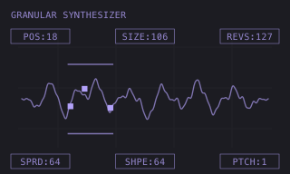

# FRACT — granular machine artwork



Original conceptual artwork for FRACT's Modwerk track-machine interface,
approved by ex1010. This is an illustration, not a device screenshot or a
measurement. The displayed values are illustrative.

- [Editable SVG](thumbnail.svg): 320 × 192 viewBox.
- [Card PNG](thumbnail.png): 320 × 192.
- [Large PNG](thumbnail@3x.png): 960 × 576.
- [Three emulator screenshots](screenshots/README.md): selection, sample loading and playback.

The GRANULAR SYNTHESIZER heading aligns with the left parameter frames.
POS / SIZE / REVS appear above the smooth line waveform; SPRD / SHPE / PTCH
appear below. All six readouts use equal rectangular frames. Three filled
grain markers and two horizontal range bars use the lilac accent (`#b2a1f9`)
on the dark preview surface (`#1c1c22`). The waveform and bars are centred
between the two parameter rows.

The SVG is the source of truth. Re-export the PNGs after editing it:

```sh
rsvg-convert -w 320 -h 192 thumbnail.svg -o thumbnail.png
rsvg-convert -w 960 -h 576 thumbnail.svg -o thumbnail@3x.png
```

The artwork accompanies the three-grain source draft in
[draft PR #926](https://github.com/repeat98/modwerk/pull/926), together with the
native FLEX fix and the emulator previews. That consolidation replaces the
earlier FX2/SPACE proposal; #1108 is to be superseded after its changes are
included. The machine remains unlisted and unqualified for release. The artwork
is available as `presentation/thumbnail.svg` for later integration.

Copyright © 2026 ex1010. These original SVG and PNG files are available under
the [MIT licence](LICENSE.md), for reuse and modification with its notice.
They contain no firmware, stock screen captures, recordings or samples.
