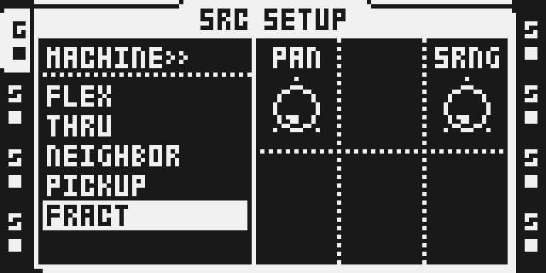
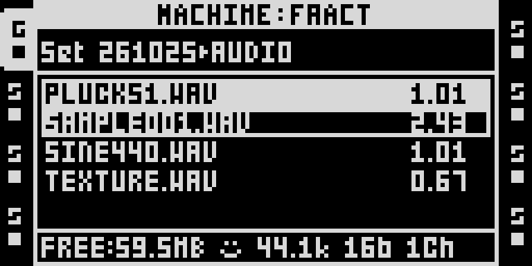
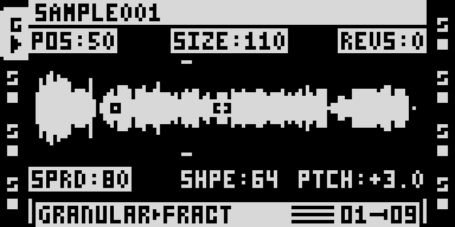

# FRACT emulator screenshots

These three monochrome LCD captures show the current private FRACT track-machine prototype in the Octatrack emulator. They are previews only: PR #1108 changes native FLEX reader lifecycle behavior; it does not contain or release the FRACT machine integration. The public draft PR #926 still contains the earlier FX2/SPACE implementation and must be refreshed separately before it can represent this machine.

## Select FRACT

Select FRACT in SRC SETUP.

## Load a sample

Load SAMPLE001.WAV into FRACT.

## Play with three grains

Play FRACT with three grains.

Captures by ex1010 from the octemu emulator. The screenshots do not establish hardware or listening qualification. The displayed SAMPLE001.WAV name and waveform do not include or distribute the source audio. No sample audio, firmware, card image, NVRAM, raw framebuffer or capture metadata is included. The artwork's MIT licence does not cover these screenshots or the underlying Octatrack interface and marks; their respective rights remain with their owners.
