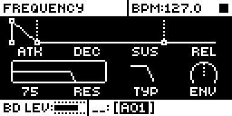
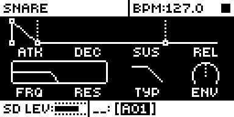

# Ctrl All

## Overview

Ctrl All turns TRK into an all-tracks modifier. Hold TRK and turn a knob on a sound
page (SYNTH, SAMPLE, FILTER, AMP, LFO) or the TRIG page, and the same step goes to that
parameter on all twelve sound tracks. Their differences are kept, and each track stops
at its own limits.

- On the SYNTH page each track moves the parameter under the same knob of its own
  machine's page, within that parameter's range. A track whose machine has no parameter
  under that knob is left alone.
- FILTER TYP is set rather than stepped: every track takes the type the selected track
  reaches.
- With the FX track selected, while a trig key is held, or on FX and global pages, the
  knob behaves as stock, so parameter locks stay on one track.

Version **1.2.0** for Analog Rytm MKII OS **1.74**, with core-ar2 0.3. It is
[rytm2_mods](https://github.com/Iced-Cream/rytm2_mods)' elemod port of MrScruff's
`0014-ctrl-all` from [rytm-mods-src](https://github.com/Iced-Cream/rytm-mods-src),
including his 1.1 and 1.2 updates, with his code unchanged. Hardware testing is recorded
in the [hardware report](evidence/hardware-testing.json) and [TESTING.md](TESTING.md).

## Controls

| Control | Action |
| --- | --- |
| TRK + any knob | On a sound page or the TRIG page, applies the turn to that parameter on all twelve sound tracks; FILTER TYP sets every track to the selected track's new type. |

There are no other new controls, menus or settings. To get stock behaviour back, build
without the module.

## Usage

Any sound page (SYNTH, SAMPLE, FILTER, AMP, LFO) or the TRIG page, while TRK is held.

### Quick tutorial

1. Use a build containing Ctrl All. Open the FILTER page and note FRQ on two tracks.
2. On one track, hold TRK and turn FRQ (knob E). Select the other track: its FRQ moved by the same amount.
3. On the SYNTH page, hold TRK and turn a knob: each track moves the parameter under that knob on its own machine's page.
4. Release TRK, select the FX track, or hold a trig key while turning: only the selected track changes, as on stock.

## Compatibility and limitations

Requires core-ar2 0.3 on OS 1.74. Use your own original stock OS 1.74 file.

- Built for OS 1.74 only.
- On the SYNTH page a track whose machine has no parameter under the turned knob is left alone.
- FILTER TYP is set, not stepped: every track takes the type the selected track reaches.
- With a trig key held the turn stays on one track, so parameter locks are never spread.
- Parameters that other modules add stay single-track unless that module handles TRK itself.

The module patches one site, six bytes at `0x400378c2` in `param_apply_delta`
(`param_apply_delta_dispatch`), the same site as the original mod. Another module
patching those bytes cannot be combined with it.

| Address | Bytes | Op |
| --- | --- | --- |
| `0x400378c2` | 6 | jmp `ctrl_all_gate` |

## Tests and measurements

See [TESTING.md](TESTING.md) for the commands and results. In short: on an Analog Rytm
MKII with OS 1.74, beside other rytm2_mods ports, its four tests pass (FILTER FRQ, SYNTH
knobs across two machines, FILTER TYP, and the FX track and held trig key). Modwerk's own
build of this folder gives a main OS byte-identical to elekloader's build of the
rytm2_mods v1.2 release. In rytm-emu, SD's FRQ follows a TRK + FRQ turn on BD, where stock
leaves it. Memory: 432 bytes of the 128 KiB shared mod area. There is no code in the
audio, sequencer or tick paths.

## Authorship and licences

MrScruff: the original mod (rytm-mods `0014-ctrl-all`) and its 1.1 and 1.2 updates, its
design and code, published in rytm-mods-src with his permission. Iced-Cream: the elemod
port in rytm2_mods and this module. irpina: Elekloader and core-ar2.

Code: [GPL-2.0-only](LICENSE), as rytm-mods-src. `src/ctrl-all.s` (rytm2_mods'
`ctrl-all/os1.74/ctrl-all.s`) and `include/ar2-1.74.inc` are rytm2_mods' files at
`afd461d` (v1.2), unchanged; the include names firmware routines by address only. The
upstream README is in [upstream/README.md](upstream/README.md). Screens show Elektron's
interface solely to document the modification. No Elektron firmware is included.

## Screens and audio

These captures are from rytm-emu running a build of core-ar2 0.3 and Ctrl All from stock
OS 1.74. See [capture provenance](media/capture.json) for hashes and inputs. The mod
changes no sound, so there is no audio demonstration.

Press FILTER on track BD. FRQ is knob E, at the left of the lower row; both BD and SD start fully open.

Hold TRK and turn FRQ down on BD: the popup reads 75, as on stock.

Select SD (TRK + the SD pad): its FRQ moved down too, where stock leaves it fully open.
