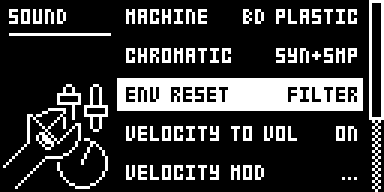
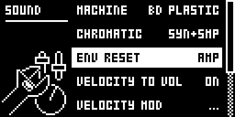

# Env Reset Amp

## Overview

Env Reset Amp extends SOUND SETTINGS > ENV RESET from OFF and FILTER to OFF, AMP, FILTER
and AMP+FILT. With AMP or AMP+FILT the amp envelope restarts from silence on every trig
instead of continuing from its current level, so the AMP attack is heard on every hit.

- The setting belongs to the sound and is saved with it, like stock's FILTER setting.
- A trig on a voice that is still sounding drops it to silence at once, which can click,
  most with ATK 0 and a long DEC.

Version **1.0.0** for Analog Rytm MKII OS **1.74**, with core-ar2 0.3. It is
[rytm2_mods](https://github.com/Iced-Cream/rytm2_mods)' elemod port of MrScruff's
`0015-env-reset-amp` from [rytm-mods-src](https://github.com/Iced-Cream/rytm-mods-src),
with his shipping code unchanged. Hardware testing is recorded in the
[hardware report](evidence/hardware-testing.json) and [TESTING.md](TESTING.md).

## Controls

| Control | Action |
| --- | --- |
| SOUND SETTINGS > ENV RESET | Steps OFF, AMP, FILTER, AMP+FILT. With AMP in the value, the amp envelope restarts from silence on every trig. |

There are no other new controls, menus or settings. To get stock behaviour back, set ENV
RESET to OFF or FILTER, or build without the module.

## Usage

SOUND menu (FUNC + MUTE) > SOUND SETTINGS > ENV RESET.

### Quick tutorial

1. Use a build containing Env Reset Amp. Pick an analog BD sound and set AMP ATK to about 40 and DEC to 100 or more.
2. With ENV RESET at OFF or FILTER, hit the pad quickly several times: the attack is heard on the first hit only.
3. Open the SOUND menu (FUNC + MUTE) > SOUND SETTINGS and set ENV RESET to AMP: every hit now fades in at the ATK rate.

## Compatibility and limitations

Requires core-ar2 0.3 on OS 1.74. Use your own original stock OS 1.74 file.

- Built for OS 1.74 only.
- A trig on a voice that is still sounding drops it to silence at once, which can click, most with ATK 0 and a long DEC.
- On stock firmware a sound saved with AMP or AMP+FILT loads with the amp bit ignored.

The module patches three sites, the same as the original mod. Another module patching
those bytes cannot be combined with it.

| Address | Bytes | Op | Why |
| --- | --- | --- | --- |
| `0x400bcf8a` | 2 | bytes `7403` (`moveq #3,%d2`) | ENV RESET's setter masked the amp bit off |
| `0x400ef8d6` | 2 | bytes `4e71` (`nop`) | the menu stepped by two (OFF and FILTER only) |
| `0x40109b70` | 6 | jmp `env_reset_amp_attack` | the trig's amp attack command |

The stub re-emits the displaced instruction, looks up the voice's track and its ENV RESET
byte, and with the amp bit set sends stock's decay form at DEC 0 instead of the attack, so
the level drops to silence; the hold states that follow ramp it up at the ATK rate. It
then resumes at `0x40109b76`.

## Tests and measurements

See [TESTING.md](TESTING.md) for the commands and results. In short: on an Analog Rytm
MKII with OS 1.74, beside other rytm2_mods ports, its test passes (ENV RESET at AMP, and
the attack heard on every quick hit). Modwerk's own build of this folder gives a main OS
byte-identical to elekloader's build of the rytm2_mods v1.2 release. In rytm-emu ENV
RESET steps through AMP and AMP+FILT, where stock steps between OFF and FILTER only.
Memory: 52 bytes of the 128 KiB shared mod area. It adds a few instructions to each
trig's amp attack command and nothing else to the audio path.

## Authorship and licences

MrScruff: the original mod (rytm-mods `0015-env-reset-amp`), its design and code,
published in rytm-mods-src with his permission. Iced-Cream: the elemod port in
rytm2_mods and this module. irpina: Elekloader and core-ar2.

Code: [GPL-2.0-only](LICENSE), as rytm-mods-src. `src/env-reset-amp.s` is rytm2_mods'
`env-reset-amp/os1.74/env-reset-amp.s` at `afd461d` (v1.2), unchanged; it names firmware
addresses only. The upstream README, which documents the OS 1.73 addresses, is in
[upstream/README.md](upstream/README.md). Screens show Elektron's interface solely to
document the modification. No Elektron firmware is included.

## Screens and audio

These captures are from rytm-emu running a build of core-ar2 0.3 and Env Reset Amp from
stock OS 1.74. See [capture provenance](media/capture.json) for hashes and inputs. The
emulator's analog voice model is not used to judge the envelope, so there is no audio
demonstration; the sound was checked on a unit.

FUNC + MUTE > SOUND SETTINGS on track BD: ENV RESET is the third row, at FILTER.

Press LEFT once: ENV RESET reads AMP. Stock goes from FILTER straight to OFF.

Step on with RIGHT: OFF, AMP, FILTER, then AMP+FILT. Stock stops at FILTER.
