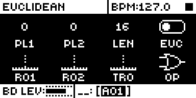
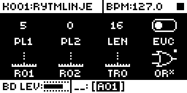
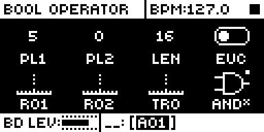

# Euclid Accents

## Overview

Euclid Accents gives the euclidean page's Bool Operator (OP) eight values instead of
four: OR, XOR, AND and SUB as stock, then OR\*, XOR\*, AND\* and SUB\*.

- In accent mode the euclidean generator no longer decides which steps play. Only the
  grid's trigs play, and a trig on a step where the euclidean pattern has a hit plays
  accented. Hand-set accents stay.
- Turning euclid off with FUNC held bakes the accents into the pattern; without FUNC the
  pattern is left as it was.
- The accent flag is per pattern track. It is kept in core-ar2's mod storage and saved
  with the pattern, so stock's own euclid bytes keep their stock values.

Version **1.1.0** for Analog Rytm MKII OS **1.74**, with core-ar2 0.3. It is
[rytm2_mods](https://github.com/Iced-Cream/rytm2_mods)' elemod port of MrScruff's
`0002-euclid-accents` from [rytm-mods-src](https://github.com/Iced-Cream/rytm-mods-src).
His code is unchanged, except that the accent flag moved from spare bits of stock's
euclid-enable byte into core storage, which removed four of his sites. Hardware testing is
recorded in the [hardware report](evidence/hardware-testing.json) and
[TESTING.md](TESTING.md).

## Controls

| Control | Action |
| --- | --- |
| OP (Bool Operator) | Eight values: OR, XOR, AND, SUB as stock, then OR\*, XOR\*, AND\*, SUB\*, which accent the grid's trigs on euclid hits instead of adding or removing steps. |
| FUNC + EUC off | In accent mode, bakes the accents into the pattern; EUC off without FUNC reverts. |

There are no other new controls, menus or settings. To get stock behaviour back, set OP
to a plain operator, or build without the module.

## Usage

EUCLIDEAN page (TRIG pressed twice): the OP (Bool Operator) parameter.

### Quick tutorial

1. Use a build containing Euclid Accents. Press TRIG twice for the EUCLIDEAN page, turn EUC on, and turn OP fully right: OR*, XOR*, AND*, SUB*.
2. Choose OR*, place a few trigs on the grid and play: only grid trigs play, and those on euclid hits are accented.
3. Hold FUNC and turn EUC off to write the accents into the pattern; turn it off without FUNC to leave the pattern as it was.

## Compatibility and limitations

Requires core-ar2 0.3 on OS 1.74. Use your own original stock OS 1.74 file.

- Built for OS 1.74 only.
- Needs core-ar2 0.3's mod storage: one bit per pattern track (`euclid_accent`). Earlier cores lose the flag at a power-off without a project save.
- On stock firmware, or a build without this module, an accent track plays as its base operator: the flag is in mod storage, which stock ignores.
- Patches param_apply_delta and param_value_text next to other gate-chain modules; each has its own site and they link together.

### Mod storage

| Field | Scope | Bits |
| --- | --- | --- |
| `euclid_accent` | track (per pattern track) | 1 |

The linker places the field from the build's lockfile, so a later build keeps it where it
was and projects keep their accent flags. Removing the module leaves the bit in the
project, unread.

### Sites

The module patches thirteen sites, the original mod's own for these functions. Another
module patching the same bytes cannot be combined with it.

| Address | Bytes | Op | Where |
| --- | --- | --- | --- |
| `0x400378a6` | 8 | jmp `euclid_accents_param_delta_gate` | param_apply_delta: applies OP's turn over 0 to 7 itself |
| `0x4009ab36` | 8 | jmp `euclid_accents_trig_fire_euclid_gate` | trig_fire: an accent track takes the grid path |
| `0x4009abde` | 6 | jmp `euclid_accents_trig_fire_accent` | trig_fire: accent on euclid hits |
| `0x400a864c` | 8 | jmp `euclid_accents_boolop_text_gate` | param_value_text: the names OR\* .. SUB\* |
| `0x400c3c7a` | 8 | jmp `euclid_accents_euclid_bake_gate` | euclid bake: FUNC + EUC off |
| `0x400a88b8` | 6 | jsr `euclid_accents_boolop_get_ui` | OP's getter |
| `0x400a9d16` | 6 | jsr `euclid_accents_boolop_set_ui` | OP's setter |
| `0x400ff44c`, `0x400ff4e2` | 2 each | bytes `7207` | the Bool Operator text formatter's limit, 3 to 7 |
| `0x400ff456`, `0x400ff4fe` | 2 each | bytes `7007` | the same formatter's limit, 3 to 7 |
| `0x400ff460` | 6 | lea `euclid_accents_boolop_labels`, `%a1` | the formatter's label table, eight entries |
| `0x401432f0` | 6 | jsr `euclid_accents_bitmapset8` | OP's icon set: eight icons, the accent four with a dot |

## Tests and measurements

See [TESTING.md](TESTING.md) for the commands and results. In short: on an Analog Rytm
MKII with OS 1.74 and core-ar2 0.3, beside the other rytm2_mods ports, its four test steps
pass and OP keeps its accent value through a power-cycle without a project save. Modwerk's
own build of this folder gives a main OS byte-identical to elekloader's build of the
rytm2_mods v1.2 release. In rytm-emu OP turns past SUB to the accent values, where stock
stops at SUB. Memory: 1,448 bytes of the 128 KiB shared mod area and one bit of track
storage. On an accent track it adds a few instructions and one storage read to each trig.

## Authorship and licences

MrScruff: the original mod (rytm-mods `0002-euclid-accents`), its design and code,
published in rytm-mods-src with his permission. Iced-Cream: the elemod port in
rytm2_mods, including the move to core storage, and this module. irpina: Elekloader and
core-ar2, whose storage keeps the flag.

Code: [GPL-2.0-only](LICENSE), as rytm-mods-src. `src/euclid-accents.s` (rytm2_mods'
`euclid-accents/os1.74/euclid-accents.s`), `include/ar2-1.74.inc` and
`shared/live-track.s` are rytm2_mods' files at `afd461d` (v1.2), unchanged; they name
firmware routines and RAM by address only. The upstream README is in
[upstream/README.md](upstream/README.md). Screens show Elektron's interface solely to
document the modification. No Elektron firmware is included.

## Screens and audio

These captures are from rytm-emu running a build of core-ar2 0.3 and Euclid Accents from
stock OS 1.74. See [capture provenance](media/capture.json) for hashes and inputs. The
accents were judged on a unit, so there is no audio demonstration.

Press TRIG twice on track BD: the EUCLIDEAN page. OP, the Bool Operator, is knob H, bottom right.

Turn OP right past SUB, where stock stops: OR\*, the first accent operator.

Further right: AND\*. XOR\* and SUB\* complete the four accent values.
