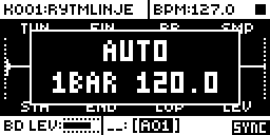
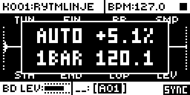
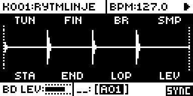

# Loop Sync

An Analog Rytm MKII mod by @stigmagit. Version 0.2.0-experimental, for OS 1.74 with core-ar2 0.3. Earlier builds tested by the author on a unit; build LS18 awaits that test.

## Overview

Loop Sync keeps sample loops in time with the project tempo by repitching them, like a varispeed. In AUTO it works out each loop's source tempo from the length of the sample that plays (between the sound's own STA and END), assuming 4/4 and a loop cut on the bar, and picks the bar count that is nearest the project tempo. Every audio block it adds the matching pitch shift to the track's effective TUN, after parameter locks, scenes and the LFO, so a SMP lock or a scene that changes the sample is followed, each sample by its own length. Pitch follows tempo, as on a turntable: there is no time-stretch.

The sound's own TUN is never written: a TUN lock still transposes on top of the sync.

## Controls

On the SAMPLE page (press SMPL), with FUNC held:

| Control | Action |
| --- | --- |
| Turn TUN (encoder A) | Steps the sound's mode, one step about every 8 encoder counts: OFF, AUTO, 1 BAR, 2 BAR, 4 BAR, 8 BAR. A box shows the mode and the source tempo of the sample the selected track plays, for example `AUTO` over `1BAR 120.0`. |
| Turn FIN (encoder B) | The correction of the sample the selected track plays, -12.7 to +12.7 % in 0.1 % steps (one every 2 counts), on top of the mode's source tempo; sample slots 1-123. A loop with a tail or a gap plays longer than its bars, so AUTO finds it slow: a + correction brings it back. Each sample slot keeps its own correction, in the project. |

The mode is kept in the sound (core-ar2 sound storage), so it travels with the sound and the kit; each sample slot's correction is kept with the project (core-ar2 project storage), so save the project to keep it. A small `SYNC` mark shows at the bottom right of the SAMPLE page while the selected track is synced. On the stock OS a FUNC + turn on the SAMPLE page does nothing (observed in the emulator on OS 1.74), so these gestures take no stock behaviour away.

## Usage

Set a loop track to AUTO and play at any tempo; correct a mis-cut loop with FUNC + FIN. Step by step:

### Quick tutorial

1. Load a loop cut on the bar, for example one bar at 120 BPM, on a sound track with a trig on step 1.
2. Press SMPL, hold FUNC and turn TUN to AUTO: the box reads AUTO over 1BAR 120.0, and SYNC appears at the bottom right.
3. Play and change the tempo: the loop follows, and the pitch glides with each tempo step. Lock SMP on a step to another loop: it is in time too, from its own length.
4. For a loop with a tail or a gap, hold FUNC and turn FIN until it sits in time; that sample keeps its correction. Save the project to keep it.

## How it works

- With END at its end, digital silence at the end of a sample (below about -72 dB, `SILENCE`) is left out of its length when it is shorter than 5 % of the sample: the padding of a loop exported a little long. A quiet last beat, longer than that, is kept. The idle tick checks four sample slots a tick and scans a slot again when its sample changes.

- `audio.s` hooks the audio interrupt just after its LFO call (one site, 10 bytes), where each track's effective parameter array is complete for the block and the voices have not read it yet. `loop_sync_audio` reads the track's effective SMP (so sample locks and scenes follow), the sound's own STA and END (copied by the idle tick from the live sound, before locks and the LFO, so a STA lock that slices the loop plays that slice at the same speed), the sample slot's frame count and rate from the stock slot table, and the tempo word; it works out `1200 * log2(tempo / source)` cents in integer arithmetic only when one of those changes, and adds the shift to the effective TUN. The array is rebuilt every block, so the add does not accumulate.
- A tempo or correction change glides to the new shift (1/64 of the way each audio block, settled in about 140 ms) instead of stepping, as a turntable speeds up; a new sample, region or mode jumps straight to its own shift.
- `ev_tick` copies each sound's mode for the interrupt and redraws when the SYNC mark changes; `ev_key` notes when SMPL opened the SAMPLE page; `ev_enc` takes FUNC + A and FUNC + B there; `ev_draw` draws the box; `ev_project` resets the caches.

It keeps no clock of its own: its timing is the tempo word ([sequencing.md](../../../../../docs/module-guides/sequencing.md)).

## Changes to stock flows

- **FUNC + TUN and FUNC + FIN on the SAMPLE page** set the mode and the correction. Stock does nothing with them.
- **A synced track's pitch** is shifted on top of TUN, FIN, locks and the LFO. TUN, FIN and their locks are untouched and keep working as transpositions. Set the mode to OFF for stock pitch.

## Compatibility and limitations

OS 1.74 only, with core-ar2 0.3 (sound storage: 3 bits per sound, `loop_sync_mode`; project storage: a signed byte per sample slot 1-123, four to a 32-bit field, `loop_sync_p0`..`loop_sync_p30`, listed in `src/slot-fields.h`; Modwerk allows 32 fields). UI claims: `FUNC + SAMPLE TUN turn`, `FUNC + SAMPLE FIN turn`. One code site: 0x40121020, 10 bytes, in the audio interrupt.

- Pitch follows tempo; no time-stretch.
- AUTO assumes 4/4 and a loop cut on the bar. A loop of 1.5 bars, say, is read as the nearest power-of-two bar count; trim it with STA and END, or correct it in percent.
- The silence check only sees digital silence (below about -72 dB) under 5 % of a sample; a loop cut long with sound in the extra part still needs the percentage correction.
- A slot's correction stays with the slot: replacing the sample in that slot keeps it. Slots 124-127 have none (Modwerk's 32-field limit).
- The shift is limited to TUN's range: the effective TUN is clamped to +-24 semitones, and no shift is applied beyond a factor of 8 between tempo and source.
- The SAMPLE page is recognised from the last page key pressed. After a menu, press SMPL again before FUNC + TUN.
- It hooks the audio interrupt next to rytm2_mods' lfo-rnd (which detours the LFO call itself, 6 bytes earlier); they patch different bytes, but the pair is not tested.

## Tests and measurements

Full record in [TESTING.md](TESTING.md). In short:

- **On a unit:** the author ran LS17 (before the review fixes) on an Analog Rytm MKII with OS 1.74: loops in time with SMP locks, the per-sample correction and the silence check, and the pitch glides on tempo changes. Listening only; persistence across saves and reboots is not reported yet.
- **In the emulator (rytm-emu, recorded audio):** at 127 BPM, beats of 120 and 100 BPM loops alternating by SMP lock, a padded loop in AUTO and a mis-cut loop with its own +5.1 % all fall 0.4717-0.4730 s apart for a target of 0.4724 s. A tempo step glides over about 140 ms instead of jumping 13.5 cents.
- **Memory:** loop-sync is 7,412 bytes of code and data (5,224 `.run` and 2,188 `.bss`, elekloader lint, LS18) in the 128 KB shared mod area (elekloader lint, LS17). **CPU:** not measured on the unit; the audio-interrupt hook does a compare per sound track and block, and the logarithm only when a track's sample, region, mode, correction or the tempo changes.

## Screens and audio

Captured in rytm-emu from build LS17 ([capture record](media/capture.json)). No audio preview is included; the emulator measurements above stand for it.

## Authorship and licences

Loop Sync is by stigmagit, under GPL-3.0-or-later ([LICENSE](LICENSE)). Built on core-ar2 and elekloader (irpina, GPL-2.0-or-later). The firmware addresses come from the symbol maps of [rytm-mods-src](https://github.com/Iced-Cream/rytm-mods-src) and [rytm2_mods](https://github.com/Iced-Cream/rytm2_mods) (MrScruff, Iced-Cream), whose lfo-rnd first described the effective parameter array; the sample slot table was located for this mod. Emulator tests ran in [rytm-emu](https://github.com/trigcondition/rytm-emu). Screenshots: [media/LICENSE.md](media/LICENSE.md).
