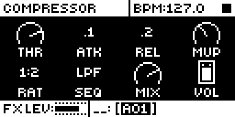

# Main RMS

## Overview

Main RMS lights the VOL knob's label on the compressor pages while the main output is
louder than -18 dBFS RMS, as a level reference for gain staging.

- The level is the louder of MAIN L and R, each a mean square averaged over about 300 ms.
  A full-scale square wave reads 0 dBFS and a full-scale sine -3.01.
- The label turns on above the threshold and off again 1 dB below it.
- MAIN is read each audio block from the receive buffer, the pair that USB and the sampler
  record: after the compressor, and not set by the master volume knob.
- Display only: the sound is unchanged.

Version **1.0.0** for Analog Rytm MKII OS **1.74**, with core-ar2 0.3. It is
[rytm2_mods](https://github.com/Iced-Cream/rytm2_mods)' elemod port of MrScruff's
`0009-main-rms` from [rytm-mods-src](https://github.com/Iced-Cream/rytm-mods-src), with
his code unchanged and the threshold fixed at his default build's value. Hardware testing
is recorded in the [hardware report](evidence/hardware-testing.json) and
[TESTING.md](TESTING.md).

## Controls

| Control | Action |
| --- | --- |
| Knob VOL (compressor) | Unchanged control. Its label draws inverted while the main output is over -18 dBFS RMS. |

There are no new controls, menus or settings. To get stock behaviour back, build without
the module.

## Usage

FX track, AMP page (the compressor): the VOL knob's label.

### Quick tutorial

1. Use a build containing Main RMS. Select the FX track and open its AMP page, the compressor.
2. Play a loud pattern: the VOL label draws inverted while the main output is over -18 dBFS RMS.
3. Turn the pattern down or mute tracks: the label clears once the level falls 1 dB below the threshold.

## Compatibility and limitations

Requires core-ar2 0.3 on OS 1.74. Use your own original stock OS 1.74 file.

- Built for OS 1.74 only.
- The threshold is fixed at -18 dBFS RMS, the default build's value.
- The master volume knob does not set the measured pair, though the circuit can move it by a few dB over the knob's travel.
- A label stock has already highlighted reads normal while over, because the inversion is an XOR.

The module patches three sites, the same as the original mod. Another module patching
those bytes cannot be combined with it.

| Address | Bytes | Op |
| --- | --- | --- |
| `0x401213ca` | 6 | jmp `main_rms_rms_scan` (the audio interrupt, once the receive buffer holds the block) |
| `0x401e14ec` | 4 | ptr `main_rms_vol_knob_draw` (compressor view, knob draw slot) |
| `0x401e14f0` | 4 | ptr `main_rms_vol_knob_draw_alt` (compressor view, second knob draw slot) |

The scan re-emits the two displaced instructions, squares the top 16 bits of each MAIN
sample with `muls.w` (not the EMAC, whose state belongs to the interrupted code) and
updates two running mean squares. The draw wrappers run stock's knob draw, then XOR the
label's box through `fill_rect` for VOL while the level is over.

## Tests and measurements

See [TESTING.md](TESTING.md) for the commands and results. In short: on an Analog Rytm
MKII with OS 1.74, beside other rytm2_mods ports, its test passes (the VOL label inverts
on a loud pattern and clears when quieter). Modwerk's own build of this folder gives a
main OS byte-identical to elekloader's build of the rytm2_mods v1.2 release. The emulator
can show the page but not the lit label, because its main output never gets loud enough.
Memory: 264 bytes of the 128 KiB shared mod area. In the audio interrupt it adds one
32-frame scan of MAIN L and R per block.

## Authorship and licences

MrScruff: the original mod (rytm-mods `0009-main-rms`), its design, measurements and
code, published in rytm-mods-src with his permission. Iced-Cream: the elemod port in
rytm2_mods and this module. irpina: Elekloader and core-ar2.

Code: [GPL-2.0-only](LICENSE), as rytm-mods-src. `src/main-rms.s` (rytm2_mods'
`main-rms/os1.74/main-rms.s`) and `include/ar2-1.74.inc` are rytm2_mods' files at
`afd461d` (v1.2), unchanged; the include names firmware routines by address only. The
upstream README, which documents the OS 1.73 addresses, is in
[upstream/README.md](upstream/README.md). Screens show Elektron's interface solely to
document the modification. No Elektron firmware is included.

## Screens and audio

This capture is from rytm-emu running a build of core-ar2 0.3 and Main RMS from stock
OS 1.74. See [capture provenance](media/capture.json) for hashes and inputs. The mod
changes no sound, so there is no audio demonstration.

FX track, AMP: the compressor page. VOL is knob H, bottom right; its label inverts while the main output is over -18 dBFS RMS. Shown quiet, as on stock.
