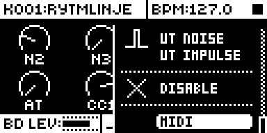
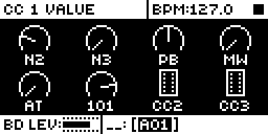
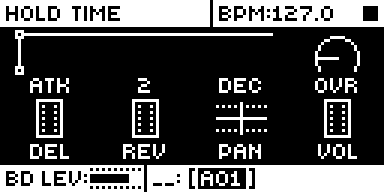

# MIDI Engine

An Analog Rytm MKII mod by @svindler. Version 0.1.0-experimental, for OS 1.74 with core-ar2 0.7. Tested on the developer's unit (ME17) over DIN and USB, and in rytm-emu.

## Overview

MIDI Engine is a machine that plays an external synth instead of a sound. Choose MIDI, the last entry of the machine list (after DISABLE), as a track's machine, and the track's trigs go out over MIDI: the trig's note, velocity and length, two chord notes, pitch bend, mod wheel, channel pressure and six CC lanes. The track itself stays silent.

Every value is a parameter of the track's sound, so it works like any other machine: parameter locks, lock trigs, the LFO, conditions, microtiming, swing, mutes and kits all apply. A lock trig (FUNC + TRIG) sends its controller changes without a note. A lane that is OFF sends nothing, which is not the same as sending 0.

## Controls

On a track on the MIDI machine, the SYNTH page holds what you play and lock:

| Knob | Name | Range | What it sends |
| --- | --- | --- | --- |
| A | N2 | OFF, -24..+24 | a second note, that many semitones from the trig's note |
| B | N3 | OFF, -24..+24 | a third note |
| C | PB | -63..+63 | pitch bend (14-bit, centred), when SND includes P |
| D | MW | 0..127 | mod wheel (CC 1), when SND includes M |
| E | AT | 0..127 | channel pressure, when SND includes A |
| F, G, H | CC1, CC2, CC3 | 0..127 | lanes 1-3, on the CC number set on the AMP page |

The FILTER page's ATK, DEC and SUS knobs are CC4, CC5 and CC6, lanes 4-6. The knobs keep their stock labels: the value is the CC value.

The AMP page holds the setup. The knobs keep their stock labels; the value shows what each one is:

| Knob label | Setup | Values |
| --- | --- | --- |
| ATK | CHN, the MIDI channel | 1..16 |
| HLD, DEC, OVR | C1#, C2#, C3#: lanes 1-3's CC numbers | OFF, 1..119 |
| DEL, REV, PAN | C4#, C5#, C6#: lanes 4-6's CC numbers | OFF, 1..119 |
| VOL | SND: which of pitch bend, mod wheel and pressure send | OFF, P, M, PM, A, PA, MA, PMA |

Every lane starts OFF. Turn its C# knob right to switch it on (the number shows, 1 or the number it had), keep turning to choose the CC, and turn it below 1 to switch it OFF again. CC 0 (Bank Select) and CCs 120-127 (channel mode messages) are not offered. Each PLAY sends every lane's value, pitch bend, mod wheel and pressure again with the first trig, so the synth starts in step; after that a value goes out when it changes.

The note is the trig's NOTE, as stock's TRK SEND MIDI sends it (C4 is note 36). Velocity and length are the trig's VEL and LEN. MIDI goes out where MIDI CONFIG > PORT CONFIG > OUTPUT TO sends it.

## Usage

A track on the MIDI machine is silent; its trigs play an external synth on the track's MIDI channel. Lock any of its values per step as on any machine.

### Quick tutorial

1. Connect the Rytm's MIDI OUT to a synth listening on channel 1. Select a track, open its machine list on the SYNTH page and choose MIDI.
2. Place trigs and play: the synth plays the trigs' notes. Set N2 to +7 for a fifth on every trig.
3. On the AMP page turn HLD (C1#) to 74, then on the SYNTH page turn CC1: the synth's CC 74 follows. Lock CC1 on a trig, or place a lock trig (FUNC + TRIG) with a CC1 lock to change it without a note.

## How it works

- The sequencer queues each track's trig events ahead of time, and the audio interrupt plays them at their time, with microtiming and swing. At that point (0x40120038, the interrupt's note branch) the engine takes a MIDI machine track's note: pitch, velocity and length. A lock trig plays no note there, as stock decides for its own MIDI notes.
- At the end of the same audio block (`ev_render_out`) the track's effective parameters, after locks, scenes and the LFO, are fresh. A value the trig locks goes out as locked; any other goes out as its knob is set now (the audio engine's copy of the sound, which takes a turn at once; its change at a trig, the trig's older values, is not followed), with the LFO's part of the effective value, because stock's engine takes a trig's other values from when the trig was prepared, a step or two earlier, and a knob turned since would jump back. The trig's locks come from its lock list (the event's +0x34). The engine queues the controllers whose value changed, then the notes, and schedules each note's off on the musical clock. Controllers also go out between trigs when a value changes (a lock trig, the LFO), at most once per lane every 6 audio blocks (about 4 ms).
- Nothing is sent from the interrupt. The queue is drained by the stock MIDI note task, at its wait for the next message (0x400912ac), woken with a message kind it ignores. MIDI Engine and TRK SEND MIDI share one sender in one task. Note-offs go first, then controllers, then notes.
- The engine owns each note it plays (channel, note). A note played again gets its off first, in the same moment. STOP sends an off for every note it holds.
- A MIDI machine track's machine runs stock's DISABLE engine. Its VOL (whose knob is SND) is held at 0 and its sample at OFF every tick, so a sample the sound had before stays silent too.

It keeps no clock of its own: note lengths and times are the sequencer's and the stock clock's ([sequencing.md](../../../../docs/module-guides/sequencing.md)).

## Changes to stock flows

- **The AMP page of a track on the MIDI machine** shows and turns the setup (CHN, C1#-C6#, SND) instead of the amp envelope, which a silent track does not use. Its VOL is held at 0. Other machines' AMP pages are stock.
- **The FILTER page's ATK, DEC and SUS on a track on the MIDI machine** show the lane values (CC4-CC6). Other machines' FILTER pages are stock.
- **Hidden machine slot 42** is listed as MIDI at the end of every track's machine list, after DISABLE.

## Compatibility and limitations

OS 1.74 only, with core-ar2 0.7. Machine slot 42. Mod storage: 9 bits a sound (`midi_engine_lanes`, 6; `midi_engine_send`, 3). Two code sites: 0x40120038 (6 bytes, the audio interrupt's note branch) and 0x400912ac (6 bytes, the MIDI note task's wait). UI claims: the SYNTH page of the MIDI machine; the FILTER ATK, DEC and SUS value texts and the AMP page's values and turns on tracks on the MIDI machine.

- Tested on one unit only. Several MIDI tracks at once, shared voices, scenes, performances, conditions and pattern or song changes are not tested yet.
- Pads, chromatic play and MIDI in on a track on the MIDI machine play nothing on MIDI yet; only the sequencer does.
- Retrigs send their first note only. Program change and slides are not there yet.
- The AMP and FILTER knobs keep their stock labels (only a machine's eight SYNTH knobs can be renamed); the value text says what each one is.
- Switching a sound on the MIDI machine back to another machine sets plain values on the pages that held the setup and lanes 4-6, as a fresh kit's BD has them: AMP ATK 0, HLD 0, DEC 127, OVR 0, VOL 110, PAN centred, DEL 0, REV 0; FILTER ATK 0, DEC 64, SUS 0. They are set as knob turns set them, so they are saved. Its lanes and SND switch OFF, so choosing MIDI again starts with nothing sent. A sound loaded over a sound on the MIDI machine keeps its own values. The sample (SMP) stays OFF.
- A lock on an AMP setup knob is kept by stock but not used: channel and CC numbers come from the sound.
- On a stock OS, or a build without this mod, a sound saved with the MIDI machine loads with DISABLE.
- At most 64 notes held at once; past that, new notes are dropped.

## Tests and measurements

Tested on the developer's unit, builds ME09 to ME17, over DIN and once over USB, with a computer reading the MIDI; earlier builds in rytm-emu. CPU load was not measured. See [TESTING.md](TESTING.md).

## Screens and audio

Captured in rytm-emu from build ME17 ([capture record](media/capture.json)). No audio preview: the track itself is silent, and the sound is the external synth's.

## Authorship and licences

Original work by @svindler, GPL-3.0-or-later, written from the developer's own specification; no code, firmware or art is taken from any other product. Addresses of the stock OS are cited, never its bytes.
