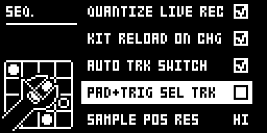
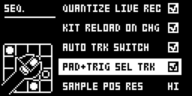

# Pad Select

## Overview

Pad Select adds **PAD+TRIG SEL TRK** to GLOBAL > CONTROL > SEQUENCER CONFIG, a checkbox just
after AUTO TRK SWITCH. Checked, the pads and TRIG keys 1-12 make sound only in LIVE or STEP
RECORDING. Stopped, playing or in GRID RECORDING, a press selects its track and stays silent,
with no MIDI note out. Hold FUNC and press the pad to play it instead, at the pad's own velocity.
Unchecked, everything is stock.

| Input | Stopped, playing, or GRID REC | LIVE REC, STEP REC |
| --- | --- | --- |
| Pad | selects its track, silent | stock |
| TRIG 1-12 | selects track n, silent (in GRID REC they place trigs, as stock) | stock |
| FUNC + pad | plays, at the pad's own velocity | stock |
| FUNC + TRIG 1-12 | stock: plays nothing | stock |
| RTRG + pad | selects, silent; FUNC + RTRG + pad plays | stock |

A silent press sends no MIDI note and leaves no held note, so its release cuts nothing the
sequencer plays. CHROMATIC mode, MUTE mode, TRK + pad, MIDI notes in, TRIG + YES and the
sequencer itself are as stock.

Version **0.2.0-experimental** for Analog Rytm MKII OS **1.74**, with core-ar2 0.3. It is
Iced-Cream's own mod, `pad-select` 0.2 in [rytm2_mods](https://github.com/Iced-Cream/rytm2_mods),
not a port of someone else's. It has been tested in rytm-emu, **not yet on a unit**, so it waits
in `_submissions/`.

## Controls

| Control | Action |
| --- | --- |
| PAD+TRIG SEL TRK | Checkbox in GLOBAL > CONTROL > SEQUENCER CONFIG, after AUTO TRK SWITCH. YES toggles it, RIGHT checks, LEFT unchecks. Unchecked by default. |
| FUNC + pad | While the setting applies, plays the pad's track at the pad's own velocity. |

The setting is kept per GLOBAL slot, in core-ar2's mod storage (one bit, `pad_select_on`), and is
saved with the project's globals. No knob, page or effect slot is added.

## Usage

Check the box once per GLOBAL slot you want it in. AUTO TRK SWITCH keeps its own setting: while
PAD+TRIG SEL TRK applies, a press always selects its track; otherwise AUTO TRK SWITCH decides, as
stock. To hear a track outside live recording, use FUNC + pad: FUNC + TRIG plays nothing, on
stock too.

### Quick tutorial

1. Use a build containing Pad Select. Open the GLOBAL menu, then CONTROL > SEQUENCER CONFIG, and check PAD+TRIG SEL TRK, just after AUTO TRK SWITCH, with YES or LEFT/RIGHT.
2. With the sequencer stopped, tap the SD pad: it makes no sound and the SD track is selected. Hold FUNC and tap SD to hear it at the pad's own velocity. TRIG 5 selects track 5 silently.
3. Press RECORD + PLAY for LIVE RECORDING: pads play and record as stock. Uncheck PAD+TRIG SEL TRK to get stock behaviour everywhere.

### Changes to stock flows

While PAD+TRIG SEL TRK is checked, and only then:

- **Pads and TRIG 1-12, stopped, playing or in GRID RECORDING** select silently instead of
  playing. This is the module's purpose: picking a track to edit without hearing it. An own page
  or a new gesture would not change what a plain press does, which is the point. Uncheck the box
  for stock.
- **FUNC + pad** plays at the pad's own velocity. Stock's FUNC + pad plays at the TRIG page's VEL;
  with plain presses silent, FUNC + pad is the way to hear a pad, so it keeps the pad's dynamics.
- **RTRG + pad** selects silently; FUNC + RTRG + pad plays.

Neighbouring flows compared with stock in rytm-emu (see [TESTING.md](TESTING.md)): LIVE, STEP and
GRID RECORDING, CHROMATIC mode, MUTE mode, MIDI notes in, MIDI out, TRIG + YES and FUNC + TRIG.
Not compared: PERF and SCENE modes, TRK + pad, NO + pad in LIVE RECORDING and the SOUND BROWSER.

## Compatibility and limitations

Requires core-ar2 0.3 on OS 1.74. Use your own original stock OS 1.74 file.

- Built for OS 1.74 only.
- **Tested in rytm-emu only; not yet run on a unit.** The emulator does not prove sound or timing.
- FUNC + TRIG 1-12 plays nothing, as on stock.
- LIVE RECORDING counts only while the sequencer runs: paused in LIVE RECORDING, pads select
  silently.
- A GLOBAL slot saved without the setting, or received as Global SysEx, loads unchecked. In
  rytm-emu, a card last saved by this build boots on stock OS 1.74 with the stock menu and pads
  that play.
- Takes the plain pad and TRIG 1-12 press, FUNC + pad and a SEQUENCER CONFIG row
  (`platform.claims`). Another module that changes what those keys play would clash with it.

The module patches five sites, all in stock code no other library module or the core patches:
the play routine both key handlers share (`0x400c772e`), the pad and TRIG key handlers' AUTO TRK
SWITCH calls (`0x400c7a3e`, `0x400c7e90`), the pad handler's FUNC test (`0x400c7950`) and
the SEQUENCER CONFIG menu's constructor (`0x400ec184`). The core-ar2 0.3 interface has no event
for the pads, the TRIG keys or the SEQUENCER CONFIG menu.

## Tests and measurements

See [TESTING.md](TESTING.md). In short: Modwerk's compiler builds this folder, and Modwerk's
linker links it on the owner's stock OS 1.74 with core-ar2 0.3 alone and beside Filter Hz and
Loop Sync. In rytm-emu the build boots, shows the row, and with it checked a pad or TRIG press
outside LIVE and STEP RECORDING reaches the play routine but no voice trigger and no MIDI out,
while FUNC + pad plays. Unchecked, every screen and every MIDI byte matched stock in the same
run. The setting came back after a power-off and cold boot, and each GLOBAL slot keeps its own.
It has **not** run on a unit. Memory: 764 bytes of the 128 KiB shared mod area, no `.bss`, no
fast SRAM. Nothing runs in the audio, sequencer or tick paths; each key press costs a few
compares (static reading, not a measurement).

## Authorship and licences

Iced-Cream: the mod, its design and code (rytm2_mods `pad-select`), and this module. MrScruff:
the globals-slot lookup, which follows his voice-dac (rytm-mods `0013-voice-dac`, as rytm2_mods
ports it). irpina: Elekloader and core-ar2, whose mod storage keeps the setting.

Code: [GPL-2.0-only](LICENSE), as rytm2_mods. `src/pad-select.s` is rytm2_mods'
`pad-select/os1.74/pad-select.s` at local commit `35ea2f0` (branch `claude/pad-select`, not yet
public), byte for byte, and `include/ar2-1.74.inc` its `include/ar2-1.74.inc`, the same file
Filter Hz carries. The source's header comment still names the OS 1.73 addresses, as upstream's
does. The include names firmware routines by address only. The upstream README is in
[upstream/README.md](upstream/README.md); its menu path leaves out CONTROL, and its FUNC + TRIG
row is corrected here. Screens show Elektron's interface solely to document the modification.
No Elektron firmware is included.

## Screens and audio

These captures are rytm-emu frames of PS74, the released core-ar2 0.3 and Pad Select on stock OS
1.74, from one cold boot. See [capture provenance](media/capture.json) for hashes and inputs. The
module changes which presses sound, not the sound itself, so there is no audio demonstration.

Open the GLOBAL menu and choose CONTROL: SEQUENCER CONFIG is its third item.

SEQUENCER CONFIG gains PAD+TRIG SEL TRK just after AUTO TRK SWITCH, unchecked by default.

Press YES (or RIGHT) to check it. The GLOBAL slot keeps it.

Back on the main screen, tapping the SD pad selects the SD track without a sound; FUNC + SD plays it.
