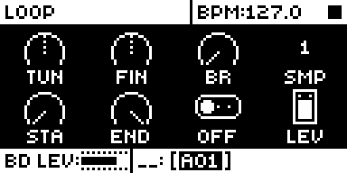
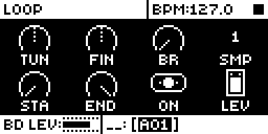
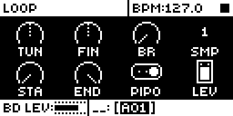
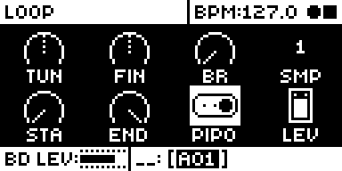
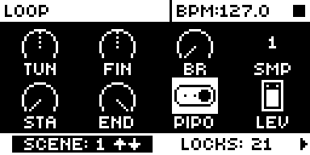
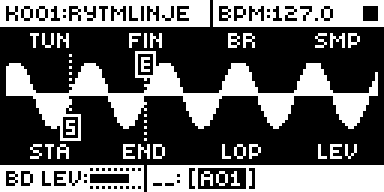
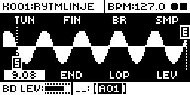
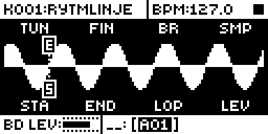
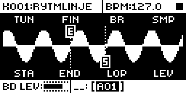
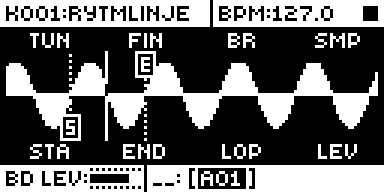

# Pipo Loop

An Analog Rytm MKII mod by npp1993 (Nathaniel Pavel). Version 0.1.0-experimental, OS 1.74 with core-ar2 0.7.

## Overview

Pipo Loop gives the SAMPLE page's LOP parameter a third value, PIPO, after OFF and ON. A sample whose LOP is PIPO plays its loop forward from STA to END, then backward to STA, then forward again, for as long as the note lasts: a ping-pong loop. ON stays the stock forward loop, which jumps back to STA at END, and OFF plays the sample once.

PIPO is an ordinary LOP value. It saves with the sound and the kit, takes parameter locks and scene locks, and comes back after a power cycle. A sound saved with PIPO plays as a normal forward loop on stock OS 1.74 or a build without this mod, because stock reads any nonzero LOP as ON. Stock has no text for PIPO, so LOP reads ERROR there until you turn the knob, which steps between OFF and ON.

On the SAMPLE page, FUNC + turn on STA or END moves that point to the next zero crossing of the sample in the direction you turn, stepping as LOP steps through its values, so start and loop points sit where the waveform crosses zero. Plain turns stay stock.

Each turn lands exactly on STA or END, at every pitch, with no jump in the waveform: at the turn the module hands stock's sample DMA the loop's frames in reverse order, so stock's own playback runs straight into the way back.

  

## Controls

| Control | Where | Values |
| --- | --- | --- |
| LOP | SAMPLE page, encoder G | OFF, ON, PIPO, on a three-position switch. OFF and ON play as stock. PIPO plays the loop between STA and END forward, then backward. |
| FUNC + STA / END | SAMPLE page or its SMPL WAVEFORM view, FUNC held, encoder E or F | The point steps to the next zero crossing the way you turn, as often as LOP would step a value (more on a fast turn), (exactly the frame stock plays from), and only ever to a crossing: with none further that way the point holds. STA and END step past each other freely (END below STA plays backward, as stock) and may share a crossing (a loop of no length: silence). With LOP ON only crossings of the other point's direction. With a trig held in GRID RECORDING it steps that trig's lock (the first detent makes the lock, as stock). Plain turns are stock. |

LOP's switch is drawn as stock's three-position switch, the one BD CLASSIC's WAV uses: OFF on the left, ON in the middle, PIPO on the right. PIPO applies only to the sample layer of a sound, as LOP does.

## Usage

Use a build containing Pipo Loop, select a track whose sound plays a sample, and press SAMPLE. LOP is encoder G.

### Quick tutorial

1. On the SAMPLE page, turn LOP past ON to PIPO and play the sound: the loop between STA and END goes back and forth.
2. Set STA and END around a sustained part of the sample (a pad, a vowel, a held note) for a seamless back-and-forth drone.
3. Hold a trig in GRID RECORDING and turn LOP to PIPO to ping-pong only on that step; the other steps keep the sound's ON or OFF.
4. Hold FUNC and turn STA (or END): the point steps from zero crossing to zero crossing, as LOP steps through its values, so the loop starts and ends where the waveform crosses zero.

 

  

### Changes to stock flows

- **LOP has a third value.** What changes: turning LOP clockwise past ON now reaches PIPO; locks and scenes can hold PIPO. Why: a musician looks for loop behaviour on LOP, and a third value needs no new page, key gesture or menu row (a FUNC gesture on the SAMPLE page was considered, but FUNC + STA, END and LOP are stock's coarse steps and FUNC + TUN and FIN belong to Loop Sync). What you see: the value text reads PIPO, and LOP's switch has three positions like BD CLASSIC's WAV, so ON now shows the knob in the middle (stock: on the right). It applies only in a build with this mod; leave LOP on OFF or ON for stock behaviour. Checked beside it: OFF and ON play exactly as stock, LOP's p-locks and scene locks, kit save through power-off, MIDI CC 30.
- **S and E labels on SMPL WAVEFORM.** What changes: the STA line gets a small boxed S at its bottom and the END line a boxed E at its top (7 x 9 pixels each). Why: stock draws both as the same dotted line, and one line only when they share a column, so with zero snap moving them crossing by crossing a musician could not tell which is which, or that both sit on one column. What you see: the two labels, drawn over the waveform; the lines, the waveform and the playhead are stock's, and nothing else on the view changes. It applies only in a build with this mod. Checked beside it: points at the sample's ends, sharing a column, END before STA, and playing. This changes how a stock screen looks, so it needs the owner's agreement.
- **FUNC + turn on STA and END.** What changes: stock steps STA and END by whole numbers with FUNC held; with this mod each FUNC detent moves the point to the next zero crossing of the sample instead. Why: a musician sets start and loop points where they would click least, on the SAMPLE page's own knobs, the way the Octatrack's audio editor steps through crossings; a new page or gesture was not needed. What you see: the point jumps crossing by crossing, on the sound or, with a trig held, on that trig's lock; plain turns are unchanged. It applies only in a build with this mod. Checked beside it: plain turns, lock editing in GRID and LIVE RECORDING, FUNC + TUN and FIN (Loop Sync's), LOP, Silent Pad+Trig's pads and TRIG keys. This moves a stock gesture, so it needs the owner's agreement.
- **MIDI CC 30 (LOP).** Stock writes CC 30's value into LOP unchanged (0 is OFF, anything else ON). With this mod a CC value of exactly 2 gives PIPO; every other value does what it did, and other OFF/ON parameters are unchanged.

## Compatibility and limitations

- OS 1.74 only, with core-ar2 0.7. No other module is needed, and it builds beside Silent Pad+Trig, Filter Hz and Loop Sync (no shared sites).
- Sites: the audio interrupt's call to the voice 0 sample prefetch at 0x40121134 (a `jsr`, through a gate that tail-calls stock), the shared OFF/ON value-text routine at 0x400fb56c (prints PIPO for 2 on LOP's own record, stock text otherwise, so another OFF/ON parameter set to 2 over MIDI still reads ON), LOP's maximum in stock's parameter table at 0x401c04f8 (data, 1.0 to 2.0), and the shared OFF/ON switch icon at 0x400fedf4 (for LOP's record only it tail-calls the three-position switch routine BD CLASSIC's WAV uses, with stock's own frames; every other switch stays stock). Exact turns take the four places stock's prefetch sets a sample DMA's source (0x4011c58a and 0x4011c5e6 for voice 0, 0x4011cb2e and 0x4011cb98 for voices 1-7). With FUNC held, a turn on STA or END is read through LOP's encoder profile (0x4003a0de, before stock's encoder engine); the S and E labels are drawn as stock's waveform widget finishes (0x4006ce72, the end of its draw routine, which only SMPL WAVEFORM calls); zero snap takes the encoder handler's apply-delta call at 0x4003a240 and its lock call at 0x4003a19c, and stock's per-trig lock edit at 0x40037f6c (STA and END with FUNC held only; every other turn passes through). Loop Sync's audio hook at 0x40121020 runs earlier in the same interrupt; Pipo Loop swaps STA and END after it, and Loop Sync's FUNC + TUN and FIN are not touched.
- With END on the sample's very last frame a turn can land up to 7 frames off; set END a little before the end. Exact turns rely on the DMA reading frames the module writes (it pushes the data cache first); rytm-emu does not model the cache, so the unit has to confirm it.
- Stock plays a loop of at least 141 frames; Pipo Loop leaves loops shorter than 160 frames to stock's forward loop.
- A new trig always starts forward from STA, as stock does.
- Zero snap is exact for samples up to 30,720 frames (0.64 s at 48 kHz). STA and END are steps of 1/30,720 of the sample, so on a longer sample the point lands on the nearest step, at most frames / 61,440 frames from the crossing: 1 frame at 1 s, about 4 at 5 s, 8 at 10 s, 47 at 60 s.
- Silence and near-zero DC (within 8 of zero, about -72 dB) count as neither sign: a snap passes over them and lands at their edge. The search reaches about 5.5 s of sample a step; with nothing found, the point holds.
- The sample's first frame and its end count as crossings only where the sample is at zero there; otherwise the first and last crossings are as far as FUNC turns go.
- STA and END glide to a new value over a fraction of a second, as stock does for every change: while a FUNC turn settles, a loop wrap or PIPO turn can land between crossings and click. Once the point has settled it plays from the crossing. A later version could let FUNC snaps skip the glide and jump straight to the crossing; that is not built, because STA and END as played are stock's smoothing plus LFO and velocity modulation, so the module would have to work out the target every audio block without breaking plain-turn smoothing or modulation.
- A PIPO turn on a crossing can still give a soft knock on a pure tone: the waveform's slope reverses at the turn, which no choice of frame avoids. A forward loop (LOP ON) between two crossings of one direction joins smoothly.
- The STA and END lines on the SMPL WAVEFORM view are stock's drawing: one column covers many frames (about 225 for a 0.6 s sample), and stock spaces the lines over 123 columns but the waveform over 124, so a line can sit one column left of the crossing it is on, more often towards the right of the screen. The frame stock plays from is the one the snap set.
- On stock OS, PIPO plays as ON and LOP reads ERROR until the knob is turned (seen on a unit). Sounds and kits keep the value, so loading them again with the mod brings PIPO back.
- Run on a unit by the author as test builds (PC03 and the diagnostics PD01 to PD05, reported in [TESTING.md](TESTING.md)); what is not yet tested on a unit is listed there.

## Tests and measurements

rytm-emu (c5732f0) on OS 1.74, build PP13, with generated ramp and sine samples on BD: the value steps OFF/ON/PIPO and reads PIPO; ON plays stock's forward loop and PIPO turns exactly at STA and END from TUN -24 to +24; switching ON to PIPO mid-note; FUNC + STA and END stepping crossing by crossing (sound, lock editor, per-trig and live recording), holding at the sample's edges, passing and sharing crossings; p-locks and scene locks of PIPO; two voices at once; retrig; persistence through power-off; stock 1.74 loading the saved PIPO state as a normal loop; the S and E labels. On a unit (author's reports, test builds up to PD05): the switch, PIPO, zero snap on the sound and on held trigs' locks, edges, passing and sharing, clean snapped LOP ON loops, the labels. CPU is a static estimate: about 0.1 % of an audio block with nothing looping and about 0.6 % with all eight voices in PIPO. See [TESTING.md](TESTING.md).

## Authorship and licences

Original code by npp1993 (Nathaniel Pavel), GPL-3.0-or-later ([LICENSE](LICENSE)). The OS 1.74 addresses were read by the author from their own stock firmware; the build carries addresses, lengths and SHA-256 guards only, no stock bytes. Screenshots: [media/LICENSE.md](media/LICENSE.md).

## Screens and audio

Screenshots are rytm-emu captures of build PP13 ([media/capture.json](media/capture.json)), the zero-snap and label ones on a generated slow sine. No audio preview yet.
