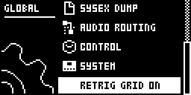
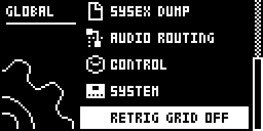

# Retrig Grid

An Analog Rytm MKII mod by @stigmagit. Version 0.1.0-experimental, for OS 1.74 with core-ar2 0.3. Tested in rytm-emu; an earlier build (LF18) reported good by the author on a unit.

**No swing yet:** the grid is straight. With the pattern's swing above 50 %, the retrigs miss the swung off-beat 16ths.

## Overview

Hold RTRG and play a pad: stock plays the pad at once, then retriggers it at the RETRIG menu's rate, counted from the moment you pressed. The rate follows the tempo, but the series keeps whatever offset the press had from the steps. Pressed between two steps, the whole roll plays between the steps.

With Retrig Grid, while the sequencer plays, the pad still sounds at the press, and the retrigs after it fall on the sequencer's grid. A 1/16 roll lands on the steps, 1/4 on the beats and 1/12 on the triplets, counted in bars from PLAY. The first grid point closer than half a period to the press is skipped, so the first gap is never shorter than half a retrig. The same applies to pads set to ALWAYS ON.

The grid is straight, as the metronome counts: retrigs do not take the pattern's swing. With the sequencer stopped there is no grid, and pads retrigger from the press, as stock.

## Controls

| Control | Action |
| --- | --- |
| GLOBAL > RETRIG GRID ON / OFF | The last row of the GLOBAL menu, after SYSTEM. YES turns it over. ON (the default) puts pad retrigs on the grid; OFF leaves them as stock. Kept with the project. |

The RETRIG menu (hold RTRG) keeps its stock rows: RETRIG (the rate), LENGTH, VEL.CUR and ALWAYS ON all work as before.

## Usage

Play a pattern, hold RTRG and play pads: the rolls stay locked to the steps whenever you come in.

### Quick tutorial

1. Press PLAY with any pattern.
2. Hold RTRG and press the BD pad between two steps, then keep it held: BD sounds at once, and the retrigs after it fall on the steps.
3. Still holding RTRG, set RETRIG to 1/4, then to 1/12, and play the pad again: the roll lands on the beats, then on the triplets of the bar.
4. To compare with stock, press GLOBAL, go down to RETRIG GRID ON and press YES: it reads RETRIG GRID OFF, and rolls follow the press again.

## How it works

Stock arms a pad's retrig series in the audio block that plays the press. It sets a tick counter to 960 (a whole note, 240 ticks a quarter note), and the next tick's deadline one tick after that block on the musical clock. Retrigs then fire on the ticks where the counter is a multiple of the rate's period. Stock arms the per-step retrigs set in the sequencer from the step itself, so those are already on the grid; only the pad path starts from the press.

Retrig Grid subscribes to core-ar2's `ev_render_out`, which runs at the end of every audio block. There it follows the sequencer's 24 PPQN pulse: each pulse moves its time on by the same amount whatever the pattern's speed, so the module counts them to know the pulse's place in the bar. It sets that place from the master step and pulse only when the sequencer (re)starts. When a pad's series has just been armed, it moves the series' deadline to the first grid tick at least half a period after the press, and sets the counter to that tick's place in the bar. Stock does everything else: the rate, LENGTH, VEL.CUR, changing the rate while RTRG is held, and stopping when the pad is released.

It patches no stock code and writes no stock record but those two words of the series it re-times. Until a pad has retriggered, the audio block costs it the pulse word and three on-chip reads. After that, it reads the twelve deadlines' sum each block and looks at the tracks only when the sum moves.

## Changes to stock flows

- **Pad retrigs while the sequencer plays** (RTRG held, or ALWAYS ON): the retrigs after the first hit move to the grid. The first hit, the rate, LENGTH and VEL.CUR are stock's. Turn RETRIG GRID OFF in GLOBAL to get stock's timing back. Checked beside it: the sequencer stopped (stock), and the switch OFF (stock).
- **GLOBAL menu**: one row, RETRIG GRID, after SYSTEM, through core-ar2's `ev_settings`. The other rows are untouched.

## Compatibility and limitations

- Analog Rytm MKII, OS 1.74, core-ar2 0.3. Events: `ev_render_out`, `ev_settings`, `ev_project`. One project storage bit (`retrig_grid_off`).
- No swing yet: the grid is straight, so with swing above 50 % the retrigs miss the swung off-beat 16ths. A trig's micro timing is not followed either.
- The grid counts bars from PLAY in the sequencer's 24 PPQN pulses, through tempo, speed and pattern changes. A track with its own speed or length still gets this grid.
- The first gap after the press is between half a period and one and a half periods. At 1/1 the first retrig can come up to a bar and a half after the press, on a bar line.
- Per-step retrigs from the sequencer are not changed: they already start on their step.
- Not tested: external MIDI clock.

## Tests and measurements

In rytm-emu on build RG05 (core-ar2 0.3 + this module), trig times read from the analog voice frame at 127 BPM. Every retrig after the first lands within 2 samples of the grid (the same 32-sample audio block):

- at 1/16, 1/4, 1/12, 1/32 and 1/80;
- for four press positions across a step;
- after a speed change to 2x or 3/2x while playing.

Stopped and OFF behave as stock, and OFF survives a power cycle. On the author's unit, the earlier build LF18 (with Loop Sync and Send FX) was reported good on all five checks of its test sheet. Its source did not yet follow speed changes. Details and the method are in [TESTING.md](TESTING.md).

Load: about 16 instructions an audio block until a pad has retriggered, and about 50 after that, counted from the compiled code. The pass over the tracks runs on retrig ticks only. Not measured on a unit.

## Screens and audio

| | |
| --- | --- |
|  |  |

Emulator captures, with the plans in [media/capture.json](media/capture.json). No audio recording.

## Authorship and licences

Original work by @stigmagit, GPL-3.0-or-later ([LICENSE](LICENSE)). It runs on elekloader's core-ar2 (irpina, GPL-2.0-or-later). The label callback follows core-ar2's store-check example. The firmware locations were found by disassembly of the owner-supplied OS 1.74 and measured in rytm-emu (trigcondition, MIT); no firmware bytes are included. Screens: [media/LICENSE.md](media/LICENSE.md).
