# Send FX

An Analog Rytm MKII mod by @stigmagit. Version 0.1.0-experimental, for OS 1.74 with core-ar2 0.3. Checked in the emulator; its chorus was heard by the author on a unit (an earlier build, `stereo-chorus`), its effects were tried on a unit by the author (LF03, then LF05 with all fifteen), who reports they sound very good.

## Overview

Send FX adds a third send effect beside the delay and the reverb, with a choice of fifteen effects: CHORUS, FLANGER, PHASER, WOW AND FLUTTER, COMB FILTER, BITCRUSH, LOWPASS, MULTIFILTER, DIRT, SAT DELAY, STEREO DELAY, CHRONO PITCH, FILTER FOLDER, FILTERBANK and FREQ WARPER. Each sound track has its own send. The voices, as the codec brings them back to the processor (the same signal the delay and reverb sends take), are summed by those sends; the chosen effect turns them into a stereo return which, at LEV, joins the PRE FX return: it reaches the analog mixer with the delay and the reverb, before the distortion and the compressor.

With every send at 0, the default, nothing is added: the unit sounds as stock.

## Controls

**FX page:** on the FX track, press DELAY (the second parameter key), then DELAY again. The effect's number and name run along the top; SND counts the sound tracks that send; LEV is the return level.

| Gesture | What it does |
| --- | --- |
| FUNC + turn A | Chooses the effect, 01-15. A new effect starts from its own defaults |
| FUNC + turn E | LEV, the return level, up to about 2x (default 71, about 0.6x) |
| Hold FUNC | The SND box shows CPU: the share of the audio block's time the mod takes, in percent, the highest of the last second |
| Turn A-H | The effect's controls below |

| Effect | A | B | C | D | E | F | G | H |
| --- | --- | --- | --- | --- | --- | --- | --- | --- |
| CHORUS | SPD 0.01-5 Hz | DEP sweep | TIME 1-30 ms | WDTH 0-180° | FDBK | HPF | LPF | - |
| FLANGER | SPD ± speed and direction | DEP span | TUNE shortest delay | FDBK ± | LPF | - | - | - |
| PHASER | SPD | DEP | SHP towards square | LAG | FREQ centre | FDBK ± | STG 2/4/6/8 | WDTH |
| WOW AND FLUTTER | SPD wow speed (0: random) | DEP | BASE low edge of the band | WDTH band width above BASE | NOIS hiss | N.HPF hiss tone | STER right side apart | - |
| COMB FILTER | SPD tempo-synced LFO | DEP | SPH LFO restart on hits (0: free) | DTUN left lower, right higher | FREQ pitch 40 Hz-4 kHz | FDBK ± up to 0.99 (+ string, - hollow) | LPF in the loop | - |
| BITCRUSH | BITS 16 down to 1 | OVER drive | SRR hold up to 64 frames | DROP dropouts, more and longer | RATE ring sine 30 Hz-8 kHz | DEP ring modulation | FREZ random stutters | F.TIM stutter length, 16 a step (0: random) |
| LOWPASS (4-pole) | SPD tempo-synced LFO | DEP | SPH LFO restart on hits (0: free) | LAG right LFO phase | FREQ 30 Hz-7.5 kHz | RESO | SPRD left/right apart | - |
| MULTIFILTER | ATK | DEC | SUS | REL | FREQ | RESO | TYPE LP-BP-HP | ENV ± amount |
| DIRT | DRV up to 64x | RECT | HPF ±: before the drive (left), after the rectifier (right) | LPF | NOIS noise rung with the signal | N.FRQ noise low-pass | N.RES | - |
| SAT DELAY | TIME 1-128 128th notes | X ping-pong OFF/ON | WDTH ± | FDBK up to past unity | HPF | LPF | DRV in the loop | - |
| STEREO DELAY | DRV input | TIME note division | FDBK | WDTH | MOD wobble | SKEW right/left ratio 1:2-2:1 | FILT ± LP / HP | - |
| CHRONO PITCH | TUNE ±24 semitones | WIN grain 10-80 ms | FDBK | DEP vibrato | HPF | LPF | SPD vibrato speed | - |
| FILTER FOLDER | ILEV in | HP before the folder | FOLD wavefolding | OLEV out | FREQ | RESO | TYPE LP4 LP2 BP2 HP2 LPN NOT1 NOT2 OFF | DIST after the filter |
| FILTERBANK | 90 Hz low-pass gain | 122 Hz | 225 Hz | 418 Hz | 777 Hz | 1.4 kHz | 2.7 kHz | 4 kHz high-pass gain |
| FREQ WARPER | SPD | DEP | SPH LFO restart on hits (0: free) | LAG right LFO phase | SHFT ± shift up to 2 kHz | SPRD right side shifted further | SBND other sideband | - |

Effects 04-15 follow, control for control, the descriptions of Tonverk's FX machines in Elektron's manual (WARBLE, COMB ± FILTER, DEGRADER, LOW-PASS FILTER, MULTIMODE FILTER, DIRTSHAPER, SATURATOR DELAY, DAISY DELAY, CHRONO PITCH, FILTER FOLDER, FILTERBANK, FREQUENCY WARPER) and, for the comb, the Digitakt II's COMB+ and COMB- filters; the DSP is this mod's own. STEREO DELAY's divisions run 1/32 to 1/4. (1/32, 1/16T, 1/32., 1/16, 1/8T, 1/16., 1/8, 1/4T, 1/8., 1/4, 1/2T, 1/4.), SAT DELAY's TIME 1/128 to a bar, both at the project tempo; a time longer than the 0.68 s line is halved until it fits. The comb's and the low-pass's LFOs are tempo-synced (SPD 16: one cycle a bar). Each effect's return is trimmed to the chorus's level. MULTIFILTER's envelope starts on each hit the input brings and releases when it falls silent.

**SEND page:** on a sound track, press AMP, then AMP again. Encoder A sets that track's send, 0-127 (default 0).

Pressing the same key once more, or any other page or menu key, goes back to the stock pages. The effect and its controls are kept in the kit (each kit its own), the send in the sound, LEV in the project: save the kit and the project to keep them. A turned control shows its value in place of its name for a moment.

## Usage

Send a few tracks, then pick and shape the effect on the FX track.

### Quick tutorial

1. Select a snare or a hi-hat track, press AMP, then AMP again: the SEND page opens. Turn encoder A to about 90.
2. Play the track: the chorus joins in at its defaults.
3. Press FX, DELAY, then DELAY again: the FX page opens. Hold FUNC and turn A to choose another effect, then shape it with A-H.
4. Press DELAY once more to go back to the delay, and save the kit to keep the settings.

## How it works

- `gate.s` hooks the end of the FX returns routine (one site, 6 bytes, `movel #32,%macsr`), right after stock has written the PRE and POST returns of this block into the codec's output ring; d2 holds the output slot. The detour runs `send_fx_block` with the EMAC (the multiply-accumulate unit stock's mixers use) in signed integer mode with saturation, keeping the two accumulators it uses as stock left them, then sets stock's MAC mode.
- The input: the codec's receive buffer, 32 frames of 12 words (MAIN, the eight voices, AUDIO IN). Stock's own tables give each voice's word and the track that plays it now, so the send of that track scales the voice, on a squared curve like stock's sends. Voices whose send is 0 are skipped; two voices or more, their sends steady, go through the EMAC, all eight a frame at once.
- The effects run on 16-bit signals, so a gain is one multiply. CHORUS, PHASER, WOW AND FLUTTER, COMB FILTER, CHRONO PITCH, SAT DELAY, STEREO DELAY and FREQ WARPER run at 24 kHz: the mean of each pair of frames in, one sample a side out, taken back up to 48 kHz by a linear step; the first five lift the top of their input first (x + (x - the sample before) / 4), as the pairs' mean and the step dull it, so they lose only what lies above about 10 kHz. The others run at 48 kHz. CHORUS: two 4-point Hermite taps on a 4096-sample line (170 ms at 24 kHz), swept by an LFO worked out at each end of the 32-frame block. FLANGER: two taps gliding through the line half a cycle apart with sin² cross-fades (a barber-pole sweep), the right side crossing the fades. PHASER: 2-8 first-order all-pass stages a side, their coefficient from a table and stepped across the block. One-pole high- and low-pass on the chorus and flanger return. WOW AND FLUTTER: the chorus's two taps, swept by a wow, a 6 Hz flutter and a random drift, then a band-pass. COMB FILTER: a feedback comb a side, read with linear interpolation, its loop through a soft clip. BITCRUSH: a soft clip, bit reduction, sample-and-hold and a ring modulator, with random dropouts and stutters. LOWPASS: two Chamberlin state-variable stages a side (24 dB/octave); MULTIFILTER: one, mono, with a block-rate ADSR started by each hit the input brings. DIRT: a soft clip with rectification, two high-passes and a ring-modulated noise, mono. CHRONO PITCH: two grains gliding through the line at the pitch ratio, cross-faded by triangles, mono. FILTER FOLDER: a triangle wavefolder between a high-pass and a state-variable multimode filter, then a soft clip, mono. FILTERBANK: a one-pole low-pass and high-pass and six state-variable band-passes at 24 kHz, mono. FREQ WARPER: a Hilbert transformer (two chains of four second-order all-passes, Olli Niemitalo's published coefficients) and a quadrature sine from a table, at 24 kHz. SAT DELAY and STEREO DELAY: two lines of 16-bit samples at 24 kHz (0.68 s), read with linear interpolation, a gain-compensated soft clip in SAT DELAY's loop so its repeats stay stable.
- Memory: the effects share one 64 KB pool (one effect runs at a time). On a change of effect it is cleared 4 KB a block, the effect silent until it is clean (about 11 ms).
- The output: scaled by LEV and added to the PRE words of the block through the EMAC, saturated to 24 bits; a 24 kHz return is taken back up on the way (the midpoint, then the sample).
- `ev_tick` copies the sends and the kit values for the audio block, `ev_key` and `ev_enc` run the pages, `ev_draw` draws them, `ev_project` clears the state. After 2 s with no send above 0 the state is cleared once and the block returns at once.
- The pages: the FX page fills the screen in the layout of Elektron's newer effect pages (number and name on top, SND and LEV on the left, two rows of illustrated controls), with this mod's own icons and font for the title; labels and values use stock's own text routine. The SEND page keeps stock's top and bottom bars and draws one stock-style dial.

The LFOs are free running, as a pedal's. The two delays take their time from stock's tempo word (0x40287ffc, 1/120 BPM, as Loop Sync reads it) every block, as a note division, and glide to a new value in about 10 ms, so a tempo change bends the echoes as a tape would; there is no clock of the mod's own ([sequencing.md](../../../../../docs/module-guides/sequencing.md)).

## Changes to stock flows

- **DELAY pressed again on the FX track** opens the FX page, and **AMP pressed again on a sound track** opens the SEND page. On stock a second press of either key does nothing (checked in the emulator, OS 1.74, also a third press). The same key once more, or any other page or menu key, gives the stock page back.
- **The PRE FX return** carries the effect too while a send is above 0. The delay and the reverb are untouched.

## Compatibility and limitations

OS 1.74 only, with core-ar2 0.3. Storage: one 7-bit sound field (`send_fx_send`), two kit fields (`send_fx_a`, 32 bits: the effect and controls 1-4; `send_fx_b`, 28 bits: controls 5-8), each control stored as its difference from the effect's default, and one 7-bit project field (`send_fx_lev`). UI claims: `FX DELAY page key twice`, `AMP page key twice`. One code site: 0x4010ee66, 6 bytes, at the end of the FX returns routine.

- **One effect at a time.** The slot holds one effect; a mod per effect would need the FX returns as a shared core event first (one owner per site).
- **Little time left in the audio block.** On the author's unit, with a busy project (Loop Sync, many loops), CHRONO PITCH at 12-13 % of the block (LF10) left the interface 2-5 s behind as soon as one track sent; the effects now run at about half that cost (emulator) and the author reports no lag (LF11). In the emulator four Hermite taps a frame, or twelve phaser stages a side, with every voice sending, stopped the audio: each effect keeps to two line reads a frame. Hold FUNC on the FX page to read the share (CPU).
- **Delay length.** 0.68 s at most: at slow tempos the longest divisions are halved. Swing and track speed do not move the echoes (they follow the tempo only).
- **Mono effects.** BITCRUSH, MULTIFILTER, DIRT, CHRONO PITCH, FILTER FOLDER and FILTERBANK return the same signal left and right.
- The controls and sends are not stock parameters: no parameter locks, LFO, scenes or MIDI CC.
- Always on the PRE return; no POST choice. Only the analog voices are sent, not the external input.
- Tracks that share a voice (RS/CP, MT/HT, CH/OH, CY/CB) share its send: the last one played sets it.
- Settings saved by the `stereo-chorus` test builds are not read (new fields).

## Tests and measurements

Full record in [TESTING.md](TESTING.md). In short:

- **In the emulator (rytm-emu):** the pages open, choose an effect, set and close as described; stock does nothing with the extra key presses. Each of the fifteen effects puts its return on the PRE words, and each runs with all eight voices sending. Through a test build fed by a sample's digital layer (the emulator's analog voice model cuts long sounds), a long snare with and without each effect was rendered for the author.
- **On a unit:** the author installed LF03 (Loop Sync + effects 01-11), tried the effects and approved them. Pressing an encoder left the page; fixed since (an encoder press on a mod page now does nothing). LF05 (all fifteen, the fix in): no latency and the effects "sound very good", as the author reports. LF11 (the effects at about half their cost, five of them at 24 kHz): no more lag on a busy project and the effects sound right, as the author reports.
- **Memory:** about 42 KB of code and 66 KB of data (the shared pool) in the 128 KB shared mod area (elekloader lint: 116,240 bytes with core-ar2; 6.4 KB spare beside Loop Sync).
- **CPU** (the FX page's meter, in the emulator): with one track sending, 1.1 % with no effect and 2.1 % (BITCRUSH) to 5.4 % (FLANGER, FILTERBANK); with all eight, 1.3 to 5.6 %. On the author's unit the meter read 12-13 % for CHRONO PITCH with LF10, whose code the emulator puts at 6.5 % with one track sending (3.4 % now); this build's figure on a unit is not reported.

## Screens and audio

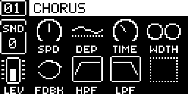

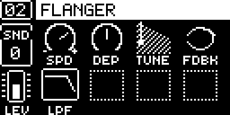

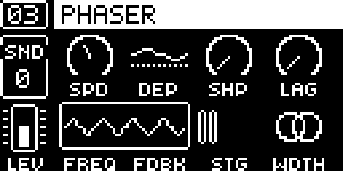

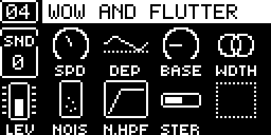

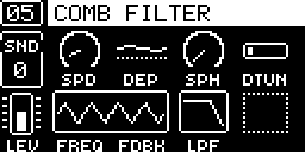

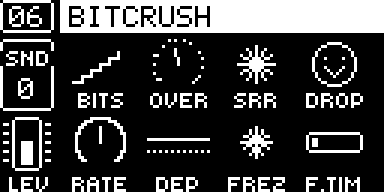

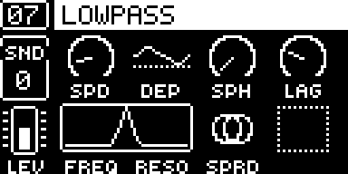

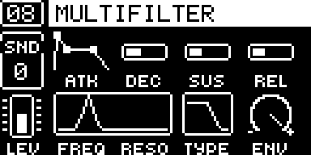

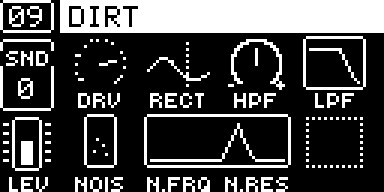

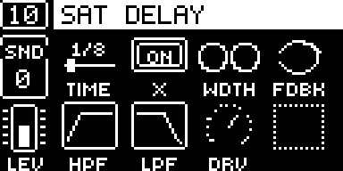

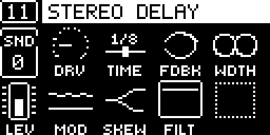

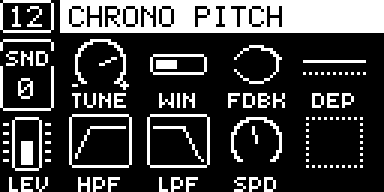

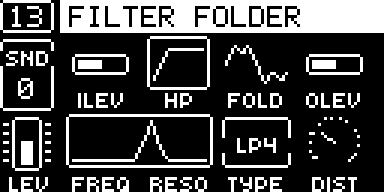

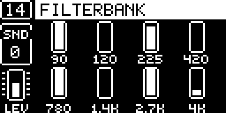

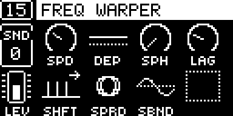

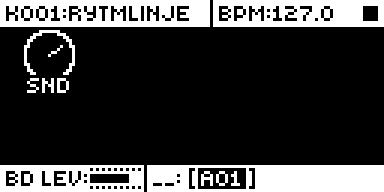

Captured in rytm-emu from build FX08 ([capture record](media/capture.json)). No audio preview is included.

## Authorship and licences

Send FX is by stigmagit, under GPL-3.0-or-later ([LICENSE](LICENSE)). Built on core-ar2 and elekloader (irpina, GPL-2.0-or-later). The FX return and receive buffers were located from the reverse engineering in [rytm-mods-src](https://github.com/Iced-Cream/rytm-mods-src) (MrScruff, Iced-Cream) and [rytm-emu](https://github.com/trigcondition/rytm-emu)'s notes, then read again in OS 1.74 for this mod. The page layout follows the style of Elektron's newer effect pages; every icon and the title font are this mod's own drawing. Emulator tests ran in rytm-emu. Screenshots: [media/LICENSE.md](media/LICENSE.md).
