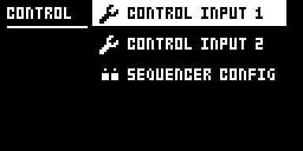
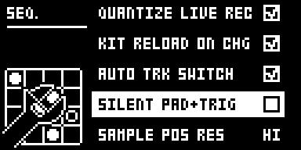
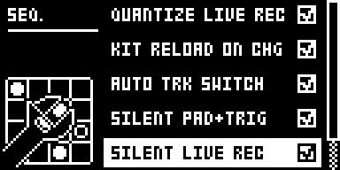
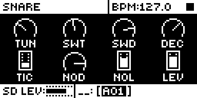

# Silent Pad+Trig

## Overview

Silent Pad+Trig adds two checkboxes to GLOBAL > CONTROL > SEQUENCER CONFIG, just after AUTO TRK
SWITCH, so a pad or TRIG key press can pick a track without sounding it:

- **SILENT PAD+TRIG** covers every state but LIVE and STEP RECORDING: stopped, playing, GRID
  RECORDING and the other modes. A pad or TRIG key 1-12 press selects its track and stays silent,
  with no MIDI note out.
- **SILENT LIVE REC** covers LIVE RECORDING: a pad press selects its track, stays silent and records
  nothing. TRIG keys play and record there as stock, since FUNC + TRIG cannot play.

Wherever a checked setting applies, hold FUNC and press the pad to play it at the pad's own
velocity; in LIVE RECORDING that also records. STEP RECORDING is always stock. Aftertouch is
untouched: holding a pad down modulates its track without sounding it. Both are unchecked by
default, and unchecked, everything is stock.

| Input | Stopped, playing, or GRID REC (SILENT PAD+TRIG) | LIVE REC (SILENT LIVE REC) | STEP REC |
| --- | --- | --- | --- |
| Pad | selects its track, silent | selects its track, silent, records nothing | stock |
| FUNC + pad | plays, at the pad's own velocity | plays and records, at the pad's own velocity | stock |
| Pad held down (aftertouch) | modulates its track, as stock | the same | stock |
| TRIG 1-12 | selects track n, silent (in GRID REC they place trigs, as stock) | stock: plays and records | stock |
| TRIG 13 (the FX track) | silent | stock | stock |
| FUNC + TRIG 1-12 | stock: plays nothing | stock | stock |
| RTRG + pad | selects, silent (FUNC + RTRG toggles the click, as stock) | the same | stock |

Each column follows only its own checkbox: with SILENT LIVE REC unchecked, pads play and record in
LIVE RECORDING as stock whatever SILENT PAD+TRIG says, and the reverse. LIVE RECORDING counts only
while the sequencer runs; a paused LIVE REC follows SILENT PAD+TRIG.

This holds wherever stock would play a pressed pad or TRIG key: on any page, with a menu open, in
the SOUND BROWSER, with the FX track selected, and in CHAIN, SONG, FILL, PERF and SCENE modes
(where the pads keep their own jobs and only the TRIG keys stop playing). A silent press sends no
MIDI note and leaves no held note, so its release cuts nothing the sequencer plays. CHROMATIC
mode, MUTE mode, TRK + pad, QPER + pad, NO + pad, BANK + TRIG, MIDI notes in, TRIG + YES and the
sequencer itself are as stock.

Version **0.5.0-experimental** for Analog Rytm MKII OS **1.74**, with core-ar2 0.3. It is
npp1993's own mod, not a port. It was first written as Pad Select (`pad-select` 0.2, row
PAD+TRIG SEL TRK) in a local checkout of [rytm2_mods](https://github.com/Iced-Cream/rytm2_mods)
that was never published there; Modwerk is its home. 0.4.x had one checkbox covering both columns
above; 0.5.0 splits it in two so silent pads while editing and silent pads while live recording
can be chosen separately. 0.3.0 and 0.4.0 ran on a unit; 0.5.0 has not yet run in the emulator or
on a unit, so it waits in `_submissions/`.

## Controls

| Control | Action |
| --- | --- |
| SILENT PAD+TRIG | Checkbox in GLOBAL > CONTROL > SEQUENCER CONFIG, after AUTO TRK SWITCH. Outside LIVE and STEP RECORDING, pads and TRIG 1-12 select silently. YES toggles it, RIGHT checks, LEFT unchecks. Unchecked by default. |
| SILENT LIVE REC | Checkbox after SILENT PAD+TRIG. In LIVE RECORDING, pads select silently and record nothing. YES toggles it, RIGHT checks, LEFT unchecks. Unchecked by default. |
| FUNC + pad | Where a checked setting applies, plays the pad's track at the pad's own velocity (the fixed velocity with FIX on); in LIVE RECORDING it also records. |
| Pad held down | Aftertouch, as stock: modulates the track's AFTERTOUCH destinations, also after a silent press. |

Both settings are kept per GLOBAL slot, in core-ar2's mod storage (one bit each,
`silent_pad_trig_on` and `silent_live_rec_on`), and saved with the project's globals. No knob, page or effect slot is added.

## Usage

Check the boxes once per GLOBAL slot you want them in. AUTO TRK SWITCH keeps its own setting: a silent
press always selects its track; a press that plays follows AUTO TRK SWITCH, as stock. To hear a
track, use FUNC + pad: FUNC + TRIG plays nothing, on stock too. With an AFTERTOUCH destination set
on a sound, tap its pad and keep pressing to modulate the track without playing it.

### Quick tutorial

1. Use a build containing Silent Pad+Trig. Open the GLOBAL menu, then CONTROL > SEQUENCER CONFIG. After AUTO TRK SWITCH are SILENT PAD+TRIG and SILENT LIVE REC; check either with YES or LEFT/RIGHT.
2. With SILENT PAD+TRIG checked and the sequencer stopped, tap the SD pad: it makes no sound and the SD track is selected. Hold FUNC and tap SD to hear it at the pad's own velocity. TRIG 5 selects track 5 silently.
3. With SILENT LIVE REC checked, press RECORD + PLAY for LIVE RECORDING: plain pad taps stay silent and record nothing; hold FUNC and tap a pad to play and record it. Uncheck both to get stock behaviour everywhere.

### Changes to stock flows

While a setting is checked, and only where it applies:

- **Pads** select silently instead of playing: outside LIVE and STEP RECORDING with SILENT
  PAD+TRIG, and in LIVE RECORDING, recording nothing, with SILENT LIVE REC. This is the module's purpose: picking a track to edit, or modulating it
  with aftertouch, without hearing it. An own page or a new gesture would not change what a plain
  press does, which is the point. Uncheck the box for stock.
- **TRIG 1-12, stopped, playing or in GRID RECORDING**, select silently with SILENT PAD+TRIG. In
  LIVE RECORDING they play and record as stock under either setting, since FUNC + TRIG cannot play.
- **FUNC + pad** plays at the pad's own velocity, and records in LIVE RECORDING. Stock's FUNC + pad
  plays at the TRIG page's VEL; with plain presses silent, FUNC + pad is the way to hear a pad, so
  it keeps the pad's dynamics.
- **RTRG + pad** selects silently. FUNC + RTRG + pad plays, but FUNC + RTRG also toggles the
  metronome click, as on stock, so it is not a clean way to roll.
- **Aftertouch** is not changed: a held pad sends its pressure to the sound and as MIDI poly
  pressure, as stock, even when its press was silent (so MIDI out gets poly pressure with no
  note-on before it).
- **SOUND BROWSER**: stock auditions the highlighted sound with a pad press. Checked, the plain
  press is silent; FUNC + pad auditions.
- **With a menu open**, a pad or TRIG key no longer plays; FUNC + pad does.
- **TRIG 13** plays the FX track on stock; checked, it is silent outside LIVE and STEP RECORDING.
- **With FIX (fixed velocity) on**, FUNC + pad plays at the fixed velocity, as stock pads do.
- **With AUTO TRK SWITCH unchecked**, a silent press still selects its track; FUNC + pad, which plays, follows AUTO TRK SWITCH as stock and does not.

Up to 0.4.1, with one setting, every mode that takes the pads, TRIG keys or FUNC was compared
with stock in rytm-emu, from matched snapshots: PERF, SCENE, MUTE, CHROMATIC, CHAIN, SONG, FILL, FIX, QPER, TRK, BANK + TRIG,
the FX track, the SOUND BROWSER, an open menu, GRID, LIVE and STEP RECORDING, NO + pad, RTRG,
AUTO TRK SWITCH off, soft strikes, aftertouch, MIDI notes in, MIDI out and TRIG + YES (table in
[TESTING.md](TESTING.md)). Unchecked, every one matched stock exactly.

## Compatibility and limitations

Requires core-ar2 0.3 on OS 1.74. Use your own original stock OS 1.74 file.

- Built for OS 1.74 only.
- **0.5.0 has not run yet**, in rytm-emu or on a unit. 0.4.0, with one setting for both
  columns, ran on a unit (TESTING.md); MIDI out, STEP REC and several other flows are not yet
  tested there.
- FUNC + TRIG 1-12 plays nothing, as on stock.
- A silent press passes its aftertouch on, so MIDI out can carry poly pressure with no note-on
  before it.
- A GLOBAL slot saved without a setting, or received as Global SysEx, loads it unchecked. In
  rytm-emu, a card last saved by this build boots on stock OS 1.74 with the stock menu and pads
  that play.
- Takes the plain pad and TRIG 1-12 press, FUNC + pad and two SEQUENCER CONFIG rows
  (`platform.claims`). Another module that changes what those keys play would clash with it.

The module patches five sites, all in stock code no other library module or the core patches:
the play routine both key handlers share (`0x400c772e`), the pad and TRIG key handlers' AUTO TRK
SWITCH calls (`0x400c7a3e`, `0x400c7e90`), the pad handler's FUNC test (`0x400c7950`) and the
SEQUENCER CONFIG menu's constructor (`0x400ec184`). The core-ar2 0.3 interface has no event for
the pads, the TRIG keys or the SEQUENCER CONFIG menu.

## Tests and measurements

See [TESTING.md](TESTING.md). In short: Modwerk's compiler builds this folder, and Modwerk's
linker links it on the owner's stock OS 1.74 with core-ar2 0.3 alone and beside Filter Hz and
Loop Sync. In rytm-emu the build boots, shows the row, and with it checked a pad press outside
STEP RECORDING (or a TRIG press outside LIVE and STEP RECORDING) reaches the play routine but no
voice trigger, no MIDI out and no recorded trig, while FUNC + pad plays, and records in LIVE
RECORDING. Unchecked, every screen and every MIDI byte matched stock in the same
run. The setting came back after a power-off and cold boot, and each GLOBAL slot keeps its own.
Every other mode that takes the pads, TRIG keys or FUNC was compared too (see the table in
TESTING.md), and a silent press left the modelled analog output byte-identical while the
sequencer played. 0.3.0 (build PS04) ran on an Analog Rytm MKII: silent pads, FUNC + pad, no cut
sequenced notes, the setting through a power cycle and per GLOBAL slot, as reported. 0.4.0 (PS05)
ran on one too: silent LIVE REC pads with FUNC + pad recording, aftertouch on a silent hold, GRID
REC, CHROMATIC and MUTE, as reported. Memory (0.5.0): a 936-byte `.run` in the 128 KiB shared mod area, no `.bss`, no
fast SRAM. Nothing runs in the audio, sequencer or tick paths; each key press costs a few
compares (static reading, not a measurement).

## Authorship and licences

npp1993 (Nathaniel Pavel): the mod, its design and code, and this module. Iced-Cream:
`include/ar2-1.74.inc` and the rytm2_mods voice-dac port. MrScruff: the globals-slot lookup,
which follows his voice-dac (rytm-mods `0013-voice-dac`, as rytm2_mods ports it). irpina:
Elekloader and core-ar2, whose mod storage keeps the setting.

Code: [GPL-2.0-only](LICENSE), as rytm2_mods, where it was first written. `src/silent-pad-trig.s`
is `pad-select/os1.74/pad-select.s` from that unpublished rytm2_mods checkout (local commit
`35ea2f0`) with the 0.4.0 changes (`play_gate`, `active`, `func_gate`, `autotrk`'s comment and
`drw_invoke`), and `include/ar2-1.74.inc` its `include/ar2-1.74.inc`, the same file
Filter Hz carries. The source's header comment still names the OS 1.73 addresses, as upstream's
does. The include names firmware routines by address only. Pad Select 0.2's original README is in
[upstream/README.md](upstream/README.md); its menu path leaves out CONTROL, and its FUNC + TRIG
row is corrected here. Screens show Elektron's interface solely to document the modification.
No Elektron firmware is included.

## Screens and audio

These captures are rytm-emu frames of PS06, the released core-ar2 0.3 and Silent Pad+Trig on stock OS
1.74, from one cold boot. See [capture provenance](media/capture.json) for hashes and inputs. The
module changes which presses sound, not the sound itself, so there is no audio demonstration.

Open the GLOBAL menu and choose CONTROL: SEQUENCER CONFIG is its third item.

SEQUENCER CONFIG gains SILENT PAD+TRIG just after AUTO TRK SWITCH, unchecked by default.

Press YES (or RIGHT) to check it. The GLOBAL slot keeps it.

Back on the main screen, tapping the SD pad selects the SD track without a sound; FUNC + SD plays it.
