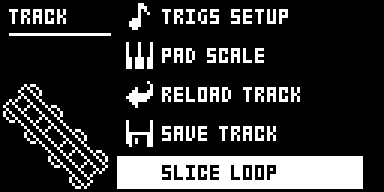
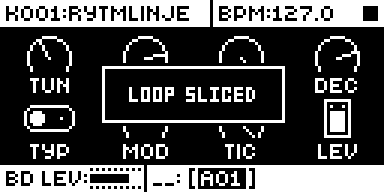
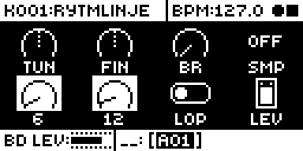
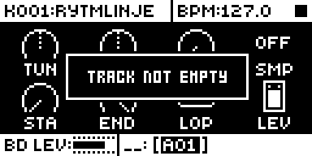

# Slice Loop

## Overview

Slice Loop adds SLICE LOOP after SAVE TRACK in the track menu (FUNC + CHRO). On an empty
sound track of 16 steps or more it:

- sets the track's TRIG page defaults to SYN off and SMP on;
- places trigs on steps 1 to 16;
- locks trig n's sample STA to 6(n-1) and END to 6n (0/6, 6/12 up to 90/96);
- shows LOOP SLICED and closes the menu.

It is meant for a one-bar loop sample padded so the bar fills 96/120 of it. Swing,
accents and micro timing then move each slice as they would a drum hit. On a track with
any trig (lock trigs included), a track shorter than 16 steps or the FX track it
refuses with TRACK NOT EMPTY, NEEDS 16 STEPS or ONLY ON SOUND TRACKS, and changes nothing.
Every write goes through stock's own setters.

Version **1.0.0** for Analog Rytm MKII OS **1.74**, with core-ar2 0.3. It is
[rytm2_mods](https://github.com/Iced-Cream/rytm2_mods)' elemod port of MrScruff's
`0012-slice-loop` from [rytm-mods-src](https://github.com/Iced-Cream/rytm-mods-src),
with his code unchanged. Hardware testing is recorded in the
[hardware report](evidence/hardware-testing.json) and [TESTING.md](TESTING.md).

## Controls

| Control | Action |
| --- | --- |
| Track menu > SLICE LOOP | On an empty sound track of 16 steps or more: SYN off, SMP on, trigs on steps 1 to 16 with STA 6(n-1) and END 6n locks. |

There are no other new controls, menus or settings. To get stock behaviour back, build
without the module.

## Usage

Track menu (FUNC + CHRO), after SAVE TRACK.

### Quick tutorial

1. Use a build containing Slice Loop. Select an empty sound track and press FUNC + CHRO: SLICE LOOP is the last item.
2. Choose it: the screen shows LOOP SLICED, and steps 1 to 16 have trigs with STA/END locks 0/6, 6/12 up to 90/96.
3. Choose it again on the same track: TRACK NOT EMPTY, and nothing changes. On the FX track it shows ONLY ON SOUND TRACKS.

## Compatibility and limitations

Requires core-ar2 0.3 on OS 1.74. Use your own original stock OS 1.74 file.

- Built for OS 1.74 only.
- Only on an empty sound track of at least 16 steps: any trig, lock trigs included, makes it refuse.
- The slices are fixed at sixteen equal parts of 96/120 of the sample.

The module patches one site, six bytes at `0x400f9f02` in the track menu's constructor
(the epilogue's `movem.l`), the same site as the original mod. Another module patching
those bytes cannot be combined with it.

| Address | Bytes | Op |
| --- | --- | --- |
| `0x400f9f02` | 6 | jmp `slice_loop_menu_add` |

The stub builds one more menu item exactly as SAVE TRACK's is built (the same
`std::function` managers, a label, an action and an empty icon), appends it, re-emits
the displaced instruction and rejoins the constructor.

## Tests and measurements

See [TESTING.md](TESTING.md) for the commands and results. In short: on an Analog Rytm
MKII with OS 1.74, beside other rytm2_mods ports, its test passes (LOOP SLICED with 16
trigs on an empty track, then TRACK NOT EMPTY). Modwerk's own build of this folder gives
a main OS byte-identical to elekloader's build of the rytm2_mods v1.2 release. In
rytm-emu, step 2 is locked to 6/12 and step 16 to 90/96 after SLICE LOOP on BD. Memory:
752 bytes of the 128 KiB shared mod area, with six relocations to its own code and
strings. There is no code in the audio, sequencer or tick paths.

## Authorship and licences

MrScruff: the original mod (rytm-mods `0012-slice-loop`), its design and code, published
in rytm-mods-src with his permission. Iced-Cream: the elemod port in rytm2_mods and this
module. irpina: Elekloader and core-ar2.

Code: [GPL-2.0-only](LICENSE), as rytm-mods-src. `src/slice-loop.s` (rytm2_mods'
`slice-loop/os1.74/slice-loop.s`) and `include/ar2-1.74.inc` are rytm2_mods' files at
`afd461d` (v1.2), unchanged; the include names firmware routines by address only. The
upstream README, which documents the OS 1.73 addresses, is in
[upstream/README.md](upstream/README.md). Screens show Elektron's interface solely to
document the modification. No Elektron firmware is included.

## Screens and audio

These captures are from rytm-emu running a build of core-ar2 0.3 and Slice Loop from
stock OS 1.74. See [capture provenance](media/capture.json) for hashes and inputs. The
emulator runs without a card, so no sample is loaded and there is no audio
demonstration.

FUNC + CHRO on track BD: SLICE LOOP is the last item, after SAVE TRACK. Stock's list ends at SAVE TRACK.

Choose it on the empty BD track: LOOP SLICED.

In grid recording, hold trig 2 on the SAMPLE page: STA and END are locked to 6 and 12.

Trig 16 is locked to 90 and 96, the last of the sixteen slices.

Choose SLICE LOOP again on BD: TRACK NOT EMPTY, and nothing changes.
