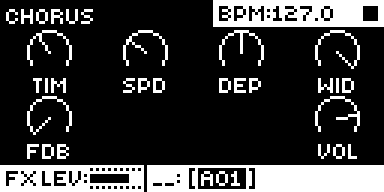
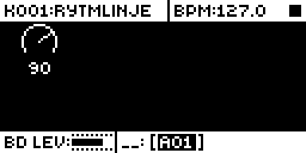

# Stereo Chorus

An Analog Rytm MKII mod by @stigmagit. Version 0.1.0-experimental, for OS 1.74 with core-ar2 0.3. Checked in the emulator; an earlier build heard by the author on a unit, this one awaits that test.

## Overview

Stereo Chorus adds a third send effect beside the delay and the reverb. Each sound track has its own CHO send. The voices, as the codec brings them back to the processor (the same signal the delay and reverb sends take), are summed by those sends into one delay line. Two taps read it, each delayed by TIM and swept by a slow LFO (SPD, DEP), the right one up to half a cycle out of phase with the left (WID). FDB feeds their mean back into the line. The stereo result, at VOL, joins the PRE FX return: it reaches the analog mixer with the delay and the reverb, before the distortion and the compressor.

With every send at 0, the default, nothing is added: the unit sounds as stock.

## Controls

**CHORUS page:** on the FX track, press DELAY (the second parameter key), then DELAY again.

| Encoder | Name | Range | Default | What it does |
| --- | --- | --- | --- | --- |
| A | TIM | 0-127 | 48 | Base delay, 1 ms to 30 ms |
| B | SPD | 0-127 | 40 | LFO rate, 0.05 Hz to 5 Hz |
| C | DEP | 0-127 | 64 | Sweep depth, up to 5.3 ms each way (never past the base delay) |
| D | WID | 0-127 | 127 | Right LFO phase against the left, 0 to 180 degrees: 0 is mono |
| E | FDB | 0-127 | 0 | Feedback, up to 0.85 |
| H | VOL | 0-127 | 100 | Return level |

**CHORUS SEND page:** on a sound track, press AMP, then AMP again. Encoder A sets that track's CHO send, 0-127 (default 0). The title names the track.

Pressing the same key once more, or any other page or menu key, goes back to the stock pages. The page values are kept in the kit, the send in the sound, as stock's own values are: save the kit (or the project) to keep them. One step of a value takes about two encoder counts.

## Usage

Send a few tracks to the chorus and set its sweep on the FX track.

### Quick tutorial

1. Select a snare or a hi-hat track, press AMP, then AMP again: CHORUS SEND opens. Turn encoder A to about 90.
2. Play the track: the chorus joins in at the default settings.
3. Press FX, DELAY, then DELAY again: the CHORUS page opens. Turn SPD and DEP for a slower or deeper sweep, WID for width, TIM for a closer or wider double.
4. Press DELAY once more to go back to the delay, and save the kit to keep the settings.

## How it works

- `gate.s` hooks the end of the FX returns routine (one site, 6 bytes, `movel #32,%macsr`), right after stock has written the PRE and POST returns of this block into the codec's output ring; d2 holds the output slot. The detour sets the MAC mode as stock does, then runs `stereo_chorus_block`.
- The input: the codec's receive buffer, 32 frames of 12 words (MAIN, the eight voices, AUDIO IN). Stock's own tables give each voice's word and the track that plays it now (shared voices such as RS/CP follow the last trig), so the CHO send of that track scales the voice, on a squared curve like stock's sends.
- The line: 4,096 samples (85 ms). The taps read it with 4-point Hermite interpolation; the LFO is a triangle bent towards a sine. Gains, delays and feedback move linearly across each 32-frame block, so turning a knob does not step.
- The output: added to the PRE words of the block, saturated to 24 bits.
- `ev_tick` copies the sends and the kit values for the audio block, `ev_key` and `ev_enc` run the two pages, `ev_draw` draws them, `ev_project` clears the line.
- The pages look like stock's: the stock top and bottom bars stay, the dials are drawn where and as stock draws its own (a circle open at the bottom and a pointer, at x = 16 + 32 per column), and the names and values use stock's own text routine and font. Opening a page shows its name over the top bar for a moment, and a turned knob shows its value in place of its name, as on stock pages.
- After 2 s with no send above 0 the line is cleared once and the block returns at once: an idle chorus costs a few instructions a block.

The LFO is free running, as a chorus pedal's: nothing is tied to the tempo ([sequencing.md](../../../../../docs/module-guides/sequencing.md)).

## Changes to stock flows

- **DELAY pressed again on the FX track** opens the CHORUS page, and **AMP pressed again on a sound track** opens CHORUS SEND. On stock a second press of either key does nothing (checked in the emulator, OS 1.74, also a third press). The same key once more, or any other page or menu key, gives the stock page back.
- **The PRE FX return** carries the chorus too while a send is above 0. The delay and the reverb are untouched.

## Compatibility and limitations

OS 1.74 only, with core-ar2 0.3. Storage: one 7-bit sound field (`stereo_chorus_send`) and two kit fields (`stereo_chorus_a`, 28 bits, and `stereo_chorus_b`, 14 bits), each value stored as its difference from the default. UI claims: `FX DELAY page key twice`, `AMP page key twice`. One code site: 0x4010ee66, 6 bytes, at the end of the FX returns routine.

- The CHORUS values and CHO sends are not stock parameters: they cannot be parameter-locked, modulated by the LFO, or changed by scenes, and they are not sent or received as MIDI CC.
- The chorus always joins the PRE return (through the distortion and the compressor); there is no POST choice.
- A track's send follows the voice it plays: RS and CP, MT and HT, CH and OH, CY and CB share a voice each, so their chorus follows the last of the pair that played.
- Only the analog voices are sent; the external input is not.
- A kit saved with this mod and loaded without it plays without the chorus; the values come back when the mod is installed again.
- The load on the unit is not measured yet; the static estimate is below.

## Tests and measurements

Full record in [TESTING.md](TESTING.md). In short:

- **In the emulator (rytm-emu):** the CHORUS and CHORUS SEND pages open, set their values and close as described, and stock does nothing with a second or third DELAY or AMP press. With a send at 90 to 127 the PRE return words carry the chorus; with every send at 0 they are the stock ones. The emulator models the analog voices only roughly, so the chorus was also heard through a test build fed by a sample's digital layer: its wet signal follows the dry one 12 ms later (TIM 48) over the whole tail.
- **Memory:** 5.8 KB of code and 16.5 KB of data (the delay line) in the 128 KB shared mod area (elekloader lint).
- **CPU:** static estimate about 330 instructions a frame while a track sends (32 frames, 1,500 blocks a second: about 16 million instructions a second, eight voices sending); a few instructions a block when idle. Not measured on a unit.

## Screens and audio

Captured in rytm-emu from build SC04 ([capture record](media/capture.json)). No audio preview is included.

## Authorship and licences

Stereo Chorus is by stigmagit, under GPL-3.0-or-later ([LICENSE](LICENSE)). Built on core-ar2 and elekloader (irpina, GPL-2.0-or-later). The FX return and receive buffers were located from the reverse engineering in [rytm-mods-src](https://github.com/Iced-Cream/rytm-mods-src) (MrScruff, Iced-Cream) and [rytm-emu](https://github.com/trigcondition/rytm-emu)'s notes, then read again in OS 1.74 for this mod. Emulator tests ran in rytm-emu. Screenshots: [media/LICENSE.md](media/LICENSE.md).
