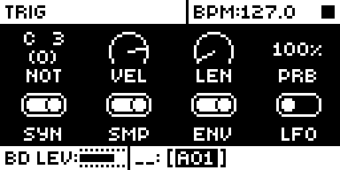
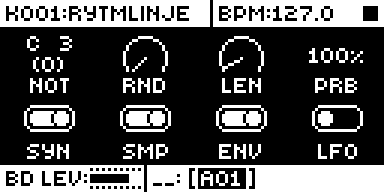
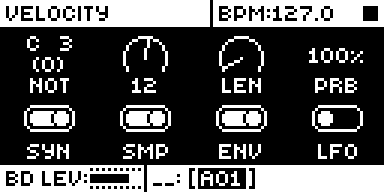

# Velocity Humanise

## Overview

Velocity Humanise gives each track a random velocity offset. Every trig's velocity moves
by a random amount up to ±N, clamped to 1..127.

- N is one of sixteen steps from 0 to 64. N = 0 is stock behaviour.
- It is set by holding FUNC and turning VEL on the TRIG page: the label reads RND and the
  knob becomes a sixteen-position selector. Without FUNC, VEL is the trig velocity as on stock.
- N is per pattern track. It is kept in core-ar2's mod storage and saved with the pattern.

Version **1.1.0** for Analog Rytm MKII OS **1.74**, with core-ar2 0.3. It is
[rytm2_mods](https://github.com/Iced-Cream/rytm2_mods)' elemod port of MrScruff's
`0003-velocity-humanise` from [rytm-mods-src](https://github.com/Iced-Cream/rytm-mods-src).
His code is unchanged, except that N moved from spare bits of stock's euclid-enable byte
into core storage, so the module no longer needs Euclid Accents in the same build. Hardware
testing is recorded in the [hardware report](evidence/hardware-testing.json) and
[TESTING.md](TESTING.md).

## Controls

| Control | Action |
| --- | --- |
| FUNC + VEL (TRIG page) | Sets the track's random velocity range N: sixteen steps from 0 to 64. Each trig's velocity moves by a random amount up to ±N, clamped to 1..127. |

There are no other new controls, menus or settings. To get stock behaviour back, set N to
0, or build without the module.

## Usage

TRIG page: the VEL knob with FUNC held.

### Quick tutorial

1. Use a build containing Velocity Humanise. On the TRIG page, hold FUNC and turn VEL: the label reads RND and the popup shows N.
2. Set N to 32 and play a track of equal-velocity trigs: the hits vary in level. Set N to 0: they are equal again.
3. Release FUNC: VEL is the trig velocity again, unchanged.

## Compatibility and limitations

Requires core-ar2 0.3 on OS 1.74. Use your own original stock OS 1.74 file.

- Built for OS 1.74 only.
- Needs core-ar2 0.3's mod storage: four bits per pattern track (`vel_rnd`). Earlier cores lose N at a power-off without a project save.
- On stock firmware, or a build without this module, the track plays its plain velocities: N is in mod storage, which stock ignores.
- Patches param_apply_delta and param_value_text next to other gate-chain modules; each has its own site and they link together.

### Mod storage

| Field | Scope | Bits |
| --- | --- | --- |
| `vel_rnd` | track (per pattern track) | 4 |

The linker places the field from the build's lockfile, so a later build keeps it where it
was and projects keep their N. Removing the module leaves the bits in the project, unread.

### Sites

The module patches five sites, the original mod's own. Another module patching the same
bytes cannot be combined with it.

| Address | Bytes | Op |
| --- | --- | --- |
| `0x400378ae` | 8 | jmp `velocity_humanise_vel_amount_gate` (param_apply_delta: FUNC + VEL sets N) |
| `0x4009b00c` | 6 | jmp `velocity_humanise_vel_humanise` (the trig's velocity, each trig) |
| `0x400a8654` | 8 | jmp `velocity_humanise_vel_text_gate` (param_value_text: N in the popup) |
| `0x400a9004` | 6 | jmp `velocity_humanise_vel_label_gate` (the RND label) |
| `0x400a8822` | 6 | jsr `velocity_humanise_vel_get_ui` (VEL's getter, with FUNC held) |

## Tests and measurements

See [TESTING.md](TESTING.md) for the commands and results. In short: on an Analog Rytm
MKII with OS 1.74 and core-ar2 0.3, beside the other rytm2_mods ports (with and without
Euclid Accents), its test steps pass and N survives a power-cycle without a project save.
Modwerk's own build of this folder gives a main OS byte-identical to elekloader's build of
the rytm2_mods v1.2 release. In rytm-emu, FUNC on the TRIG page relabels VEL as RND and
turning it shows N. Memory: 828 bytes of the 128 KiB shared mod area and four bits of
track storage. On each trig it adds one storage read, a random draw and a clamp.

## Authorship and licences

MrScruff: the original mod (rytm-mods `0003-velocity-humanise`), its design and code,
published in rytm-mods-src with his permission. Iced-Cream: the elemod port in
rytm2_mods, including the move to core storage, and this module. irpina: Elekloader and
core-ar2, whose storage keeps N.

Code: [GPL-2.0-only](LICENSE), as rytm-mods-src. `src/velocity-humanise.s` (rytm2_mods'
`velocity-humanise/os1.74/velocity-humanise.s`), `include/ar2-1.74.inc`,
`shared/live-track.s` and `shared/shared.s` are rytm2_mods' files at `afd461d` (v1.2),
unchanged; they name firmware routines and RAM by address only. The upstream README is in
[upstream/README.md](upstream/README.md). Screens show Elektron's interface solely to
document the modification. No Elektron firmware is included.

## Screens and audio

These captures are from rytm-emu running a build of core-ar2 0.3 and Velocity Humanise
from stock OS 1.74. See [capture provenance](media/capture.json) for hashes and inputs.
The varied velocities were judged on a unit, so there is no audio demonstration.

Press TRIG on track BD: the TRIG page, with VEL as knob B.

Hold FUNC: VEL's label reads RND. Stock keeps VEL.

Turn it with FUNC held: the popup shows N, here 12. Stock shows the trig velocity, 100.
