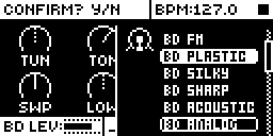
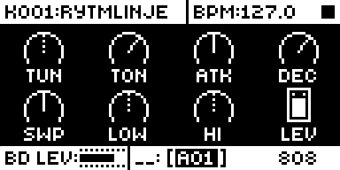
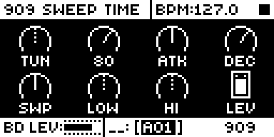

# Analog BD for the Analog Rytm MKII

## Overview

BD ANALOG plays repeat98's 808 and 909 bass drum models from Analog BD for the Octatrack (0.1.7: the 909 refitted to Skee Mask's recorded TR-909), on the BD, SD and BT tracks. The tables are generated from his Python models at 48 kHz (`tools/gen_tables.py`); like the Octatrack, the 909 works its control out every 16 samples. The engine is fixed point on the ColdFire: hand-scheduled assembly for every per-sample pass (`src/ab_*.s`), each checked against its C reference (`tools/asm_check.py`). It is the first of the Modwerk base's digital voices ([guide](../../../machines/analog-rytm-mkii/README.md#digital-voices)): the base handles the hit, the voice's stream, LEV and the 808/909 switch, and the voice's filter, AMP and OVR come after it, as for stock CP CLASSIC. It needs the Modwerk base, not irpina's core-ar2 0.7 release.

## Controls

SYNTH page:

| Knob | Label | What it does |
| --- | --- | --- |
| A | TUN | Body pitch. 909: one octave, 32.7 to 65.4 Hz, 64 the recorded 909. The note (chromatic mode) transposes it. |
| B | TON / SWT | 808: tone of the hit and body. 909: pitch sweep time and end point (the 909's TUNE). |
| C | ATK | Click strength. |
| D | DEC | Body decay. 909: 15 ms to 600 ms, 80 the recording. |
| E | SWP | Pitch sweep depth. |
| F | LOW | Desk low band's weight. 64 is neutral. |
| G | HI | Desk high band's weight. 64 is neutral. |
| H | LEV | Level into the voice. |

- **808 or 909:** tap encoder B on this page. B's label shows which (TON 808, SWT 909). It is saved with the sound, starts at 808, and is not a p-lockable parameter.
- **Accent** is each hit's velocity. 100 is the recorded 909 balance; softer hits are rounder, harder ones snappier.
- **Fixed:** every hit opens the same way (the OT's FIXD on). No SAT; use OVR or DIST. No LPF; use the filter page.

## Usage

Choose BD ANALOG on the BD, SD or BT track and play it like a stock BD machine: from the sequencer, the pads or MIDI. The voice's filter, AMP and OVR pages shape it as they do a stock machine.

### Quick tutorial

1. Select the BD track, press FUNC + SRC, scroll to BD ANALOG (the last of the BD section) and press YES.
2. Play the pad soft and hard: velocity is the accent, harder hits are snappier.
3. Turn TUN for the pitch and DEC for the length; SWP sets how far the pitch sweeps down.
4. Tap encoder B: the label changes from TON to SWT and the bar from 808 to 909. Play it again, and tap again for the 808.

### Changes to stock flows

None: BD ANALOG is a machine of its own in the machine list. Choosing another machine, kits, sound locks and saving work as for a stock machine; the 808/909 type is stored in the sound's mod storage.

## Compatibility and limitations

- Tracks: BD ANALOG is in the machine list of the BD, SD and BT tracks only. On the unit (rig, 11 Nov 2026) three 909s hit together played clean and four overran the audio block, so three voices is the cap.
- CPU: the Rytm's own audio work takes about two thirds of the audio block with nothing playing. An 808 voice adds about 7 % of the block (its render about 5 %, the base's work under 1 %, stock's for the track about 1 %). Hits spread across the beat cost less than hits at the same instant ([TESTING.md](TESTING.md)).
- The level into the voice's analog path and how hard it can be driven are not yet measured on a unit.
- Built for OS 1.74 only, on the Modwerk base's digital voices (its send-bus variant: the site picks it for a set with this module).

## Tests and measurements

rytm-emu on OS 1.74, the hand-written assembly against its C, the host engine against repeat98's float models, the author's own unit by hand (0.1.0) and the author's automated rig on a MKII (0.2.0): [TESTING.md](TESTING.md).

## Authorship and licences

Original 808/909 models, fits and coefficients: Jannik Aßfalg (repeat98), MIT, from Analog BD for the Octatrack (`sdk/octabam/modules/analog-bassdrum`). Rytm port: Nathaniel Pavel (@npp1993), MIT ([LICENSE](LICENSE)). The tables are generated from those models; the build carries no Elektron code or tables. Screens show Elektron's interface solely to document the modification ([media/LICENSE.md](media/LICENSE.md)).

## Screens and audio

Screenshots are rytm-emu captures of build BA21 (0.2.0 on the base of the digital voices, repeat98/modwerk#1447) ([media/capture.json](media/capture.json)). No audio preview yet.
