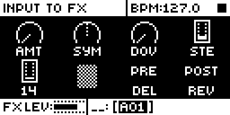
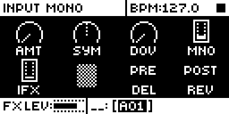

# Audio In FX

An Analog Rytm MKII mod by npp1993 (Nathaniel Pavel). Version 0.1.0-experimental, OS 1.74 with core-ar2 0.7.

## Overview

On stock the AUDIO IN jacks reach the sampler, its monitor and USB, and EXT IN joins after the distortion. Audio In FX plays AUDIO IN through the Rytm's own effects.

Two knobs on the FX track's DISTORTION page set where it goes. D (STE, or MNO in mono) puts it in the analog mix before DIST and COMP, beside the drums. E (IFX) sends it to the delay and the reverb at once. They are parallel: what goes to DIST does not reach the effects unless E is up. F stays empty, as on stock.

Both knobs are real stock parameters: they save with the kit and take parameter locks, scene locks and performance locks (QPERF's too) like any FX track parameter. At 0, with nothing locked, the mod changes no audio word.

## Controls

| Control | Where | Values |
| --- | --- | --- |
| STE or MNO | DISTORTION page, knob D | 0 to 127. AUDIO IN into the mix before DIST and COMP. 0 is off, 110 passes the converter's level unchanged, 127 is about 1.33x, +2.5 dB. |
| IFX | DISTORTION page, knob E | 0 to 127. AUDIO IN to both the delay's and the reverb's input, on the same scale. Balance them with the delay's and reverb's own pages. |
| FUNC + turn | D or E on the page | Jumps between 0, 110 and 127, paced as stock's VOL: a quick turn jumps, the next jump comes after about half a second, and slow single clicks do nothing. With a trig held it sets that trig's lock. |
| Trig + turn, scenes, performances | D or E on the page | Stock's own parameter locks, scene locks and performance locks, as on any FX track parameter. |
| Tap of encoder D | The page | Sums AUDIO IN to mono on both paths, and the knob reads MNO, the header Input Mono. Another tap goes back to stereo: STE, Input Stereo. Not saved: it starts stereo. Not with a trig, FUNC or NO held, a pad held in scene or performance mode, nor in running live recording. A hold or a press and turn is not a tap. |

The scale is squared, as stock's levels are, and 110 is the default of stock's VOL parameters. The same knob value runs about 2.5 dB hotter than a stock return, which reaches about 1.0x only near 127.

Stock's DEL and REV on the same page still route the returns: PRE runs a return through DIST and COMP, POST skips both. Stock's defaults are delay PRE and reverb POST.

## Usage

Patch into AUDIO IN L and R, not EXT IN. For the closest to a dry signal, raise D with AMT at 0: the signal still passes DIST and COMP.

### Quick tutorial

1. Plug a source into AUDIO IN L and R. Press FX, then FLTR.
2. Turn D (STE) up: the source plays through COMP and DIST.
3. Raise AMT to drive it. AMT distorts the drums too: DIST is one stage.
4. Turn E (IFX) up to send the source to the delay and the reverb.

### What it overrides and how it hooks in

One stock site: the delay's entry at 0x4010da24, which runs once a block after stock has mixed both sends. Two hidden TEST parameter ids get new names, the FX track's category and the VOL bar's draw callback: 445 points at FX word 29 and 446 at FX word 0, the FX track's only words that stock saves and no stock parameter uses, and 446's default becomes 0. So stock saves, copies, clears, pastes and locks them as its own. The audio reads the engine's words for the two (0x8000fb98 + 2 x word), where stock has already applied parameter, scene and performance locks. One slot of stock's parameter page view (0x401cc3ec, a held trig's turn) goes through the mod so that FUNC + turn on a held trig jumps between the stops; every other id goes on to stock. The names of id 445 are rewritten in the id table for MNO.

### Changes to stock flows

With both knobs at 0 and nothing locked, the block handler returns before touching a word. Nothing else in stock's flows changes.

## Compatibility and limitations

- AUDIO IN jacks only. EXT IN is an analog sum after DIST: no firmware switch reaches it.
- DIST is one analog stage, so AMT applies to drums and input alike.
- E feeds the delay and the reverb at one level. A separate reverb level would need a third saved FX word, and the FX track has no more: the base's kit storage (words 38 to 41) is full.
- Mono is not saved.
- Mono is L + R, so one cable in either jack plays at its level on both sides, and a loud stereo source can clip digitally, ahead of DIST.
- Level, noise and latency have not been measured on a unit. In rytm-emu a sine at -8.7 dBFS on AUDIO IN, D at 110, peaks at 4442 in the analog mix, against 5897 for the default kit's BD, 5362 for SD and 4489 for CH; 127 is 2.5 dB up.
- OS 1.74 only, with core-ar2 0.7.

## Tests and measurements

On the author's Analog Rytm MKII (AC20, AC21) and in rytm-emu, on the builds named in [TESTING.md](TESTING.md). Level, noise and latency are not measured: the emulator models the analog stages roughly.

## Authorship and licences

Original code by npp1993 (Nathaniel Pavel), GPL-3.0-or-later ([LICENSE](LICENSE)). No stock code is included: patch preconditions are an address, a length and a SHA-256.

## Screens and audio

Screenshots are rytm-emu captures of build AF22 ([media/capture.json](media/capture.json)). No audio preview yet.
