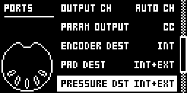

# Chromatic Aftertouch Fix

## Overview

On stock Analog Rytm MKII OS 1.74, a pad played in CHROMATIC mode sends its MIDI aftertouch (poly
pressure) 24 semitones above the note it sent. Hold the BD pad in CHROMATIC mode and MIDI out reads
note on 36, then poly pressure for note 60, then note off 36. A synth or a MIDI monitor that follows
the held note sees no aftertouch. Press UP or DOWN during the hold and stock's pressure moves to yet
another note, and it keeps sending pressure after the note off.

Chromatic Aftertouch Fix sends that poly pressure on the note the pad played, the note its note off
uses, from the note on to the note off. Nothing else changes: note on, note off, the MIDI channel
and the pressure values are as stock, the Rytm's own sound gets its aftertouch as before, and pads
outside CHROMATIC mode, which already sent pressure on their note, are left alone. It has no menu
row and stores nothing: installed, it is on.

| Held CHROMATIC pad | Stock 1.74 | With the fix |
| --- | --- | --- |
| BD | `9d 24 7f`, `ad 3c pp`, `8d 24 00` | `9d 24 7f`, `ad 24 pp`, `8d 24 00` |
| SD | `9d 25 7f`, `ad 3d pp`, `8d 25 00` | `9d 25 7f`, `ad 25 pp`, `8d 25 00` |
| BD, UP pressed during the hold | `9d 24 7f`, `ad 3c pp`, `ad 44 pp`, `8d 24 00` | `9d 24 7f`, `ad 24 pp`, `ad 24 pp`, `8d 24 00` |
| BD, pressure after the release | `9d 24 7f`, `ad 3c pp`, `8d 24 00`, `ad 3c pp` | `9d 24 7f`, `ad 24 pp`, `8d 24 00` |

Bytes from rytm-emu on the AUTO channel (14, `d`); `pp` is the pressure.

Version **0.1.0-experimental** for Analog Rytm MKII OS **1.74**, with core-ar2 0.7. Written by
Nathaniel Pavel (@npp1993); not a port.

## Controls

| Control | What it does |
| --- | --- |
| A pad held in CHROMATIC mode | Sends MIDI poly pressure on the note its note on sent, until its note off. Stock sends it 24 semitones higher and follows UP and DOWN during the hold. |

There is nothing to set. To get stock's bytes back, build without the module.

Messages: the module changes the poly pressure (`An note value`) a held CHROMATIC pad sends: its note
number, and none after the pad's note off. Channel, port and value are as stock picks them (PAD
DEST, PRESSURE DST, AUTO or per-track channel). It reads no MIDI, consumes nothing, adds no message
and moves none in time; every other message, MIDI in and MIDI thru are as stock.

## Usage

Install a build that contains the module, let the pads reach MIDI out, press CHRO and play. A synth
whose patch uses poly aftertouch now responds to holding a pad harder.

### Quick tutorial

1. In GLOBAL > MIDI CONFIG > PORT CONFIG, check that PAD DEST and PRESSURE DST are INT+EXT (the default) so the pads reach MIDI out. Connect a MIDI monitor to MIDI OUT or USB.
2. Press CHRO. Strike the BD pad and hold it: the monitor shows a note on for note 36.
3. Press harder while holding: poly pressure for note 36 follows, then the note off for note 36 on release. Stock sent that pressure for note 60.
4. Hold BD and press UP or DOWN: the pads shift to other notes, and the held note's pressure stays on its note until you let go.

### How it works

ChromPadsView keeps two notes for each pad: its place in the current layout, which UP and DOWN
rewrite, and the note a press played, held until the release. The note on and the note off go out
24 below the held note; stock's pressure handler instead sends the layout note, as it is. The
module replaces that one call (OS 1.74, `0x400c628e`, 6 bytes) with thirteen instructions of its
own that send the held note less 24, the note off's note. With no note held, after the release,
it sends nothing. A note outside 0 to 127 sends nothing either, as the note on sender drops such a
note. Stock's layout marks a pad past its top with -1, and stock's pressure would then go out with
note byte `ff`; that was read in the code, not reached in rytm-emu. The pressure the sound
receives is set per track, with no note, and is not touched.

## Compatibility and limitations

- OS 1.74 only, with core-ar2 0.7.
- One stock site, `0x400c628e`. No other module or the base patches it. Silent Pad+Trig Settings
  patches the call 32 bytes before it (`0x400c626e`), which gates the same pressure message on a
  muted track: with both installed an unmuted pad sends its pressure on the right note
  (rytm-emu), and a muted one still sends nothing, since that gate skips this call (read in the
  code).
- Declares the claim `midi:CHROMATIC pad poly pressure note on MIDI out`; no key gesture or screen.
  No `requires` and no conflicts.
- Changes only what CHROMATIC pads send to MIDI out. MIDI in, pads outside CHROMATIC mode and the
  Rytm's own aftertouch modulation are untouched.
- A receiver set up around stock's bytes, listening for pressure 24 semitones above the note, sees
  it move to the played note.
- Ran on a unit as test build CA02, alone on core-ar2 0.7, as reported by the author ([TESTING.md](TESTING.md)); beside Silent Pad+Trig only in rytm-emu.

## Tests and measurements

rytm-emu on OS 1.74, MIDI out bytes: a held CHROMATIC pad sends note on, poly pressure and note off
on one note across the UP and DOWN layouts, with UP pressed during the hold, with two pads held,
and sends no pressure after its note off; alone and beside Silent Pad+Trig. core-ar2 alone keeps
stock's bytes, and pads outside CHROMATIC are as stock. Details, builds and the unit steps are in
[TESTING.md](TESTING.md). The author ran build CA02 on a unit and every step passed, as reported. Memory: 44 bytes of the shared mod area. Load: at most thirteen
instructions per poly pressure message from a held CHROMATIC pad, nothing otherwise (static count,
not measured).

## Authorship and licences

Original code by Nathaniel Pavel (@npp1993), GPL-3.0-or-later ([LICENSE](LICENSE)). Builds with
irpina's core-ar2 and Elekloader, as every Rytm module here. The OS 1.74 addresses were read by the
author from their own stock firmware; the build carries an address, a length and a SHA-256 guard
only, no stock bytes. Screens show Elektron's interface solely to document the modification
([media/LICENSE.md](media/LICENSE.md)). No Elektron firmware is included.

## Screens and audio

The screenshot is a rytm-emu capture of build CA02 ([media/capture.json](media/capture.json)). The
module has no screen of its own and makes no sound of its own.
