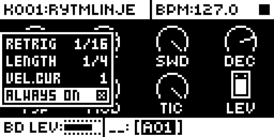

# Pad Pressure Fix

## Overview

Pad Pressure Fix closes two gaps in what pad pressure does on stock Analog Rytm MKII OS 1.74. The
result is one rule for every held pad: pressure always reaches the sound's aftertouch and MIDI out,
and during a retrig roll it also sets the roll's velocity unless VEL.CUR is set.

**During a retrig roll** (RTRG held, or a pad set to ALWAYS ON), stock sends pad pressure only to
the roll's velocity while VEL.CUR is OFF: squeeze and the roll gets louder, but the sound's
AFTERTOUCH targets stop moving and MIDI out gets no poly pressure. With VEL.CUR set the curve owns
the velocity, so stock frees pressure for aftertouch, but only for ALWAYS ON pads: with RTRG held
the RETRIG menu takes the pressure and throws it away. With the fix:

| During a roll | Roll velocity | Aftertouch and MIDI poly pressure |
| --- | --- | --- |
| VEL.CUR OFF | follows pressure, as stock | follows pressure (stock: none) |
| VEL.CUR set, ALWAYS ON | follows the curve, as stock | follows pressure, as stock |
| VEL.CUR set, RTRG held | follows the curve, as stock | follows pressure (stock: none) |

The first row goes past stock rather than fixing a fault: stock chose velocity alone there. With
the fix one squeeze moves both; set VEL.CUR (1 is almost flat) for aftertouch alone.

**In CHROMATIC mode** stock sends a held pad's poly pressure 24 semitones above the note it played
(note on 36, pressure for 60, note off 36), so a synth following the note sees no aftertouch. The
fix sends it on the played note, also when UP or DOWN shift the pads during the hold, and none after
the note off.

Note on, note off, channels, pressure values, MIDI in and the retrig timing are as stock. It has
no menu row and stores nothing: installed, it is on.

Version **0.2.0-experimental** for Analog Rytm MKII OS **1.74**, with core-ar2 0.7. Written by
Nathaniel Pavel (@npp1993); not a port. It was called Chromatic Aftertouch Fix up to 0.1.0; the id
`chromatic-aftertouch-fix` stays.

## Controls

| Control | What it does |
| --- | --- |
| A pad held in a retrig roll | RTRG held or ALWAYS ON: pressure reaches the sound's AFTERTOUCH modulation and MIDI poly pressure, as PAD DEST and PRESSURE DST pick. With VEL.CUR OFF it also sets the roll's velocity, as stock. |
| A pad held in CHROMATIC mode | Sends MIDI poly pressure on the note its note on sent, until its note off. |

There is nothing to set. To get stock's behaviour back, build without the module.

Messages: during rolls the pads send poly pressure (`An note value`) where stock sent none, on the
note and channel a plain held pad uses; in CHROMATIC mode the poly pressure's note number changes.
It reads no MIDI, consumes nothing and moves no message in time.

## Usage

Install a build that contains the module and play: rolls keep the pad's aftertouch, and CHROMATIC
pads send theirs on the played note. Give the sound an AFTERTOUCH target to hear it, and let the
pads reach MIDI out (PAD DEST, PRESSURE DST) to send it.

### Quick tutorial

1. Give the BD sound an AFTERTOUCH target (SOUND SETTINGS > AFTERTOUCH, or SAMPLER + a knob with Quick Velocity+Aftertouch Assign), for example filter cutoff.
2. Hold RTRG and hold the BD pad: it rolls. Press harder: the target moves, and with VEL.CUR OFF the roll also gets louder. Stock moved only the loudness.
3. Set VEL.CUR in the RETRIG menu (hold RTRG, DOWN twice, RIGHT) and roll again: the curve sets the loudness, and pressure moves the aftertouch target only. Stock sent nothing with RTRG held.
4. Turn ALWAYS ON for the track (hold RTRG, YES on the ALWAYS ON row) and hold the pad without RTRG: the same as with RTRG held.
5. With a MIDI monitor on MIDI OUT or USB and PAD DEST and PRESSURE DST at INT+EXT (the default), the rolls send poly pressure. Press CHRO and hold a pad: its pressure goes out on the note it played.

### How it works

A pad pressure event goes to the top view first, and to the view below only if that one returns
0. Stock's pad views (KeyboardView, ChromPadsView) test RTRG and ALWAYS ON; if either holds and
VEL.CUR is OFF, they write the pressure to the roll's velocity and return before the aftertouch
and MIDI path. While RTRG is held the RETRIG menu sits above them: it writes the roll's velocity
when VEL.CUR is OFF, and in every case reports the event taken.

The module changes three stock instructions (OS 1.74) and one call:

- `0x400c755a` (KeyboardView) and `0x400c6228` (ChromPadsView): the branch past the aftertouch
  path after the roll velocity write becomes no-ops, so the pressure also takes the plain pad's
  path to the sound's aftertouch and MIDI out.
- `0x400e2924` (RETRIG menu): returns 0, so the event also reaches the pad view below, which then
  does the above.
- `0x400c628e` (ChromPadsView, since 0.1.0): the poly pressure call goes through thirteen
  instructions that send the held note less 24, the note off's note, and nothing once released.

## Compatibility and limitations

- OS 1.74 only, with core-ar2 0.7.
- Four stock sites; no other module or the base patches them. Silent Pad+Trig Settings gates the
  two MIDI pressure sends after them (`0x400c75f2`, `0x400c626e`), so a pad it mutes still sends
  no pressure, now in rolls too. Live Rec Retrig Fix patches other RETRIG menu sites, not its
  pressure handler; the roll's velocity, which it records, is written as on stock.
- With RTRG held, pressure also reaches whatever view is under the RETRIG menu, as without RTRG:
  the pads' handler on the pad pages and in CHROMATIC mode.
- During a roll with VEL.CUR OFF, one squeeze moves both the velocity and the aftertouch targets.
- A receiver that relied on stock's CHROMATIC poly pressure 24 semitones above the note sees it
  move to the played note.
- Declares the claims `midi:CHROMATIC pad poly pressure note on MIDI out`, `midi:pad pressure
  during pad retrigs on MIDI out` and `ui:pad pressure during pad retrigs (RTRG held, ALWAYS ON)`;
  no key gesture or screen. No `requires` and no conflicts.
- 0.2.0's roll change ran in rytm-emu; its unit test is in [TESTING.md](TESTING.md) when done.
  0.1.0's CHROMATIC fix passed on a unit as CA02.

## Tests and measurements

rytm-emu on OS 1.74 with stock, core-ar2 alone and this module (PF01), BD pressure 20, 30, 28:
plain pad, RTRG held, ALWAYS ON, each with VEL.CUR OFF and set, normal and CHROMATIC pads. Stock and
core-ar2 write no aftertouch and send no poly pressure in any roll; PF01 does in every case, and
writes the roll's velocity only with VEL.CUR OFF, as stock. Details in [TESTING.md](TESTING.md).
Memory: 44 bytes of the shared mod area. Load: at most thirteen instructions per CHROMATIC poly
pressure message; in a roll each pressure event also runs stock's own plain-pad aftertouch path
once (static count, not measured).

## Authorship and licences

Original code by Nathaniel Pavel (@npp1993), GPL-3.0-or-later ([LICENSE](LICENSE)). Builds with
irpina's core-ar2 and Elekloader, as every Rytm module here. The OS 1.74 addresses were read by the
author from their own stock firmware; the build carries addresses, lengths, SHA-256 guards and the
module's own replacement bytes, no stock bytes. Screens show Elektron's interface solely to
document the modification ([media/LICENSE.md](media/LICENSE.md)). No Elektron firmware is included.

## Screens and audio

The screenshots are rytm-emu captures of build PF01 ([media/capture.json](media/capture.json)).
The module has no screen of its own and makes no sound of its own.
