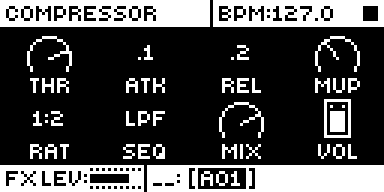
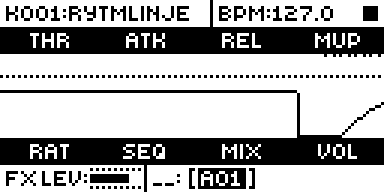
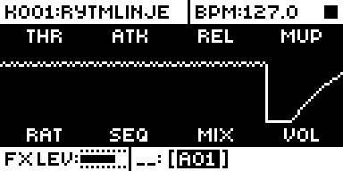

# Compressor Preview

## Overview

Compressor Preview adds one more page behind the compressor page key on the FX track: a scrolling
trace of the estimated gain reduction of the master compressor. Pressing the key again returns to
the stock page.

- The trace is built from the eight voices (split by pan, dropped when off the main bus), the PRE
  delay and reverb returns, the master distortion and each SEQ's sidechain, with a 5 ms peak detector.
  A static curve that THR slides along the level axis gives the demand, and one attack/release pole
  follows it. It is an estimate: the compressor has no gain-reduction readback.
- FUNC + the page key switches the layout: the level, threshold and gain reduction together, or gain
  reduction alone with 0 dB at the top. FUNC + LEFT/RIGHT sets the scroll speed, FUNC + UP/DOWN the
  vertical scale.
- It is stock page 11 listed twice, so stock's parameter lookup, title and knob mapping are inherited.
  It changes no setting and no sound.

Version **1.1.0** for Analog Rytm MKII OS **1.74**, with core-ar2 0.4 or later (Modwerk's base is
core-ar2 0.7). It is [rytm2_mods](https://github.com/Iced-Cream/rytm2_mods)' elemod port of MrScruff's
`0006-comp-preview` from [rytm-mods-src](https://github.com/Iced-Cream/rytm-mods-src). His code is
unchanged. From 1.1 the preview is listed through core-ar2's page lists (`core_view_pages`) instead
of 1.0's own list for the view, so a module that adds a page behind COMP can sit beside it. Testing is
recorded in the [hardware report](evidence/hardware-testing.json) and [TESTING.md](TESTING.md).

## Controls

| Control | Action |
| --- | --- |
| AMP, pressed again (FX track) | Steps from the stock compressor page to the preview and back. With another module's page on the key, it steps through the stock page, the preview, then that page. |
| FUNC + AMP (preview) | Switches the layout: level, threshold and gain reduction together, or gain reduction alone. |
| FUNC + LEFT / RIGHT (preview) | Sets the scroll speed. |
| FUNC + UP / DOWN (preview) | Sets the vertical scale. |

The COMP view keeps the page it was on when you come back to it, so the preview is not dropped. There
are no other controls, menus or settings. Build without the module for the stock page.

## Usage

FX track, AMP page (the compressor): press AMP again.

### Quick tutorial

1. On the FX track, open the AMP page (the compressor). Press AMP again: the preview page, a scrolling trace of estimated gain reduction.
2. Play a pattern and turn THR down: the gain-reduction line dips below the dotted threshold row. If the trace sits at the bottom of the screen, hold FUNC and press UP once or twice (the vertical scale). FUNC + AMP switches to gain reduction alone and back; FUNC + LEFT/RIGHT sets the scroll speed.
3. Press AMP again to return to the stock compressor page. Build without the module and the page is stock.

The stock page of step 1, the preview and its second layout of step 2 are under [Screens and audio](#screens-and-audio):
[compressor page](media/compressor-page.png), [preview](media/preview.png), [gain reduction alone](media/preview-gr-only.png).

## Compatibility and limitations

Requires core-ar2 0.4 or later on OS 1.74. Use your own original stock OS 1.74 file.

- Built for OS 1.74 only. 1.0 replaced the COMP view's page list itself and does not link with core-ar2 0.4 or later.
- The trace is an estimate. On random settings over drum patterns it was not fitted on it reads 1.6 dB rms from the measured reduction with no bias (author's calibration, 2026-09-26), a steady tone 0.56. DIST symmetry away from 64 is outside the model; the reduction past 36 dB is capped; POST returns are not modelled and PRE returns join the sum about 4 ms early; material whose crest factor is far from the calibration tone's reads off.
- The estimate runs in the audio interrupt and costs 4 to 5 points of CPU. It stands aside while core-ar2's `core_audio_load` says the last block was over 95 % busy and comes back below 88 %, so the trace pauses rather than the audio or the UI running short. Stock alone peaks near 84 % on a unit.
- At very low THR (around 24) the estimate holds a large reduction between hits, so the trace is a nearly flat line even on a raised vertical scale. At THR 41 one or two FUNC + UP presses bring the full trace back (unit run T217).
- It keeps no settings: nothing is stored in mod storage or saved with a project.

### Sites

The module patches three sites. Another module patching the same bytes cannot be combined with it. The
preview's place in the COMP view's page list is an entry in core-ar2's `core_view_pages`
(`comp_preview_view_page`, stock page 11 again, order 20).

| Address | Bytes | Op |
| --- | --- | --- |
| `0x4012140c` | 10 | jmp `comp_preview_comp_probe` (the estimate, in the audio interrupt) |
| `0x401e1460` | 4 | ptr `comp_preview_comp_keys` (the preview's keys) |
| `0x401e1468` | 4 | ptr `comp_preview_comp_draw` (the preview's drawing) |

## Tests and measurements

See [TESTING.md](TESTING.md) for the commands and results. In short: on an Analog Rytm MKII with OS 1.74 on Modwerk's base (CPH1, 2026-11-08, with analoghealth 1.3 for remote keys), AMP again opens the preview and returns to the stock page, FUNC + AMP switches the layout, FUNC + LEFT/RIGHT and UP/DOWN change speed and scale (judged from shots), and CPU read 84.8 % with BD playing and the preview open (74.5 % idle). On the current base (CPH2, plain variant 1c14b6b0, 2026-11-09) the full layout at THR 41 showed little on its starting scale and one or two FUNC + UP presses brought the trace back; at THR 24 it stayed nearly flat (judged from shots). Before that, on the author's unit with core-ar2 0.4 (2026-10-21), COMP and the preview cycle, the FUNC keys work, the page is kept on leaving the FX track, and the load guard pauses the trace rather than the audio; in the busiest case the audio interrupt peaked at 94 %. Modwerk's package linked with core-ar2 0.7 gives a main OS byte-identical to the rytm2_mods v1.3 release object linked with it. In the emulator on the Modwerk base (CP11), AMP again opens the preview, FUNC + AMP its second layout, and BD hits draw the trace. Memory: 3912 bytes of the 128 KiB shared mod area.

## Authorship and licences

MrScruff: the original mod (rytm-mods `0006-comp-preview`), its design, calibration and code,
published in rytm-mods-src with his permission. Iced-Cream: the elemod port in rytm2_mods and this
module. irpina: Elekloader and core-ar2, whose page lists the preview is listed through.

Code: [GPL-2.0-only](LICENSE), as rytm-mods-src. `src/comp-preview.s` (rytm2_mods'
`comp-preview/os1.74/comp-preview.s`) and `src/calib.inc` are rytm2_mods' files at `e029f75` (v1.3),
unchanged; they name firmware routines and RAM by address only. The upstream README is in
[upstream/README.md](upstream/README.md). No Elektron firmware is included.

## Screens and audio

These captures are from analog-emu (trigcondition's emulator built on rytm-emu) running CP11, the Modwerk base
for core-ar2 0.7 and Compressor Preview 1.1.0, from stock OS 1.74. See [capture provenance](media/capture.json)
for hashes and inputs. The trace is the emulator's estimate from its rendered voices; the
preview's behaviour was judged on a unit. There is no audio demonstration, and the module makes no sound.

On the FX track, press AMP: the stock compressor page.

Press AMP again: the preview. With THR at 64 the trace runs below the dotted threshold row; a BD
hit pulls it down and it recovers. The header shows the kit, as it does after any pad press. Stock
stays on the compressor page.

Hold FUNC and press AMP: gain reduction alone, 0 dB at the top. A BD hit pulls the line down and it
recovers.
