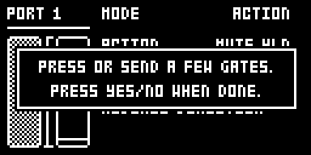
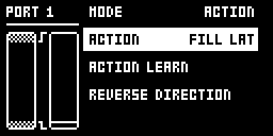

# Control In Actions

An Analog Rytm MKII mod by Nathaniel Pavel (@npp1993). Version 0.1.0-experimental, OS 1.74 with core-ar2 0.7.

## Overview

A footswitch or a 0 to 5 V gate on EXP/CV IN 1 or 2 can play a panel action, so both hands stay on the pads. Stock OS 1.74 already holds a footswitch mode in GLOBAL > CONTROL > CONTROL INPUT 1 and 2, left over from Elektron's other machines, but stops MODE at EXPR and does nothing with it on the Rytm. This mod opens it as **ACTION**:

- **MUTE HLD / MUTE TGL**: MUTE mode while the input is held, then back to the mode you were in, or a MUTE press.
- **REC HLD / REC TGL**: live recording while held, or on and off. It starts a stopped sequencer and never stops it.
- **FILL HLD / FILL LAT**: FILL while held, or latched as FUNC + FILL FILL and ended as FILL.

Everything is set up in stock's own CONTROL INPUT menus and saved with stock's control-input settings. Bars beside the menu, laid out as EXPR's, show the input against the learned levels and when it counts as pressed.

## Controls

| Control | Where | What it does |
| --- | --- | --- |
| MODE | GLOBAL > CONTROL > CONTROL INPUT 1 or 2 | Turns past EXPR to **ACTION** (stock's hidden FSW). Each jack has its own MODE, so one can play actions while the other plays the kit's CONTROL IN MOD macro as CV or an expression pedal. |
| ACTION | the row below MODE, in ACTION mode | What the input does, below. |
| ACTION LEARN | the next row | Reads a footswitch's two levels: press the switch (or send the gate) a few times, then YES to save or NO to keep the levels you had. Nothing happens on the pads while it runs. Stock's FOOTSWITCH LEARN, renamed after EXPRESSION LEARN. |
| REVERSE DIRECTION | the last row | Swaps the two levels, for a switch that reads lower while pressed. As in EXPR mode it shows no message; the bars show it. |

| ACTION | Input goes high (pressed) | Input goes low (released) |
| --- | --- | --- |
| OFF | Nothing | Nothing |
| MUTE HLD | Opens MUTE mode | Goes back to the mode you were in: CHRO, SCNE, PERF, or none; if MUTE mode was already open, it stays |
| MUTE TGL | A MUTE press: opens or closes MUTE mode | Nothing |
| REC HLD | Live recording on (RECORD + PLAY: starts the sequencer when stopped) | Live recording off; the pattern plays on |
| REC TGL | Live recording on (starting a stopped sequencer) or off (the pattern plays on) | Nothing |
| FILL HLD | Holds FILL: fill mode on, as while you hold the key | Lets FILL go: fill mode off, and a latched fill unlatched, as stock's FILL release |
| FILL LAT | Latches fill mode, as FUNC + FILL FILL, or ends the latch, as FILL | Nothing |

The switch point is halfway between the two learned levels, with a margin of an eighth of their range, at least 0.2 V, either side of it, so a noisy or slow edge switches once. Until you learn, the levels are stock's 0 V and 5 V: a gate counts as pressed above about 3.1 V and as released below about 1.9 V. As stock's, a learn takes the higher level as pressed. If the bars' right-hand line drops to the far end with your foot off the switch, choose REVERSE DIRECTION after learning.

The bars: at the left a level line against the two learned levels, shaded beyond them and bracketed, which move as ACTION LEARN runs; beside it a line, as EXPR's output line, that moves to the box's far end while the input counts as pressed. While the CONTROL INPUT screen is open, the jack follows what it shows, so a new ACTION choice works at once; stock saves the menu when you leave it.

## Usage

Plug the switch or gate in, set MODE to ACTION, learn the levels if it is a footswitch, pick an action and leave the menu. Stay within the jack's -5 V to +5 V.

### Quick tutorial

1. Plug a footswitch or a 0 to 5 V gate into EXP/CV IN 1, then open GLOBAL > CONTROL > CONTROL INPUT 1 and turn MODE past EXPR to ACTION.
2. Choose ACTION LEARN, press the switch a few times and press YES. If the bars' right-hand line drops with your foot off the switch, choose REVERSE DIRECTION.
3. Set the ACTION row to MUTE HLD, leave the menu and play: hold the switch and tap pads to mute them, let go to go back to playing.
4. Set it to REC TGL: a tap starts live recording, even from stop, and the next tap leaves it while the pattern plays on.

## Changes to stock flows

| Change | For whom | Why | Neighbouring flows |
| --- | --- | --- | --- |
| MODE in CONTROL INPUT 1 and 2 goes one step further, to ACTION (stock's hidden FSW). | Anyone with the mod installed. | The mod's whole setup lives in stock's menus rather than a page of its own. | OFF, CV and EXPR are unchanged; the kit's CONTROL IN MOD keeps working on a jack in CV or EXPR. |
| Stock's hidden FOOTSW DEST row is named ACTION and lists OFF, MUTE HLD, MUTE TGL, REC HLD, REC TGL, FILL HLD and FILL LAT instead of stock's six, which the Rytm never acts on. | Anyone who sets MODE to ACTION. | Stock hides the row; its TEMPO, ACTIVE, PRESET and ENV TRIG are not handled by the Rytm's input code. | REVERSE DIRECTION is stock's, unchanged. |
| Stock's hidden FOOTSWITCH LEARN is named ACTION LEARN; its message's first line reads PRESS OR SEND A FEW GATES., and NO puts the levels you had back. | Anyone who sets MODE to ACTION. | It learns a gate's levels as well as a switch's. Stock's NO leaves the new levels in the menu unsaved, where leaving the menu saves them. | It records the lowest and highest level seen, as stock's; the second line, PRESS YES/NO WHEN DONE., is stock's. |
| EXPRESSION LEARN's NO also puts the levels you had back. | Anyone with the mod installed who runs EXPRESSION LEARN. | Stock's NO there leaves the new range in the menu, and leaving the menu saves it (traced in the code, seen in rytm-emu): the message offers YES or NO, so NO has to cancel, and both learns in this menu should answer NO the same way. A separate mod cannot do this beside this one: it needs the CONTROL INPUT draw site this mod already patches. | YES, the bars and every other EXPR row are stock's. Without the mod, NO behaves as stock's again. |
| In ACTION mode the CONTROL INPUT screen draws the bars described above, and is drawn again on each UI tick while it shows ACTION or a learn. | Anyone who sets MODE to ACTION. | Stock draws nothing there in this mode, and redraws only when the converter reports. | OFF, CV and EXPR draw as stock's. |
| A jack in ACTION mode plays no CONTROL IN MOD macro. | Anyone who sets MODE to ACTION. | Stock's input code leaves the macro's last value standing in this mode; the mod clears it. | Switching back to CV or EXPR restores stock's behaviour. |

## Compatibility and limitations

- OS 1.74 only, with core-ar2 0.7. No other module is needed.
- It changes nine stock instructions, all in the CONTROL INPUT menu: the two MODE limits, the ACTION row's limit and where it reads its names, the names of the mode, the row and ACTION LEARN, ACTION LEARN's first message line, and the draw's test for EXPR, so that ACTION draws its bars. Stock's own text stays in the firmware; only these screens point at the mod's. It subscribes to `ev_tick` and no key, encoder or audio hook; an action is the key press stock already handles (MUTE, CHRO, SCNE, PERF, PLAY, FILL), played through stock's own key path (`KEYDISP`), so the pads, LEDs and modes behave as from the panel. REC HLD and REC TGL hold RECORD as stock reads it only for their one PLAY press. No storage of its own.
- It claims the ACTION mode of the CONTROL INPUT menus and the jacks in that mode.
- The input is read about 20 times a second, so an action can come up to about 50 ms after it: fine for the MUTE screen, but a sequencer started from REC HLD or REC TGL can start that late.
- Without the mod, a unit left in ACTION mode reads that jack as nothing, and the menu turns MODE back no further than EXPR.

## Tests and measurements

The author's unit, builds alone: CI06 passed every action, ACTION LEARN with YES and NO, REVERSE DIRECTION and a power cycle; CI07 passed EXPRESSION LEARN's NO and YES. CI09, this package, adds the ACTION LEARN name and a code review's fixes; on the unit its bars, both learns' NO and a hold action passed ([TESTING.md](TESTING.md)). Memory (CI09, -O2): 3,260 bytes of code and initialised data and 32 bytes of `.bss` in the 128 KiB shared mod area. Load: UI only, two readings each UI tick; nothing runs in the audio path.

## Authorship and licences

Original code by Nathaniel Pavel (@npp1993), GPL-3.0-or-later ([LICENSE](LICENSE)). The OS 1.74 addresses were read by the author from their own stock firmware; the build carries addresses only, no stock bytes. No Elektron firmware is included.

## Screens and audio

Screenshots are rytm-emu captures of build CI09 ([media/capture.json](media/capture.json)). No audio preview.

 

