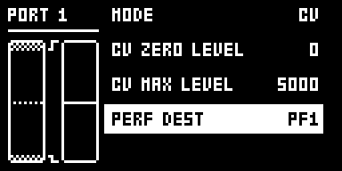

# Ctrl In Perf

An Analog Rytm MKII mod by MrScruff, ported to OS 1.74 by Iced-Cream. Version 0.1.0-experimental, OS 1.74 with core-ar2 0.7.

## Overview

EXP/CV IN 1 and 2 can play a performance macro. In GLOBAL > CONTROL > CONTROL INPUT 1 and 2, CV and EXPR modes get a last row, **PERF DEST**: OFF, or PF1 to PF12. With a destination set, the jack sets that macro as its knob would:

- CV ZERO LEVEL to CV MAX LEVEL (in CV mode) or the learned range (in EXPR mode) maps to 0 to 127; below ZERO reads 0.
- The macro's performance locks follow, and its pad shows the level in PERF mode.
- The jack always wins: while it drives a macro, that macro's knob, pad and CC 35 to 47 are overwritten at the next audio block.
- The value moves in whole steps, and only when the jack moves by more than three quarters of a step, so converter noise never moves it.
- Nothing is sent over MIDI or Overbridge, and neither the kit nor the project is marked edited.

Stock's CONTROL IN 1 MOD and 2 MOD keep playing beside it, from the same jack.

## Controls

| Control | Where | What it does |
| --- | --- | --- |
| PERF DEST | GLOBAL > CONTROL > CONTROL INPUT 1 or 2, the last row in MODE CV or EXPR | The performance macro the jack sets: OFF, or PF1 to PF12. |

PERF DEST is kept for each jack in the active globals slot and saved with the project's globals. A new project, or one saved without the module, reads OFF.

## Usage

Set each jack up in its own CONTROL INPUT menu, then play the jack as you would the macro's knob. Set PERF DEST back to OFF to give the macro back to its knob and pad.

## Quick tutorial

1. Plug a CV source or an expression pedal into EXP/CV IN 1, then open GLOBAL > CONTROL > CONTROL INPUT 1 and set MODE to CV or EXPR (for EXPR, run EXPRESSION LEARN).
2. Set PERF DEST, the last row, to PF1 and leave the menu.
3. Give performance 1 some locks (hold PF1 in PERF mode and turn knobs), then move the jack: the locks follow it, and pad 1 lights with the level in PERF mode.
4. Set PERF DEST back to OFF to give PF1 back to its knob and pad.

Stay within the jack's -5 V to +5 V.

## Compatibility and limitations

- Analog Rytm MKII OS 1.74 only, with core-ar2 0.7 (the Modwerk base).
- Stay within the jack's -5 V to +5 V.
- While a jack drives a macro, that macro's knob, pad and CC 35 to 47 are overwritten at the next audio block, about 0.7 ms later.
- PERF DEST belongs to the globals slot and is saved with the project's globals: a new project, or one saved without the module, reads OFF.
- A jack in OFF mode, or in another module's mode (such as Control In Actions' ACTION), drives no macro. CONTROL IN 1 MOD and 2 MOD still play as stock beside it.

## How it hooks

- `ev_render_in` (core-ar2): each audio block, before stock's performance lock loop, each jack with a PERF DEST and MODE CV or EXPR writes its macro's value.
- `ev_tick` (core-ar2): each jack's MODE, through stock's settings getter, and its PERF DEST, from mod storage, for the audio block.
- Mod storage: `ctrl_in_perf_dest_1` and `ctrl_in_perf_dest_2`, 4 bits each, global scope.
- One site: the CONTROL INPUT page's rebuild, where its mode branches meet (OS 1.74 `0x40131b2e`, 6 bytes), appends PERF DEST in CV and EXPR modes. No other module or the base patches it.

[upstream/README.md](upstream/README.md) lists what changed from the OS 1.73 original.

## Screens and audio

The CONTROL INPUT 1 menu in MODE CV, with PERF DEST at OFF and at PF1 ([capture record](media/capture.json)):

The module makes no sound of its own: it moves performance macros, which change the sound through their locks.

## Tests and measurements

On an Analog Rytm MKII with OS 1.74 (2026-11-08), PERF DEST showed and stepped as described in CV mode, and PF1 was kept over a project save, reload and power cycle. On 2026-11-09 an Analog Four's CV output into EXP/CV IN 1 drove macro 1 to 0, 64 and 127 at 0, 2.5 and 5 V, and a BD TUNE lock on performance 1 followed it. EXPR mode and CONTROL INPUT 2 were not run on the unit. In analog-emu, on CP02 (the Modwerk base for core-ar2 0.7 with this module), PERF DEST shows and steps as described, and a poked CV at ZERO, midway and MAX set macro 1 to 0, 63 and 127. It takes 952 bytes of the shared mod RAM and 672 bytes of flash. [TESTING.md](TESTING.md) has the details and the hardware steps still to run.

## Authorship and licences

MrScruff wrote the original, rytm-mods `0017-ctrl-in-perf`, published in rytm-mods-src with permission. Iced-Cream ported it to OS 1.74 and core-ar2 0.7. irpina wrote Elekloader and core-ar2.

GPL-2.0-only, as rytm-mods-src ([LICENSE](LICENSE)).
