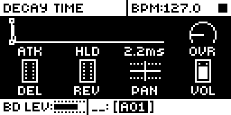
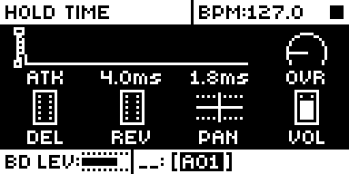

# Improved Envelopes

## Overview

Module for the Analog Rytm MKII, OS 1.74. It reworks the AMP envelope and shows times on every
envelope knob: AMP HLD runs from no hold to AUTO without cutting the attack, ATK, DEC, REL and HLD get
fine steps at short times (0.2 ms up to 5 ms). It installs beside Env Reset Amp (ENV RESET AMP), which
it began from.

## Controls

| Control | Stock | With Envelopes |
|---|---|---|
| AMP HLD | 0 = AUTO, 1..127 = 15.6 ms .. 16 s from the trig, 7.8 ms steps to 250 ms | 0 = no hold, 1..126 = 0.67 ms steps to 10 ms (15), 1.3 ms to 18 ms (21), 3.3 ms to 51 ms (31), 6.7 ms to 151 ms (46), 13 ms to 298 ms (57), then about 6 % a step to 15.5 s, 127 = AUTO. The decay never starts before the attack reaches the top. 0.67 ms is a block, the OS's smallest hold step |
| AMP DEC, FILTER DEC, FILTER REL | stock's curve: 7.9 ms at 1, about 8 ms steps at the low end, 300 ms at 23, 45 s at 127 | 0 instant, 0.2 ms steps to 5 ms (25), 0.5 ms to 15 ms (45), 1 ms to 25 ms (55), 2.5 ms to 50 ms (65), 5 ms to 100 ms (75), 10 ms to 200 ms (85), 25 ms to 300 ms (89), then about 14 % a step to 39.4 s (AMP 126) or 45 s (FILTER 127). AMP DEC 127 stays INF |
| AMP ATK | 0 instant, 1 = 5.3 ms, about 5 ms steps at the low end, 127 = 30 s | 0 instant, 0.2 ms steps to 5 ms (25), 0.5 ms steps to 15 ms (45), then about 10 % a step to 30 s (measured on the unit) |
| FILTER ATK | stock's curve (as AMP's) | the same new curve as AMP ATK, built for the filter's speed measured on the unit (1.00x the OS model); played on the unit in EV14, 7.5..384 ms within 0.3 % of target |
| FUNC + turn on HLD | jumps to AUTO | steps 0, 124.7 ms (a 16th at 120 BPM, HLD 42), AUTO |
| AMP ATK, HLD, DEC, FILTER ATK, DEC, REL | 0..127 | times: an attack's full ramp, a hold's length, a decay's or release's time to -60 dB; AMP DEC 127 = INF |

## Usage

Shape short, clicky transients and tight holds by ear and by number: every envelope knob reads its
time, and the short end has the resolution drums need.

### Quick tutorial

1. Press AMP. Turn DEC down: the knob shows its time to -60 dB, in 0.2 ms steps below 5 ms.
2. Turn HLD to 0: the decay starts as soon as the attack peaks. Turn it up for a hold in ms, or to the top for AUTO (decay from note-off).
3. Hold FUNC and turn HLD: it jumps between 0, 125 ms and AUTO.
4. On the FILTER page, ATK, DEC and REL show their times on the same fine curves.

## How it works

- `src/amp-write.s` takes the amp record write in `amp_env_commands` (0x40109c24, every voice every
  block) and calls `envelopes_voice`, except for a voice whose record repeats the last one it took when
  that one changed nothing (an idle voice, a decay at its end): an idle unit makes no C call there.
- `envelopes_voice` (`src/envelopes.c`) follows each voice's amp level from the records sent (the level
  lives in the voice hardware) and sets the state stock moves to: after a trig 1 (gate, AUTO) or 2
  (timed); in the timed state it ends the hold when the hold time has passed and the level is at the
  top. A one-pole decay is followed slightly fast, so the attack is never thought done early.
- ATK's rates come from `atk_rate` (`tools/atk_table.py`, 16-bit packed): `envelopes_voice` writes
  them into the attack's records (the trig's and each held block's) as they are sent.
- FILTER ATK's rates come from `envelopes_flt_atk` (same script, 32-bit words): a `ptr` site in
  `build.json` points stock's lea at 0x4010d2a8 (the filter attack table, read for the attack record
  and the state counter alike) at it.
- DEC, REL and HLD: `tools/dec_table.py` builds three tables (`envelopes_amp_dec`, `envelopes_flt_dec`,
  `envelopes_hold`, 128 words each) and `ptr` sites in `build.json` point stock's leas at them: the amp
  decay record (0x40109bee), the filter decay and release records (0x4010d342, 0x4010d3b2, 0x4010d3da)
  and the hold compare (0x40109bc2). Stock's tables stay where they are, unread by the OS. The AMP table is built
  for the VCA's 0.918x decay speed, the filter's for 1.00x. The hold counter moves a block (16 ticks,
  0.67 ms) at a time, so every hold is a whole number of blocks.
- Times on the knobs come from core-ar2's `core_params` text for ids 50..58; HLD's FUNC jump is its
  parameter record's jump function (id 57, +0x4c/+0x50).

## Changes to stock flows

| Change | For whom | Why | Neighbouring flows |
| --- | --- | --- | --- |
| AMP HLD 0 is no hold and 127 is AUTO (stock: 0 is AUTO, 127 is 16 s); HLD, ATK, DEC and REL follow new curves. | Anyone with the module installed, including projects made on stock. | A hold that starts at zero and grows with the knob, and resolution at the short end, need the knob's values to mean new times. | Saved sounds and projects play their stored bytes on the new curves (no migration); MIDI CC follows the knob. |
| FUNC + turn on HLD steps 0, 124.7 ms, AUTO (stock: jumps to AUTO). | Anyone who uses the FUNC jump on HLD. | Quick access to the three most used holds. | Other knobs' FUNC jumps are unchanged. |

Saved values keep their bytes and are read the new way: a project made on stock plays HLD 0 as no hold
(was AUTO) and HLD 127 as AUTO (was 16 s), HLD 1..126, DEC and REL on the new curves (the same byte is a different time, mostly shorter at the low end), and AMP and FILTER ATK on the new curve. MIDI CC 79 (HLD) and the ATK CC
follow the knob. There is no migration.

The ramps stay as stock makes them: the attack is a straight line in amplitude, decay and release are
exponential (straight lines in dB). A choke or stop still fades over stock's fixed ~43 ms.

## Compatibility and limitations

It patches the amp record write in `amp_env_commands` (0x40109c24) and points stock's envelope table
reads at its own tables (`ptr` sites, listed under How it works), and subscribes to `ev_tick`. Claims:
FUNC + turn on AMP HLD, the value text of AMP ATK/HLD/DEC and FILTER ATK/DEC/REL,
the AMP page picture and the amp and filter envelope tables. It needs no other module.

- AMP ATK and DEC times are calibrated to one Rytm MKII (EV06, 6 Nov 2026): its VCA ran attacks at
  0.957x and decays at 0.918x the OS's timing model, so the ATK table is built for 0.957 and the
  AMP DEC text is scaled by 0.918. The filter envelope, measured through the self-oscillating
  filter's pitch, runs at the OS model's speed (attack 3 ms..390 ms, decay and release 47 ms..1.2 s
  time constants), so FILTER times need no factor; attacks under 3 ms were not resolved.
  Another unit may differ slightly. HLD is counted by the OS and matched within 2 ms.
- AMP DEC under about 5 ms is blurred by the VCA's own slew (~0.8 ms): DEC 1..8 all measure 1-2 ms.
  FILTER DEC and REL under 15 ms were not resolved on the unit (TESTING.md).
- A module that times a note by AMP DEC's table must read the table address the OS code holds at
  0x40109bf0, not stock's 0x401ee61c: with this module that address points at the new table.
- On stock firmware a sound saved here plays the stock way (HLD 0 = AUTO, the old ATK curve).
- Beside Env Reset Amp: with AMP in a track's ENV RESET, that module replaces the trig's attack
  record with a drop to silence. Envelopes then keeps its HOLD rule from the next block's attack
  record (read in the OS code: [upstream/README.md](upstream/README.md#beside-env-reset-amp)); the
  pair has not yet run together on a unit.
- Unit results: TESTING.md.

## Tests and measurements

Measured on the author's Analog Rytm MKII over USB (builds EV04 to ED02, in combined sets of up to 16
modules), with rytm-emu for the screens ([TESTING.md](TESTING.md)): AMP DEC within 0.7 % of its text
from 5 ms, AMP HLD within 0.1 ms, FILTER ATK within 0.3 %, FILTER DEC and REL 1.5 % (the method's).
Memory: 5,900 bytes of the shared mod area (the base alone leaves 119,004, with this module 113,104).
Load: the amp record write runs every block for every voice; an idle voice makes no C call there.

## Authorship and licences

Nathaniel Pavel (@npp1993): Envelopes, the curves and the knob times. MrScruff and Iced-Cream: Env
Reset Amp (rytm-mods 0015 and its elemod port), whose reading of the amp envelope's commands this
module started from; none of its code is carried. irpina: Elekloader and core-ar2. GPL-2.0-only
([LICENSE](LICENSE)). The source names firmware addresses only; no Elektron firmware is included.

## Screens and audio

Screenshots are rytm-emu captures of build EN01, this package linked alone on the Modwerk base
([media/capture.json](media/capture.json)). No audio preview.

 
