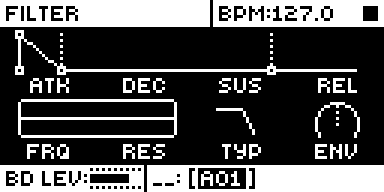
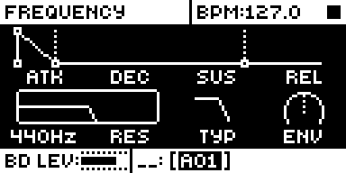
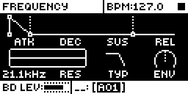
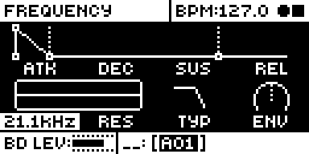
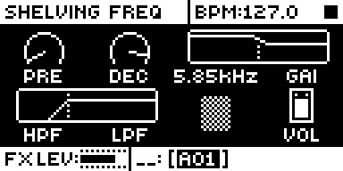
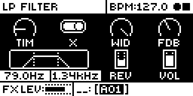

# Filter Hz

## Overview

Frequency knobs show their frequency instead of 0 to 127.

**FILTER FRQ** shows the cutoff to three significant figures: 13.8Hz at 0, 440Hz at 60,
1.11kHz at 76 and 21.1kHz at 127. The scale is one semitone a step,

    f = 440 × 2^((v − 60) / 12)

as MrScruff measured it on the self-oscillating LP2 filter (every fourth value from
16 to 116 within 0.01 semitone of the formula).

**The FX track** (since 1.3.0): DELAY HPF and LPF and REVERB FRQ, HPF and LPF show the
frequency the stock delay and reverb filters use. Filter Hz reads the coefficient the DSP
uses from the running OS and works the frequency out from the filter's equation:

- **HPF** (DELAY and REVERB): the high-pass's −3 dB point, 5.00Hz at 0, 48.1Hz at the default 32,
  463Hz at 64 and 12.0kHz at 127.
- **LPF** (DELAY and REVERB): the low-pass's −3 dB point. The stock filter places it from
  HPF + LPF together, so LPF's frequency moves when HPF does, as the page's graph shows. From
  HPF + LPF of about 113 up the low-pass has no −3 dB point below 24 kHz and LPF reads **OPEN**:
  at the defaults (HPF 32, LPF 96) it is open.
- **REVERB FRQ**: the corner of the reverb's treble shelf (GAI sets the treble's level), its
  −3 dB point with GAI at 0: 974Hz at 0, 5.85kHz at the default 64 and 14.0kHz at 127.

Only the display changes: the filters, their ranges, saved kits and every other parameter are
untouched. A locked value's white box is 33 pixels instead of stock's 27, the same for every
value, so kHz values fit.

Version **1.3.0** for Analog Rytm MKII OS **1.74**, with core-ar2 0.3. It is
[rytm2_mods](https://github.com/Iced-Cream/rytm2_mods)' elemod port of MrScruff's
`0008-filter-hz` from [rytm-mods-src](https://github.com/Iced-Cream/rytm-mods-src),
with his code unchanged; Modwerk's 1.2.1 adds the wider box and 1.3.0 the FX track.
Testing is in [TESTING.md](TESTING.md): 1.2.0 and 1.2.1 on a unit, 1.3.0 in the
emulator so far ([report](evidence/emulator-1.3.0.json)).

## Controls

| Control | Action |
| --- | --- |
| FILTER knob E — FRQ | Unchanged control. Shows the cutoff in Hz or kHz instead of the number. |
| DELAY knobs E and F — HPF, LPF | Unchanged controls. Show the high-pass and low-pass frequencies; LPF reads OPEN when the low-pass is fully open. |
| REVERB knob C — FRQ | Unchanged control. Shows the treble shelf's corner frequency. |
| REVERB knobs E and F — HPF, LPF | Unchanged controls. As the DELAY's: the same filters and scale. |

There are no new controls, menus or settings. To get the stock numbers back, build
without the module.

## Usage

The frequency shows whenever one of these knobs is turned or shown locked, on any track and
in any kit.

### Quick tutorial

1. Use a build containing Filter Hz. Select a track and press FILTER to open its FILTER page.
2. Turn FRQ (knob E). The value popup reads the cutoff in hertz instead of 0 to 127: 440Hz at the stock value 60, one semitone a step.
3. Select the FX track and press SRC for DELAY or SMPL for REVERB. Turn HPF, LPF or the reverb's FRQ: each reads its frequency, and LPF reads OPEN above where the low-pass does anything.

| Stock value | FILTER FRQ | HPF | LPF (HPF at 0) | REVERB FRQ |
| --- | --- | --- | --- | --- |
| 0 | 13.8Hz | 5.00Hz | 5.00Hz | 974Hz |
| 32 | 87.3Hz | 48.1Hz | 48.1Hz | 2.89kHz |
| 64 | 554Hz | 463Hz | 463Hz | 5.85kHz |
| 96 | 3.52kHz | 4.21kHz | 4.57kHz | 9.86kHz |
| 127 | 21.1kHz | 12.0kHz | OPEN | 14.0kHz |

With a trig held, or a scene's pad held in SCENE edit, LPF uses that trig's or scene's HPF lock when it has one, as the stock filter will.

## Compatibility and limitations

Requires core-ar2 0.3 on OS 1.74. Use your own original stock OS 1.74 file.

- Built for OS 1.74 only.
- FILTER FRQ's scale was measured on the self-oscillating LP2 filter; the other filter types are assumed to share it.
- Each value is the knob's value or the held trig's or scene's lock: envelope depth and LFO modulation are not included.
  PERFORMANCE edit keeps stock's signed depth (+5, −2): it is an amount, not a frequency.
- The FX frequencies come from the stock filters' equations and coefficients at 48 kHz, read in the
  code: −3 dB points for HPF and LPF, the shelf's corner for REVERB FRQ. They were not measured with audio.
- LPF needs HPF's value. It reads it as the page's graph does, from the FX page; anywhere the FX page
  is not open (no stock screen does this today) LPF shows the stock number.
- The 0 to 127 numbers are no longer shown for these knobs.

The module patches two sites: eight bytes in `param_value_text` at `0x400a86b4`,
the same site as the original mod, and since 1.2.1 twenty bytes at `0x40037bea` in
stock's knob value drawing, where it pushes a locked value's box. For FRQ and the FX
knobs the box is 33 pixels, x−16..x+16, for every value: one pixel past the widest text
on each side. When HPF and LPF are both locked their boxes meet at one column, which
shows as a one-pixel divider. Every other parameter keeps stock's box. Another
module patching either site cannot be combined with it. A module that gives these
parameters its own text through the base's `core_params` (a replacement reverb, say)
is asked first, so its text wins.

## Tests and measurements

See [TESTING.md](TESTING.md) for the commands and results. In short: 1.2.0's popup
shows Hz on an Analog Rytm MKII in a build of the released core and Filter Hz alone,
and 1.2.1's box was checked on a unit. In rytm-emu 1.3.0 shows the expected text at every
value of the five FX knobs, unlocked and locked, in a 33-pixel box with nothing outside
it; the FILTER page's frames are byte for byte 1.2.1's. Memory: 1,673 bytes (302 in
1.2.1) of the 128 KiB shared mod area. There is no code in the audio, sequencer or tick
paths.

## Authorship and licences

MrScruff: the original mod (rytm-mods `0008-filter-hz`), its design, code and
frequency measurements, published in rytm-mods-src with his permission.
Iced-Cream: the elemod port in rytm2_mods and this module. Nathaniel Pavel (npp1993):
Modwerk's wider lock box (1.2.1) and the FX track's frequencies (1.3.0). irpina:
Elekloader and core-ar2.

Code: [GPL-2.0-only](LICENSE), as rytm-mods-src. `src/filter-hz.s` and
`include/ar2-1.74.inc` are rytm2_mods' `filter-hz/os1.74/filter-hz.s` and
`include/ar2-1.74.inc` at `afd461d` (v1.2), byte for byte, except that 1.2.1 adds
`filter_hz_box` and its two constants to the source and 1.3.0 the FX ids, the call to
`src/fx-hz.c` and the list of ids with the wider box. `src/fx-hz.c` is new in 1.3.0. The
source's site comment still names the OS 1.73 address, as upstream's does. The include and
`fx-hz.c` name firmware routines and tables by address only; no stock table is copied.
The upstream README is in [upstream/README.md](upstream/README.md). Screens show
Elektron's interface solely to document the modification. No Elektron firmware is included.

## Screens and audio

These captures are rytm-emu frames of the released core-ar2 0.3 and Filter Hz on stock
OS 1.74. The first four are the same files on FZ74 (1.2.0), FZ78 (1.2.1) and FZ79 (1.3.0);
the last two are FZ79's. See [capture provenance](media/capture.json) for hashes and
inputs. The mod changes no sound, so there is no audio demonstration.

Press FILTER on any track to open its FILTER page. FRQ is knob E, at the left of the lower row.

Turn FRQ: the popup now reads the cutoff in hertz. At the stock value 60 it shows 440Hz; each step is one semitone.

Turn FRQ fully right and the popup reads 21.1kHz, the open filter; fully left reads 13.8Hz.

Lock FRQ on a trig (hold the trig, turn FRQ): the white box behind the value is wide enough for kHz values.

On the FX track's REVERB page (SMPL), turn FRQ: it reads the corner of the reverb's treble shelf, 5.85kHz at the stock value 64. HPF and LPF read in Hz too.

On the DELAY page, HPF and LPF locked on a held trig: 79.0Hz and 1.34kHz, each in its own wide box. LPF follows the trig's locked HPF, as the stock filter does.
