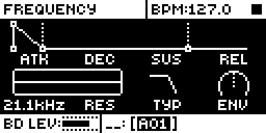

# Filter Hz

## Overview

The FILTER page's FRQ value popup shows the cutoff frequency instead of 0 to 127:
13.8Hz at 0, 440Hz at 60, 1.11kHz at 76 and 21.1kHz at 127, to three significant
figures. The scale is one semitone a step,

    f = 440 × 2^((v − 60) / 12)

as MrScruff measured it on the self-oscillating LP2 filter (every fourth value from
16 to 116 within 0.01 semitone of the formula). Only the text changes: the filter,
its range, saved kits and every other parameter are untouched.

Version **1.2.0** for Analog Rytm MKII OS **1.74**, with core-ar2 0.3. It is
[rytm2_mods](https://github.com/Iced-Cream/rytm2_mods)' elemod port of MrScruff's
`0008-filter-hz` from [rytm-mods-src](https://github.com/Iced-Cream/rytm-mods-src),
with his code unchanged. Hardware testing is recorded in the
[hardware report](evidence/hardware-testing.json) and in [TESTING.md](TESTING.md).
1.2.0 drops the OS 1.73 release (core-ar2 0.1) that 1.0.0 and 1.1.0 had: Modwerk now
supports the Rytm on OS 1.74 only.

## Controls

| Control | Action |
| --- | --- |
| Knob E — FRQ | Unchanged control. Its value popup shows the cutoff in Hz or kHz instead of the number. |

There are no new controls, menus or settings. To get the stock popup back, build
without the module.

## Usage

The popup appears whenever FRQ is turned, on any track and in any kit.

### Quick tutorial

1. Use a build containing Filter Hz. Select a track and press FILTER to open its FILTER page.
2. Turn FRQ (knob E). The value popup reads the cutoff in hertz instead of 0 to 127: 440Hz at the stock value 60, one semitone a step.
3. Turn FRQ fully right for 21.1kHz, the open filter, or fully left for 13.8Hz. RES and every other parameter still show their plain numbers.

| Stock value | Popup |
| --- | --- |
| 0 | 13.8Hz |
| 60 | 440Hz |
| 76 | 1.11kHz |
| 126 | 19.9kHz |
| 127 | 21.1kHz |

## Compatibility and limitations

Requires core-ar2 0.3 on OS 1.74. Use your own original stock OS 1.74 file.

- Built for OS 1.74 only.
- The scale was measured on the self-oscillating LP2 filter; the other filter types are assumed to share it.
- The popup shows the knob's value: envelope depth, LFO modulation and parameter locks applied elsewhere are not included.
- The 0 to 127 number is no longer shown for FRQ, so check the ends (13.8Hz, 21.1kHz) rather than a middle value when comparing with stock.

The module patches one site, eight bytes in `param_value_text` at `0x400a86b4`,
the same site as the original mod. Another module patching those bytes cannot be
combined with it.

## Tests and measurements

See [TESTING.md](TESTING.md) for the commands and results. In short: the popup
shows Hz on an Analog Rytm MKII in a build of the released core and Filter Hz alone,
and beside the other rytm2_mods ports. Modwerk's own build of this folder gives a main OS
byte-identical to that tested build, the core linked with the rytm2_mods v1.2
release. In rytm-emu the popup reads 440Hz and 21.1kHz where stock reads
60 and 127, with every other pixel the same. Memory: 256 bytes
of the 128 KiB shared mod area. There is no code in the audio, sequencer or tick
paths.

## Authorship and licences

MrScruff: the original mod (rytm-mods `0008-filter-hz`), its design, code and
frequency measurements, published in rytm-mods-src with his permission.
Iced-Cream: the elemod port in rytm2_mods and this module. irpina: Elekloader and
core-ar2.

Code: [GPL-2.0-only](LICENSE), as rytm-mods-src. `src/filter-hz.s` and
`include/ar2-1.74.inc` are rytm2_mods' `filter-hz/os1.74/filter-hz.s` and
`include/ar2-1.74.inc` at `afd461d` (v1.2), byte for byte; the source's site comment
still names the OS 1.73 address, as upstream's does. The include names firmware
routines by address only. The upstream README is in
[upstream/README.md](upstream/README.md). Screens show Elektron's interface solely
to document the modification. No Elektron firmware is included.

## Screens and audio

These captures are rytm-emu frames of FZ74, the released core-ar2 0.3 and Filter Hz
on stock OS 1.74. They were first taken on an OS 1.73 build, which gives the same
three screens byte for byte. See [capture provenance](media/capture.json) for hashes and
inputs. The mod changes no sound, so there is no audio demonstration.

Press FILTER on any track to open its FILTER page. FRQ is knob E, at the left of the lower row.

Turn FRQ: the popup now reads the cutoff in hertz. At the stock value 60 it shows 440Hz; each step is one semitone.

Turn FRQ fully right and the popup reads 21.1kHz, the open filter; fully left reads 13.8Hz.
