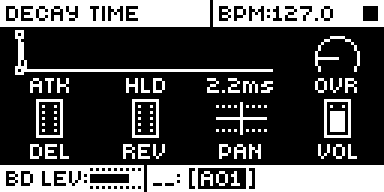
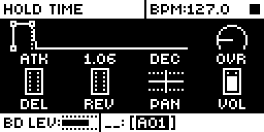
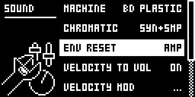

# Improved AMP

## Overview

Module for the Analog Rytm MKII, OS 1.74. It reworks the AMP page: HLD runs from no hold to AUTO
without cutting the attack and reads in steps, ATK, DEC and REL get fine steps at short times (0.2 ms
up to 5 ms) and show times, OVR gets a fine low end, and SOUND SETTINGS > ENV RESET gains AMP and
AMP+FILT, which restart the amp envelope from silence on every sequenced trig without a click. The
FILTER envelope's ATK, DEC and REL get the same curves and times. It is always on: there is no switch.

## Controls

| Control | Stock | With Improved AMP |
|---|---|---|
| AMP HLD | 0 = AUTO, 1..127 = 15.6 ms .. 16 s from the trig, 7.8 ms steps to 250 ms | 0 = no hold, 1..126 = 0.67 ms steps to 10 ms (15), 1.3 ms to 18 ms (21), 3.3 ms to 51 ms (31), 6.7 ms to 151 ms (46), 13 ms to 298 ms (57), then about 6 % a step to 15.5 s, 127 = AUTO. The decay never starts before the attack reaches the top. 0.67 ms is a block, the OS's smallest hold step |
| AMP HLD's number | 0..127 | the hold in steps of the selected track at the current tempo and track speed, three digits: 0.005, 0.080, 1.00, 2.38, 31.2, 124, AUTO. The hold itself stays a fixed time; the number says how many steps that is now |
| AMP DEC, FILTER DEC, FILTER REL | stock's curve: 7.9 ms at 1, about 8 ms steps at the low end, 300 ms at 23, 45 s at 127 | 0 instant, 0.2 ms steps to 5 ms (25), 0.5 ms to 15 ms (45), 1 ms to 25 ms (55), 2.5 ms to 50 ms (65), 5 ms to 100 ms (75), 10 ms to 200 ms (85), 25 ms to 300 ms (89), then about 14 % a step to 39.4 s (AMP 126) or 45 s (FILTER 127). AMP DEC 127 stays INF |
| AMP ATK | 0 instant, 1 = 5.3 ms, about 5 ms steps at the low end, 127 = 30 s | 0 instant, 0.2 ms steps to 5 ms (25), 0.5 ms steps to 15 ms (45), then about 10 % a step to 30 s (measured on the unit) |
| FILTER ATK | stock's curve (as AMP's) | the same new curve as AMP ATK, built for the filter's speed measured on the unit (1.00x the OS model) |
| AMP ATK, DEC, FILTER ATK, DEC, REL's numbers | 0..127 | times: an attack's full ramp, a decay's or release's time to -60 dB; AMP DEC 127 = INF |
| FUNC + turn on HLD | jumps to AUTO | steps 0, HLD 42 (124.7 ms: one step at 120 BPM, 1x) and AUTO |
| AMP OVR | the overdrive's control rises evenly with the knob, so most of the distortion arrives in the first few values | the same range, 0 and 127 as stock, spread so the distortion rises evenly: stock's first step takes about eight knob values, stock's 12 sits at 64. The number stays 0..127 |
| SOUND SETTINGS > ENV RESET | OFF, FILTER | OFF, AMP, FILTER, AMP+FILT. With AMP in the value, the amp envelope restarts from silence on every sequenced trig and retrig: the voice fades out just before the trig |

## Usage

Shape short, clicky transients and tight holds by ear and by number, dial in a little overdrive, and
let a long sound restart cleanly on every step.

### Quick tutorial

1. Press AMP. Turn DEC down: the knob shows its time to -60 dB, in 0.2 ms steps below 5 ms.
2. Turn HLD to 0: the decay starts as soon as the attack peaks. Turn it up: the knob shows the hold in steps at the current tempo (1.00 is one step). At the top it reads AUTO (decay from note-off).
3. Hold FUNC and turn HLD: it jumps between 0, 124.7 ms (one step at 120 BPM) and AUTO.
4. Turn OVR up from 0: the first values add drive gently.
5. On an analog BD sound set ATK to about 40 and DEC to 100 or more, and place trigs on every second step. Press PLAY: the attack is heard on the first trig only.
6. Open the SOUND menu (FUNC + MUTE) > SOUND SETTINGS and set ENV RESET to AMP: every trig now fades in at the ATK rate, without a click.

## How it works

- `src/pre-fade.s` and `src/pre-fade.c` subscribe to the base's amp record hook `ev_amp_record`
  (`amp_env_commands` 0x40109c24, every voice every block) at order 20. Once a block the scan looks at
  each track's queued trigs (stock holds up to three a track: with swing or micro timing a trig is
  queued while the one before still waits) and running retrig series; a voice whose next trig is at most 10 blocks
  (6.7 ms) away, on a sound with AMP in ENV RESET, gets a fade record in place of stock's: a ramp at a
  fixed rate from the current level to silence, held there until the trig. Stock's own attack, which
  ramps from the current level, then starts from silence on time.
- A queued trig is judged by the sound it will play: its sound lock's pool sound, or its kit's sound
  for the track. A trig of the kit the track's sound already came from loads no sound in stock, so it
  is judged by the track's sound as it stands, an ENV RESET edit included. A retrig keeps the sound of the trig that started it. Mutes and solo are read as stock
  reads them when a trig fires. Stock fires one queued event a track a block, the lowest slot of those
  due first, and steps a retrig series one tick a block, a block later when a queued event took the
  track's turn; the scan counts the blocks the same way.
- A retrig is faded for only while its series lasts: a trig's retrig length is counted down as stock
  counts it, and the track's next trig that plays a note ends the series as it does in stock. The hit
  that would fall on the series' end never plays, so the last hit keeps its tail.
- `src/amp-write.s` subscribes to the same hook at order 50 and calls `improved_amp_voice`, except for
  a voice whose record repeats the last one it took when that one changed nothing (an idle voice, a
  decay at its end): an idle unit makes no C call there. A fade record passes through unchanged.
- `improved_amp_voice` (`src/improved-amp.c`) follows each voice's amp level from the records sent (the
  level lives in the voice hardware) and sets the state stock moves to: after a trig 1 (gate, AUTO) or
  2 (timed); in the timed state it ends the hold when the hold time has passed and the level is at the
  top. A one-pole decay is followed slightly fast, so the attack is never thought done early.
- ATK's rates come from `atk_rate` (`tools/atk_table.py`, 16-bit packed): `improved_amp_voice` writes
  them into the attack's records (the trig's and each held block's) as they are sent.
- FILTER ATK's rates come from `improved_amp_flt_atk` (same script, 32-bit words): a `ptr` site in
  `build.json` points stock's lea at 0x4010d2a8 (the filter attack table, read for the attack record
  and the state counter alike) at it.
- DEC, REL and HLD: `tools/dec_table.py` builds three tables (`improved_amp_amp_dec`,
  `improved_amp_flt_dec`, `improved_amp_hold`, 128 words each) and `ptr` sites point stock's leas at
  them: the amp decay record (0x40109bee), the filter decay and release records (0x4010d342,
  0x4010d3b2, 0x4010d3da) and the hold compare (0x40109bc2). Stock's tables stay where they are,
  unread by the OS. The AMP table is built for the VCA's 0.918x decay speed, the filter's for 1.00x.
  The hold counter moves a block (16 ticks, 0.67 ms) at a time, so every hold is a whole number of
  blocks.
- OVR: `src/ovr.s` replaces stock's reader of the knob's live value (0x40109b14, once a voice a block)
  and looks the overdrive's control up in a 129-point table, interpolated between points so LFOs and
  performance moves stay smooth. `tools/ovr_table.py` builds the table from a sweep of the stage's
  distortion measured on the unit: knob k gives the stock value whose distortion rise is k/127 of the
  whole.
- ENV RESET's values: two byte sites, as in Env Reset Amp. 0x400bcf8a lets the setter keep the amp
  bit, 0x400ef8d6 makes the menu step by one. The setting is the sound's byte, saved with it.
- The knob texts come from core-ar2's `core_params` text for ids 50..58. HLD's reads the tempo, the
  pattern's or track's speed and the selected track each time it is drawn. HLD's FUNC jump is its
  parameter record's jump function (id 57, +0x4c/+0x50).

## Changes to stock flows

| Change | For whom | Why | Neighbouring flows |
| --- | --- | --- | --- |
| AMP HLD 0 is no hold and 127 is AUTO (stock: 0 is AUTO, 127 is 16 s); HLD, ATK, DEC and REL follow new curves. | Anyone with the module installed, including projects made on stock. | A hold that starts at zero and grows with the knob, and resolution at the short end, need the knob's values to mean new times. | Saved sounds and projects play their stored bytes on the new curves (no migration); MIDI CC follows the knob. |
| AMP OVR's values 1..126 give less drive than the same number on stock; 0 and 127 are unchanged. | Anyone with the module installed, including projects made on stock. | Stock packs most of the overdrive's range into the first few values. | Saved sounds keep their OVR byte and play it on the new curve; LFO, velocity and performance depths to OVR move along the same curve. |
| FUNC + turn on HLD steps 0, 124.7 ms, AUTO (stock: jumps to AUTO). | Anyone who uses the FUNC jump on HLD. | Quick access to the three most used holds. | Other knobs' FUNC jumps are unchanged. |
| ENV RESET steps OFF, AMP, FILTER, AMP+FILT (stock: OFF, FILTER). | Anyone who opens SOUND SETTINGS. | The amp envelope's restart is a setting of the sound, beside the filter's. | OFF and FILTER behave as stock. With AMP, a sounding voice is silent for up to about 7 ms before each sequenced trig. |

The module is always on. Saved values keep their bytes and are read the new way: a project made on
stock plays HLD 0 as no hold (was AUTO) and HLD 127 as AUTO (was 16 s), HLD 1..126, ATK, DEC and REL on
the new curves (the same byte is a different time, mostly shorter at the low end) and OVR on its new
curve. MIDI CC follows the knobs. There is no migration: removing the module plays every project as
before.

The ramps stay as stock makes them: the attack is a straight line in amplitude, decay and release are
exponential (straight lines in dB). A choke or stop still fades over stock's fixed ~43 ms.

## Compatibility and limitations

It needs Modwerk's Rytm base with the amp record hook. It takes the amp record through `ev_amp_record`,
points stock's envelope table reads at its own tables, replaces the OVR reader and two bytes of the ENV
RESET menu (sites in [upstream/README.md](upstream/README.md)), and subscribes to `ev_tick`. Claims:
FUNC + turn on AMP HLD, the value text of AMP ATK/HLD/DEC and FILTER ATK/DEC/REL, the AMP page picture,
SOUND SETTINGS ENV RESET's values, the amp and filter envelope tables and the overdrive's control. It
needs no other module. It cannot be installed with Env Reset Amp, whose ENV RESET values it carries:
the configurator offers one or the other.

- ENV RESET AMP acts on trigs the Rytm schedules itself. Pad hits, MIDI notes and the first trig
  after PLAY play as stock: the envelope carries on from its level.
- With AMP set, a sounding voice falls silent up to about 7 ms before each sequenced trig; a retrig
  roll faster than twice that gets half its spacing to sound.
- A retrig hit that lands less than 7 ms before the track's next trig starts and is faded out again
  at once.
- A lock trig without a note that fires within the fade before a trig makes stock load the kit's
  sound again on that trig. If the track's ENV RESET was changed since, the trig is judged by the
  changed value: its fade can be missing or late (read in the code, not tested).
- A pad roll (RTRG held) ends the moment the pad is let go, which nothing announces: let go within
  the fade before the roll's next hit, the last hit's tail is cut short.
- On a pattern change stock clears trigs it had queued past the change. One cleared within the fade
  before it leaves a dip of at most 7 ms where no trig follows (read in the code in part only).
- On external MIDI clock, a clock tick that arrives late shortens the next fade by as much; after a
  tick 6 ms or more late, the next trig plays as stock. A retrig series' last hit that falls within a
  block (0.67 ms) of the series' end can be judged wrong either way there: faded for and not played,
  or played without a fade.
- The HLD number counts steps of the selected track at the tempo when it is drawn. The hold is a fixed
  time: after a tempo or speed change the same hold reads as a different number of steps.
- AMP ATK and DEC times are calibrated to one Rytm MKII (EV06, 6 Nov 2026): its VCA ran attacks at
  0.957x and decays at 0.918x the OS's timing model, so the ATK table is built for 0.957 and the
  AMP DEC text is scaled by 0.918. The filter envelope, measured through the self-oscillating
  filter's pitch, runs at the OS model's speed, so FILTER times need no factor; attacks under 3 ms
  were not resolved. Another unit may differ slightly. HLD is counted by the OS and matched within 2 ms.
- AMP DEC under about 5 ms is blurred by the VCA's own slew (~0.8 ms): DEC 1..8 all measure 1-2 ms.
  FILTER DEC and REL under 15 ms were not resolved on the unit (TESTING.md).
- OVR's curve comes from one unit's overdrive, measured with one sound. On the unit its level rise
  follows the design (8 gives stock's 1, 64 stock's 12, the ends unchanged); it has not been judged by
  ear yet (TESTING.md).
- A module that times a note by AMP DEC's table must read the table address the OS code holds at
  0x40109bf0, not stock's 0x401ee61c: with this module that address points at the new table.
- On stock firmware a sound saved here plays the stock way: HLD 0 = AUTO, the old curves, and ENV
  RESET's amp bit ignored.
- Unit results: TESTING.md.

## Tests and measurements

The envelope curves and the pre-fade were measured on the author's Analog Rytm MKII over USB in earlier
builds (EV04 to EN05), with rytm-emu for the screens ([TESTING.md](TESTING.md)): AMP DEC within 0.7 %
of its text from 5 ms, AMP HLD within 0.1 ms, FILTER ATK within 0.3 %, FILTER DEC and REL 1.5 % (the
method's); with ENV RESET AMP every one of 493 sequenced hits and retrigs fell to silence before its
trig. This version ran on the same unit on 9 and 10 November 2026 under the author's automated USB test
rig (image IL02: this source on a development base with a USB test link, loaded to RAM), 25 cases: the
screens with HLD in steps at three tempos and track speeds, lengths by DEC, HLD and AUTO, OVR's level
curve and the FILTER times beside the same base without the module, and ENV RESET AMP's fade before
sequenced trigs, retrigs, swung, micro-timed and sound-locked trigs, with none for MIDI notes, muted
trigs, lock trigs and trigs whose condition fails. Not run on a unit: this package's own image, pads, a
power cycle, a boot from flash, an external MIDI clock, a pattern change inside a fade.
Memory: 7,868 bytes of the shared mod area (the plain base alone leaves 119,004, with this module 111,136).
Load: the amp record entries run every block for every voice; an idle voice makes no C call there, and
the trig scan runs once a block.

## Authorship and licences

Nathaniel Pavel (@npp1993): Improved AMP, its curves, knob texts, OVR curve and the pre-fade. MrScruff:
the original ENV RESET AMP mod (rytm-mods 0015-env-reset-amp), whose design and ENV RESET sites this
module carries. Iced-Cream: Env Reset Amp, its elemod port (rytm2_mods), which this module started
from. irpina: Elekloader and core-ar2. GPL-2.0-only ([LICENSE](LICENSE)). The source names firmware
addresses only; no Elektron firmware is included.

## Screens and audio

Screenshots are rytm-emu captures of build IA08, this package linked alone on the Modwerk base
([media/capture.json](media/capture.json)). No audio preview.

  
