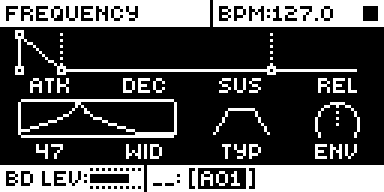
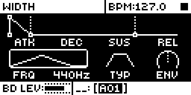
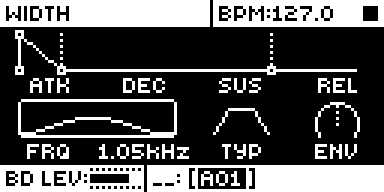

# Improved FLTR

## Overview

Improved FLTR adds a base-width type to the FILTER page: the Rytm's own analog filter as a high-pass and a low-pass in one. FRQ sets the high-pass edge (the base) and the knob next to it, which reads **WID** in this type, sets how far above it the low-pass edge sits. It is all analog: the voice's 2-pole multimode filter runs as a band-pass whose resonance goes below stock's RES 0, which widens the band (measured on a unit). The two edges can sit from one semitone up to five octaves apart, with 6 dB/oct slopes on each side.

TYP turns past PK to **BW**. FRQ, its locks and an LFO on it move the whole band; an LFO or lock on WID changes the width; the filter envelope moves the whole band. The FILTER graph draws the band as the filter plays it.

Version **0.1.0-experimental** for Analog Rytm MKII OS **1.74**, on Modwerk's base (core-ar2 0.7). Written by Nathaniel Pavel.

## Controls

| Control | Action |
| --- | --- |
| FILTER TYP | Past PK: BW. The knob shows a band picture. |
| FILTER FRQ | In BW: the high-pass edge (the base). Its scale is stock's: a semitone a step, 440 Hz at 60 (Filter Hz shows it in hertz). |
| FILTER WID (RES's knob) | In BW: the width, 0 to 127 for 0 to 59.5 semitones above FRQ; it shows where the low-pass edge is, in hertz. The knob's label and name read WID and Width while the selected sound is BW, RES and Resonance otherwise. |
| FILTER ENV | Moves the analog cutoff, the band's centre: both edges move together and the width stays. |
| The FILTER graph | In BW: the band's response as measured, both edges, the slopes and the level, 4 dB a row with +15 dB at the top. |

The other FILTER knobs and every other type are stock's. An LFO, performance or lock on FRQ moves the base (so the band), on RES the width.

## Usage

Choose BW on a track's FILTER page, then set the base with FRQ and the width with WID.

### Quick tutorial

1. Use a build containing Improved FLTR. On BD, press FILTER and turn TYP past PK: it reads BW, the knob shows a band, RES's knob now reads WID and the graph draws the band.
2. Turn FRQ to about 220 Hz and WID up: the band opens upward from 220 Hz; WID shows its top edge in hertz.
3. Turn FRQ: the whole band moves and keeps its width.
4. Add filter envelope with ENV: the band sweeps on each hit.
5. Lock FRQ or WID on trigs, or point an LFO at either, as on any type.

## How it works

Read in OS 1.74 and measured on a unit (the study's notes are private; the numbers that matter are here):

- **One filter, one cutoff.** Each voice has one resonant 2-pole filter, one cutoff word, one resonance word and a 3-bit type switch (the filter routine at 0x4010d0fc writes them each audio block). Two independent analog cutoffs are not possible on one voice.
- **Below RES 0.** The resonance word is signed: stock sends 0x0000..0x7f00, and words below 0 damp the filter further. On a unit, band-pass Q went from 0.62 at RES 0 to 0.24 at 0xf000 and 0.095 at 0xe000, the same at 220 Hz, 880 Hz and 3.5 kHz. A 2-pole band-pass with Q under 0.5 is a 1-pole high-pass and a 1-pole low-pass in series, with -3 dB edges at centre x (sqrt(1 + 1/4Q^2) -/+ 1/2Q).
- **Edges to words.** For edges w semitones apart the filter's cutoff is their midpoint (their geometric mean in hertz) and its Q is 1 / (2^(w/24) - 2^(-w/24)). `tools/width_table.py` turns the measured Q curve (`tools/calibration.json`) into the resonance word for each width (`src/width-table.h`). The filter routine's three stores are taken by one site (`src/band.s`): stock's types pass as stock's, the band types get the midpoint, the table's word and BP's switch code.
- **The page.** TYP's maximum in stock's id table is opened from 6 to 7, so stock's turn, setter, locks and MIDI take BW. Stock's eighth TYP picture, blank in OS 1.74, points at the band picture. RES's two names in the id table point at the module's, which follow the selected sound's TYP (WID / Width in BW). The FILTER graph draws BW itself: the measured gain at the band's width less 10 log10(1 + (Q u)^2), u = 2^(d/12) - 2^(-d/12) for d semitones from the centre, with the tables `tools/width_table.py` writes. TYP's and RES's texts come through the core's `core_params`.

## Changes to stock flows

- **TYP's list gains BW after PK.** Stock's seven types are unchanged; BW only acts when chosen. Considered instead: one type with a mode in mod storage, which cannot be locked per trig and needs a sound-load hook the plain base lacks; a second, unlinked type (RES the low-pass cutoff) and a tap of RES between the two, both dropped as harder to use.
- **In BW, FRQ and RES mean the base and the width,** and RES's knob reads WID (its label and its name in the header and in lists that name parameters, such as performance and scene assignments) while the selected sound is BW. Every other type is stock's.
- Checked beside: Filter Hz (FRQ in hertz), Improved AMP (FILTER envelope times), stock's locks on FRQ, RES and TYP.

## Compatibility and limitations

Requires Modwerk's base (core-ar2 0.7) on OS 1.74. Use your own original stock OS 1.74 file.

- **Without the module** a kit with a band type plays it as PK (stock's own clamp) and draws a blank TYP picture; nothing else changes. Stock's MIDI CC 76 already stores values 7 to 127 unclamped, so such kits can come from stock too; the module treats only 7 as BW.
- **Widths.** 1 semitone to 5 octaves. Narrow bands are resonant (Q 17 at one semitone); past about 4.5 octaves the band flattens and drops in level.
- **Level.** A wider band is quieter: about 7 dB down at 4.5 octaves, 14 dB at 7 octaves. Set VOL by ear; there is no make-up gain.
- **WID's name** follows the selected sound's TYP: on the FILTER page as the page shows it (a held trig's TYP lock included), elsewhere as edited. Lists that name other tracks' parameters (performance and scene assignments) name every RES as Width while the selected sound is BW.
- **Kits from test builds** with TYP 8 (an earlier two-type layout) play as PK, show the band picture and an empty TYP text.
- **Accuracy.** On a unit the edges landed within about 7 % of FRQ and RES (two runs; the analog filter itself moves a few percent from run to run), a 5-octave band's low edge up to 18 % high.
- **Slopes.** 6 dB/oct each side, the analog filter's own: a 2-pole band-pass split in two.
- **The graph** is drawn from the calibration, not measured live: the analog filter moves a few percent from run to run. Its top is +15 dB: bands narrower than about 3 semitones peak higher (up to +26 dB at one semitone) and are drawn clipped there.
- **RES carries over** when TYP moves between a band type and a stock type: its value keeps its number and takes the new type's meaning. A BW band's WID read as stock resonance can self-oscillate loudly on LP2..PK (WID above about 80); a stock RES 0 read as WID is the narrowest, most resonant band. Set RES after changing TYP.
- **At the top.** The analog cutoff stops at stock's top (FRQ 127, 21.1 kHz): a wide band with a high base then starts below FRQ. RES shows the low-pass edge as played, OPEN above 21.1 kHz.
- **TYP 8 to 127** (from MIDI CC 76 only) play and read as PK, as on stock, but show the band picture: stock draws its eighth picture for any type above 6.
- **A locked RES** shows its hertz in stock's 27-pixel lock box, which kHz values overrun (Filter Hz widens the box for FRQ only).

## Tests and measurements

See [TESTING.md](TESTING.md). Memory: 3,652 bytes (3,628 of code, tables and names, 24 of variables; the graph's shape tables are most of it). Audio: a few instructions a voice a block in the filter routine.

## Authorship and licences

Nathaniel Pavel wrote it; the core is irpina's Elekloader core-ar2. GPL-3.0-or-later, see [LICENSE](LICENSE). No firmware, extracted routines or tables are included: the patch sites are addresses, lengths and SHA-256s, and the band picture is original.

## Screens and audio

These captures are from rytm-emu running Modwerk's base for core-ar2 0.7 and Improved FLTR alone, from stock OS 1.74 ([capture provenance](media/capture.json)). The emulator's analog voices are stubbed, so the screens show the controls, not the sound; FRQ shows stock's number because Filter Hz is not in this build.

BW with FRQ turned down to 47 (about 208 Hz) and WID at 0: a narrow band at the base. RES's knob reads WID.

WID turned up: the band opens upward, and WID shows its top edge, 440 Hz.

Further up: a wider band, drawn lower because the analog filter's band-pass loses level as it widens; top edge at 1.05 kHz.
