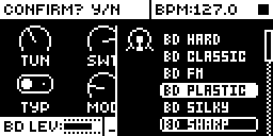
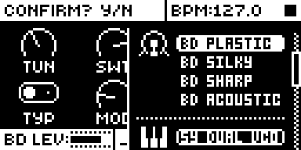
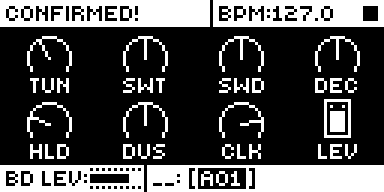

# Improved Machine Browser

An Analog Rytm MKII mod by Nathaniel Pavel (@npp1993). Version 0.1.0-experimental, OS 1.74 with core-ar2 0.7.

## Overview

Browse the machine list without changing the track's sound, and jump between its sections. On stock, every machine the list's outline passes loads at once: the voice and the SRC page change while you scroll, and NO puts the old sound back. Here:

- **UP**, **DOWN** and the knobs **A-H** move the outline only. The header asks Confirm? Y/N, as on stock, but the track keeps its machine and its SRC page.
- **FUNC + DOWN** jumps to the first machine of the next section: the list's own groups, drawn with a dotted line and an icon between them (BD, SY, SD, UT and so on).
- **FUNC + UP** jumps to the first machine of the current section, or of the section above when the outline is already there.
- **YES** loads the outlined machine, and stock confirms and closes the list. **NO** closes it with nothing changed.

Stock has no section jump: FUNC + UP or DOWN moves one machine, as UP or DOWN alone does.

## Controls

| Gesture | What it does |
| --- | --- |
| SRC pressed twice, or FUNC + SRC | Opens the machine list, as on stock. |
| UP / DOWN | Outline one machine up or down. Nothing loads. Held, it repeats. |
| Any knob A-H | Outline one machine per detent, right for down, left for up. |
| FUNC + DOWN | First machine of the next section. In the last section it stays. |
| FUNC + UP | First machine of this section; pressed there, the first of the section above. |
| FUNC + knob A-H | As FUNC + DOWN (right) or FUNC + UP (left). |
| YES | Loads the outlined machine; stock shows Confirmed! and closes the list. |
| NO | Closes the list; the track keeps the machine it had. |

There are no settings, no pages and no stored data.

## Usage

Open the list, find the machine with the arrows or a knob, using FUNC to skip whole sections, and press YES. To compare a few machines by ear, load one with YES, play, and open the list again.

### Quick tutorial

1. Press SRC twice to open the machine list on the BD track.
2. Press DOWN a few times: the outline moves and the header asks Confirm? Y/N, but the BD keeps its machine and its SRC page.
3. Press FUNC + DOWN: the outline jumps to SY DUAL VCO, the first machine of the next section. FUNC + UP goes back to the top of the BD section.
4. Press YES: the outlined machine loads and the list closes. Open it again, scroll and press NO: nothing changed.

## Changes to stock flows

| Change | For whom | Why | Neighbouring flows |
| --- | --- | --- | --- |
| In the machine list, UP, DOWN and the knobs A-H no longer load the machine they reach; YES does. Tapping the track's pad there plays the machine the track has, not the outlined one. | Anyone with the module installed; leave it out of the set to have stock's list. | The purpose of the module: scrolling past machines changed the sound being played, which stock only undoes with NO. A preview on the pad was considered and left out at the author's choice, so nothing loads before YES. | NO, the pads, the other keys in the list and the SRC page's own UP, DOWN and knobs stay stock's. Checked in rytm-emu: NO after scrolling leaves the machine; YES with the outline on the loaded machine only confirms. |
| FUNC + UP and FUNC + DOWN in the machine list jump between sections instead of moving one machine. | The same. | Stock's FUNC + UP or DOWN there does the same as UP or DOWN, so the gesture was free; the Sound browser's FUNC + UP or DOWN scrolls faster, which a section jump matches. | FUNC + SRC (opening the list) and FUNC with the other keys stay stock's. |

## Compatibility and limitations

It subscribes to the core's `ev_key` and `ev_enc` and acts only while the machine list is the screen on top (popups above it pass these keys on, as on stock). It patches no stock code and needs nothing else from the base. Claims `ui:UP and DOWN in the machine list`, `ui:FUNC + UP and FUNC + DOWN in the machine list`, `ui:knobs A-H in the machine list` and `ui:YES in the machine list`.

The outline moves through stock's own routine, and YES loads with the same call stock's step makes, so a machine loads exactly as it does on stock, its MIDI out included. The sections are the list's own dotted lines. On the Modwerk base, whose machine list sections file a mod machine under its section, a mod machine is reached with the others of its section; on a build without them it sits above BD. A track's list ends with machines for other tracks' voices and those all tracks share (UT, DISABLE); each of their sections is a jump stop too.

## Tests and measurements

On the author's Analog Rytm MKII (build MBC3, beside sixteen other modules), and in rytm-emu on OS 1.74, alone on the Modwerk base and beside the same set ([TESTING.md](TESTING.md)). Memory: 1,072 bytes of code in the 128 KiB shared mod area, no stored data. Load: UI only, on key and knob events while the machine list is open; nothing runs in the audio path.

## Authorship and licences

Original code by Nathaniel Pavel (@npp1993), GPL-3.0-or-later ([LICENSE](LICENSE)). The OS 1.74 addresses were read by the author from their own stock firmware; the build carries addresses only, no stock bytes. No Elektron firmware is included.

## Screens and audio

Screenshots are rytm-emu captures of build MB03 ([media/capture.json](media/capture.json)). No audio preview.

 

