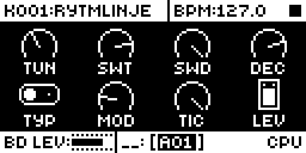

# Improved Performance

An Analog Rytm MKII mod by Nathaniel Pavel (@npp1993). Version 0.1.0-experimental, for OS 1.74.

## Overview

Stock computes nearly everything in every audio block, whether it is used or not: all eight sample voices, every send, the delay and the reverb, every modulation pass. Improved Performance tests, block by block, whether a piece of that work can change anything, and leaves it out when it cannot. The output is stock's bit for bit, with one exception far below hearing ([How it works](#how-it-works)). With the time saved the unit redraws and reads its keys sooner, and a busy pattern keeps further from dropouts.

On the author's unit, one 12-track pattern in a set of 17 other modules used 85.4 % of the audio block without it and 72.1 % with it; the longest block fell from 99.4 % to 89.8 %, and the screen's redraw step from 19.1 ms to 8.6 ms ([Tests and measurements](#tests-and-measurements)).

`CPU` appears in the lower right corner of the screen while the audio load is close to its limit, and `OVR` while it is over.

## Controls

None. There is nothing to switch on or set.

| What you see | Meaning |
| --- | --- |
| `CPU` in the lower right corner, in the bottom status bar | The audio load averaged 88 % or more over the last half second, or several blocks reached 97 %: close to dropouts. |
| `OVR` in the same place | The load averaged 92 % or more, or several blocks used their whole period: the screen and keys slow down, and audio can drop out. |

Both are written in the bar's own font, on its text line. They show on every screen that has the bottom status bar, and not in menus, lists or browsers. The corner is theirs: what else stands there (a voice machine's type name, Loop Sync's SYNC) is covered for as long as the word shows. The mark stays a second and a half after its cause has gone, so it does not flicker.

## Usage

Add it to a set that is short of CPU: big patterns, many modules, a screen that lags while the pattern plays.

### Quick tutorial

1. Add it to your set and send the OS: there is nothing to switch on.
2. Play as usual. The sound is unchanged; under load the screen and keys answer sooner.
3. If CPU shows in the lower right corner, the audio load is close to its limit; OVR means it is over. Mute tracks, lower sends or take a module out of the set until it goes.

## How it works

All of it sits in the audio interrupt, which runs once for every 32 samples. Each part stands in front of a piece of stock's work, tests in that block whether the work can change anything, and either jumps it or hands over to stock.

| Part | Left out when | Source |
| --- | --- | --- |
| Sample voices | a voice plays nothing and its filters hold zero: no interpolation, no decimation, no transfer of silence | `src/sample-voices.s` |
| Send mixer | a voice's send gains are zero and not moving | `src/effects.s` |
| Delay, reverb | their input, state and memory windows are zero | `src/effects.s` |
| Slide pass, velocity and pressure lists, performance matrix | no slide runs, a list's value or depths are zero, no performance pad is held | `src/modulation.s` |
| Parameter smoothing | a track's 42 parameters have come to rest on their targets (a changed target is seen in the same block) | `src/engine.s` |
| Compressor control words | the compressor's eight parameters are the same as in the last block | `src/engine.s` |
| USB audio input | nothing streams: its two buffers are not cleared again, and the voice mix runs without that term | `src/engine.s` |

Where a part runs its own loop in place of stock's (the smoother, the voice mix, the mixer over the busy sends), the loop does stock's arithmetic in stock's order, so the results are the same bit for bit. Each source file's header says what its part assumes and why the result is the same.

**The one place that is not bit-identical.** Stock's delay and reverb never come back to exact silence after use: their filters settle on a residue of a few hundred in 2^31. Once one of them has had no input for the whole length of its memory (the delay about 11 seconds, the reverb about a third of a second) and everything in it lies below -114 dBFS, this module rests it and its output is exact zero, where stock goes on computing that residue. The first input ends the rest and stock runs on what it left. Before their first use after power-on, nothing differs at all.

The CPU mark reads the core's own figure for each audio block (`core_audio_load`), patches nothing and draws with stock's own text routine.

## Changes to stock flows

- **`CPU` and `OVR`** are written into the lower right corner of the bottom status bar while the load is high; the bar's right end, columns 96 to 127, is cleared under them. In stock that stretch is empty. On a voice machine's page the base writes the voice type there (808, 909 for Analog BD), and other modules put marks there (Loop Sync's SYNC on the SAMPLE page): the word covers them while the load is high, and they come back when it has gone, because the warning matters more. On a screen without the bottom bar nothing is drawn. It cannot be turned off. It is there because a module set can now bring the unit to its limit, and stock gives no sign of that before audio drops out.
- Nothing else changes: no page, key, menu, save or load behaves differently.

## Compatibility and limitations

- Analog Rytm MKII, OS 1.74 only.
- It patches 18 places in the audio interrupt (`build.json`). No other module in the library patches those bytes. Improved SMPL and Audio In Routing have sites of their own in two of the same routines (the sample engine, the delay's entry); all the tests on the unit ran beside both.
- The after-use rest of the delay and the reverb is not bit-identical to stock (above).
- The savings depend on the project. A sample voice that plays, a send that is up, a modulation that is in use cost what they cost in stock. On the author's project the reverb never rested and the delay only with the sequencer stopped.
- Tested on one unit, with one project. Not tested: a project load while sound rings, a long USB audio stream, a second unit.

## Tests and measurements

Full record: [TESTING.md](TESTING.md).

- **rytm-emu:** the module alone on the release base, and beside 17 other modules, against the same image with its patches put back to stock: parameters, smoother states, control frames, voice records and the audio output were identical in every one of about 69,500 blocks. A kit load while the reverb rang gave identical output too.
- **On the author's unit (OS 1.74):** self-checking builds, in which stock does all the work and every skip is compared with it, counted 0 differences for every part. Audio load, the unit's own meter, the author's pattern in a set of 17 other modules: 85.4 % without, 72.1 % with; longest block 99.4 % and 89.8 %.
- **Memory:** about 4 KB.

## Screens and audio

Both from rytm-emu, from a build of this source with the mark's thresholds lowered so that it shows there ([capture record](media/capture.json)). No audio example: the sound is stock's.

## Authorship and licences

Nathaniel Pavel (@npp1993): the mod, its design and code. GPL-3.0-or-later ([LICENSE](LICENSE)). It links with core-ar2 by irpina (Elekloader), whose audio load figure the CPU mark reads.

The source names firmware addresses only; the patch preconditions in `build.json` are addresses, lengths and SHA-256s.
