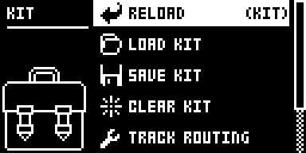
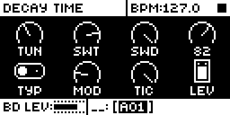
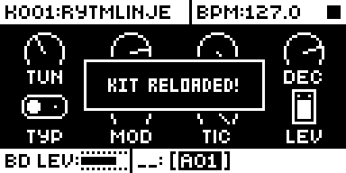
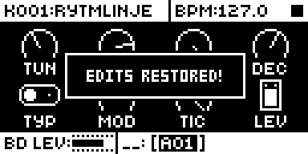
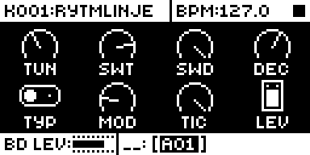

# Kit A/B

## Overview

Kit A/B turns the single-kit reload into an A/B between the kit as edited and the kit as saved.

- The first NO + PLAY MODE (or RELOAD in the KIT menu) keeps your edits in a stash and loads the saved kit, under stock's popup: KIT 1 RELOADED!.
- The next press copies the stash back and applies it as stock's reload applies a kit: EDITS RESTORED!.
- Editing while the original plays ends the A/B. The next press keeps those edits instead, drops the stashed ones and reloads as a first press does. The same happens after a change of kit or any other reload; the module notices by a checksum of the working kit taken after each press.
- A press on a kit with no edits is a plain reload and arms nothing.

Reloading every kit stays stock. The stash is one kit (0x9e3 bytes, about 2.5 KB) taken from the firmware's heap on the first press and kept; if that fails, the press is a plain reload.

Version **1.0.0** for Analog Rytm MKII OS **1.74**, on Modwerk's base (core-ar2 0.7). It is
[rytm2_mods](https://github.com/Iced-Cream/rytm2_mods)' elemod port of MrScruff's
`0010-kit-ab` from [rytm-mods-src](https://github.com/Iced-Cream/rytm-mods-src),
with his code unchanged.

## Controls

| Control | Action |
| --- | --- |
| NO + PLAY MODE, and KIT menu > RELOAD | First press: stash the edited kit and reload the saved one (KIT 1 RELOADED!). Next press: restore the stash (EDITS RESTORED!). A press on a kit with no edits is a plain reload. |

There are no other new controls, menus or settings. To get stock behaviour back, build without the module.

## Usage

NO + PLAY MODE wherever stock reloads the single kit, or RELOAD in the KIT menu (FUNC + PLAY MODE).

### Quick tutorial

1. Use a build containing Kit A/B. Edit a sound on the loaded kit, for example BD DEC.
2. Press NO + PLAY MODE: the screen shows KIT 1 RELOADED! and the saved value is back.
3. Press NO + PLAY MODE again: EDITS RESTORED! and your edited value returns. The KIT menu's RELOAD (FUNC + PLAY MODE) does the same, with KIT RELOADED! in place of KIT 1 RELOADED!.

**What changes from stock:** a second kit reload in a row no longer reloads the saved kit again; it brings your edits back. Press it once more to hear the saved kit. Temp Save (FUNC + YES / FUNC + NO) works beside it: checked together in the emulator.

## Compatibility and limitations

Built on Modwerk's base (core-ar2 0.7) for OS 1.74; the same code also links with core-ar2 0.3. Use your own original stock OS 1.74 file.

- Built for OS 1.74 only.
- One set of edits is kept, in a stash of one kit taken from the firmware's heap on the first press.
- The restore applies the stash exactly as stock's reload applies the saved kit, including `kit_mark(working, 0)`, whose meaning is not established.
- Reloading every kit stays stock.

The module patches four sites, two in the key handler's NO + PLAY MODE path and two in the KIT menu's reload path. Each is the call to stock's single-kit reload and the address of its popup text; another module patching those bytes cannot be combined with it.

| Address | Bytes | Op |
| --- | --- | --- |
| `0x400cd51a` | 6 | jsr `kit_ab_toggle` (NO + PLAY MODE) |
| `0x400cd542` | 6 | pea `kit_ab_kab_msg` (NO + PLAY MODE, "KIT %d RELOADED!") |
| `0x400dd64a` | 6 | jsr `kit_ab_toggle` (KIT menu RELOAD) |
| `0x400dd652` | 6 | pea `kit_ab_kab_msg` (KIT menu RELOAD, "KIT RELOADED!") |

## Tests and measurements

See [TESTING.md](TESTING.md). On an Analog Rytm MKII with OS 1.74 on Modwerk's base, NO + PLAY MODE (build KBH8, 2026-11-09) and the KIT menu's RELOAD (KBH7, 2026-11-08) stashed and restored a BD DEC edit, and an edit while the saved kit played, or a change of kit, ended the A/B.

## Authorship and licences

MrScruff: the original mod (rytm-mods `0010-kit-ab`), its design and code, published in rytm-mods-src with his permission. Iced-Cream: the elemod port in rytm2_mods and this module. irpina: Elekloader and core-ar2.

Code: [GPL-2.0-only](LICENSE), as rytm-mods-src. `src/kit-ab.s` (rytm2_mods' `kit-ab/os1.74/kit-ab.s`) and `include/ar2-1.74.inc` are rytm2_mods' files at `2b3561a`, unchanged; the include names firmware routines by address only. The upstream README, which documents the OS 1.73 addresses, is in [upstream/README.md](upstream/README.md). No Elektron firmware is included.

## Screens and audio

Emulator captures (analog-emu, headless `dtboot`) of KB17, Modwerk's base (core-ar2 0.7, plain variant) with this module, built from stock OS 1.74; see [the capture record](media/capture.json). The KIT menu's RELOAD and NO + PLAY MODE both reach the module in the emulator.

FUNC + PLAY MODE opens the KIT menu with RELOAD first.

An edit on the loaded kit: BD DEC turned down to 82.

First RELOAD: the edits go to the stash and the saved kit loads, under stock's KIT RELOADED!.

NO + PLAY MODE does the same from any page, under stock's KIT 1 RELOADED!; its second press shows the EDITS RESTORED! below.

Second RELOAD: EDITS RESTORED!. Stock shows KIT RELOADED! again here.

After the second RELOAD the DEC dial is back at the edited value.

There is no audio demonstration.
