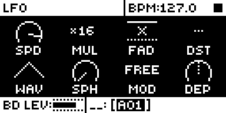
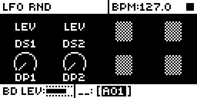
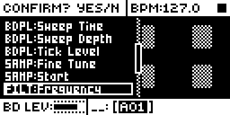
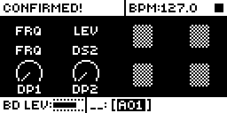
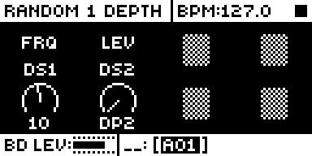

# LFO RND

## Overview

LFO RND adds a second LFO page with two random modifiers per sound. On every note trig
each modifier moves one parameter of the sound by a new random amount, holds it until the
next note, and the next note draws again.

- Press the LFO page key a second time on a voice track: the LFO RND page. Press it again
  to return to the LFO page.
- DS1 and DS2 (knobs A and B) pick each modifier's destination from stock's LFO
  destination list, limited to sixteen: the eight machine parameters, FIN, STA, FRQ, RES,
  DEC, PAN, DEL and REV.
- DP1 and DP2 (knobs E and F) set each modifier's depth, 0 to 64 in sixteen steps. On each
  note the destination moves by a random amount between -depth and +depth, clamped to the
  parameter's range, on top of p-locks, slides and LFO 1. Depth 0 is off.
- The four settings belong to the sound. They are kept in core-ar2's mod storage and saved
  with the kit.

Version **1.2.0** for Analog Rytm MKII OS **1.74**, with core-ar2 0.4 or later (Modwerk's
base is core-ar2 0.7). It is [rytm2_mods](https://github.com/Iced-Cream/rytm2_mods)' elemod
port of MrScruff's `0004-lfo-rnd` from
[rytm-mods-src](https://github.com/Iced-Cream/rytm-mods-src). His code is unchanged, except
that the four settings moved from the sound's parameter word 0 into core storage (1.1), and
that from 1.2 the page and its four knobs are reached through core-ar2's page tables
(`core_pages`, `core_params` and `core_view_pages`) instead of detours of its own at the
entries of the page routines and the LFO key's page list, which core-ar2 0.4 and later own.
Hardware testing is recorded in the [hardware report](evidence/hardware-testing.json) and
[TESTING.md](TESTING.md).

## Controls

| Control | Action |
| --- | --- |
| DS1 (knob A, LFO RND page) | Modifier 1's destination. Turning it opens the destination list (sixteen entries); YES confirms. |
| DS2 (knob B, LFO RND page) | Modifier 2's destination, as DS1. |
| DP1 (knob E, LFO RND page) | Modifier 1's depth: 0, 1, 2, 3, 4, 6, 8, 10, 12, 16, 20, 24, 32, 40, 48, 64. 0 is off. |
| DP2 (knob F, LFO RND page) | Modifier 2's depth, as DP1. |

There are no other new controls, menus or settings. To get stock behaviour back, set both
depths to 0, or build without the module.

## Usage

The LFO page key, pressed a second time on a voice track.

### Quick tutorial

1. Use a build containing LFO RND. Open the LFO page on a voice track and press the LFO page key again: LFO RND shows DS1 and DS2 on knobs A and B, DP1 and DP2 on E and F.
2. Turn DS1: the destination list opens. Pick FRQ and press YES, then turn DP1 to 32.
3. Play trigs on that track: the filter cutoff moves to a new random value on every note. Turn DP1 to 0: the notes play as stock again. Press LFO once more to go back to the LFO page.

Ideas: a small depth on FIN or TUN for drifting pitch, on PAN for a scattered stereo image,
on DEC for uneven hits. The new value arrives with the note, so it suits percussive
sounds more than long drones.

## Compatibility and limitations

Requires core-ar2 0.4 or later on OS 1.74. Use your own original stock OS 1.74 file.

- Built for OS 1.74 only.
- Needs core-ar2's page tables (core-ar2 0.4 and later). lfo-rnd 1.1 and earlier detoured the page routines and the LFO key's page list itself and do not link with core-ar2 0.4 or later.
- Voice tracks only: the FX track has no LFO RND page.
- The four settings are sound settings: they cannot be p-locked, scene-locked, sent by MIDI or modulated. lfo-rnd 1.3 adds that, but needs core-ar2 0.9, which Modwerk's base is not yet.
- The offset is drawn when a note starts and added to the destination's playing value until the next note, so turning the destination's knob during a note moves the value under the offset. A change to DS or DP applies from the next trig.
- On stock firmware, or a build without this module, the sound plays without the offsets: the settings are in mod storage, which stock ignores.
- It hooks the audio interrupt next to [Loop Sync](../loop-sync/)'s site. They patch different bytes and the configurator plans them together, but the pair has not been linked or run.

### Mod storage

| Field | Scope | Bits |
| --- | --- | --- |
| `lfo_rnd_cfg` | sound | 16 |

DS1 in bits 0-3 (a position in the sixteen destinations), DP1 in 4-7 (an index into the
sixteen depths), DS2 in 8-11, DP2 in 12-15. All zero is both destinations on the machine's
first parameter and both depths 0 (off). The linker places the field from the build's
lockfile, so a later build keeps it where it was and kits keep their settings. Removing the
module leaves the bits in the sound, unread.

Sounds saved by lfo-rnd 1.0, which kept the settings in the sound's parameter word 0, keep
them: the module reads that word while the field is 0, and the first edit moves the settings
into the field.

### Sites

The module patches 31 sites, the original mod's own: nine detours and, in the parameter
name table, the records of hidden parameter ids 1 to 4 (their range, a group flag and three
name pointers each), which become DS1, DP1, DS2 and DP2. Another module patching the same
bytes cannot be combined with it; none in the library does. The page itself is an entry in
`core_pages` (page 12, LFO RND), its knobs an entry in `core_params` (ids 1 to 4), and the
LFO key's second press an entry in `core_view_pages` (behind LFO, order 20).

| Address | Bytes | Op |
| --- | --- | --- |
| `0x40039d32` | 6 | jmp `lfo_rnd_list_same_gate` (the destination list, same entry) |
| `0x40039d9a` | 6 | jmp `lfo_rnd_list_new_gate` (the destination list, new entry) |
| `0x4003a5f2` | 6 | jmp `lfo_rnd_knob_cidx_gate` (a knob's container index) |
| `0x4004aec6` | 6 | jmp `lfo_rnd_list_filter_gate` (the destination list's filter (sixteen entries)) |
| `0x4009b06c` | 8 | jmp `lfo_rnd_trig_cfg_gate` (each voice trig: copy the sound's settings) |
| `0x400a85e8` | 8 | jmp `lfo_rnd_knob_draw_gate` (the dials) |
| `0x400a8e66` | 8 | jmp `lfo_rnd_read_gate` (the popups' value) |
| `0x400a906c` | 8 | jmp `lfo_rnd_setter_gate` (the destination picker's commit) |
| `0x4012101a` | 6 | jmp `lfo_rnd_audio_gate` (each note's start: draw and add the offsets) |

The 22 name-table sites (`bytes` and `ptr`, 4 bytes each) are listed in
[build.json](build.json).

## Tests and measurements

See [TESTING.md](TESTING.md) for the commands and results. In short: on an Analog Rytm MKII
with OS 1.74 and core-ar2 0.4 beside the other rytm2_mods ports (P4A4, Q4A4 and U4A4,
2026-10-21), the page and its knobs through core's page tables passed every test step, the
LFO key's list stepped LFO, LFO RND, LFO, and the header followed. This folder's package has
the same code, symbols, relocations, sites and contributions as rytm2_mods v1.3's release
object, and linked with core-ar2 0.7 it gives a main OS byte-identical to that object linked
with the same core. In the emulator on the Modwerk base (LR12) the page, the destination list,
DS1 and DP1 work as on the unit. On the unit with Modwerk's base (LT12, 2026-11-08) the page,
DS1 FRQ and DP1 passed, CP's tone varied 12.6 times as much from note to note at DP1 64 as at
DP1 0, and the settings were kept through a power cycle. Memory:
1,676 bytes of the 128 KiB shared mod area (`.run` 1,664 bytes) and 1,216 bytes of flash.

## Authorship and licences

MrScruff: the original mod (rytm-mods `0004-lfo-rnd`), its design and code, published in
rytm-mods-src with his permission. Iced-Cream: the elemod port in rytm2_mods, including the
move to core storage and to core-ar2's page tables, and this module. irpina: Elekloader and
core-ar2, whose storage and page tables it uses.

Code: [GPL-2.0-only](LICENSE), as rytm-mods-src. `src/lfo-rnd.s` is rytm2_mods'
`lfo-rnd/os1.74/lfo-rnd.s` at `e029f75` (v1.3) with six comments reworded to describe what
each patched site does instead of quoting the stock instructions there; the code is
unchanged. `include/ar2-1.74.inc` and `shared/shared.s` are rytm2_mods' files at `e029f75`,
unchanged. They name firmware routines and RAM by address only. The upstream README is in [upstream/README.md](upstream/README.md). Screens show Elektron's
interface solely to document the modification. No Elektron firmware is included.

## Screens and audio

These captures are from analog-emu (trigcondition's emulator built on rytm-emu) running LR12,
the Modwerk base for core-ar2 0.7 and LFO RND 1.2.0, from stock OS 1.74. See
[capture provenance](media/capture.json) for hashes and inputs. The random offsets were
judged on a unit, so there is no audio demonstration.

Press LFO on track BD: the LFO page, as on stock.

Press LFO again: LFO RND, with DS1 and DS2 on knobs A and B and DP1 and DP2 on E and F. Stock stays on the LFO page.

Turn DS1: the destination list opens. Here FILT:Frequency is selected; press YES to confirm.

After YES, DS1 reads FRQ: modifier 1 now moves the filter frequency.

Turn DP1: the popup shows the depth, here 10. Each note now offsets FRQ by up to plus or minus 10; 0 turns it off.
