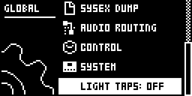
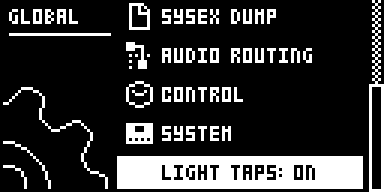

# Light Taps

Original Analog Rytm MKII module by @filefolder, 0.1.0-experimental, for OS 1.74 on the Modwerk base (core-ar2 0.7).

## Overview

The Rytm's pads tell the OS about a press in two ways: a key press, which selects tracks and toggles mutes, and a strike, which plays the sound with its velocity. A light tap sends the key press but no strike, so stock plays nothing, even though the same tap still toggles a mute.

With LIGHT TAPS on, a pad press that gets no strike within 3 ms plays the pad as a soft hit, at velocity 8 of 255: just below the softest hit the pads report themselves. Real hits are untouched and keep the pads' own velocity, so playing goes from light taps into graded hits without a gap. Off, the pads behave exactly as on stock.

## Controls

Press GLOBAL, scroll past SYSTEM to the module's row, and press YES:

| Row | Action | Default |
| --- | --- | --- |
| LIGHT TAPS | Toggle between OFF and ON | OFF, saved with the project |

## Usage

1. Press GLOBAL and scroll down past SYSTEM to LIGHT TAPS: OFF.
2. Press YES: the row reads LIGHT TAPS: ON. Leave the menu.
3. Tap a pad lightly with a fingertip: it plays as a soft hit. Hit it harder: it plays with the pads' own velocity, as on stock.

With VELOCITY TO VOL on, a light tap is quiet; with it off, it plays at the sound's full level, as every hit does. To turn the module off, press YES on the row again.

A light tap plays the sound like any hit: the amp, the filter envelope, velocity modulation, live recording and MIDI out all see a strike of velocity 8. A sound whose filter envelope or velocity modulation needs a firmer hit to open may stay silent on a light tap; that is the sound's own setting.

## A change to a stock flow

- **What changes:** with LIGHT TAPS on, a light pad tap that stock ignores plays the pad's sound at velocity 8. This affects anyone who plays the pads with LIGHT TAPS on.
- **Why:** the pads send no strike for a light tap, so nothing else can make it play. A threshold or curve change in the OS cannot help: the experiments on the unit (Pad Thresh, branch `pad-probe-prototype` on @filefolder's fork) showed that a light tap never reaches the OS as a strike at any threshold. A pad page or gesture of its own was not considered: the point is the pads' own playing.
- **What a musician sees:** light taps sound. Mutes, pad selection, CHRO and the other pad modes get the same key presses as before.
- **Opt out:** LIGHT TAPS is OFF by default, and OFF is stock. It is saved with the project, so a project saved with it OFF, or by a build without the module, loads OFF.
- **Neighbouring flows checked:** see TESTING.md. A hard hit plays once, at its own velocity: a press that comes within 3 ms after its pad's strike gets no light tap.

## How it works

The module hooks three spots in OS 1.74's panel driver that no other module or the base patches, and declares them as claims:

- `0x4008232c`, where the driver posts a pad's strike or pressure, and `0x40082492`, where it posts a key press or release. The module notes each pad press and release, and each strike, then passes the event on unchanged. A press that arrives while the same pad is still held is treated as a key repeat and ignored, so holding a pad lightly gives one soft hit; this applies only once a release has been seen from that pad.
- `0x40081944`, in the driver's task that runs about every millisecond. The module counts these ticks itself rather than reading the panel's own counter, which wraps every 4,096 ms: stamps from it made a fresh light tap a multiple of 4.096 s after a firm hit look like a press just after that hit. A strike's mark also expires after 3 ms. A pad press with no strike for 3 ms gets one: the record the driver builds itself (type 3, the pad's strike code, velocity 8, the time stamp), posted to the driver's own queue, so the OS plays it as any hit.

## Compatibility and limitations

- OS 1.74 and core-ar2 0.7 only.
- Checked on a unit beside Silent Pad+Trig Settings: a light tap's strike meets its silent selection, FUNC + pad, LIVE REC and MUTE ALL SOUND as a real strike does. Audio load is unchanged (it does not run in the audio interrupt).
- No dependency on another catalogue module. It takes no key gesture or screen; its row in the GLOBAL menu comes through the core's shared `ev_settings` hook.
- Every light tap plays at the same velocity: the pads report no force or pressure for a light tap, so there is nothing to grade it by.
- A light tap plays about 3 ms after its press, the time the module waits for a strike.
- Projects saved by builds with other module sets may load the setting OFF when the storage layout differs (see the Rytm guide's Mod storage).

## Tests and measurements

See TESTING.md. Never commit firmware, snapshots, card images or built OS files.

## Authorship and licences

GPL-3.0-or-later; see LICENSE. An original module by @filefolder. Elekloader's GPL-2.0-or-later core by irpina and Iced-Cream provides the shared hooks and storage; the settings row's label callback follows MIDI Feedback's (GPL-3.0-or-later). The driver's addresses were read from @filefolder's own OS 1.74; no firmware code or tables are included.

## Screens and audio

Emulator captures of build LT02 in rytm-emu (screen documentation only; `media/capture.json` has the plan):

