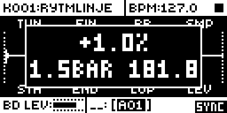

# Loop Sync

An Analog Rytm MKII mod by @stigmagit. Version 0.3.0-experimental, for OS 1.74 with core-ar2 0.3. Build LS24 heard by the author on a unit.

## Overview

Loop Sync keeps sample loops in time with the project tempo by repitching them, like a varispeed. In AUTO it works out each loop's source tempo from the length of the sample that plays (between the sound's own STA and END), assuming 4/4 and a loop cut on the bar, and picks the bar count, 1/4 to 16 in powers of two, that is nearest the project tempo; the other lengths (3/4, 1.5, 3, 6, 12 bars) are chosen by hand. Every audio block it adds the matching pitch shift to the track's effective TUN, after parameter locks, scenes and the LFO, so a SMP lock or a scene that changes the sample is followed, each sample by its own length. Pitch follows tempo, as on a turntable: there is no time-stretch.

The sound's own TUN is never written: a TUN lock still transposes on top of the sync.

## Controls

On the SAMPLE page (press SMPL), with FUNC held:

| Control | Action |
| --- | --- |
| Turn TUN (encoder A) | Steps the mode of the sample the selected sound loads, one step about every 8 encoder counts: OFF, AUTO, then 1/4, 1/2, 3/4, 1, 1.5, 2, 3, 4, 6, 8, 12 or 16 BAR. A box shows the mode and the source tempo, for example `AUTO` over `1BAR 120.0`. |
| Turn FIN (encoder B) | The correction of that sample, -25 to +25 % in 0.2 % steps (one every 2 counts), on top of the mode's source tempo. A loop with a tail or a gap plays longer than its bars, so AUTO finds it slow: a + correction brings it back. |

Each sample keeps its own mode and correction, with the project (core-ar2 project storage). A sample without a setting of its own (OFF and 0 %), played by a SMP lock or a scene while the sound's own sample is synced, needs none: a copy of that sample (as many frames) takes its mode and correction and plays at its speed, and any other sample plays in AUTO at 0 % from its own length. Give a locked loop its own setting when it needs a length or a correction: load it in the sound for a moment (SMP, YES), set it, and load the main loop back. FUNC + TUN and FUNC + FIN always set the sample the sound loads, never the one a lock plays at that moment, so the box does not jump from step to step while the pattern plays. Save the project to keep them. Up to 51 samples a project keep a setting; past that the box reads `FULL` until one is set back to OFF and 0 %. A small `SYNC` mark shows at the bottom right of the SAMPLE page while the selected track is synced. On the stock OS a FUNC + turn on the SAMPLE page does nothing (observed in the emulator on OS 1.74), so these gestures take no stock behaviour away.

## Usage

Set each loop sample to AUTO, or to its length in bars, and play at any tempo; correct a mis-cut loop with FUNC + FIN. Step by step:

### Quick tutorial

1. Load a loop cut on the bar, for example one bar at 120 BPM, on a sound track with a trig on step 1.
2. Press SMPL, hold FUNC and turn TUN to AUTO: the box reads AUTO over 1BAR 120.0, and SYNC appears at the bottom right.
3. Play and change the tempo: the loop follows, and the pitch glides with each tempo step. Lock SMP on a step to another loop: it plays in AUTO from its own length, in time too, with no setting; a copy of the loop plays at the same speed. Save the project after setting loops: settings live in it.
4. For a loop of 3 beats or 1.5 bars, or one with a tail or a gap, hold FUNC and turn TUN to its length, then FIN until it sits in time. Save the project to keep it.

## How it works

- With END at its end, digital silence at the end of a sample (below about -72 dB, `SILENCE`) is left out of its length when it is shorter than 5 % of the sample: the padding of a loop exported a little long. A quiet last beat, longer than that, is kept. The idle tick checks four sample slots a tick and scans a slot again when its sample changes.

- `audio.s` hooks the audio interrupt just after its LFO call (one site, 10 bytes), where each track's effective parameter array is complete for the block and the voices have not read it yet. `loop_sync_audio` reads the track's effective SMP (so sample locks and scenes follow), the sound's own STA and END (copied by the idle tick from the live sound, before locks and the LFO, so a STA lock that slices the loop plays that slice at the same speed), the sample slot's frame count and rate from the stock slot table, and the tempo word; it works out `1200 * log2(tempo / source)` cents in integer arithmetic only when one of those changes, and adds the shift to the effective TUN. The array is rebuilt every block, so the add does not accumulate.
- A tempo or correction change glides to the new shift (1/64 of the way each audio block, settled in about 140 ms) instead of stepping, as a turntable speeds up; a new sample, region or mode jumps straight to its own shift.
- The settings are one bit stream over the 32 project fields: 51 entries of 20 bits (slot, mode, correction). An entry is taken when a sample gets a setting and freed when it is back to OFF and 0 %.
- `ev_tick` copies each sound's STA and END for the interrupt and redraws when the SYNC mark changes; `ev_key` notes when SMPL opened the SAMPLE page; `ev_enc` takes FUNC + A and FUNC + B there; `ev_draw` draws the box; `ev_project` reads the project's settings and resets the caches.

It keeps no clock of its own: its timing is the tempo word ([sequencing.md](../../../../docs/module-guides/sequencing.md)).

## Changes to stock flows

- **FUNC + TUN and FUNC + FIN on the SAMPLE page** set the mode and the correction. Stock does nothing with them. FUNC + SMP (opens the sample list), FUNC + BR and FUNC + LEV (jump the value) are stock gestures (emulator, OS 1.74), so the mod takes no third encoder to pick a locked sample.
- **A synced track's pitch** is shifted on top of TUN, FIN, locks and the LFO. TUN, FIN and their locks are untouched and keep working as transpositions. Set the mode to OFF for stock pitch.

## Compatibility and limitations

OS 1.74 only, with core-ar2 0.3 (project storage: 32 fields of 32 bits, `loop_sync_t0`..`loop_sync_t31`, listed in `src/slot-fields.h`; Modwerk allows 32 fields). UI claims: `FUNC + SAMPLE TUN turn`, `FUNC + SAMPLE FIN turn`. One code site: 0x40121020, 10 bytes, in the audio interrupt.

- Pitch follows tempo; no time-stretch.
- AUTO assumes 4/4 and a loop cut on the bar, and only picks powers of two: among all twelve lengths, a one-bar loop of 100 BPM played at 127 would read as 1.5 bars of 150 BPM (measured in the emulator). Choose 3/4, 1.5, 3, 6 or 12 bars by hand; a loop of 5 beats, say, needs its nearest length and a correction.
- Settings saved by 0.2 (a mode per sound, a correction per slot) are not read by 0.3: set the loops again.
- The silence check only sees digital silence (below about -72 dB) under 5 % of a sample; a loop cut long with sound in the extra part still needs the percentage correction.
- A setting stays with the slot: replacing the sample in that slot keeps it. At most 51 samples a project have one (Modwerk's 32-field limit).
- The shift is limited to TUN's range: the effective TUN is clamped to +-24 semitones (a factor of 4). Past it the loop stays as slow or as fast as TUN goes, out of time: choose a length that puts the source tempo nearer the project tempo.
- The SAMPLE page is recognised from the last page key pressed. After a menu, or after choosing a sample in the SMP list with YES, press SMPL again before FUNC + TUN.
- It hooks the audio interrupt next to rytm2_mods' lfo-rnd (which detours the LFO call itself, 6 bytes earlier); they patch different bytes, but the pair is not tested.

## Tests and measurements

Full record in [TESTING.md](TESTING.md). In short:

- **On a unit, LS24:** the author heard his pattern with SMP locks to loops in other slots, and his fast loop with the tempo lowered below 128 BPM, play as they should ("c'est bon"). Listening only; persistence, external MIDI clock and CPU not reported.
- **On a unit, LS21:** the author heard a pattern with SMP locks to loops in other slots play in time once each locked loop of another length had its own setting. Listening only; persistence, external MIDI clock and CPU not reported.
- **On a unit, LS17:** the author ran LS17 (before the review fixes) on an Analog Rytm MKII with OS 1.74: loops in time with SMP locks, the per-sample correction and the silence check, and the pitch glides on tempo changes. Listening only; persistence across saves and reboots is not reported yet.
- **In the emulator, builds LS19 to LS24 (recorded audio):** at 127 BPM, a one-bar 120 BPM loop in AUTO plays its beats 0.4725 s apart (target 0.4724 s); set to 1.5 BAR with +1.0 %, 0.7158 s apart (target 0.7157 s); a tail loop with its own +5.2 % falls 0.4714-0.4733 s apart, also when FUNC + TUN is turned while the pattern plays (LS20; LS19 set the locked loop then), and a 100 BPM loop locked on step 9 with no setting plays in AUTO at 0 % from its own length: 0.4714-0.4733 s apart (LS24; LS21 gave it the main loop's +5.2 %, 0.4972 s). A loop set far too long for its tempo (16 BAR on a one-bar loop) stays at TUN's limit instead of snapping back to its own speed (LS23).
- **In the emulator, build LS18:** at 127 BPM, beats of 120 and 100 BPM loops alternating by SMP lock, a padded loop in AUTO and a mis-cut loop with its own +5.1 % all fall 0.4717-0.4730 s apart for a target of 0.4724 s. A tempo step glides over about 140 ms instead of jumping 13.5 cents.
- **Memory:** loop-sync is 8,268 bytes of code and data (5,884 `.run` and 2,384 `.bss`, elekloader lint, LS24) in the 128 KB shared mod area. **CPU:** not measured on the unit; the audio-interrupt hook does a compare per sound track and block, and the logarithm only when a track's sample, region, mode, correction or the tempo changes.

## Screens and audio

Captured in rytm-emu from build LS19, identical with LS20 to LS24 ([capture record](media/capture.json)). No audio preview is included; the emulator measurements above stand for it.

## Authorship and licences

Loop Sync is by stigmagit, under GPL-3.0-or-later ([LICENSE](LICENSE)). Built on core-ar2 and elekloader (irpina, GPL-2.0-or-later). The firmware addresses come from the symbol maps of [rytm-mods-src](https://github.com/Iced-Cream/rytm-mods-src) and [rytm2_mods](https://github.com/Iced-Cream/rytm2_mods) (MrScruff, Iced-Cream), whose lfo-rnd first described the effective parameter array; the sample slot table was located for this mod. Emulator tests ran in [rytm-emu](https://github.com/trigcondition/rytm-emu). Screenshots: [media/LICENSE.md](media/LICENSE.md).
