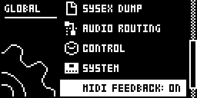
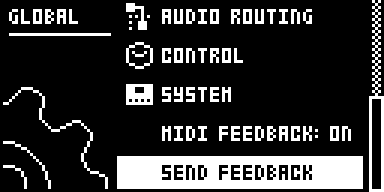

# MIDI Feedback

Original Analog Rytm MKII module by @claptom-music, 0.1.0-experimental.

**Development only. Basic emulator output passed; qualification is incomplete.**
This is not a released module or a firmware ready for hardware installation.

## Overview

Send the underlying settings of seven parameters on each of the twelve drum
tracks to a controller with pickup, such as the Faderfox PC12. All 84 assignments
are available; choose which to map to the PC12's 72 pots. A controller setup
does not have to use every assignment.

Feedback follows parameter edits, kit recalls and channel changes. It also
refreshes all assignments automatically about every two seconds while ON,
so reconnecting the controller or changing its setup needs no menu visit.
SEND FEEDBACK is an optional immediate refresh. It does not stream the moving results of parameter locks,
LFOs, scenes or performances. These continue to affect the sound as on stock.

## Controls

Press GLOBAL, scroll past SYSTEM to the module's rows, and press YES:

| Row | Action | Default |
| --- | --- | --- |
| MIDI FEEDBACK | Toggle feedback | OFF, stored per project |
| SEND FEEDBACK | Optional immediate refresh; background refresh already runs | Momentary |

No keys or encoder turns are consumed. The module subscribes to `ev_settings`,
`ev_tick` and `ev_project`; it patches no stock instructions. Resource claims
are `settings:MIDI FEEDBACK` and `settings:SEND FEEDBACK`. The planned base's
USB link, loader and send bus remain base-owned.

## MIDI message map

| Parameter | CC | Value |
| --- | --- | --- |
| Track LEVEL knob, distinct from AMP Volume | 95 | 0–127 |
| Filter Frequency | 74 | 0–127 |
| Filter Resonance | 75 | 0–127 |
| Amp Attack | 78 | 0–127 |
| Amp Decay | 80 | 0–127 |
| Delay Send | 82 | 0–127 |
| Reverb Send | 83 | 0–127 |

The proposed output is `Bn cc value`, with n the track's configured MIDI
channel minus one. A disabled track channel emits nothing. Use distinct track
channels to distinguish all twelve tracks. No private channel mapping is added.
Seven-bit feedback intentionally follows the controller's coarse resolution.

This module consumes or remaps **no incoming messages**. All CCs, NRPN selectors
and data entry, notes (including velocity-zero note-off), pitch bend, pressure,
program changes, system-common messages, clock, start, continue, stop, active
sensing and SysEx retain stock handling. This does not mean they are echoed to
MIDI OUT: the module creates no THRU path. It emits no notes, transport, NRPN,
bank selection or SysEx. **No SysEx ID is used or claimed.**

Feedback targets DIN MIDI OUT only. PARAM OUTPUT must be CC, ENCODER DEST must
allow parameter output, and OUTPUT TO must include MIDI. USB-only output
suppresses feedback; selecting MIDI+USB does not make this module send a USB
copy. Stock panel output remains stock and may send the same value separately.
None of these seven CCs is CC64–67; their stock Rytm parameter meanings remain.

## Usage

1. In MIDI CONFIG, set distinct track channels, PARAM OUTPUT to CC, ENCODER DEST to INT+EXT, and OUTPUT TO to MIDI or MIDI+USB.
2. Map PC12 pots to the listed CCs and track channels, enable snap mode, and route feedback into the PC12 without MIDI THRU back to Rytm.
3. Press GLOBAL, select MIDI FEEDBACK, and press YES for ON. Feedback then refreshes automatically; SEND FEEDBACK is optional.

Choose six of the seven assignments per track or use more than one PC12 setup. Sending a PC12 snapshot changes the instrument; it is not a request for its values.

## Output bounds and lifecycle

The scheduler considers 84 assignments and sends at most four CC messages per
UI tick, about 80 messages per second at the documented 20 Hz. This is a work
limit, not a musical clock. A complete unchanged 84-message refresh takes at
least 21 ticks, about 1.05 seconds; busy output can extend it. Fresh edits can
be delayed behind other pending assignments, so this is controller pickup
feedback rather than an automation stream with a timing guarantee. A full
refresh is requested every 40 UI ticks while enabled and allowed by stock
output settings, roughly every two seconds. Repeated requests preserve the
round-robin cursor, so later tracks are not starved by a busy output.

One slot per assignment holds the latest value. Updates replace stale pending
values and increment the coalesced counter. When the sender cannot accept a
message, flushing stops, increments the deferred counter and retries the newest
value next tick. Nothing waits for queue space. Reset discards pending values;
turning feedback on again requests a fresh snapshot. No incoming message is
echoed directly, and an unchanged value received back does not create another
feedback event. External THRU loops still must be disabled.

## Compatibility and limitations

- OS 1.74 and core-ar2 0.7; OS 1.72 is unsupported.
- No dependency on another catalogue module.
- Basic emulator output passed for all 84 assignments and a Track Level edit.
- DIN capacity checks, Track Level access, recall/persistence behavior and
  stock-flow comparisons require emulator probes before enabling output.
- Physical DIN timing, CPU load, PC12 pickup and Windows/WSL MIDI routing are
  not qualified. Emulator results do not establish hardware behavior.

## Tests and measurements

See TESTING.md. Never commit firmware, snapshots, card images or built OS files.

## Authorship and licences

GPL-3.0-or-later; see LICENSE. Elekloader's GPL-2.0-or-later core by irpina and
Iced-Cream provides the shared hooks and storage. Its SDK examples document the
menu callback ABI; its newer core-ar2 MIDI source identifies stock output and
configuration routines. No firmware code or tables are included.

Message assignments: [Elektron manual, Appendix C](https://www.elektron.se/wp-content/uploads/2025/01/Analog-Rytm-MKII-User-Manual_ENG_OS1.72_250130.pdf).
Pickup behavior: [Faderfox PC12 manual](https://www.faderfox.de/PDF/PC12%20Manual%20V04.pdf).

## Screens and audio

These are firmware-rendered OS 1.74 emulator captures from the named private build in media/capture.json. They show the menus, not hardware or audio qualification. No audio demo is supplied for this MIDI feedback module.
