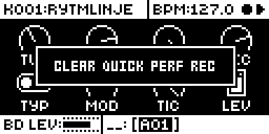

# QPERF

An Analog Rytm MKII mod by Nathaniel Pavel (@npp1993). Version 0.2.0-experimental, OS 1.74 with core-ar2 0.7. See [TESTING.md](TESTING.md) for what ran on a unit.

## Overview

Set performance locks from the QPER key, much faster than one performance at a time, and record performance moves. Hold QPER and turn a knob: it edits that parameter's offset in the performance linked to QPER, as holding a performance pad does. QPER + YES writes what you hear into the kit. In LIVE RECORDING, what you do with the performance pads, the QPER knob and MIDI is kept in a quick perf rec that loops with the pattern and plays back through the performances; RECORD + YES writes it into the pattern as locks.

## Controls

QPER links one performance at a time. Hold QPER and press a pad or trig key: the link moves there. Press the linked one to unlink it. With QPER still held and one performance linked:

| Gesture | What it does | Message |
| --- | --- | --- |
| Turn a knob | Edits the linked performance's lock, as holding a performance pad does: the knob inverts and shows the offset. | |
| PLAY | Clears the linked performance with stock's clear. PLAY again undoes it. | CLEAR PERFORMANCE, UNDO CLEAR |
| YES | Writes what you hear into the kit and removes those locks. The sound holds at any position. Muted, it still applies, so the sound moves by what the knob would add. At knob zero nothing is added and the locks stay. | PERFORMANCE n APPLIED, NOTHING TO APPLY |
| RECORD | Copies the linked performance. | COPY PERFORMANCE n |
| STOP | Pastes onto the linked performance. STOP again undoes it. | PASTE PERFORMANCE, UNDO PASTE |

The quick perf rec, in any recording mode:

| Gesture | What it does | Message |
| --- | --- | --- |
| RECORD + YES | Applies the quick perf rec to the pattern as trigless parameter locks, one per step, and empties it. | APPLY QUICK PERF REC, NOTHING TO APPLY |
| RECORD + NO | Empties the quick perf rec. NO again brings it back. | CLEAR QUICK PERF REC, UNDO CLEAR |

FUNC + QPER (mute) is stock's. A key or turn with nothing linked shows NO PERFORMANCE LINKED, with several linked MORE THAN ONE LINKED, and with no room LOCK MEM FULL!. Stock draws every message.

These work on the sound pages and in PERF, SCNE, MUTE and CHRO. Press QPER in a menu, dialog, list, the SAMPLER or TEMPO and everything stays stock's, for as long as you hold it. A menu opened with QPER held keeps its keys too. The one exception is linking: where stock lets a pad or trig link over a screen, such as the GLOBAL menu, it moves the one link here too.

## Usage

Shape a performance with QPER held and a few knob turns, sweep it with the QPER knob, and keep a position you like with QPER + YES. To keep motion rather than one position, play the performances in LIVE RECORDING and write the take into the pattern with RECORD + YES.

### Quick tutorial

1. Hold QPER, press pad 1 to link its performance, and keep holding.
2. Turn FLTR's cutoff up and the resonance a little, and let go of QPER.
3. Sweep the QPER knob. Both moves come in together.
4. When a position sounds right, hold QPER and press YES to keep it in the kit.
5. Hold QPER and press RECORD, press pad 2, then STOP to start another performance from this one.
6. Press PERF, hold RECORD and press PLAY. While the pattern plays, press and squeeze pads 1 and 2. Let go and listen to the next pass.
7. Hold RECORD and press YES to write the moves into the pattern.

### The quick perf rec

Stock's LIVE RECORDING records knob turns but no performance moves. With this mod, while LIVE RECORDING plays, every performance you move goes into the quick perf rec: the pads in PERF mode (several at once), the QPER knob on the linked performance, and performance CCs from MIDI. It plays back on every pass, 8 points a step, and you hear it through the performances themselves, so a lock you change later changes the recorded move too.

- **A pass records only what you touch.** The other performances keep playing what they recorded. A pad sends its pressure only when it changes and a 0 when you let go, so it counts as held from its first pressure until that 0: held still, it keeps recording and overrides the take. Letting go records its return to zero.
- **The QPER knob records to the loop's end.** In LIVE RECORDING, a turn makes the linked performance record what the knob plays, moving or not, from where the turn started to the end of the loop; then it plays back, even with LIVE RECORDING still on, so an earlier take before the turn is kept. Turning on does not stretch it; after the knob has rested, turn it again to record another take. Until you touch it, its take is left alone. With LIVE RECORDING off the knob takes over only while it turns past 2 steps from where it rests (a resting knob wobbles), and lets go about 0.05 s after it stops. Pads, the linked one included, record while held.
- **It loops with the pattern, 64 steps at most.** It loops on the pattern's length, which with a length per track (SCALE per track) is the master length, so a move can run longer than a short track's loop. With INF, or a master length over 64 (it goes up to 1024), it loops every 64 steps and drifts against a longer master cycle. 64 is a choice, not a limit of the Rytm: it is the longest a track can be, so an applied take always fits one track, and it keeps the RAM small. Raising it would mean a coarser take or more RAM, and moves a track could not hold when applied.
- **It lives in RAM.** Changing pattern, loading a project or powering off drops it. Only RECORD + YES keeps the moves, in the pattern.
- **The written locks.** Each step gets the take's first recorded value in that step, added to the step's own lock or the kit's value, so a move shorter than a step still lands. The step after a move ends gets the parameter's own value back. Locks stop at the parameter's maximum. A step with no trig becomes a lock trig, as stock's live recording does. A step whose trig has a condition takes the move only on the passes where the trig plays, as any lock on it does.
- **Tracks shorter than the take.** With a length per track, the Rytm restarts every track when the master length comes round, so a 16- or 24-step track under a 32-step master already repeats its steps until the master restarts it. RECORD + YES makes such a track as long as the take and fills the new steps with that repetition, so it plays exactly as before, then writes the moves on every step. Conditions that count loops are rewritten so each copy plays on the same passes: a 1:2 copied twice becomes no condition on the first copy and no trig on the second, and 1ST stays only on the first copy. This changes the track's length in the pattern: reload the pattern to get the old one back.
- **When a track is left out.** A track at another speed than the pattern, in Euclidean mode, or with a track-wide condition that counts loops keeps its length and gets no locks. So does one whose length does not divide 64 when the master length is INF or over 64, since the Rytm does not restart it every 64 steps then. RECORD + YES then shows how many tracks were left out (n TRACKS LEFT OUT). The take is emptied all the same, so a left-out track's moves are dropped, while the tracks that fit keep theirs as locks.
- **72 lock rows a pattern.** Stock keeps one row for each locked parameter of each track, two for a fine one, and uses 71. If the moves need more, RECORD + YES shows LOCK MEM FULL! and writes nothing.
- **The recording mode stays.** With no recording mode on, stock switches GRID RECORDING at RECORD's press; RECORD + YES and RECORD + NO switch it back, as stock's RECORD + PLAY does, so the RECORD light may flick.

### Things to know

- **Kits with several links.** A kit keeps the links it was saved with, and they all play. This is the only way to have several. YES, PLAY, RECORD, STOP and a knob edit act on one performance, so they show MORE THAN ONE LINKED and change nothing until you press a pad or trig with QPER held. That press leaves one link, and saving the kit stores it.
- **The sound follows the link.** An unlinked performance stops adding, and a newly linked one takes the knob's position. The pads show each performance's level, so a linked pad lights to the knob's position, as on stock.
- **48 locks a kit.** All 12 performances share them. A new parameter with none left shows LOCK MEM FULL! and writes nothing.
- **Power on.** Stock does not know the QPER knob until it moves, so the amount is 0 and YES adds nothing until then.
- **Locks past a parameter's range.** Stock lets a lock go past what the parameter can hold, here too. YES stops at the limit, so the sound can change.
- **Full QPER is at most 99.6% of a lock.** Stock's knob value is 8 bits, times 128, and the engine's full scale is 32768. YES keeps what plays, so +54 at full reads 53.
- **YES uses up the lock.** Full QPER no longer reaches the old offset, because the part you did not apply is gone. Stock's undo does not bring it back; reloading an unsaved kit does.

## Changes to stock flows

| Change | For whom | Why | Neighbouring flows |
| --- | --- | --- | --- |
| QPER + a pad or trig moves the one link, and the linked one unlinks it; stock links several. | Anyone with the module installed. | Linked offsets add up, so several made the knob's total and QPER + YES hard to follow. | A kit keeps the links it was saved with until such a press; see Things to know. |
| QPER + PLAY clears the linked performance; stock starts the sequencer. PLAY alone still starts it. | Anyone pressing QPER + PLAY. | Clear needs a gesture on the QPER key. | Stock's undo on a second press, as stock's own clears. |
| QPER + RECORD and QPER + STOP copy and paste; stock acts as RECORD and STOP. | Anyone pressing them. | Copy and paste on the QPER key. | Stock's undo for paste. |
| QPER + knob edits locks and leaves the parameter alone; stock changes the parameter. | Anyone holding QPER. | The lock edit itself. | The knob inverts and shows the offset, as with a held performance pad. |
| QPER + YES writes the linked performance into the kit; stock does nothing visible (rytm-emu, OS 1.74). | Anyone pressing it. | Keeping a sound. | |
| RECORD + YES and RECORD + NO apply and clear the quick perf rec; stock gives them no meaning (TransportView 0x40041734). | Anyone pressing them. | Apply and discard in any recording mode. | With no recording mode on, stock switches GRID RECORDING at RECORD's press; the chord switches it back. |
| Performance moves during LIVE RECORDING are kept and played back; stock keeps none. RECORD + YES can lengthen tracks and rewrite their loop-counting conditions. | Anyone recording performance moves. | The quick perf rec itself. | Reloading the pattern brings back its saved lengths, trigs and locks. |

Kits are not changed by loading them: only a pad or trig press with QPER held changes a kit's links. Remove the mod to get these back.

## Compatibility and limitations

It patches three stock sites (the QPER knob's message, the QPER view's pad and trig link, and the routine run after every whole-kit change) and subscribes to `ev_key`, `ev_tick`, `ev_project` and `ev_render_out`. Claims QPER + knob, pads and trigs, PLAY, YES, RECORD and STOP, RECORD + YES, RECORD + NO and the live recording of performance moves. It needs no other module.

The quick perf rec lives in RAM: a pattern change, project load or power off drops a take you have not applied, and it loops every 64 steps at most. A track at another speed, in Euclidean mode, with a track-wide loop-counting condition, or of a length that does not divide 64 under an INF or longer master is left out of RECORD + YES. See [The quick perf rec](#the-quick-perf-rec).

## Tests and measurements

On the author's Analog Rytm MKII: builds QP01 to QC13 for the QPER controls and QT01 to QT08 (with a debug trace over USB MIDI) for the quick perf rec, QPERF alone, and rytm-emu on OS 1.74 ([TESTING.md](TESTING.md)). Memory: 17,876 bytes of the 128 KiB shared mod area (Modwerk's linker, base alone against base with QPERF), 6,912 of them the quick perf rec (12 performances, 64 steps, 8 points a step, and a bit for each point). Load: the quick perf rec's record and playback run once per audio block; not measured with the base's CPU reading.

## Authorship and licences

Original work by Nathaniel Pavel (@npp1993), GPL-3.0-or-later ([LICENSE](LICENSE)). The OS 1.74 addresses were read by the author from their own stock firmware; the build carries addresses only, no stock bytes. No Elektron firmware is included.

## Screens and audio

Screenshots are rytm-emu captures of this package linked alone on the Modwerk base ([media/capture.json](media/capture.json)). No audio preview.

 
