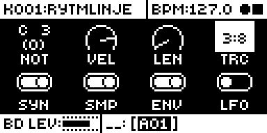
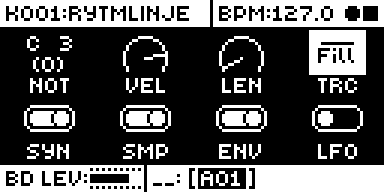

# Quick Trig Conditions

An Analog Rytm MKII mod by Nathaniel Pavel (@npp1993). Version 0.2.0-experimental, OS 1.74 with core-ar2 0.7. Called Quick Fill Trig Condition before 0.2.0; its id, `quick-fill-trig-condition`, stays.

## Overview

Lock a trig to FILL, NOT FILL or a ratio such as 3:8 without turning the TRC knob. On stock a trig condition is set by holding the trig and turning TRC through stock's long list of probabilities, FILL, PRE, NEI, 1ST and ratios. Here, with a trig held in GRID RECORDING:

- **FILL** steps FILL, NOT FILL, then no lock.
- **UP** steps a ratio's first number and **DOWN** its second, from 1:2 to 8:8.

The lock is stock's own, the same one the TRC knob writes, so it saves with the pattern and plays on a unit without the mod.

## Controls

| Gesture | What it does |
| --- | --- |
| Hold a trig in GRID RECORDING, press FILL | The trig gets a FILL condition lock. |
| Press FILL again | NOT FILL. |
| Press FILL again | The lock goes, and the trig follows the TRIG page's condition. |
| Hold a trig in GRID RECORDING, press UP | The first number of a ratio: from 1:4, 2:4, 3:4, 4:4, then back to 1:4. |
| Hold a trig in GRID RECORDING, press DOWN | The second number, keeping the first: 1:2, 1:3 up to 1:8. Past 8 the lock goes. |

UP or DOWN on a trig with no ratio lock gives 1:2. So 1:4 is DOWN three times, and 3:8 is DOWN twice for 1:3, UP twice for 3:3, then DOWN five times. The ratios are stock's, the same as on the TRC knob: N:M plays the trig on the Nth of every M pattern loops, M from 2 to 8.

Holding several trigs writes all of them, with FILL, UP or DOWN: the lowest one sets the step, the others follow it, so they end up alike. A trig whose lock is another condition goes to FILL with FILL and to 1:2 with UP or DOWN. Nothing shows on screen but stock's own TRC value, which appears on the TRIG page while the trig is held. There are no settings, no effect slot and no knob.

In Euclidean mode a held trig writes the pulse its key maps to, as stock's own trig edit does, and a key on no pulse leaves the key to stock.

The gesture works in PERF, SCNE, MUTE and CHRO, where the page stays on screen. With QPER held, a menu open or any other screen on top, TRC is covered, so FILL, UP and DOWN stay stock's and write nothing. With the trig's RETRIG menu open (trig + RTRG), UP and DOWN stay the menu's. A message on screen does not get in the way.

A trig counts on the page and track where its key is down. PAGE moves the page on its release, so the gesture still works with PAGE held. Once the page moves, stock ends every hold, so a trig still held no longer counts, even back on its own page: press it again. Change track and FILL, UP and DOWN write only if that track has a trig on the step; otherwise FILL plays a fill and UP or DOWN opens the RETRIG menu, as on stock. Stock places no trig past the pattern's length, so FILL plays a fill there too.

## Usage

Hold the trig, look at TRC on the TRIG page, and press FILL, UP or DOWN until it reads what you want. Several held trigs change together.

### Quick tutorial

1. Press RECORD for GRID RECORDING and open the TRIG page. Place a trig on step 1.
2. Hold the trig and press DOWN three times: TRC shows 1:2, 1:3, then 1:4. Play the pattern: the trig sounds on the first of every four loops.
3. Keep holding and press UP: 2:4. UP steps the first number, DOWN the second; past 8:8 DOWN clears the lock.
4. Hold another trig and press FILL: Fill. Press FILL again for NOT FILL, and once more to clear it. Hold FILL while the pattern plays to hear the fill trig.

## Changes to stock flows

| Change | For whom | Why | Neighbouring flows |
| --- | --- | --- | --- |
| UP or DOWN pressed with a trig held in GRID RECORDING writes a ratio condition and does not open the trig's RETRIG menu. Their releases and repeats are taken too. | Anyone with the module installed; there is no setting. | The ratio gesture. Stock opens the same RETRIG menu with trig + RTRG, so nothing is lost: only one of its two ways in moves. A gesture with trig keys (hold UP, tap N then M) was considered: it takes trig keys from stock's multi-trig hold. | Trig + RTRG, UP and DOWN with the RETRIG menu open, UP and DOWN with no trig held, outside GRID RECORDING, in STEP RECORDING and with FUNC held stay stock's. |
| FILL pressed with a trig held in GRID RECORDING writes the condition and does not engage fill. Its release is taken too, so a fill latched with FUNC + FILL plays out its loop. | Anyone with the module installed; it applies only while it is. There is no setting: leave the module out of the set to turn it off. | The gesture itself. A musician who holds a trig and presses FILL to hear a fill now writes a lock. Press FILL first and then the trig, and the fill plays, as stock. A row or page would be no quicker than the TRC knob, and FUNC + FILL is stock's latch. | FILL alone, FILL then a trig, FUNC + FILL, FILL with QPER held or a menu open, and FILL outside GRID RECORDING stay stock's. Trig release after the write follows stock's lock edit: the trig stays. |

## Compatibility and limitations

It patches two stock calls in the view under the pages: the head of the FILL case, and the held-trig test of the case UP, DOWN and RTRG share. It needs nothing else from the base. A screen above that view that takes those keys keeps them. Claims `ui:TRIG + FILL`, `ui:TRIG + UP` and `ui:TRIG + DOWN`.

The write goes through stock's own step setter, so the lock is the same one the TRC knob makes: it saves with the pattern, copies with the trig, and shows and changes on the knob as any other. Stock has no undo for a step's condition, and any other condition on the trig is replaced. It works in GRID RECORDING only: LIVE RECORDING and STEP RECORDING keep stock's keys.

## Tests and measurements

On the author's Analog Rytm MKII: 0.1.0's FILL gesture (builds FC04 to FC07, alone and beside seven other modules) and 0.2.0's UP and DOWN ratios (build FC09, alone), and rytm-emu on OS 1.74 ([TESTING.md](TESTING.md)). Memory: 1,212 bytes of code and initialised data, no `.bss`, in the 128 KiB shared mod area. Load: UI only, on key events with a trig held; nothing runs in the audio path.

## Authorship and licences

Original code by Nathaniel Pavel (@npp1993), GPL-3.0-or-later ([LICENSE](LICENSE)). The OS 1.74 addresses were read by the author from their own stock firmware; the build carries addresses only, no stock bytes. No Elektron firmware is included.

## Screens and audio

Screenshots are rytm-emu captures of build FC09 ([media/capture.json](media/capture.json)). No audio preview.

 

