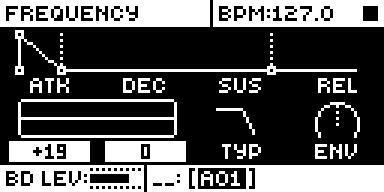
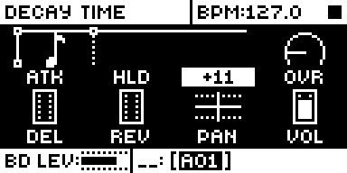
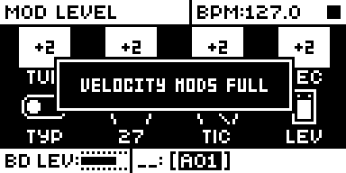
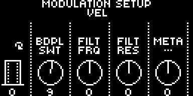
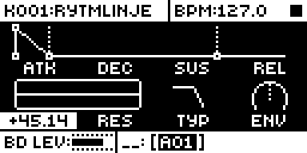
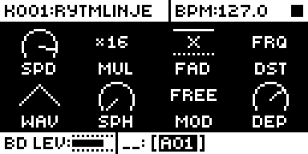

# Quick Mod Assign

An Analog Rytm MKII mod by Nathaniel Pavel (@npp1993). Version 0.2.0-experimental, OS 1.74 with core-ar2 0.7.

## Overview

Linking velocity or aftertouch to a parameter on stock takes a trip through SOUND SETTINGS: FUNC + FLTR, down to VELOCITY MOD, YES, scroll a long list for the destination, turn the amount, then NO, NO back to the page. Quick Mod Assign does it from the page you are playing:

- **Hold FIX and turn a knob**: that parameter is linked to velocity, and the turn sets the amount.
- **Hold SAMPLER and turn a knob**: the same for aftertouch.
- **Hold LFO and turn a knob**: that parameter becomes the LFO's destination, and further turns set its depth.

While either key is held, every knob already linked shows its amount the way stock shows a performance or scene lock (an inverted box with +n), since an amount is an offset as theirs are. Envelope graphics follow the amount as they do for a lock. The mod fills stock's own four velocity and four aftertouch slots of the selected sound, so the links save with the kit, show in SOUND SETTINGS as usual and keep playing on a unit without the mod.

## Controls

| Control | Where | What it does |
| --- | --- | --- |
| FIX held | SYNTH, SAMPLE, FILTER, AMP and LFO pages of a sound track, also in PERF, SCNE, MUTE and CHRO | Shows the velocity links: each linked knob as a box with its amount. Turning a knob links it, or changes its amount, -128 to +127. The parameter's own value does not move. |
| FIX or SAMPLER held, press a knob | as above | Sets that link's amount to 0, as a press clears a lock on stock, so its slot is free for another parameter. |
| SAMPLER held | as above | The same for aftertouch. A new kit links aftertouch to FILT FRQ at +16, so that box shows on the FILTER page. |
| FIX tap | anywhere stock takes it | Toggles fixed velocity as on stock, on the release instead of the press. |
| SAMPLER tap | anywhere | Opens the recorder, as on stock. After a hold with a turn it does not. |
| LFO held | SYNTH, SAMPLE, FILTER and AMP pages of a sound track, the FX track's pages, PERF, SCNE, MUTE and CHRO | Shows the LFO's destination knob as a box with its depth, written as the LFO page writes DEP (+1.96, and (0) at 0). The box fills the knob's column, one width whatever the digits, as the LFO page's value does; on a knob shown as a widget (OVR, DEL, REV, PAN, VOL) it sits over the widget, as stock's lock box does. Turning a knob makes that parameter the LFO's destination (DST) at depth 0; further turns of the same knob set the depth (DEP), with the same steps and speed as stock's DEP knob. The parameter's own value does not move. |
| LFO held, press the destination's knob | as above | Sets the LFO's depth to 0. |
| LFO tap | anywhere | Opens the LFO page, as on stock, on the release instead of the press. After a hold with a turn the page stays. |
| LFO on the LFO page | the LFO page | Stock's: holding it shows the page's values, as any page key does, and a tap steps to a module's page behind LFO. |

A parameter already linked keeps its mod slot. A new one takes the first slot, left to right, with no destination or an amount of 0; turning a link back to 0 frees its slot. A link at 0 still shows as 0 while the key is held (a new kit links FILT FRQ and FILT RES to velocity at 0, so those are the first taken). With all four slots holding other parameters a popup says `VELOCITY MODS FULL` (`AFTERTOUCH MODS FULL`) and nothing changes. A parameter that is not in stock's destination list says `NOT A VELOCITY DEST` (`NOT AN AFTERTOUCH DEST`, `NOT AN LFO DEST`) and nothing changes; the LFO's own parameters are no LFO destination. Each knob event moves the amount at least one step, more when turned fast, whatever the parameter's own resolution.

FUNC + FIX (stock's FIXED VELOCITY), the FX track (FIX and SAMPLER there are stock's, and selecting it during a hold hands its knobs back to stock), and a performance or scene pad or a trig that holds stock's lock edit keep stock's behaviour: a pad pressed in PERF or SCNE during a hold makes a performance or scene lock as usual, and the links show again when it is let go. During a hold the other two keys do nothing. FUNC + LFO, and LFO while a pad, a trig or QPER holds stock's lock edit, stay stock's.

## Usage

Hold FIX or SAMPLER on any sound page and turn the knob you want to move with velocity or pad pressure. SOUND SETTINGS, VELOCITY MOD and AFTERTOUCH show the same links for fine-tuning. Hold LFO and turn a knob to send the LFO there; keep turning it to set how far.

### Quick tutorial

1. Select a sound track and press FLTR. Hold FIX: FRQ and RES show 0 boxes, the new kit's velocity links.
2. Keep FIX held and turn FRQ to the right: its box counts up and FRQ itself does not move. Play soft and hard hits: harder ones open the filter.
3. Press AMP, hold SAMPLER and turn DEC: pad pressure now lengthens the decay.
4. Hold FIX and press FRQ's knob: the link goes back to 0, and its slot is free for another parameter.
5. Press FLTR, hold LFO and turn FRQ: the LFO now moves the filter. Keep turning to set the depth, then let go and tap LFO: the LFO page shows DST FRQ.

## Changes to stock flows

- **FIX's toggle moves to the release.** What changes: on the pages and pad screens of a sound track, a FIX press is held back until the release, so a hold with a turn leaves fixed velocity as it was. Why: the press cannot know whether a turn follows; stock toggles at the press. What you see: the FIX state changes when you let go. Elsewhere, and with FUNC held, FIX is stock's. Checked: a tap, two taps, a hold past key repeat, a hold with a turn, FUNC + FIX, in rytm-emu.
- **SAMPLER held with a turn does not open the recorder.** Stock opens it on SAMPLER's release, also after a knob turn; with this mod a turn during the hold makes it an assignment instead. A tap opens the recorder as before, and on the FX track SAMPLER is stock's. Checked in rytm-emu.
- **FIX or SAMPLER held changes what a knob turn does.** What changes: on a sound page, a turn sets a mod slot instead of the parameter, drawn as a performance lock. Why: that is the mod. Stock does nothing special with FIX or SAMPLER held and a knob turned (checked in rytm-emu: the knob edits as normal). It applies while the key is held only.
- **During a hold, some knobs do nothing.** What changes: with FIX or SAMPLER held, the TRIG page's knobs, a knob turned with a trig held, and FUNC + a knob no longer edit (stock's lock edit, which the hold switches on, refuses TRIG parameters, and the mod refuses a link with a trig held so none is made by accident). Why: the hold is for links; a trig edit or a fine FUNC edit can wait until the key is let go. What you see: the knob does not move. Considered: passing these turns to stock, which stock's lock edit does not allow without a patch of its own. Checked in rytm-emu: TRIG page, a trig held, both key orders.
- **LFO's page opens on the release.** What changes: on the other pages and pad screens of a sound or the FX track, an LFO press is held back until the release; a tap then plays the press and the release to stock and to every other mod, so the LFO page opens as before, a little later. A hold with a turn leaves the page where it is. On the LFO page itself the key stays stock's. Why: as for FIX, the press cannot know whether a turn follows. Checked: on the author's unit by the test rig (plain taps from the FILTER, LFO and SAMPLE pages give stock's screens, and Loop Sync sees the page change), and in rytm-emu with LFO RND's page behind LFO.
- **LFO held changes what a knob turn does.** What changes: a turn sets the LFO's destination and depth instead of the parameter. Stock does nothing special with LFO held: its press has already opened the LFO page. It applies while the key is held only.
- **The other key does nothing during a hold.** What changes: FIX pressed during a SAMPLER hold does not toggle fixed velocity, and SAMPLER pressed during a FIX hold does not open the recorder. Why: a key brushed mid-assignment should not change the sound or leave the page. Checked in rytm-emu.

## Compatibility and limitations

- OS 1.74 only, with core-ar2 0.7. No other module is needed.
- The LFO's DST and DEP are the sound's own (the FX track's on the FX track), written through stock's own writers, so they save with the kit and play on a unit without the mod. A tap's replay goes through the core's `core_key`, so every key mod sees it.
- After a knob press in an LFO hold, the other knobs do nothing until LFO is let go.
- It patches no stock site. It sets its own locker in stock's parameter UI while a key is held, as QPER Live Rec does with QPER, and adds a `core_params` entry for every parameter id with only a turn function (order 5) for a turn that reaches stock's parameter edit. It subscribes to `ev_key`, `ev_enc`, `ev_tick` and `ev_draw` (the LFO depth's box, in stock's label font). No storage.
- A performance or scene pad, or a trig, that holds stock's locker when FIX or SAMPLER goes down or during the hold keeps it; the mod shows its amounts again within a tick of it letting go.
- Stock's LFO DST knob opens its list rather than turning, so FIX + DST does nothing.
- On a unit, 0.2.0: the package's own image beside LFO RND (QP02, flashed) passed the author's hand checks, kit save and power cycle included, and the test rig's six cases passed in QL13 (with Loop Sync): see [TESTING.md](TESTING.md).
- On a unit, by the author's report: QM06 (FIX + knob, the FIX key, save and power cycle) RC18's QM10 (SAMPLER aftertouch links, the lock-style display, envelopes following, mods full, kit save and reload, power cycle) RC19's QM11 and QM12 alone (the FX track, and the checks above again) pass: see [TESTING.md](TESTING.md).

## Tests and measurements

rytm-emu on OS 1.74 ([TESTING.md](TESTING.md)), the author's unit on combined images with builds QM10 and QM11 and on QM12 alone, and for 0.2.0 the test rig and the author's hand checks on the author's unit (QL02 to QL13). Memory (0.2.0 package): 7,554 bytes of code and initialised data and 72 bytes of `.bss` in the 128 KiB shared mod area. Load: UI only, on key events and knob turns; nothing runs in the audio path.

## Authorship and licences

Original code by Nathaniel Pavel (@npp1993), GPL-3.0-or-later ([LICENSE](LICENSE)). The OS 1.74 addresses were read by the author from their own stock firmware; the build carries addresses only, no stock bytes. No Elektron firmware is included.

## Screens and audio

Screenshots are rytm-emu captures of build QM21 ([media/capture.json](media/capture.json)). No audio preview yet.

 

 

 
