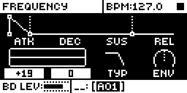
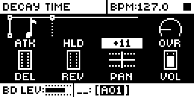
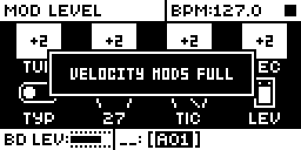
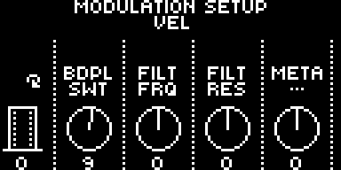
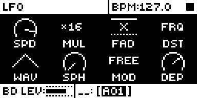
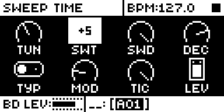
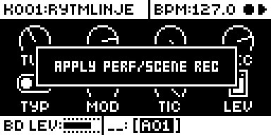

# Improved Modulation

An Analog Rytm MKII mod by Nathaniel Pavel (@npp1993). Version 0.6.0-experimental, OS 1.74 with core-ar2 0.7. Called Quick Mod Assign up to 0.3.1 and Improved Mod Assign in 0.4.0; its id stays `quick-velocity-aftertouch-assign`. Since 0.5.0 it holds QPER Live Rec (`qperf`, 0.3.0), and that module has left the library. Since 0.6.0 PERF holds the performance gestures QPER held (QPER keeps its link), CHRO holds the aftertouch assign SAMPLER held, and the quick perf rec records scene changes too. See [TESTING.md](TESTING.md) for what ran on a unit.

## Overview

Linking velocity or aftertouch to a parameter on stock takes a trip through SOUND SETTINGS: FUNC + FLTR, down to VELOCITY MOD, YES, scroll a long list for the destination, turn the amount, then NO, NO back to the page. Improved Modulation does it from the page you are playing:

- **Hold FIX and turn a knob**: that parameter is linked to velocity, and the turn sets the amount.
- **Hold CHRO and turn a knob**: the same for aftertouch.
- **Hold LFO and turn a knob**: that parameter becomes the LFO's destination, and further turns set its depth.
- **Hold SCENE and turn a knob**: that parameter is locked in the active scene (with none engaged, the scene engaged last), as scene edit does with the scene's pad held, without leaving the page. Tap pads while SCENE is held to move between tracks and lock each. SCENE + YES writes the scene into the kit.
- **Hold PERF and turn a knob**: that parameter is locked in the performance linked to QPER, as a held performance pad does, without leaving the page. Pads, REC, STOP, PLAY and YES work as with SCENE, on that performance.

While FIX, CHRO or LFO is held, every knob already linked shows its amount the way stock shows a performance or scene lock (an inverted box with +n), since an amount is an offset as theirs are. Envelope graphics follow the amount as they do for a lock. The mod fills stock's own four velocity and four aftertouch slots of the selected sound, so the links save with the kit, show in SOUND SETTINGS as usual and keep playing on a unit without the mod.

### PERF, QPER and the quick perf rec

Set performance locks from the PERF key, much faster than one performance at a time, and record performance moves and scene changes. QPER + a pad picks the performance (the QPER link). Hold PERF and turn a knob: it edits that parameter's offset in the performance linked to QPER, as holding a performance pad does. PERF + YES writes what you hear into the kit. In LIVE RECORDING, what you do with the performance pads, the QPER knob and MIDI is kept in a quick perf rec that loops with the pattern and plays back through the performances; RECORD + YES writes it into the pattern as locks.

## Controls

| Control | Where | What it does |
| --- | --- | --- |
| FIX held | SYNTH, SAMPLE, FILTER, AMP and LFO pages of a sound track, also in PERF, SCNE, MUTE and CHRO | Shows the velocity links: each linked knob as a box with its amount. Turning a knob links it, or changes its amount, -128 to +127. The parameter's own value does not move. |
| FIX or CHRO held, press a knob | as above | Sets that link's amount to 0, as a press clears a lock on stock, so its slot is free for another parameter. |
| CHRO held | as above | The same for aftertouch (SAMPLER before 0.6.0; SAMPLER is stock's again). A new kit links aftertouch to FILT FRQ at +16, so that box shows on the FILTER page. |
| FIX tap | anywhere stock takes it | Toggles fixed velocity as on stock, on the release instead of the press. A hold of about half a second or more is a look at the amounts and does not toggle. |
| CHRO tap | anywhere stock takes it | Toggles chromatic mode as on stock, on the release instead of the press. After a hold with a turn, or of about half a second or more, it does not. |
| LFO held | SYNTH, SAMPLE, FILTER and AMP pages of a sound track and the FX track's pages, also in PERF, SCNE, MUTE and CHRO | Shows the LFO's destination knob as a box with its depth, written as the LFO page writes DEP (+1.96, and (0) at 0). The box fills the knob's column, one width whatever the digits, as the LFO page's value does; on a knob shown as a widget (OVR, DEL, REV, PAN, VOL) it sits over the widget, as stock's lock box does. Turning a knob makes that parameter the LFO's destination (DST) at depth 0; further turns of the same knob set the depth (DEP), with the same steps and speed as stock's DEP knob. The parameter's own value does not move. |
| LFO held, press the destination's knob | as above | Sets the LFO's depth to 0. |
| LFO tap | anywhere | Opens the LFO page, as on stock, on the release instead of the press. After a hold with a turn, or of about half a second or more, the page stays. |
| SCENE held, turn a knob | a track's pages (the FX track's too), PERF, SCNE, MUTE and CHRO, and scene edit with no scene pad held (there the scene it shows) | Locks that parameter in the active scene, or with none engaged in the scene engaged last (scene 1 until one has been since power-on; the module keeps it across kit loads, so a new kit's locks go to that scene number), without engaging it, as stock's scene edit does with the scene's pad held: the first turn makes the lock at the knob's value plus the turn, and every knob the scene locks shows as stock's inverted box with the lock's value. The page stays, and neither scene edit nor scene mode opens when SCENE is let go. With all 48 of the kit's scene locks in use, `SCENE LOCKS FULL`. |
| SCENE held, press a knob | as above | Removes that parameter's lock from that scene, as a press does in scene edit. |
| SCENE held a moment | as above | The scene's locks show as boxes about 0.2 s into the hold, before any knob is turned. |
| SCENE held, REC, STOP or PLAY | as above | Copies, pastes or clears that scene's locks with stock's own routines, as FUNC + REC, STOP and PLAY do in scene edit: `COPY SCENE n`, `PASTE SCENE`, `CLEAR SCENE`, and a second STOP or PLAY undoes (`UNDO PASTE`, `UNDO CLEAR`). The transport does nothing then. |
| SCENE held, YES | as above | Writes that scene into the kit: each of its locks becomes the parameter's value and the lock goes (`SCENE n APPLIED`, `NOTHING TO APPLY`). YES again in the same hold undoes it (`UNDO APPLY`); a value changed since, by MIDI say, is left as it is. |
| SCENE held, tap a pad | as above | Ends the hold as a knob does: scene edit does not open on the release. On the pages the pad plays and, with AUTO TRK SWITCH on, selects its track as on stock, so the next turns lock that track. In scene mode (SCNE) it selects its track the same way instead of engaging its scene. In PERF, MUTE and CHRO the pad does what stock does there. |
| SCENE held and let go, no knob or pad | anywhere stock takes it | Opens scene edit, as on stock, when SCENE is let go instead of while it is held. A tap toggles scene mode as before. |
| LFO on the LFO page | a sound's or the FX track's LFO page, also in PERF, SCNE, MUTE and CHRO (not while a pad is held to set a performance or scene lock) | Stock's: holding it shows the page's values, as any page key does, and a tap steps to a module's page behind LFO. |

A parameter already linked keeps its mod slot. A new one takes the first slot, left to right, with no destination or an amount of 0; turning a link back to 0 frees its slot. A link at 0 still shows as 0 while the key is held (a new kit links FILT FRQ and FILT RES to velocity at 0, so those are the first taken). With all four slots holding other parameters a popup says `VELOCITY MODS FULL` (`AFTERTOUCH MODS FULL`) and nothing changes. A parameter that is not in stock's destination list says `NOT A VELOCITY DEST` (`NOT AN AFTERTOUCH DEST`, `NOT AN LFO DEST`) and nothing changes; the LFO's own parameters are no LFO destination. Each knob event moves the amount at least one step, more when turned fast, whatever the parameter's own resolution.

FUNC + FIX (stock's FIXED VELOCITY), the FX track (FIX and CHRO there are stock's, and selecting it during a hold hands its knobs back to stock), and a performance pad or a trig that holds stock's lock edit keep stock's behaviour: a pad held in PERF (or in scene edit) during a hold makes a performance (or scene) lock as usual, and the links show again when it is let go. During a hold the other two keys do nothing. FUNC + LFO, and LFO while a pad, a trig or QPER holds stock's lock edit, stay stock's.

### PERF and QPER

QPER links one performance at a time. Hold QPER and press a pad or trig key: the link moves there. Press the linked one to unlink it. Everything else on QPER is stock's. Hold PERF, with one performance linked (in performance edit with no pad held, the performance it shows):

| Gesture | What it does | Message |
| --- | --- | --- |
| Turn a knob | Edits the linked performance's lock, as holding a performance pad does: the knob inverts and shows the offset. The locks show 0.2 s into the hold. | |
| Tap a pad | Ends the hold as a knob does: performance edit does not open on the release. On the pages it plays and, with AUTO TRK SWITCH on, selects its track; in PERF mode it selects its track instead of playing its performance. | |
| Nothing, then let go | Opens performance edit, as on stock, when PERF is let go instead of while it is held. A tap toggles PERF mode as before. | |
| PLAY | Clears the linked performance with stock's clear. PLAY again undoes it. | CLEAR PERFORMANCE, UNDO CLEAR |
| YES | Writes what you hear into the kit and removes those locks. The sound holds at any position. Muted, it still applies, so the sound moves by what the knob would add. At knob zero nothing is added and the locks stay. YES again in the same PERF hold undoes it: the kit's values and the locks come back (a value changed since, by MIDI say, is left as it is). | PERFORMANCE n APPLIED, NOTHING TO APPLY, UNDO APPLY |
| RECORD | Copies the linked performance. | COPY PERFORMANCE n |
| STOP | Pastes onto the linked performance. STOP again undoes it. | PASTE PERFORMANCE, UNDO PASTE |

The quick perf rec, in any recording mode:

| Gesture | What it does | Message |
| --- | --- | --- |
| RECORD + YES | Applies the quick perf rec to the pattern as trigless parameter locks, one per step, performance moves and scene changes, and empties it. | APPLY QUICK PERF REC, NOTHING TO APPLY |
| RECORD + NO | Empties the quick perf rec. NO again brings it back. | CLEAR QUICK PERF REC, UNDO CLEAR |

FUNC + QPER (mute) and FUNC + PERF are stock's. PLAY, RECORD, STOP and YES act at once in performance edit and 0.1 to 0.15 s into a hold on a page, so PERF rolled into PLAY still starts the sequencer. A key or turn with nothing linked shows NO PERFORMANCE LINKED, with several linked MORE THAN ONE LINKED, and with no room LOCK MEM FULL!. Stock draws every message.

These work on the sound pages and in PERF, SCNE, MUTE and CHRO, on every track, the FX track included. While a pad is held in PERF or SCNE, stock's own performance or scene edit has the keys, so PERF and RECORD + YES/NO stay stock's until you let go. Press PERF or QPER in a menu, dialog, list, the SAMPLER or TEMPO and everything stays stock's. The one exception is QPER's linking: where stock lets a pad or trig link over a screen, such as the GLOBAL menu, it moves the one link here too.

## Usage

Hold FIX or SAMPLER on any sound page and turn the knob you want to move with velocity or pad pressure. SOUND SETTINGS, VELOCITY MOD and AFTERTOUCH show the same links for fine-tuning. Hold LFO and turn a knob to send the LFO there; keep turning it to set how far.

Link a performance with QPER + a pad, shape it with PERF held and a few knob turns, sweep it with the QPER knob, and keep a position you like with PERF + YES. To keep motion rather than one position, play the performances and scenes in LIVE RECORDING and write the take into the pattern with RECORD + YES.

### Quick tutorial

1. Select a sound track and press FLTR. Hold FIX and turn FRQ to the right: its box counts up and FRQ itself does not move. Play soft and hard hits: harder ones open the filter.
2. Press AMP, hold CHRO and turn DEC: pad pressure now lengthens the decay. Hold FIX and press a knob to set its link back to 0.
3. Press FLTR, hold LFO and turn FRQ: the LFO now moves the filter. Keep turning to set the depth.
4. Hold SCENE: the active scene's locks show as boxes. Turn SWT: it becomes a lock in that scene, and the page stays. Still holding SCENE, press REC to copy the scene.
5. Hold QPER and press pad 1 to link its performance. Then hold PERF, turn FLTR's cutoff up and let go.
6. Sweep the QPER knob: the cutoff comes in. When a position sounds right, hold PERF and press YES to keep it in the kit.
7. Press PERF, hold RECORD and press PLAY. While the pattern plays, press and squeeze pads 1 and 2, or engage a scene. Let go and listen to the next pass.
8. Hold RECORD and press YES to write the moves into the pattern.

### The quick perf rec

Stock's LIVE RECORDING records knob turns but no performance moves or scene changes. With this mod, while LIVE RECORDING plays, every performance you move goes into the quick perf rec: the pads in PERF mode (several at once), the QPER knob on the linked performance, and performance CCs from MIDI. It plays back on every pass, 8 points a step, and you hear it through the performances themselves, so a lock you change later changes the recorded move too.

- **A pass records only what you touch.** The other performances keep playing what they recorded. A pad sends its pressure only when it changes and a 0 when you let go, so it counts as held from its first pressure until that 0: held still, it keeps recording and overrides the take. Letting go records its return to zero.
- **The QPER knob records to the loop's end.** In LIVE RECORDING, a turn makes the linked performance record what the knob plays, moving or not, from where the turn started to the end of the loop; then it plays back, even with LIVE RECORDING still on, so an earlier take before the turn is kept. Turning on does not stretch it; after the knob has rested, turn it again to record another take. Until you touch it, its take is left alone. If the loop gets longer during a turn's take, or shorter but still past where the take has got to, the take runs to the new end; cut short of that, the take ends there. With LIVE RECORDING off the knob takes over only while it turns past 2 steps from where it rests (a resting knob wobbles), and lets go about 0.05 s after it stops. Pads, the linked one included, record while held.
- **Scene changes record to the loop's end too.** In LIVE RECORDING, engaging a scene, switching to another or disengaging it records the scene engaged from that point to the end of the loop; then the take plays it back by engaging the recorded scene wherever it changes, so a scene you pick by hand stays until the next recorded change. RECORD + YES writes, on each step where a scene was engaged, that scene's locks as the step's value (performance moves add on top), and the parameter's own value on the step after; RECORD + NO empties scene changes with the performance moves. A track a scene locks that is left out (below) keeps no scene locks either.
- **It loops with the pattern, 64 steps at most.** It loops on the pattern's length, which with a length per track (SCALE per track) is the master length, so a move can run longer than a short track's loop. Make the loop longer and the take repeats over the new steps as soon as the length changes: 16 to 32 plays it twice, 16 to 24 plays steps 1 to 8 again on 17 to 24, and switching to SCALE per track with a 32-step master does the same, whether the length jumps or the SCALE menu steps it one at a time. Make it shorter and only its start plays. Once a whole loop has played at the shorter length, lengthening again repeats that start over the steps you hid, so the older moves there are gone; before that, for a length that played less than a whole loop (scrolling the SCALE menu past it) or one set while stopped, lengthening brings the older steps back. A short length played for a whole loop, even for a second at 3 steps, does cut it. INF and lengths over 64 count as 64. A take you cleared with RECORD + NO takes the loop it comes back to with NO. With INF, or a master length over 64 (it goes up to 1024), it loops every 64 steps and drifts against a longer master cycle. 64 is a choice, not a limit of the Rytm: it is the longest a track can be, so an applied take always fits one track, and it keeps the RAM small. Raising it would mean a coarser take or more RAM, and moves a track could not hold when applied.
- **It lives in RAM.** Changing pattern, loading a project or powering off drops it. Only RECORD + YES keeps the moves, in the pattern.
- **The written locks.** Each step gets the take's first recorded value in that step, added to the step's own lock or the kit's value, so a move shorter than a step still lands. The step after a move ends gets the parameter's own value back. Locks stop at the parameter's maximum. A step with no trig becomes a lock trig, as stock's live recording does. A step whose trig has a condition takes the move only on the passes where the trig plays, as any lock on it does.
- **Tracks shorter than the take.** With a length per track, the Rytm restarts every track when the master length comes round, so a 16- or 24-step track under a 32-step master already repeats its steps until the master restarts it. RECORD + YES makes such a track as long as the take and fills the new steps with that repetition, so it plays exactly as before, then writes the moves on every step. Conditions that count loops are rewritten so each copy plays on the same passes: a 1:2 copied twice becomes no condition on the first copy and no trig on the second, and 1ST stays only on the first copy. This changes the track's length in the pattern: reload the pattern to get the old one back.
- **When a track is left out.** A track at another speed than the pattern, in Euclidean mode, or with a track-wide condition that counts loops keeps its length and gets no locks. So does one whose length does not divide 64 when the master length is INF or over 64, since the Rytm does not restart it every 64 steps then. RECORD + YES then shows how many tracks were left out (n TRACKS LEFT OUT). The take is emptied all the same, so a left-out track's moves are dropped, while the tracks that fit keep theirs as locks.
- **72 lock rows a pattern.** Stock keeps one row for each locked parameter of each track, two for a fine one, and uses 71. If the moves need more, RECORD + YES shows LOCK MEM FULL! and writes nothing.
- **The recording mode stays.** With no recording mode on, stock switches GRID RECORDING at RECORD's press; RECORD + YES and RECORD + NO switch it back, as stock's RECORD + PLAY does, so the RECORD light may flick.

### Things to know

- **Kits with several links.** A kit keeps the links it was saved with, and they all play. This is the only way to have several. YES, PLAY, RECORD, STOP and a knob edit act on one performance, so they show MORE THAN ONE LINKED and change nothing until you press a pad or trig with QPER held. That press leaves one link, and saving the kit stores it.
- **The sound follows the link.** An unlinked performance stops adding, and a newly linked one takes the knob's position. The pads show each performance's level, so a linked pad lights to the knob's position, as on stock.
- **48 locks a kit.** All 12 performances share them. A new parameter with none left shows LOCK MEM FULL! and writes nothing.
- **Power on.** Stock does not know the QPER knob until it moves, so the amount is 0 and YES adds nothing until then.
- **Locks past a parameter's range.** Stock lets a lock go past what the parameter can hold, here too. YES stops at the limit, so the sound can change.
- **Full QPER is at most 99.6% of a lock.** Stock's knob value is 8 bits, times 128, and the engine's full scale is 32768. YES keeps what plays, so +54 at full reads 53.
- **YES uses up the lock.** Full QPER no longer reaches the old offset, because the part you did not apply is gone. A second YES in the same QPER hold brings it back; after that, reloading an unsaved kit does.

## Changes to stock flows

- **FIX's toggle moves to the release.** What changes: on the pages and pad screens of a sound track, a FIX press is held back until the release, so a hold with a turn, or of about half a second or more, leaves fixed velocity as it was (holding just to look at the amounts). Why: the press cannot know whether a turn follows; stock toggles at the press. What you see: the FIX state changes when you let go. Elsewhere, and with FUNC held, FIX is stock's. Checked: a tap, two taps, a hold with a turn, FUNC + FIX, in rytm-emu; the half-second look's cutoff on LFO and CHRO, which take the same check (FIX's toggle shows nothing on the screen).
- **CHRO's chromatic toggle moves to the release.** What changes: on the pages and pad screens of a sound track, a CHRO press is held back; a tap then plays the press and the release to stock, so chromatic mode toggles when you let go, and a hold with a turn, or of about half a second or more, leaves it as it was. Why: CHRO holds the aftertouch assign (SAMPLER did up to 0.5.0, and is stock's again: its recorder no longer waits for a release with no turn). What you see: chromatic mode changes when you let go. FUNC + CHRO and CHRO on the FX track are stock's. Checked in rytm-emu: a tap enters chromatic mode as stock's does (a pad then plays a note instead of selecting its track).
- **FIX or CHRO held changes what a knob turn does.** What changes: on a sound page, a turn sets a mod slot instead of the parameter, drawn as a performance lock. Why: that is the mod. Stock does nothing special with FIX or CHRO held and a knob turned (checked in rytm-emu: the knob edits as normal). It applies while the key is held only.
- **During a hold, some knobs do nothing.** What changes: with FIX or CHRO held, the TRIG page's knobs, a knob turned with a trig held, and FUNC + a knob no longer edit (stock's lock edit, which the hold switches on, refuses TRIG parameters, and the mod refuses a link with a trig held so none is made by accident). Why: the hold is for links; a trig edit or a fine FUNC edit can wait until the key is let go. What you see: the knob does not move. Considered: passing these turns to stock, which stock's lock edit does not allow without a patch of its own. Checked in rytm-emu: TRIG page, a trig held, both key orders.
- **LFO's page opens on the release.** What changes: on the other pages and pad screens of a sound or the FX track, an LFO press is held back until the release; a tap then plays the press and the release to stock and to every other mod, so the LFO page opens as before, a little later. A hold with a turn, or of about half a second or more (a look at the amounts, also when a page key is pressed during it), leaves the page where it is. On the LFO page itself the key stays stock's, in any pad mode too. Why: as for FIX, the press cannot know whether a turn follows. Checked: on the author's unit by the test rig (plain taps from the FILTER, LFO and SAMPLE pages give stock's screens, and Loop Sync sees the page change), and in rytm-emu with LFO RND's page behind LFO.
- **LFO held changes what a knob turn does.** What changes: a turn sets the LFO's destination and depth instead of the parameter. Stock does nothing special with LFO held: its press has already opened the LFO page. It applies while the key is held only.
- **SCENE's scene edit opens on the release.** What changes: on the pages and the PERF, SCNE, MUTE and CHRO screens, SCENE's key repeats are held back while it is held, so a hold opens scene edit when SCENE is let go, not about 0.2 s into the hold. A tap still toggles scene mode; FUNC + SCENE (PATTERN), YES or NO + SCENE (quick save, reload) and SCENE in performance edit are stock's. In scene edit with no scene pad held, a SCENE hold is the module's too (below); a tap there closes scene edit as on stock, and a hold with nothing touched leaves it open as on stock. Why: the module must wait to see whether a knob follows, and a hand needs longer than 0.2 s to reach one. What you see: scene edit appears as you let go.
- **SCENE held with a knob changes what a knob does.** What changes: a turn makes a scene lock (in the active scene, or with none engaged the scene engaged last) instead of moving the parameter, in LIVE RECORDING too (no p-lock is recorded), and the TRIG page's knobs do nothing; a trig held makes its p-lock as on stock. Stock does nothing special with SCENE held and a knob turned before scene edit opens: the knob edits as normal. The first knob event ends SCENE's hold as stock does when its scene edit opens, so SCENE's release does nothing, and any other key held at that moment loses its clean release (a CHRO pad's release, say). On a module voice's type knob, the base's tap still steps the type when it is pressed with SCENE held.
- **SCENE held makes a scene-mode pad pick its track.** What changes: in scene mode, a pad pressed while SCENE is held selects its track (with AUTO TRK SWITCH on; with it off, nothing) and does not engage or disengage its scene, and a pad during any SCENE hold keeps scene edit from opening on the release. Why: a hold is for setting up locks on several tracks without leaving the page. Stock opens scene edit 0.2 s into the hold, so a pad there picks the edited scene; here scene edit is not open yet. What you see: the pad's track's page, the scene unchanged. A tap of a pad without SCENE held is stock's.
- **SCENE held with a knob in scene edit makes a lock.** What changes: in scene edit with no scene pad held, SCENE held and a knob turned locks the scene scene edit shows instead of moving the parameter, and SCENE's release then leaves scene edit open. Stock edits the parameter there. Why: a scene picked in scene edit can be locked without leaving it or holding its pad. What you see: the knob's box with the lock, scene edit's LOCKS count going up. A scene pad held keeps stock's own lock edit.
- **SCENE held takes REC, STOP and PLAY.** What changes: in scene edit at once, and on a page once a SCENE hold is 0.1 to 0.15 s old or a knob or pad was used, REC copies, STOP pastes and PLAY clears the scene it locks, as FUNC + REC, STOP and PLAY do in scene edit, and the transport does nothing. Pressed sooner on a page, they are the transport's, as on stock. In scene edit, SCENE rolled into PLAY clears the scene rather than starting the sequencer (a second PLAY undoes it). Why: copying a scene's locks without opening scene edit. What you see: stock's `COPY SCENE n`, `PASTE SCENE`, `CLEAR SCENE`; a second STOP or PLAY undoes.
- **SCENE + YES writes the scene into the kit.** What changes: once a SCENE hold is under way (at once in scene edit), YES writes the scene's locks into the kit as the parameters' values and removes them; a second YES in the same hold undoes. Stock gives SCENE + YES no meaning there. Why: keeping a scene's sound, as PERF + YES keeps a performance's. Checked in rytm-emu: the applied values read as the locks (DEC 22 from scene 1's lock).
- **PERF holds the performance gestures QPER held.** What changes: a PERF hold works as SCENE's does: performance edit opens when PERF is let go, not about 0.2 s into the hold; a knob turned edits the linked performance's lock (in performance edit with no pad held, the shown performance's); a pad picks its track (in PERF mode instead of playing its performance); PLAY, RECORD, STOP and YES clear, copy, paste and apply the performance, at once in performance edit and 0.1 to 0.15 s into the hold on a page. A tap toggles PERF mode as before. QPER + knob, PLAY, RECORD, STOP and YES are stock's again; QPER + a pad still moves the one link. Why: one key per kind of lock, SCENE for scenes and PERF for performances (the musician's choice for 0.6.0). Checked in rytm-emu against stock.
- **The other key does nothing during a hold.** What changes: FIX pressed during a CHRO hold does not toggle fixed velocity, and CHRO pressed during a FIX hold does not toggle chromatic mode. The same holds between SCENE, PERF and FIX, CHRO or LFO: with one held the others do nothing (SCENE does not toggle scene mode or open scene edit, PERF neither PERF mode nor performance edit). Why: a key brushed mid-assignment should not change the sound or leave the page. Checked in rytm-emu.

QPER and the quick perf rec:

| Change | For whom | Why | Neighbouring flows |
| --- | --- | --- | --- |
| QPER + a pad or trig moves the one link, and the linked one unlinks it; stock links several. | Anyone with the module installed. | Linked offsets add up, so several made the knob's total and QPER + YES hard to follow. | A kit keeps the links it was saved with until such a press; see Things to know. |
| PERF + PLAY clears the linked performance once the hold is under way; stock starts the sequencer. A fast roll from PERF into PLAY still starts it. | Anyone pressing PERF + PLAY. | Clear on the PERF key. | Stock's undo on a second press, as stock's own clears. |
| PERF + RECORD and PERF + STOP copy and paste; stock acts as RECORD and STOP. | Anyone pressing them. | Copy and paste on the PERF key. | Stock's undo for paste. |
| PERF + knob edits locks and leaves the parameter alone; stock changes the parameter. | Anyone holding PERF. | The lock edit itself. | The knob inverts and shows the offset, as with a held performance pad. |
| PERF + YES writes the linked performance into the kit; stock does nothing visible (rytm-emu, OS 1.74). | Anyone pressing it. | Keeping a sound. | |
| RECORD + YES and RECORD + NO apply and clear the quick perf rec; stock gives them no meaning (TransportView 0x40041734). | Anyone pressing them. | Apply and discard in any recording mode. | With no recording mode on, stock switches GRID RECORDING at RECORD's press; the chord switches it back. |
| Performance moves and scene changes during LIVE RECORDING are kept and played back; stock keeps neither. RECORD + YES writes them as locks and can lengthen tracks and rewrite their loop-counting conditions. | Anyone recording performance moves or scene changes. | The quick perf rec itself. | A recorded scene change engages the scene on playback where the take changes; a scene picked by hand stays until the next recorded change. |

Kits are not changed by loading them: only a pad or trig press with QPER held changes a kit's links. Remove the mod to get these back.

## Compatibility and limitations

- OS 1.74 only, with core-ar2 0.7. No other module is needed.
- The LFO's DST and DEP are the sound's own (the FX track's on the FX track), written through stock's own writers, so they save with the kit and play on a unit without the mod. A tap's replay goes through the core's `core_key`, so every key mod sees it.
- After a knob press in an LFO hold, the other knobs do nothing until LFO is let go.
- A turn that reaches the LFO hold through stock's locker interface without a Rytm encoder event (MIDI through a module that uses stock's locker, for one) sets the depth by the change in the value it passes (one value step moves DEP by 1.00); from 0.3.0. Earlier, only the Rytm's encoder set the depth there.
- SCENE + knob writes through stock's own scene locker routines on an object of the module's own, so the lock is stock's: absolute, among the kit's 48 scene locks, saved with the kit, and shown in scene edit as usual. It never takes a scene pad's own locker.
- FIX, SAMPLER, LFO and SCENE patch no stock site: they set the module's own locker in stock's parameter UI while a key is held, as QPER does, and adds a `core_params` entry for every parameter id with only a turn function (order 5) for a turn that reaches stock's parameter edit. It subscribes to `ev_key`, `ev_enc`, `ev_tick` and `ev_draw` (the LFO depth's box, in stock's label font). No storage.
- A performance or scene pad, or a trig, that holds stock's locker when FIX or CHRO goes down or during the hold keeps it; the mod shows its amounts again within a tick of it letting go.
- Stock's LFO DST knob opens its list rather than turning, so FIX + DST does nothing.
- On a unit, 0.2.0: the package's own image beside LFO RND (QP02, flashed) passed the author's hand checks, kit save and power cycle included, and the test rig's six cases passed in QL13 (with Loop Sync): see [TESTING.md](TESTING.md).
- On a unit, by the author's report: QM06 (FIX + knob, the FIX key, save and power cycle) RC18's QM10 (SAMPLER aftertouch links, the lock-style display, envelopes following, mods full, kit save and reload, power cycle) RC19's QM11 and QM12 alone (the FX track, and the checks above again) pass: see [TESTING.md](TESTING.md).

QPER and the quick perf rec patch three stock sites (the QPER knob's message, the QPER view's pad and trig link, and the routine run after every whole-kit change). The module subscribes to `ev_key`, `ev_enc`, `ev_tick`, `ev_draw`, `ev_project` and `ev_render_out`. Claims QPER + pads and trigs, PERF + knob, pads, PLAY, YES, RECORD and STOP, RECORD + YES, RECORD + NO and the live recording of performance moves and scene changes. It needs no other module.

The quick perf rec lives in RAM: a pattern change, project load or power off drops a take you have not applied, and it loops every 64 steps at most. A track at another speed, in Euclidean mode, with a track-wide loop-counting condition, or of a length that does not divide 64 under an INF or longer master is left out of RECORD + YES. See [The quick perf rec](#the-quick-perf-rec).

## Tests and measurements

rytm-emu on OS 1.74 ([TESTING.md](TESTING.md)), the author's unit on combined images with builds QM10 and QM11 and on QM12 alone, and for 0.2.0 the test rig and the author's hand checks on the author's unit (QL02 to QL13).

On the author's Analog Rytm MKII: builds QP01 to QC13 for the QPER controls and QT01 to QT08 (with a debug trace over USB MIDI) for the quick perf rec, QPERF alone, and rytm-emu on OS 1.74 ([TESTING.md](TESTING.md)).

Memory (0.6.0, Modwerk's linker on the plain base 1c14b6b0, base alone against base with the module): 30,820 bytes of the shared mod area, about 21,000 of them the performance and scene locks' code and the quick perf rec (6,912 of those the quick perf rec's performance lanes: 12 performances, 64 steps, 8 points a step, and 576 its scene lane). Load: FIX, CHRO, LFO, SCENE and PERF are UI only, as is the scene lane (once a UI tick), on key events, knob turns and ticks; the quick perf rec's record and playback run once per audio block (`ev_render_out`): about 0.5 % of the block idle, measured on a unit for QPER Live Rec 0.2.2.

## Authorship and licences

Original code by Nathaniel Pavel (@npp1993), GPL-3.0-or-later ([LICENSE](LICENSE)). The OS 1.74 addresses were read by the author from their own stock firmware; the build carries addresses only, no stock bytes. No Elektron firmware is included.

## Screens and audio

Screenshots are rytm-emu captures of build Q606, the module's own image on the plain base ([media/capture.json](media/capture.json)). No audio preview yet.

 

 

 

 

 
