# Improved SMPL

An Analog Rytm MKII mod by Nathaniel Pavel (@npp1993). Version 0.6.0-experimental, OS 1.74 with core-ar2 0.7. Called Sample Playback Rate before 0.2.0 and Fine Tune + Sample Rate in 0.2.0 and 0.3.0; its id stays `sample-rate`. Since 0.6.0 it holds Ping Pong Loop (LOP PIPO and the zero snap on STA and END), which was its own module, `pipo-loop`, up to 0.1.2: both change how a sample plays from the SAMPLE page, so they live in one place. Do not install Ping Pong Loop beside it.

## Overview

Improved SMPL improves the Rytm's SAMPLE page: fine tuning on TUN, RATE on FIN's knob, ping-pong loops on LOP, zero crossings on STA and END, and the SMPL key always shows the waveform, with the values that matter in one row.

TUN on the SAMPLE page turns in cents: a plain turn moves 1 cent a step, faster as you spin it, and a press and turn moves whole semitones and keeps the cents. The value reads with two places, as LFO depth does: +3.07, +3.00, and (0) at zero. The cents are kept in TUN's own value, which stock's engine already plays and stock's sound, kit and SysEx already save, so a saved sound plays the same pitch on stock OS, which shows only the whole number.

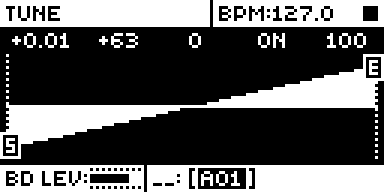

FIN's knob is RATE on every sound: a pure speed control, the Octatrack's RATE with its setting on PTCH. No time stretch, just the sample played faster or slower, down to a stop and on into reverse. Stock's pitch stops at a quarter of the speed. RATE carries on to zero. +63 plays at normal speed, 0 stops the sample, -64 plays it backward at normal speed, and the speed scales in a straight line between them. TUN stays as it is and multiplies RATE, up to stock's 4x. The knob, the header and the LFO destinations all call it RATE.

LOP gets a third value, PIPO, after OFF and ON. A sample whose LOP is PIPO plays its loop forward from STA to END, then backward to STA, then forward again, for as long as the note lasts: a ping-pong loop. ON stays the stock forward loop, which jumps back to STA at END, and OFF plays the sample once. Each turn lands exactly on STA or END, at every pitch, with no jump in the waveform: at the turn the module hands stock's sample DMA the loop's frames in reverse order, so stock's own playback runs straight into the way back. PIPO is an ordinary LOP value. It saves with the sound and the kit, takes parameter locks and scene locks, and comes back after a power cycle. A sound saved with PIPO plays as a normal forward loop on stock OS 1.74 or a build without this mod, because stock reads any nonzero LOP as ON. Stock has no text for PIPO, so LOP reads ERROR there until you turn the knob, which steps between OFF and ON.

FUNC + turn on STA or END moves that point to the next zero crossing of the sample in the direction you turn, stepping as LOP steps through its values, so start and loop points sit where the waveform crosses zero. Plain turns stay stock.

The SMPL key always opens the waveform view (SMPL WAVEFORM), and a second press stays there: the knob-only view is gone. The view shows values, not names: one row holds TUN, RATE, BR, LOOP (OFF, ON or PIPO) and LEV, over a waveform 37 pixels tall instead of 32. STA and END need no number: their lines on the waveform show where they are, a boxed S on STA's and a boxed E on END's. Turning D opens stock's sample list. While any knob turns, the header names it, as stock's does.

RATE starts at +63 on a new or cleared sound. A sound saved with FIN at +0, stock's default and every sound saved before 0.3.0 without SMP RATE, loads with RATE 0 and does not play until RATE is turned up.

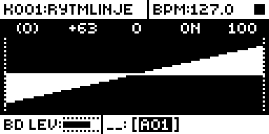

## Controls

| Control | Where | Values |
| --- | --- | --- |
| TUN | SAMPLE page, encoder A | -24.00 to +24.00 semitones, shown with two places. Turn: 1 cent a step, with acceleration. Press and turn: whole semitones, cents kept. FUNC + turn: stock's jump to -24, 0 or +24. |
| RATE | SAMPLE page, encoder B (FIN's knob) | +63 to -64. +63 is 1x, +32 is 0.5x, 0 stops, -32 is -0.5x, -64 is -1x. +63 on a new or cleared sound. |
| LOP | SAMPLE page, encoder G | OFF, ON, PIPO, on a three-position switch. OFF and ON play as stock. PIPO plays the loop between STA and END forward, then backward. |
| FUNC + STA / END | SAMPLE page, FUNC held, encoder E or F | The point steps to the next zero crossing the way you turn, as often as LOP would step a value (more on a fast turn), exactly the frame stock plays from, and only ever to a crossing: with none further that way the point holds. STA and END step past each other freely (END below STA plays backward, as stock) and may share a crossing (a loop of no length: silence). With LOP ON only crossings of the other point's direction. With a trig held in GRID RECORDING it steps that trig's lock (the first detent makes the lock, as stock). Plain turns are stock. |
| SMPL key | Page keys | Opens the SAMPLE page in its waveform view, every time: one row of values (TUN, RATE, BR, LOOP, LEV) over a taller waveform. |

The value row reads LOP's word: OFF, ON or PIPO. Where stock draws LOP's switch (the knob view, shown only if another module brings it back), it is stock's three-position switch, the one BD CLASSIC's WAV uses: OFF on the left, ON in the middle, PIPO on the right. PIPO applies only to the sample layer of a sound, as LOP does.

## Usage

Select a track whose sound plays a sample and press SMPL: the waveform view opens. Turn encoder A for TUN in cents, press and turn it for semitones. Turn encoder B for RATE, encoder G for LOP, and hold FUNC while turning E or F to step STA or END through zero crossings.

### Quick tutorial

1. Press SMPL and turn TUN slowly: it moves 1 cent a step and reads +0.01, +0.02. Spin it faster to cover more ground.
2. Press TUN's knob and turn: whole semitones, the cents kept.
3. Put a long sample on a track, with LOP ON, and set RATE (FIN's knob) to +63. Play the pad and turn RATE down: the sample slows like a stopping turntable and rests at 0.
4. Keep turning below 0: it runs backward, smoothly through the stop. A new trig now starts from END.
5. Turn LOP (knob G) past ON to PIPO and play the sound: the loop between STA and END goes back and forth. Set them around a sustained part (a pad, a vowel) for a seamless drone.
6. Hold FUNC and turn STA (or END): the point steps from zero crossing to zero crossing, so the loop starts and ends where the waveform crosses zero.

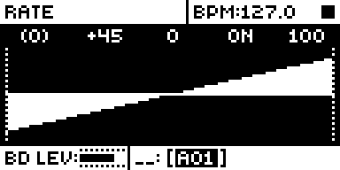

 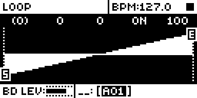 

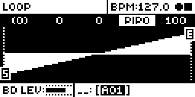 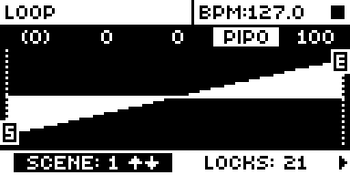

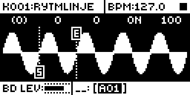 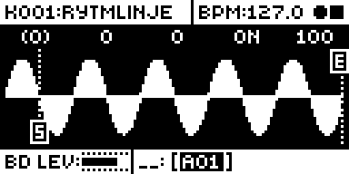

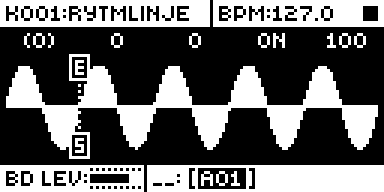 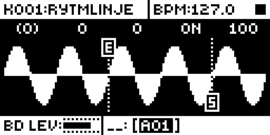 

### What it overrides and what still applies

RATE replaces FIN in the sample's pitch. TUN, the trig's note on a chromatic track and every modulation of TUN still apply, and multiply RATE. Parameter locks, scene and performance locks and LFOs reach RATE as they reached FIN: it is the same parameter, and the sample glides between values as stock's parameters do. STA, END and the sample slot behave as stock; LOP adds PIPO. It covers the sample layer of a sound on any track; the analog voice is untouched. FIN's MIDI CC 25 sets RATE, and it holds across trigs as FIN does on stock.

- With RATE below 0 a trig starts from END and plays towards STA. With END set below STA (stock's backward play) that makes it run forward, the opposite way to stock's backward.
- With LOP ON the sample loops the way it is going. With LOP OFF it plays once and stops at STA. With LOP PIPO it turns at STA and END whichever way RATE runs.
- At 0 the voice holds its last value while the AMP envelope is open, like a stopped tape.

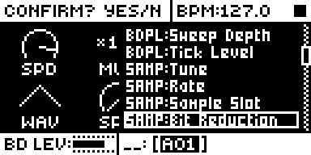

### Changes to stock flows

- **The SMPL key shows the waveform view only.** What changes: stock's SMPL key opens the SAMPLE page on its knob view or its waveform view and toggles between them; with this mod it always opens SMPL WAVEFORM and a second press stays there. Why: the author wants the sample in view while editing it; the waveform view already carries all eight knob names, and each value shows while its knob turns, so only the dials go. What you see: the waveform every time. It applies only in a build with this mod; with another module that adds a page behind the SMPL key, the knob view stays in the cycle. Checked beside it: SMPL held + PLAY still clears the page (CLEAR PAGE SMPL WAVEFORM), and knob turns, locks and the header work as on stock's waveform view. A stock page that behaves differently by default needs the owner's agreement: asked in the pull request.
- **SMPL WAVEFORM shows values in one row.** What changes: stock's waveform view names the eight knobs in two rows, above and below a 32-pixel waveform, and shows a knob's value only while it turns; with this mod one row shows the values of TUN, RATE, BR, LOP and LEV all the time, the waveform is 37 pixels tall, and STA, END and SMP have no text. Why: the author knows where each knob sits and wants the numbers: TUN in cents and RATE matter most, LOP's word (OFF, ON, PIPO) says how the sample plays, and STA and END are already drawn as lines on the waveform, so their numbers and the SMP label were clutter. What was considered: values in place of the eight names (stock's own view while SMPL is held), and keeping the names. What you see: the row of values; while a knob turns, the header names it, as stock; D still opens stock's sample list. With a trig held, the row's locks are boxed as stock boxes them; a lock on STA, END or SMP shows no box (the line moves). It applies only in a build with this mod. Checked in rytm-emu: every knob's turn, the sample list, a held trig's locks, no sample, BD's playhead, the PIPO word and the S and E labels. The owner reviews this change.
- **S and E labels on SMPL WAVEFORM.** What changes: the STA line gets a small boxed S at its bottom and the END line a boxed E at its top (7 x 9 pixels each). Why: stock draws both as the same dotted line, and one line only when they share a column, so with zero snap moving them crossing by crossing a musician could not tell which is which, or that both sit on one column. What you see: the two labels, drawn over the waveform; the lines, the waveform and the playhead are stock's. It applies only in a build with this mod. Checked: points at the sample's ends, sharing a column, END before STA, and playing. This changes how a stock screen looks, so it needs the owner's agreement.
- **TUN's turn.** What changes: a plain turn of TUN moves 1 cent a step instead of a semitone, and a press and turn moves one semitone a step instead of stock's fast turn. Why: a sample needs tuning between semitones, and FIN no longer detunes. The knob turns as stock's STA and END do, fine plain and coarse pressed. What you see: the value with two places, as stock's LFO depth shows it (+3.00, (0) at zero), instead of whole semitones. FUNC + turn, CC 24 and every other way to set TUN are stock's. It applies only in a build with this mod. Loop Sync takes FUNC + TUN's counts in `ev_enc`, before stock turns them (read in its code, not run beside it).
- **FIN is RATE on every sound.** What changes: FIN no longer detunes; it sets the sample's speed, its default is +63 instead of +0, and its name is RATE (short) and Rate (long) on every screen. Why: fine tuning moved to TUN, so FIN's knob is free for RATE, and a per-sound switch (0.1.x and 0.2.0: a SOUND SETTINGS row and a tap of the knob) is no longer needed, which gives the knob's press back to stock. What you see: RATE on the SAMPLE page, in the header and in the LFO destination list (SAMP:Rate). It changes how saved sounds play: one saved with FIN at +0 loads stopped, and one saved with a FIN detune plays at that speed. It applies only in a build with this mod: on stock OS FIN is FIN again, so a RATE of +63 plays about a semitone sharp. The owner reviews this change.
- **LOP has a third value.** What changes: turning LOP clockwise past ON now reaches PIPO; locks and scenes can hold PIPO. Why: a musician looks for loop behaviour on LOP, and a third value needs no new page, key gesture or menu row (a FUNC gesture on the SAMPLE page was considered, but FUNC + STA, END and LOP are stock's coarse steps and FUNC + TUN and FIN belong to Loop Sync). What you see: the value reads PIPO; where LOP's switch is drawn it has three positions like BD CLASSIC's WAV, so ON shows the knob in the middle (stock: on the right). It applies only in a build with this mod; leave LOP on OFF or ON for stock behaviour. Checked: OFF and ON play exactly as stock, LOP's p-locks and scene locks, kit save through power-off, MIDI CC 30.
- **FUNC + turn on STA and END.** What changes: stock steps STA and END by whole numbers with FUNC held; with this mod each FUNC detent moves the point to the next zero crossing of the sample instead. Why: a musician sets start and loop points where they would click least, on the SAMPLE page's own knobs, the way the Octatrack's audio editor steps through crossings; a new page or gesture was not needed. What you see: the point jumps crossing by crossing, on the sound or, with a trig held, on that trig's lock; plain turns are unchanged. It applies only in a build with this mod. Checked: plain turns, lock editing in GRID and LIVE RECORDING, FUNC + TUN and FIN (Loop Sync's), LOP, Silent Pad+Trig's pads and TRIG keys. This moves a stock gesture, so it needs the owner's agreement.
- **MIDI CC 30 (LOP).** Stock writes CC 30's value into LOP unchanged (0 is OFF, anything else ON). With this mod a CC value of exactly 2 gives PIPO; every other value does what it did, and other OFF/ON parameters are unchanged.

## Compatibility and limitations

- OS 1.74 only, with core-ar2 0.7. No other module is needed. It links beside Silent Pad+Trig, Loop Sync and Filter Hz, with no shared sites. Ping Pong Loop is part of it since 0.6.0: never install the two together.
- Sites, fine TUNE: stock's add of a turn to a value (0x400a88ea), where a plain turn of TUN becomes cents; one data word, TUN's fine-lock flag in its parameter row (0x401c03c8); TUN's turn profile in its RAM record (written each UI tick); the value text through core-ar2's `core_params`.
- The waveform view's layout: one site in the SAMPLE view's own knob loop (0x400d20ee), where stock calls a knob's text routine; the module calls the same routine with the row's place and the value shown. The taller waveform is no site: the widget's y and height in the view's RAM (view + 400, +32 and +40) move from stock's 16 and 32 to 10 and 37, once, while they are still stock's.
- The SMPL key: no site; each UI tick the module finds the SAMPLE view (vtable 0x401e3420) in the view manager's stack and, where its own page list is exactly the knob page then the waveform, counts it as one page with the waveform selected.
- Sites, RATE: the audio interrupt just before the sample prefetch (0x4012112c), TUN and FIN's read and the step's write in the prefetch's rate loop (0x4011c644, 0x4011c686), and three words of FIN's parameter row: its default (0x401c03f8) and its long and short name pointers (0x401c0410, 0x401c0418). It subscribes to `ev_tick` and `ev_enc` for TUN's turn. No storage.
- Sites, PIPO: the audio interrupt's call to the voice 0 sample prefetch at 0x40121134 (a `jsr`, through a gate that tail-calls stock; it runs after RATE's gate at 0x4012112c, which swaps STA and END for a voice going backward), the shared OFF/ON value-text routine at 0x400fb56c (prints PIPO for 2 on LOP's own record, stock text otherwise, so another OFF/ON parameter set to 2 over MIDI still reads ON), LOP's maximum in stock's parameter table at 0x401c04f8 (data, 1.0 to 2.0), and the shared OFF/ON switch icon at 0x400fedf4 (for LOP's record only it tail-calls the three-position switch routine BD CLASSIC's WAV uses, with stock's own frames). Exact turns take the four places stock's prefetch sets a sample DMA's source (0x4011c58a and 0x4011c5e6 for voice 0, 0x4011cb2e and 0x4011cb98 for voices 1-7).
- Sites, zero snap and labels: with FUNC held, a turn on STA or END is read through LOP's encoder profile (0x4003a0de, before stock's encoder engine); zero snap takes the encoder handler's apply-delta call at 0x4003a240 and its lock call at 0x4003a19c, and stock's per-trig lock edit at 0x40037f6c (STA and END with FUNC held only; every other turn passes through). The S and E labels are drawn as stock's waveform widget finishes (0x4006ce72, the end of its draw routine, which only SMPL WAVEFORM calls). Loop Sync's audio hook at 0x40121020 runs earlier in the same interrupt, and its FUNC + TUN and FIN are not touched.
- RATE never goes above 1x by itself, as on the Octatrack. TUN does: stock's ceiling of about 4x either way stands, set by its 140-frame read window.
- Below 0 the module swaps the effective STA and END before stock's prefetch reads them, so stock plays the sample backward. A change of direction on a looping voice waits until it is 32 frames clear of STA and END: about 0.7 ms at 1x, longer as RATE nears zero (53 ms at 1/64x). A trig does not wait. With LOP PIPO the turns stayed exact in rytm-emu at every RATE tried, forward, backward and below one frame a block.
- With LOP OFF, once the sample has played out, changing RATE does not bring it back: trig again.
- A sample previewed with FUNC + YES in a sample list plays at 1x, forward, as on stock, whatever the track's RATE; with an LFO on RATE it plays without the small pitch bend stock's preview takes from an LFO on FIN. Stock's preview plays on the active track's voice with the sample in its own slot (129, past the project's 127) and FIN at rest, which an LFO on RATE still moves; the module plays any voice whose SMP slot is 128 or above at 1x and never turns it backward. A project's slots stay at 127 or below, even under an LFO on SMP, so nothing else changes. If stock also previews a Sound from the SOUND BROWSER from slot 129, that preview plays at 1x whatever the Sound's RATE (not run).
- Scene and performance locks should reach RATE as they reached FIN; not run.
- On stock OS, or a build without this mod, a saved sound plays FIN as FIN: by the code, RATE +63 is about a semitone sharp and RATE -64 a semitone flat. PIPO plays as ON and LOP reads ERROR until the knob is turned (seen on a unit). Sounds and kits keep the values, so loading them again with the mod brings RATE and PIPO back.
- MIDI CC 24 sets TUN in whole semitones and clears the cents, as stock's CC does. NRPN keeps them to 1/128 semitone.
- TUN's cents are shown on the SAMPLE page only: LFO destinations, a sound lock's list and stock OS show the whole number. The pitch is the same everywhere.
- A TUN lock in cents keeps its cents through a pattern save because TUN's row now carries stock's fine-lock flag, as STA and END do: the pattern saves one more lock lane for that track, of stock's 72, and stock OS loads it. A pattern saved by a build without this mod drops the cents of such locks.
- With END on the sample's very last frame a PIPO turn can land up to 7 frames off; set END a little before the end. Exact turns rely on the DMA reading frames the module writes (it pushes the data cache first); rytm-emu does not model the cache, so the unit has to confirm it.
- Stock plays a loop of at least 141 frames; loops shorter than 160 frames stay stock's forward loop under PIPO. A new trig always starts forward from STA, as stock does (backward from END with RATE below 0).
- Zero snap is exact for samples up to 30,720 frames (0.64 s at 48 kHz). STA and END are steps of 1/30,720 of the sample, so on a longer sample the point lands on the nearest step, at most frames / 61,440 frames from the crossing: 1 frame at 1 s, about 4 at 5 s, 8 at 10 s, 47 at 60 s.
- Silence and near-zero DC (within 8 of zero, about -72 dB) count as neither sign: a snap passes over them and lands at their edge. The search reaches about 5.5 s of sample a step; with nothing found, the point holds. The sample's first frame and its end count as crossings only where the sample is at zero there; otherwise the first and last crossings are as far as FUNC turns go.
- STA and END glide to a new value over a fraction of a second, as stock does for every change: while a FUNC turn settles, a loop wrap or PIPO turn can land between crossings and click. Once the point has settled it plays from the crossing.
- A PIPO turn on a crossing can still give a soft knock on a pure tone: the waveform's slope reverses at the turn, which no choice of frame avoids. A forward loop (LOP ON) between two crossings of one direction joins smoothly.
- The STA and END lines on the SMPL WAVEFORM view are stock's drawing: one column covers many frames (about 225 for a 0.6 s sample), and stock spaces the lines over 123 columns but the waveform over 124, so a line can sit one column left of the crossing it is on. The frame stock plays from is the one the snap set.
- Not tested on a unit: see [TESTING.md](TESTING.md).

## Tests and measurements

rytm-emu on OS 1.74, on a 23,777-frame ramp: the step word is exact at every RATE tried, a trig below 0 starts from END, and with PIPO no case clicks. PIPO and the zero snap (Ping Pong Loop's builds PP13 to PP21): the value steps OFF/ON/PIPO, PIPO turns exactly at STA and END from TUN -24 to +24, p-locks and scene locks, two voices, retrig, persistence through power-off, stock 1.74 loading PIPO as a normal loop, zero snap on the sound and on held trigs' locks, the S and E labels. 0.6.0 replays every documented capture of both former modules frame for frame against the two side by side. The author ran RATE and TUN on a unit as SP03 to SP13 (0.1.x), with an automated rig (0.2.0 to 0.4.0), by hand in combo images beside Ping Pong Loop (0.5.0) and as SU02 (0.5.1); PIPO and the zero snap as PP14, RC07 and LF01. Details, builds and what was not run are in [TESTING.md](TESTING.md). Load: the RATE handler returns at once while no track's RATE is below 0; PIPO tests one byte of armed voices per block, then the once-a-block pass over the eight voices.

## Authorship and licences

Original code by Nathaniel Pavel (@npp1993), GPL-3.0-or-later ([LICENSE](LICENSE)). The speed formula follows the Octatrack's published behaviour of RATE on PTCH. The OS 1.74 addresses were read by the author from their own stock firmware; the build carries addresses, lengths and SHA-256 guards only, no stock bytes. Screens show Elektron's interface solely to document the modification ([media/LICENSE.md](media/LICENSE.md)). No Elektron firmware is included.

## Screens and audio

Screenshots are rytm-emu captures of build SP01 (0.6.0) ([media/capture.json](media/capture.json)), the zero-snap and label ones on a generated slow sine. No audio preview yet.
