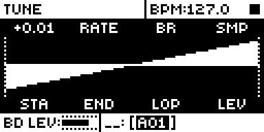
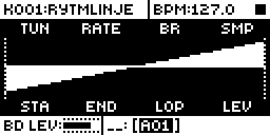
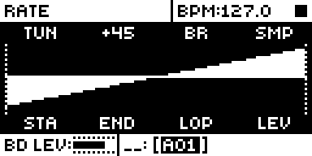
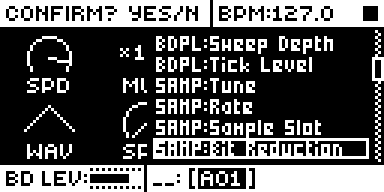

# Improved SMPL

An Analog Rytm MKII mod by Nathaniel Pavel (@npp1993). Version 0.4.0-experimental, OS 1.74 with core-ar2 0.7. Called Sample Playback Rate before 0.2.0 and Fine Tune + Sample Rate in 0.2.0 and 0.3.0; its id stays `sample-rate`.

## Overview

Improved SMPL improves the Rytm's SAMPLE page: fine tuning on TUN, RATE on FIN's knob, and the SMPL key always shows the waveform.

TUN on the SAMPLE page turns in cents: a plain turn moves 1 cent a step, faster as you spin it, and a press and turn moves whole semitones and keeps the cents. The value reads with two places, as LFO depth does: +3.07, +3.00, and (0) at zero. The cents are kept in TUN's own value, which stock's engine already plays and stock's sound, kit and SysEx already save, so a saved sound plays the same pitch on stock OS, which shows only the whole number.

FIN's knob is RATE on every sound: a pure speed control, the Octatrack's RATE with its setting on PTCH. No time stretch, just the sample played faster or slower, down to a stop and on into reverse. Stock's pitch stops at a quarter of the speed. RATE carries on to zero. +63 plays at normal speed, 0 stops the sample, -64 plays it backward at normal speed, and the speed scales in a straight line between them. TUN stays as it is and multiplies RATE, up to stock's 4x. The knob, the header and the LFO destinations all call it RATE.

The SMPL key always opens the waveform view (SMPL WAVEFORM), and a second press stays there: the knob-only view is gone. All eight knob names sit above and below the waveform, and each knob's value shows while it turns.

RATE starts at +63 on a new or cleared sound. A sound saved with FIN at +0, stock's default and every sound saved before 0.3.0 without SMP RATE, loads with RATE 0 and does not play until RATE is turned up.

## Controls

| Control | Where | Values |
| --- | --- | --- |
| TUN | SAMPLE page, encoder A | -24.00 to +24.00 semitones, shown with two places. Turn: 1 cent a step, with acceleration. Press and turn: whole semitones, cents kept. FUNC + turn: stock's jump to -24, 0 or +24. |
| SMPL key | Page keys | Opens the SAMPLE page in its waveform view, every time. |
| RATE | SAMPLE page, encoder B (FIN's knob) | +63 to -64. +63 is 1x, +32 is 0.5x, 0 stops, -32 is -0.5x, -64 is -1x. +63 on a new or cleared sound. |

## Usage

Select a track whose sound plays a sample and press SMPL: the waveform view opens. Turn encoder A for TUN in cents, press and turn it for semitones. Turn encoder B for RATE.

### Quick tutorial

1. Press SMPL and turn TUN slowly: it moves 1 cent a step and reads +0.01, +0.02. Spin it faster to cover more ground.
2. Press TUN's knob and turn: whole semitones, the cents kept.
3. Put a long sample on a track, with LOP ON, and set RATE (FIN's knob) to +63. Play the pad and turn RATE down: the sample slows like a stopping turntable and rests at 0.
4. Keep turning below 0: it runs backward, smoothly through the stop. A new trig now starts from END.

### What it overrides and what still applies

RATE replaces FIN in the sample's pitch. TUN, the trig's note on a chromatic track and every modulation of TUN still apply, and multiply RATE. Parameter locks, scene and performance locks and LFOs reach RATE as they reached FIN: it is the same parameter, and the sample glides between values as stock's parameters do. STA, END, LOP and the sample slot behave as stock. It covers the sample layer of a sound on any track; the analog voice is untouched. FIN's MIDI CC 25 sets RATE, and it holds across trigs as FIN does on stock.

- With RATE below 0 a trig starts from END and plays towards STA. With END set below STA (stock's backward play) that makes it run forward, the opposite way to stock's backward.
- With LOP ON the sample loops the way it is going. With LOP OFF it plays once and stops at STA.
- At 0 the voice holds its last value while the AMP envelope is open, like a stopped tape.

### Changes to stock flows

- **The SMPL key shows the waveform view only.** What changes: stock's SMPL key opens the SAMPLE page on its knob view or its waveform view and toggles between them; with this mod it always opens SMPL WAVEFORM and a second press stays there. Why: the author wants the sample in view while editing it; the waveform view already carries all eight knob names, and each value shows while its knob turns, so only the dials go. What you see: the waveform every time. It applies only in a build with this mod; with another module that adds a page behind the SMPL key, the knob view stays in the cycle. Checked beside it: SMPL held + PLAY still clears the page (CLEAR PAGE SMPL WAVEFORM), and knob turns, locks and the header work as on stock's waveform view. A stock page that behaves differently by default needs the owner's agreement: asked in the pull request.
- **TUN's turn.** What changes: a plain turn of TUN moves 1 cent a step instead of a semitone, and a press and turn moves one semitone a step instead of stock's fast turn. Why: a sample needs tuning between semitones, and FIN no longer detunes. The knob turns as stock's STA and END do, fine plain and coarse pressed. What you see: the value with two places, as stock's LFO depth shows it (+3.00, (0) at zero), instead of whole semitones. FUNC + turn, CC 24 and every other way to set TUN are stock's. It applies only in a build with this mod. Loop Sync takes FUNC + TUN's counts in `ev_enc`, before stock turns them (read in its code, not run beside it).
- **FIN is RATE on every sound.** What changes: FIN no longer detunes; it sets the sample's speed, its default is +63 instead of +0, and its name is RATE (short) and Rate (long) on every screen. Why: fine tuning moved to TUN, so FIN's knob is free for RATE, and a per-sound switch (0.1.x and 0.2.0: a SOUND SETTINGS row and a tap of the knob) is no longer needed, which gives the knob's press back to stock. What you see: RATE on the SAMPLE page, in the header and in the LFO destination list (SAMP:Rate). It changes how saved sounds play: one saved with FIN at +0 loads stopped, and one saved with a FIN detune plays at that speed. It applies only in a build with this mod: on stock OS FIN is FIN again, so a RATE of +63 plays about a semitone sharp. The owner reviews this change.

## Compatibility and limitations

- OS 1.74 only, with core-ar2 0.7. No other module is needed. It links beside Pipo Loop, Silent Pad+Trig, Loop Sync and Filter Hz, with no shared sites.
- With LOP PIPO, Pipo Loop's turns stayed exact in rytm-emu at every RATE tried, forward, backward and below one frame a block; a unit has to confirm it.
- Sites, fine TUNE: stock's add of a turn to a value (0x400a88ea), where a plain turn of TUN becomes cents; one data word, TUN's fine-lock flag in its parameter row (0x401c03c8); TUN's turn profile in its RAM record (written each UI tick); the value text through core-ar2's `core_params`.
- The SMPL key: no site; each UI tick the module finds the SAMPLE view (vtable 0x401e3420) in the view manager's stack and, where its own page list is exactly the knob page then the waveform, counts it as one page with the waveform selected.
- Sites, RATE: the audio interrupt just before the sample prefetch (0x4012112c), TUN and FIN's read and the step's write in the prefetch's rate loop (0x4011c644, 0x4011c686), and three words of FIN's parameter row: its default (0x401c03f8) and its long and short name pointers (0x401c0410, 0x401c0418). It subscribes to `ev_tick` and `ev_enc` for TUN's turn. No storage.
- RATE never goes above 1x by itself, as on the Octatrack. TUN does: stock's ceiling of about 4x either way stands, set by its 140-frame read window.
- Below 0 the module swaps the effective STA and END before stock's prefetch reads them, so stock plays the sample backward. A change of direction on a looping voice waits until it is 32 frames clear of STA and END: about 0.7 ms at 1x, longer as RATE nears zero (53 ms at 1/64x). A trig does not wait.
- With LOP OFF, once the sample has played out, changing RATE does not bring it back: trig again.
- Scene and performance locks should reach RATE as they reached FIN; not run.
- On stock OS, or a build without this mod, a saved sound plays FIN as FIN: by the code, RATE +63 is about a semitone sharp and RATE -64 a semitone flat.
- MIDI CC 24 sets TUN in whole semitones and clears the cents, as stock's CC does. NRPN keeps them to 1/128 semitone.
- TUN's cents are shown on the SAMPLE page only: LFO destinations, a sound lock's list and stock OS show the whole number. The pitch is the same everywhere.
- A TUN lock in cents keeps its cents through a pattern save because TUN's row now carries stock's fine-lock flag, as STA and END do: the pattern saves one more lock lane for that track, of stock's 72, and stock OS loads it. A pattern saved by a build without this mod drops the cents of such locks.
- Not tested on a unit: see [TESTING.md](TESTING.md).

## Tests and measurements

rytm-emu on OS 1.74, on a 23,777-frame ramp: the step word is exact at every RATE tried, a trig below 0 starts from END, and with Pipo Loop no case clicks. Details, builds and what was not run are in [TESTING.md](TESTING.md). The author ran it on a unit as test builds SP03 to SP13 (0.1.x) and with an automated rig (0.2.0, 0.3.0; [TESTING.md](TESTING.md)). Load: the block handler returns at once while no track's RATE is below 0; with one below 0, as 0.1.0 with RATE on (not measured for 0.3.0).

## Authorship and licences

Original code by Nathaniel Pavel (@npp1993), GPL-3.0-or-later ([LICENSE](LICENSE)). The speed formula follows the Octatrack's published behaviour of RATE on PTCH. The OS 1.74 addresses were read by the author from their own stock firmware; the build carries addresses, lengths and SHA-256 guards only, no stock bytes. Screens show Elektron's interface solely to document the modification ([media/LICENSE.md](media/LICENSE.md)). No Elektron firmware is included.

## Screens and audio

Screenshots are rytm-emu captures of build SR43 (0.4.0) ([media/capture.json](media/capture.json)). No audio preview yet.
