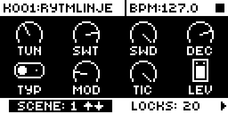

# Scene Mutes

## Overview

Scene Mutes lets each scene carry its own track mutes. In scene edit, FUNC + a trig key
toggles that track in the edited scene's mute mask (T1 to T12 for the sound tracks, T13 for
FX). The first toggle marks the scene as one that sets mutes.

- Engaging a marked scene replaces the mutes with its mask.
- Engaging an unmarked scene, or none, puts back the mutes from before the first scene.
- A mute changed by hand or by MIDI while a scene is engaged goes into that saved state too,
  so disengaging keeps it.
- `<CLEAR>` drops the edited scene's mask and mark, `<CLEAR ALL>` every scene's.

Scenes engaged from the pads, CC 92, NRPN and Overbridge all count. Each mute change is a
normal mute with no MIDI echo, so screens and notices follow and nothing is sent as CC 94.

Version **0.1.0-experimental** for Analog Rytm MKII OS **1.74**, with core-ar2 0.7. It is a
port of MrScruff's `0018-scene-mutes` from
[rytm-mods-src](https://github.com/Iced-Cream/rytm-mods-src), with his code unchanged, moved
from OS 1.73 to 1.74. It passed its tests on a unit ([TESTING.md](TESTING.md)).

## Controls

| Control | Action |
| --- | --- |
| SCENE (held) + FUNC + T1..T13 | Toggles that track in the edited scene's mute mask and marks the scene; T13 is FX. |
| SCENE (held) + FUNC (held) | The trig keys light for the tracks the edited scene mutes. |
| SCENE (held) + FUNC + pad | Stock: picks the scene to edit without engaging it, so a mask can be set silently. |
| `<CLEAR>` / `<CLEAR ALL>` in scene edit | Also drop the edited scene's, or every scene's, mask and mark. |

## Usage

Scene edit: hold SCENE until it opens, then FUNC + T1..T13.

### Quick tutorial

1. Hold SCENE until scene edit opens (FUNC pressed straight after SCENE does not open it).
2. Hold FUNC and press T1 and T2: the scene now mutes BD and SD, and those keys light while FUNC is held.
3. Release SCENE, start the pattern and engage the scene (SCENE + its pad): BD and SD mute.
4. Disengage it: the mutes come back as they were before.

## Compatibility and limitations

Requires core-ar2 0.7 on OS 1.74. Use your own original stock OS 1.74 file.

- While SCENE is held the module takes FUNC + trig in every mode, so grid record's trigless
  lock trig and step record's track preview on that gesture are hidden until SCENE is released.
- The masks live in the current kit's record in the stored project, in bytes stock leaves
  alone and core-ar2's kit storage does not use. They persist with the project and follow kit
  changes, and edits are saved at once: RELOAD does not revert them.
- Kit copy and paste, SysEx kit transfer, COPY/PASTE SCENE and clearing a kit do not carry
  or clear the masks.
- A kit change while a scene is engaged keeps the old saved mutes; a kit that loads with a
  scene active saved none, so disengaging leaves the mutes as they are.
- Overbridge's silent mute path is not followed into the saved mutes.

The module patches six sites, none shared with the core, the base or another module:

| Address | Bytes | Op |
| --- | --- | --- |
| `0x401e2ef0` | 4 | ptr `scene_mutes_keys` (SceneEditView key handler) |
| `0x401e2efc` | 4 | ptr `scene_mutes_leds` (SceneEditView LED update) |
| `0x400d0a74` | 6 | bytes, `<CLEAR>`'s action to `scene_mutes_clear` |
| `0x400d0afc` | 6 | bytes, `<CLEAR ALL>`'s action to `scene_mutes_clear_all` |
| `0x400a7d70` | 8 | jmp `scene_mutes_ksa` (scene engage entry) |
| `0x400b78d8` | 8 | jmp `scene_mutes_tms` (track mute entry) |

## Tests and measurements

See [TESTING.md](TESTING.md). In short: in rytm-emu on OS 1.74 with core-ar2 0.7, FUNC +
T1, T2 in scene edit lights T1 and T2, engaging the scene mutes BD and SD and disengaging
unmutes them, where the base alone does nothing. On a unit (run T210) the same held, the mask
survived a power cycle and `<CLEAR>` dropped it. Memory: about 1 KB of the
shared mod area. There is no code in the audio, sequencer or tick paths.

## Screens and audio

This capture is from rytm-emu running SM01, the Modwerk base for core-ar2 0.7 with Scene
Mutes, built from stock OS 1.74 ([capture provenance](media/capture.json)). The module draws
nothing on the screen: its mask shows on the trig keys. It changes no sound, so there is no
audio demonstration.

Scene edit with SCENE and FUNC held, after T1 and T2: on the unit, T1 and T2 light for the
tracks the scene mutes.

## Authorship and licences

MrScruff: the original mod (rytm-mods `0018-scene-mutes`), its design and code, published in
rytm-mods-src with his permission. Iced-Cream: this module and its move to OS 1.74. irpina:
Elekloader and core-ar2.

Code: [GPL-2.0-only](LICENSE), as rytm-mods-src. `include/ar2-1.74.inc` names firmware
routines by address only. No Elektron firmware is included.
