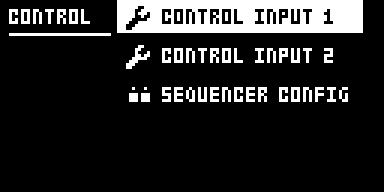
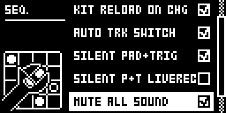
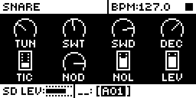

# Silent Pad+Trig Settings

## Overview

Silent Pad+Trig Settings adds three checkboxes to GLOBAL > CONTROL > SEQUENCER CONFIG, just after AUTO TRK
SWITCH. The first two let a pad or TRIG key press pick a track without sounding it; the third makes a
mute silence everything you play:

- **SILENT PAD+TRIG** covers every state but LIVE and STEP RECORDING: stopped, playing, GRID
  RECORDING and the other modes. A pad or TRIG key 1-12 press selects its track and stays silent,
  with no MIDI note out.
- **SILENT P+T LIVEREC** covers LIVE RECORDING: a pad or TRIG key 1-13 press stays silent and records
  nothing; pads and TRIG 1-12 select their track.
- **MUTE ALL SOUND** extends a mute. On stock a muted track skips its sequencer trigs but still
  plays from a pad, TRIG key or MIDI note. Checked, those start no voice on it either, so nothing
  reaches the main outs, delay or reverb, and a pad or TRIG key sends no MIDI note on or poly pressure. Recording is untouched: tap a muted track in LIVE
  RECORDING and the trig goes down in silence.

Wherever one of the first two applies, hold FUNC and press the pad to play it at the pad's own
velocity, and FUNC + TRIG to play its track at the TRIG page's VEL, as a plain TRIG press does on
stock; in LIVE RECORDING both also record. Those two leave STEP RECORDING stock and aftertouch
untouched: holding a pad down modulates its track without sounding it. All three are unchecked by
default, and unchecked, everything is stock.

| Input | Stopped, playing, or GRID REC (SILENT PAD+TRIG) | LIVE REC (SILENT P+T LIVEREC) | STEP REC |
| --- | --- | --- | --- |
| Pad | selects its track, silent | selects its track, silent, records nothing | stock |
| FUNC + pad | plays, at the pad's own velocity | plays and records, at the pad's own velocity | stock |
| Pad held down (aftertouch) | modulates its track, as stock | the same | stock |
| TRIG 1-12 | selects track n, silent (in GRID REC they place trigs, as stock) | selects track n, silent, records nothing | stock |
| TRIG 13 (the FX track) | silent | silent, records nothing | stock |
| FUNC + TRIG 1-13 | plays, at the TRIG page's VEL (in GRID REC it places a trig, as stock) | plays and records, at the TRIG page's VEL | stock: plays the track and selects it |
| RTRG + pad | selects, silent (FUNC + RTRG toggles the click, as stock) | the same | stock |

Each column follows only its own checkbox: with SILENT P+T LIVEREC unchecked, pads and TRIG keys play
and record in LIVE RECORDING as stock whatever SILENT PAD+TRIG says, and the reverse. LIVE RECORDING counts only
while the sequencer runs; a paused LIVE REC follows SILENT PAD+TRIG.

MUTE ALL SOUND holds in every state, STEP RECORDING included, and FUNC + pad does not get past it.
A track counts as muted by its own mute, or because another track is soloed. MUTE ALL SOUND holds
for every PAD DEST setting: with pads set to send MIDI only, a muted pad sends no note on either. Two tracks that share a voice are judged apart: with CP muted, a CP pad leaves a
ringing RS alone, and RS plays as usual.

This holds wherever stock would play a pressed pad or TRIG key: on any page, with a menu open, in
the SOUND BROWSER, with the FX track selected, and in CHAIN, SONG, FILL, PERF and SCENE modes
(where the pads keep their own jobs and only the TRIG keys stop playing). A silent press sends no
MIDI note and leaves no held note, so its release cuts nothing the sequencer plays. In CHROMATIC
mode the pads play as stock, and TRIG 1-12 select silently there too. MUTE mode, TRK + pad, QPER +
pad, NO + pad, BANK + TRIG, MIDI notes in, TRIG + YES and the sequencer itself are as stock.

Version **0.8.0-experimental** for Analog Rytm MKII OS **1.74**, with core-ar2 0.3. It is
Nathaniel Pavel's (@npp1993) own mod, not a port. It was first written as Pad Select (`pad-select` 0.2, row
PAD+TRIG SEL TRK) in a local checkout of [rytm2_mods](https://github.com/Iced-Cream/rytm2_mods)
that was never published there; Modwerk is its home. 0.4.x had one checkbox covering both columns
above; 0.5.0 splits it in two so silent pads while editing and silent pads while live recording
can be chosen separately; 0.5.1 renames its second row from SILENT LIVE REC to SILENT PAD LIVEREC
and changes nothing else; 0.6.0 adds MUTE ALL SOUND; 0.7.0 lets FUNC + TRIG play where TRIG keys are
silent and has the LIVE REC row cover the TRIG keys too, renaming it SILENT P+T LIVEREC; 0.8.0 lets
RTRG + a muted pad record its whole roll in LIVE RECORDING without taking a shared voice. 0.3.0, 0.4.0, 0.5.0 and 0.5.1 ran on a unit; 0.5.1 also ran in rytm-emu (build PS08). 0.6.0
ran on a unit as builds PS10, PS11 and PS12, as reported. 0.7.0 ran on a unit as PS14 and as PS16, which renames the row and its storage field, as reported. 0.8.0 ran on a unit in the combined build AT04, as reported.

## Controls

| Control | Action |
| --- | --- |
| SILENT PAD+TRIG | Checkbox in GLOBAL > CONTROL > SEQUENCER CONFIG, after AUTO TRK SWITCH. Outside LIVE and STEP RECORDING, pads and TRIG 1-12 select silently. YES toggles it, RIGHT checks, LEFT unchecks. Unchecked by default. |
| SILENT P+T LIVEREC | Checkbox after SILENT PAD+TRIG. In LIVE RECORDING, pads and TRIG 1-13 are silent and record nothing; pads and TRIG 1-12 select their track. YES toggles it, RIGHT checks, LEFT unchecks. Unchecked by default. |
| MUTE ALL SOUND | Checkbox after SILENT P+T LIVEREC. A pad, TRIG key or MIDI note starts no voice on a muted track, and a pad or TRIG key sends no MIDI note on or poly pressure; recording is untouched. YES toggles it, RIGHT checks, LEFT unchecks. Unchecked by default. |
| FUNC + pad | Where SILENT PAD+TRIG or SILENT P+T LIVEREC applies, plays the pad's track at the pad's own velocity (the fixed velocity with FIX on); in LIVE RECORDING it also records. |
| FUNC + TRIG 1-13 | Where SILENT PAD+TRIG or SILENT P+T LIVEREC applies, plays the track at the TRIG page's VEL, as a plain TRIG press does on stock; in LIVE RECORDING it also records. GRID and STEP RECORDING keep stock's FUNC + TRIG. |
| Pad held down | Aftertouch, as stock: modulates the track's AFTERTOUCH destinations, also after a silent press. |

All three settings are kept per GLOBAL slot, in core-ar2's mod storage (one bit each,
`silent_pad_trig_on`, `silent_pt_live_rec_on` and `silent_mute_on`), and saved with the project's globals. No knob, page or effect slot is added.

## Usage

Check the boxes once per GLOBAL slot you want them in. AUTO TRK SWITCH keeps its own setting: a silent
press always selects its track; a press that plays follows AUTO TRK SWITCH, as stock. To hear a
track, use FUNC + pad, or FUNC + TRIG to hear it at VEL. With an AFTERTOUCH destination set
on a sound, tap its pad and keep pressing to modulate the track without playing it.

### Quick tutorial

1. Use a build containing Silent Pad+Trig Settings. Open the GLOBAL menu, then CONTROL > SEQUENCER CONFIG. After AUTO TRK SWITCH are SILENT PAD+TRIG, SILENT P+T LIVEREC and MUTE ALL SOUND; check any with YES or LEFT/RIGHT.
2. With SILENT PAD+TRIG checked and the sequencer stopped, tap the SD pad: it makes no sound and the SD track is selected. Hold FUNC and tap SD to hear it at the pad's own velocity. TRIG 5 selects track 5 silently; FUNC + TRIG 5 plays it at VEL.
3. With SILENT P+T LIVEREC checked, press RECORD + PLAY for LIVE RECORDING: plain pad and TRIG key taps stay silent and record nothing; hold FUNC and tap a pad or TRIG key to play and record it. Uncheck both to get stock behaviour everywhere.
4. With MUTE ALL SOUND checked, mute BD in MUTE mode, press RECORD + PLAY and tap BD: you hear nothing. Stop, unmute BD and play: the trigs you tapped are there.

### Changes to stock flows

While a setting is checked, and only where it applies:

- **Pads and TRIG 1-13** select silently instead of playing: outside LIVE and STEP RECORDING with
  SILENT PAD+TRIG, and in LIVE RECORDING, recording nothing, with SILENT P+T LIVEREC. This is the module's purpose: picking a track to edit, or modulating it
  with aftertouch, without hearing it. An own page or a new gesture would not change what a plain
  press does, which is the point. Uncheck the box for stock.
- **TRIG 1-12 in GRID RECORDING** place trigs, as stock; only their sound is gone.
- **FUNC + TRIG 1-13**, where plain TRIG presses are silent, plays the track at the TRIG page's VEL
  and follows AUTO TRK SWITCH, as a plain TRIG press does on stock; in LIVE RECORDING it records, as
  FUNC + pad does. Stock's FUNC + TRIG plays
  nothing there, so nothing is taken from it. TRIG 14-16 are stock.
- **FUNC + pad** plays at the pad's own velocity, and records in LIVE RECORDING. Stock's FUNC + pad
  plays at the TRIG page's VEL; with plain presses silent, FUNC + pad is the way to hear a pad, so
  it keeps the pad's dynamics.
- **RTRG + pad** selects silently. FUNC + RTRG + pad plays, but FUNC + RTRG also toggles the
  metronome click, as on stock, so it is not a clean way to roll.
- **Aftertouch** is not changed: a held pad sends its pressure to the sound and as MIDI poly
  pressure, as stock, even when its press was silent (so MIDI out gets poly pressure with no
  note-on before it).
- **SOUND BROWSER**: stock auditions the highlighted sound with a pad press. Checked, the plain
  press is silent; FUNC + pad auditions.
- **With a menu open**, a pad or TRIG key no longer plays; FUNC + pad and FUNC + TRIG do.
- **TRIG 13** plays the FX track on stock; checked, it is silent outside LIVE and STEP RECORDING.
- **CHROMATIC mode**: the pads play their notes as stock; TRIG 1-12, which play their track there
  on stock, select silently with SILENT PAD+TRIG, as in every other mode.
- **With FIX (fixed velocity) on**, FUNC + pad plays at the fixed velocity, as stock pads do.
- **A muted track's pads, TRIG keys and MIDI notes**, with MUTE ALL SOUND, start no voice, and a pad
  or TRIG key sends no MIDI note on or poly pressure. Stock plays them and sends both. This is the module's purpose: recording or playing into a muted track in silence. In
  LIVE RECORDING a muted pad's hit goes on to the audio block, which drops it before it takes a
  voice: RTRG + pad keeps its roll counting, so every hit records, nothing sounds, and a track that
  shares the voice (CH and OH, say) keeps ringing. The pad still lights on each hit. A mute that
  also zeroed the track's level and sends would cut a ringing note too, so a ringing note is left
  as stock leaves it. Uncheck the box for stock. Compared with it unchecked: muted and
  unmuted pads, RTRG + pad, MIDI notes, solo through MIDI CC 93, LIVE RECORDING and shared voices.
- **With AUTO TRK SWITCH unchecked**, a silent press still selects its track; FUNC + pad and FUNC + TRIG, which play, follow AUTO TRK SWITCH as stock and do not.

In 0.5.0 every mode that takes the pads, TRIG keys or FUNC was compared with stock in rytm-emu,
from matched snapshots, with neither setting, each alone and both checked: PERF, SCENE, MUTE,
CHROMATIC, CHAIN, SONG, FILL, FIX, QPER, TRK, BANK + TRIG, the FX track, the SOUND BROWSER, an open
menu, GRID, LIVE and STEP RECORDING, NO + pad, RTRG, AUTO TRK SWITCH off, soft strikes, aftertouch,
MIDI notes in, MIDI out and TRIG + YES (table in [TESTING.md](TESTING.md)). With both unchecked,
every one matched stock exactly; checked, each setting changed only its own column above.

## Compatibility and limitations

Requires core-ar2 0.3 on OS 1.74. Use your own original stock OS 1.74 file.

- Built for OS 1.74 only.
- 0.5.0 (build PS07) ran on a unit, and both settings worked as intended, as reported; 0.5.1 is
  the same code with the row renamed, and has run only in rytm-emu. MIDI out, STEP REC and several
  other flows are not yet tested on a unit (TESTING.md).
- MUTE ALL SOUND stops new hits only. A note already ringing when you mute rings on, as stock, and
  delay and reverb tails decay as stock. In LIVE RECORDING a muted pad's hit still sets its track's
  pitch and velocity, so a note the track itself still rings can change pitch; letting go of the
  pad ends that note, as stock's release would.
- A muted pad's light in LIVE RECORDING is the module's: a fixed level on each dropped hit, fading
  as a sound's light does, not following the hit's velocity.
- The SOUND BROWSER's audition reaches the voice by another path, so it still plays on a muted
  track, on purpose (read in the code, not tested). A muted hit runs no envelope or LFO trig.
- In CHROMATIC mode stock sends a pad's poly pressure 24 semitones above its note on (note 36 presses
  note 60), so a monitor or synth watching the held note sees no aftertouch. This is stock's, read
  in the code and matched byte for byte against stock in rytm-emu; the module leaves it as it is.
- A muted tap sends no MIDI note on or poly pressure, but its release still sends a note off, which
  a receiver ignores. That keeps a note held across a mute from sticking. The pad's pressure still
  reaches the sound, so it can modulate a note that is ringing.
- A unit that ran 0.6.x starts 0.7.0 with its rows unchecked when this module is linked alone: the
  LIVE REC row's storage field is renamed (`silent_pt_live_rec_on`), which changes the storage
  layout, so check the rows again once. The same held from 0.5.x to 0.6.0 and from 0.4.x to 0.5.x.
- Like stock's SEQUENCER CONFIG rows, a changed row is saved when you leave the menu: power off
  straight from SEQUENCER CONFIG and the change is lost. On a unit, KIT RELOAD ON CHG behaved the
  same.
- FUNC + TRIG is stock in GRID and STEP RECORDING: in GRID RECORDING it places a trig, and in STEP
  RECORDING it plays the track and selects it (read in the code and seen in rytm-emu on stock OS
  1.74). With SILENT P+T LIVEREC unchecked, LIVE RECORDING is stock too: TRIG keys play and record,
  and FUNC + TRIG plays nothing.
- 0.7.0 renames the second row from SILENT PAD LIVEREC to SILENT P+T LIVEREC, as it now covers the
  TRIG keys too, and its storage field to `silent_pt_live_rec_on`.
- With the SILENT rows, a silent press passes its aftertouch on, so MIDI out can carry poly pressure with no note-on
  before it.
- A GLOBAL slot saved without a setting, or received as Global SysEx, loads it unchecked. In
  rytm-emu, a card last saved by this build boots on stock OS 1.74 with the stock menu and pads
  that play.
- Takes the plain pad and TRIG 1-12 press, FUNC + pad, FUNC + TRIG 1-13 and three SEQUENCER CONFIG rows
  (`platform.claims`). Another module that changes what those keys play would clash with it.

The module patches ten sites, all in stock code no other library module or the core patches:
the play routine both key handlers share (`0x400c772e`), the pad and TRIG key handlers' AUTO TRK
SWITCH calls (`0x400c7a3e`, `0x400c7e90`), the pad handler's FUNC test (`0x400c7950`), the
SEQUENCER CONFIG menu's constructor (`0x400ec184`) and the voice trigger call in the routine every
pad, TRIG key and MIDI note plays through (`0x40084114`), and both pad views' MIDI note on
(`0x400c6fb0`, `0x400c58f0`) and poly pressure (`0x400c75f2`, `0x400c626e`). The core-ar2 0.3 interface has no event for
the pads, the TRIG keys or the SEQUENCER CONFIG menu.

## Tests and measurements

See [TESTING.md](TESTING.md). 0.8.0 ran on an Analog Rytm MKII in AT04, a combined build, as
reported: with MUTE ALL SOUND, OH playing and CH muted, RTRG + CH in LIVE RECORDING recorded every
retrig with no sound and no click, OH kept ringing, and the CH pad lit on each hit; outside LIVE
RECORDING muted pads stayed silent. In rytm-emu (AT04E, CH forced muted) the same roll was
sample-identical to no press while CH's retrig series counted as unmuted; with nothing muted the
audio matched the build before. 0.7.0 (PS14), in rytm-emu: with both SILENT rows checked, FUNC +
TRIG 5 and 13 played their track at VEL, with a MIDI note on, stopped, playing, in CHAIN, SONG, PERF,
SCENE, MUTE, CHROMATIC, LIVE RECORDING and with a menu open, while plain TRIG 5 and 13 stayed silent.
In LIVE RECORDING a plain TRIG press ran none of the play routine's record code and left the audio
sample-identical to no press; FUNC + TRIG ran the same calls as stock's plain press. GRID and STEP
RECORDING behaved as stock; with SILENT P+T LIVEREC unchecked, LIVE RECORDING was stock. On an Analog
Rytm MKII, PS14 passed the same as reported: FUNC + TRIG plays and follows VEL, and in LIVE RECORDING
only FUNC + TRIG records. 0.6.0 (PS12), in rytm-emu: with MUTE ALL SOUND checked,
pads, RTRG + pad and MIDI notes on a muted or solo-silenced track gave digital zero on the modelled
output and the FX returns and no MIDI note on or poly pressure; unchecked they played as stock; LIVE RECORDING stayed sample-identical
to a run with no press, and the trig played back after unmuting; a muted CP pad left the shared voice
with RS; the row came back after a power-off. PS10 ran on an Analog Rytm MKII, as reported: muted pads
and TRIG keys silent, delay and reverb tails carrying on, RS unharmed by a muted CP, the row kept. PS11 ran there too: LIVE RECORDING into a muted track was silent
and played back, and a muted tap showed nothing in a MIDI monitor. For 0.5.1, in short: Modwerk's compiler builds this folder, and Modwerk's
linker links it on the owner's stock OS 1.74 with core-ar2 0.3 alone (builds PS07 and PS08) and beside
Filter Hz and Loop Sync. In rytm-emu (emulator results, not hardware), PS07 cold-boots with both
rows after AUTO TRK SWITCH, unchecked and drawn aligned, and YES, LEFT and RIGHT set each on its
own. From matched snapshots against stock, with neither, each and both settings checked: both
unchecked, every count, MIDI byte and screen matched stock in 26 groups; SILENT PAD+TRIG silenced
pads and TRIG 1-12 outside LIVE and STEP RECORDING and nowhere else; SILENT P+T LIVEREC silenced pads
in LIVE RECORDING, and the modelled analog output showed a plain tap there neither sounded nor was
recorded, while FUNC + pad played and recorded. FUNC + pad played at the strike's velocity, STEP
REC stayed stock, aftertouch on a silent hold went out, and AUTO TRK SWITCH off behaved as designed.
Both rows came back after a power-off and two cold boots, and GLOBAL slot 2 kept its own; opening
SEQUENCER CONFIG 30 times caused no trouble. 0.5.1 (PS08) changes only the second row's label: its
full text shows, its box lines up with the other rows', and a card saved by PS07 with the row
checked boots PS08 with it still checked. 0.3.0 (build PS04) and 0.4.0 (PS05), with one setting,
and 0.5.0 (PS07) ran on an Analog Rytm MKII, as reported. Memory (0.8.0): a 1524-byte
`.run` in the 128 KiB shared mod area (0.7.0: 1196), no `.bss`, no fast SRAM, three storage bits.
Each key press costs a few compares; the audio block's trig loop a few compares per track (13 a
block) and its pad glow store a table read per track (12 a block); the tick reads MUTE ALL SOUND
about 20 times a second (static reading, not a measurement).

## Authorship and licences

Nathaniel Pavel (@npp1993): the mod, its design and code, and this module. Iced-Cream:
`include/ar2-1.74.inc` and the rytm2_mods voice-dac port. MrScruff: the globals-slot lookup,
which follows his voice-dac (rytm-mods `0013-voice-dac`, as rytm2_mods ports it). irpina:
Elekloader and core-ar2, whose mod storage keeps the setting.

Code: [GPL-2.0-only](LICENSE), as rytm2_mods, where it was first written. `src/silent-pad-trig.s`
is `pad-select/os1.74/pad-select.s` from that unpublished rytm2_mods checkout (local commit
`35ea2f0`) with the 0.4.0 changes (`play_gate`, `active`, `func_gate`, `autotrk`'s comment and
`drw_invoke`), and `include/ar2-1.74.inc` its `include/ar2-1.74.inc`, the same file
Filter Hz carries. The source's header comment still names the OS 1.73 addresses, as upstream's
does. The include names firmware routines by address only. Pad Select 0.2's original README is in
[upstream/README.md](upstream/README.md); its menu path leaves out CONTROL, and its FUNC + TRIG
row is corrected here. Screens show Elektron's interface solely to document the modification.
No Elektron firmware is included.

## Screens and audio

These captures are rytm-emu frames of PS14, core-ar2 0.7 and Silent Pad+Trig 0.7.0 on
stock OS 1.74, from one cold boot. See [capture provenance](media/capture.json) for hashes and inputs. The
module changes which presses sound, not the sound itself, so there is no audio demonstration.

Open the GLOBAL menu and choose CONTROL: SEQUENCER CONFIG, which holds the three rows, is its third item.

SEQUENCER CONFIG gains three rows after AUTO TRK SWITCH, all unchecked by default; MUTE ALL SOUND is the last.

Press YES (or RIGHT) on a row to check it; each is set on its own and the GLOBAL slot keeps all three.

Back on the main screen with SILENT PAD+TRIG checked, tapping the SD pad selects the SD track
without a sound; FUNC + SD plays it.
