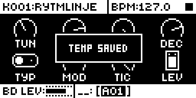
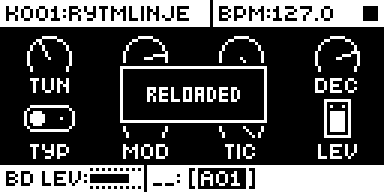

# Temp Save

An Analog Rytm MKII mod by Nathaniel Pavel (@npp1993). Version 0.1.0-experimental, OS 1.74 with core-ar2 0.7. See [TESTING.md](TESTING.md) for what ran on a unit.

## Overview

Save the pattern and its kit with one gesture, try something, and get back. On stock, going back means reloading the pattern and the kit with separate key combinations, and only to the last save. Here FUNC + YES saves both and FUNC + NO reloads both, with stock's own save and reload, so trigs, the kit and its performance and scene locks come back together.

## Controls

| Gesture | What it does | Message |
| --- | --- | --- |
| FUNC + YES | Saves the active pattern and its kit. | TEMP SAVED |
| FUNC + NO | Reloads both. | RELOADED |
| FUNC + NO with no save for this pattern and kit | Nothing changes. | NO TEMP SAVE |
| FUNC + YES when the pattern links another kit than the active one | Nothing is saved, and an earlier save is dropped. | KIT NOT LINKED |

Both work on the main screen and the sound pages, stopped or playing. In running LIVE RECORDING, FUNC + NO stays stock's: it erases the active track's locks. There are no settings, no effect slot and no knob.

## Usage

Save before a risky edit, change things freely, then return. The save lasts until the pattern or kit changes, a project loads or the power goes off.

### Quick tutorial

1. On the main screen, hold FUNC and press YES: TEMP SAVED. The pattern and its kit are saved.
2. Change the pattern's trigs, or turn a sound knob. Play the pattern if you like.
3. Hold FUNC and press NO: RELOADED. Trigs, kit and performance and scene locks are back as they were at the save.
4. FUNC + NO shows NO TEMP SAVE once you change pattern or kit, or load a project: save again with FUNC + YES.

## What it saves

It runs stock's pattern save and kit save, then stock's pattern reload and kit reload. The kit's record holds its performance and scene locks, so they come back too.

- **The pattern's copy is one buffer in RAM.** Stock refills it on every pattern change, so a save belongs to its pattern and its kit. Change either and come back, load a project or power off, and FUNC + NO shows NO TEMP SAVE. A project save keeps the copy apart from the pattern's edits: load that project and the pattern comes up as it was at the project save, and stock's pattern reload still returns to FUNC + YES. A power cycle does not keep it: the pattern stays as it was, and stock's pattern reload changes nothing. The module uses no memory for the copy: a pattern is 85,760 bytes, more than the room modules share.
- **The kit's copy is the kit's saved copy.** FUNC + YES replaces what stock's kit reload returns to, and a project save keeps it apart from the kit's edits: load that project and the kit comes up as it was at the project save, and stock's kit reload still returns to FUNC + YES. This is the difference from the Octatrack module of the same name.
- **Stock's kit reload reads the kit the pattern links.** A save needs that kit to be the active one, or a reload would bring back a different kit.
- **Stock's saves share those copies.** Save the pattern, a track or the kit with stock after FUNC + YES, and FUNC + NO brings back that later save.

## Changes to stock flows

| Change | For whom | Why | Neighbouring flows |
| --- | --- | --- | --- |
| FUNC + NO on a sound page reloads instead of setting stock's lock erase, unless LIVE RECORDING is running or a trig is held. | Anyone with the module installed. | The gesture matches Digitakt and Digitone and the Octatrack module. Stock's erase only acts in running LIVE RECORDING, and there FUNC + NO stays stock's. | Erasing locks in LIVE RECORDING, RANDOMIZE PAGE (page key + YES) and the sample slot list were run with the module in; see TESTING.md. |
| FUNC + YES saves where stock does nothing visible. | Anyone with the module installed. | The gesture itself. | Menus and lists take YES first and keep it. |
| FUNC + YES replaces stock's saved pattern and saved kit, the copies NO + SCNE and NO + PLAY MODE return to. | Anyone who presses it. | A pattern is larger than the room modules share, so the module keeps no copy of its own. The musician's earlier stock save is lost, with no prompt, and the owner agreed this in review. | Stock's reloads and saves on their own, kit reload after a power cycle and after a project load were run on a unit; see TESTING.md. |

## Compatibility and limitations

It patches three stock calls, in the main view's YES and NO cases and in the sound page's NO case, and subscribes to `ev_tick` and `ev_project`. A screen above those views that takes YES or NO keeps it, and the RECORDER keeps both. Claims `ui:FUNC + YES` and `ui:FUNC + NO`. It needs no other module.

A save is one pattern buffer in RAM plus the kit's saved copy, so it is lost on a pattern or kit change, a project load or power off, and FUNC + YES replaces the musician's earlier stock save of both. In running LIVE RECORDING, FUNC + NO stays stock's. See [What it saves](#what-it-saves).

## Tests and measurements

On the author's Analog Rytm MKII: build TS09, Temp Save alone, and rytm-emu on OS 1.74 ([TESTING.md](TESTING.md)). Memory: 1,092 bytes of code plus 8 of `.bss`, in the 128 KiB shared mod area. Load: UI only, on FUNC + YES, FUNC + NO and the project event; nothing runs in the audio path.

## Authorship and licences

Original work by Nathaniel Pavel (@npp1993), GPL-3.0-or-later ([LICENSE](LICENSE)). The design follows Digitakt's and Digitone's temp save and the Octatrack's Temp Save, with no code shared. The OS 1.74 addresses were read by the author from their own stock firmware; the build carries addresses only, no stock bytes. No Elektron firmware is included.

## Screens and audio

Screenshots are rytm-emu captures of build TS10, this package linked alone ([media/capture.json](media/capture.json)). No audio preview.

 
