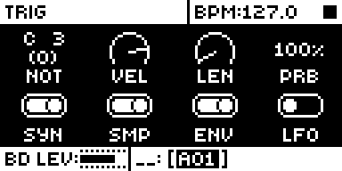
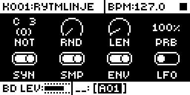
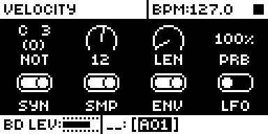

# Velocity Humanise

## Overview

Velocity Humanise gives each track a random velocity offset. Every trig's velocity moves
by a random amount up to ±N, clamped to 1..127.

- N is one of sixteen steps from 0 to 64. N = 0 is stock behaviour.
- It is set by holding FUNC and turning VEL on the TRIG page: the label reads RND and the
  knob becomes a sixteen-position selector. Without FUNC, VEL is the trig velocity as on stock.
- N is per pattern track. It is kept in core-ar2's mod storage and saved with the pattern.

Version **1.2.0** for Analog Rytm MKII OS **1.74**, with core-ar2 0.4 or later (Modwerk's
base is core-ar2 0.7). It is
[rytm2_mods](https://github.com/Iced-Cream/rytm2_mods)' elemod port of MrScruff's
`0003-velocity-humanise` from [rytm-mods-src](https://github.com/Iced-Cream/rytm-mods-src).
His code is unchanged, except that N moved from spare bits of stock's euclid-enable byte
into core storage, so the module no longer needs Euclid Accents in the same build, and that
from 1.2 FUNC + VEL's turn and text are reached through core-ar2's parameter table,
`core_params`, instead of two detours of his own at the entries of param_apply_delta and
param_value_text, which core-ar2 0.4 and later own. Hardware
testing is recorded in the [hardware report](evidence/hardware-testing.json) and
[TESTING.md](TESTING.md).

## Controls

| Control | Action |
| --- | --- |
| FUNC + VEL (TRIG page) | Sets the track's random velocity range N: sixteen steps from 0 to 64. Each trig's velocity moves by a random amount up to ±N, clamped to 1..127. |

There are no other new controls, menus or settings. To get stock behaviour back, set N to
0, or build without the module.

## Usage

TRIG page: the VEL knob with FUNC held.

### Quick tutorial

1. Use a build containing Velocity Humanise. On the TRIG page, hold FUNC and turn VEL: the label reads RND and the popup shows N.
2. Set N to 32 and play a track of equal-velocity trigs: the hits vary in level. Set N to 0: they are equal again.
3. Release FUNC: VEL is the trig velocity again, unchanged.

## Compatibility and limitations

Requires core-ar2 0.4 or later on OS 1.74. Use your own original stock OS 1.74 file.

- Built for OS 1.74 only.
- Needs core-ar2's parameter table (`core_params`, core-ar2 0.4 and later) for FUNC + VEL's turn and text. 1.1.0 patched param_apply_delta and param_value_text itself and does not link with core-ar2 0.4 or later.
- Needs core-ar2's mod storage: four bits per pattern track (`vel_rnd`).
- On stock firmware, or a build without this module, the track plays its plain velocities: N is in mod storage, which stock ignores.
- Not beside [Sample RATE](../sample-rate/): both patch the start of param_short_name (`0x400a9000`), the knob label routine, for different parameters (VEL here, FIN there), so `compatibility.conflicts` names it. Modwerk's base (core-ar2 0.7) has no shared hook for labels yet; core-ar2 0.10's knob-name service would let the two share.

### Mod storage

| Field | Scope | Bits |
| --- | --- | --- |
| `vel_rnd` | track (per pattern track) | 4 |

The linker places the field from the build's lockfile, so a later build keeps it where it
was and projects keep their N. Removing the module leaves the bits in the project, unread.

### Sites

The module patches three sites, the original mod's own. Another module patching the same
bytes cannot be combined with it. FUNC + VEL setting N and N in the popup are an entry in
core-ar2's `core_params` (`velocity_humanise_params`, parameter 30, VEL), which the core
asks from param_apply_delta's and param_value_text's entries.

| Address | Bytes | Op |
| --- | --- | --- |
| `0x4009b00c` | 6 | jmp `velocity_humanise_vel_humanise` (the trig's velocity, each trig) |
| `0x400a9004` | 6 | jmp `velocity_humanise_vel_label_gate` (the RND label) |
| `0x400a8822` | 6 | jsr `velocity_humanise_vel_get_ui` (VEL's getter, with FUNC held) |

## Tests and measurements

See [TESTING.md](TESTING.md) for the commands and results. In short: on an Analog Rytm MKII, OS 1.74, with core-ar2 0.4 and the other rytm2_mods ports (P4A4, 2026-10-21): FUNC + VEL reads RND and steps through N's sixteen values, VEL alone is stock, and N survives a power-cycle without a project save. Modwerk's package linked with core-ar2 0.7 gives a main OS byte-identical to the rytm2_mods v1.3 release object linked with it. In the emulator on the Modwerk base (VH12), FUNC relabels VEL as RND and turning it shows N. Memory: 816 bytes of the 128 KiB shared mod area.

## Authorship and licences

MrScruff: the original mod (rytm-mods `0003-velocity-humanise`), its design and code,
published in rytm-mods-src with his permission. Iced-Cream: the elemod port in
rytm2_mods, including the move to core storage, and this module. irpina: Elekloader and
core-ar2, whose storage keeps N.

Code: [GPL-2.0-only](LICENSE), as rytm-mods-src. `src/velocity-humanise.s` (rytm2_mods'
`velocity-humanise/os1.74/velocity-humanise.s`), `include/ar2-1.74.inc`,
`shared/live-track.s` and `shared/shared.s` are rytm2_mods' files at `e029f75` (v1.3),
unchanged; they name firmware routines and RAM by address only. The upstream README is in
[upstream/README.md](upstream/README.md). Screens show Elektron's interface solely to
document the modification. No Elektron firmware is included.

## Screens and audio

These captures are from analog-emu (trigcondition's emulator built on rytm-emu) running VH12, the Modwerk base
for core-ar2 0.7 and Velocity Humanise 1.2.0, from stock OS 1.74; they are byte-identical
to 1.1's captures. See [capture provenance](media/capture.json) for hashes and inputs.
The varied velocities were judged on a unit, so there is no audio demonstration.

Press TRIG on track BD: the TRIG page, with VEL as knob B.

Hold FUNC: VEL's label reads RND. Stock keeps VEL.

Turn it with FUNC held: the popup shows N, here 12. Stock shows the trig velocity, 100.
