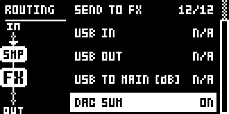
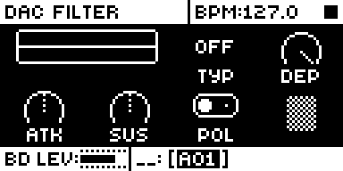
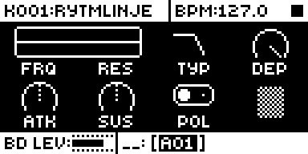
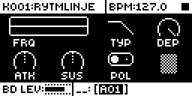

# Voice DAC

## Overview

Voice DAC takes the eight voices off the analog main bus and brings them back through the
DAC, panned and summed on the ColdFire, so each voice can be processed after its analog
filter and amp. With **GLOBAL > AUDIO ROUTING > DAC SUM** on, pressing FILTER twice opens
**DAC FILTER**: a digital filter per voice, a transient shaper and a polarity switch.

- **Filter.** FRQ, RES, TYP (OFF, LP2, LP1, BP, HP1, HP2, BS, PK, in stock's FILTER order) and
  DEP, the depth: 0 dB, then 0.25 dB steps of cut to -31.5 dB, then FULL, the plain filter.
  LP1 and HP1 are first-order (6 dB/oct); the others are one biquad each.
- **Shaper.** ATK and SUS, -64 to +63, 12 dB of attack or sustain change at full scale.
- **Polarity.** POL inverts the voice's contribution to the sum.
- **Follows TYP.** The page shows only the knobs the selected sound's TYP uses: no RES for LP1
  and HP1, and neither FRQ nor RES with TYP OFF. The knob does nothing where it is empty.
- **Kept.** The filter, shaper and polarity are per sound and travel with it (kit save and
  reload, the power-fail save, pattern kit changes, the sound pool, copy and paste); a sound
  reset sets the defaults. DAC SUM is per global slot.

Version **1.4.0** for Analog Rytm MKII OS **1.74**, on core-ar2 0.6 or later (Modwerk's base is
core-ar2 0.7). It is [rytm2_mods](https://github.com/Iced-Cream/rytm2_mods)' elemod port of
MrScruff's `0013-voice-dac` from [rytm-mods-src](https://github.com/Iced-Cream/rytm-mods-src), at
his update 3a98e23. His code is unchanged, except that the values moved into core-ar2's mod
storage and the page and its knobs are reached through core-ar2's page tables. The port's own
notes are in [upstream/README.md](upstream/README.md); what ran is in [TESTING.md](TESTING.md).

## Controls

| Control | Action |
| --- | --- |
| DAC SUM (GLOBAL > AUDIO ROUTING, last item) | OFF is stock's routing. ON routes every voice to the main mix through the DAC and enables DAC FILTER. Per global slot. |
| FILTER, pressed twice | Opens DAC FILTER while DAC SUM is on; stays on stock's page while it is off. |
| FRQ | Filter frequency, a semitone a step, 440 Hz at 60. |
| RES | Q of the 2-pole types. |
| TYP | OFF, LP2, LP1, BP, HP1, HP2, BS, PK. |
| DEP | Depth of the filter against the dry voice: 0 dB to -31.5 dB, then FULL. For PK, a boost of up to +6 dB. |
| ATK, SUS | Transient shaper, -64 to +63. FUNC + turn snaps to -64, 0 or +63. |
| POL | + or -. |

Defaults: TYP OFF, FRQ 127, DEP FULL, RES 0, ATK 0, SUS 0, POL +, DAC SUM OFF. FRQ's popup is
stock's, so it reads in hertz where Filter Hz is in the build.

## Usage

GLOBAL > AUDIO ROUTING > DAC SUM ON, then FILTER pressed twice on a voice track.

### Quick tutorial

1. Use a build containing Voice DAC. Open GLOBAL > AUDIO ROUTING and set DAC SUM (the last item) ON.
2. Press FILTER twice on a voice track: DAC FILTER. Set TYP to LP2 and turn FRQ down while a pattern plays: the voice darkens. Turn ATK and SUS to shape the hits.
3. Set TYP to LP1 or HP1: the RES knob goes empty. Set TYP to OFF: FRQ and RES go empty and the voice is unfiltered.
4. Set DAC SUM OFF: FILTER pressed twice stays on stock's page and the sound is stock's again.

## Compatibility and limitations

Requires core-ar2 0.6 or later on OS 1.74 (Modwerk's base is core-ar2 0.7). Use your own original stock OS 1.74 file.

- Built for OS 1.74 only. It uses core's page functions (`core_page_fns`), so it does not link with core-ar2 before 0.6. On Modwerk's base (core-ar2 0.7) it links and was checked in the emulator; it has not run on a unit there.
- The voices reach MAIN 2.58 ms later than through the analog bus. They share the PRE return pair with the delay and reverb returns and are clamped at its full scale. The individual outputs carry the voice before the filter.
- DAC FILTER's values cannot be p-locked or reached over MIDI. They live outside the sound's parameters.
- Switching TYP between LP1 and HP1 can click on a sound with much energy at either end.
- A global slot received as SysEx loads with DAC SUM OFF, since core keeps no mod data for it.
- Settings saved by builds before 1.2 or by rytm-mods 0013 load as the defaults.
- The filter runs in the audio interrupt. Its cost follows the number of voices using it.

### Mod storage

| Field | Scope | Bits |
| --- | --- | --- |
| `vd_flt` | sound | 24 |
| `vd_shp` | sound | 15 |
| `vd_dac` | global | 1 |

The 39 sound bits are a large share of core's sound bits: a module that needs more than what is left will not link beside this one.

## Tests and measurements

See [TESTING.md](TESTING.md). Memory: 11,080 bytes of code and data in `.run`.

## Authorship and licences

MrScruff wrote the original; a contributor ported it; the core is irpina's Elekloader core-ar2. GPL-2.0-only, see [LICENSE](LICENSE). No firmware, extracted routines or tables are included: the patch sites are addresses, lengths and SHA-256s.

## Screens and audio

These captures are from analog-emu (trigcondition's emulator built on rytm-emu) running VD14, the Modwerk base
for core-ar2 0.7 and Voice DAC 1.4.0, from stock OS 1.74. See [capture provenance](media/capture.json) for hashes
and inputs. The emulator's analog voices are stubbed, so the screens show the controls, not the sound, and there is
no audio demonstration.

GLOBAL > AUDIO ROUTING: DAC SUM is the last row. Move to it with DOWN and press RIGHT: it reads ON. Stock's list ends at USB TO MAIN.

With DAC SUM on, press FILTER twice on BD: DAC FILTER opens. TYP is OFF, so FRQ and RES are empty. Stock stays on its FILTER page.

Turn knob C (TYP) up to LP2: FRQ and RES appear under the filter graph, and FRQ sets the cutoff.

Turn TYP on to LP1: RES goes empty, since LP1 has no resonance. Set TYP back to OFF, or DAC SUM OFF, to hear the voice unfiltered.
