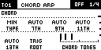
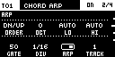
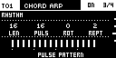
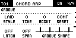

# Chord Arp

## Overview

An experimental module for Digitakt II OS 1.17 by @Claptom-music. Chord Arp turns a note trig into a chord played one note at a time on its audio track. Each trig can supply its own root, chord type, note order, and other settings.

## Usage

Open Chord Arp on an audio track with a pitched sample.

### Hear your first arp

1. Put one C5 note trig on step 1 of an audio track with a pitched sample. Give the sample enough AMP release to hear each note.
2. Open **SETTINGS**, select **CHORD ARP**, and press **YES**. On Chord, set A **TYPE** to **MAJ** and leave F **ROOT** on **TRIG**.
3. Press **RIGHT** to reach Arp. Set A **ORDER** to **UP**, F **DIV** to **1/16**, and G **ARP** to **ON**. The track number in the footer is the one you are editing.
4. Press **FUNC + RIGHT** to jump to Groove. Turn F **SPAN** on and press **PLAY**. On a straight grid with the default Rhythm settings, you should hear C5, E5 and G5 in order across the empty steps. Try **1/8** on Arp for one note every two track steps.

The pitch engine builds a chord from a root, a voicing, optional extensions and a signed octave spread. LO and HI are signed offsets from the chord root. With C5 as the root, `−1` to `+2` keeps pitches from C4 through C7, including both endpoints. At either end of the note range, the limit stops at the nearest playable occurrence of the root. AUTO keeps the full pitch set produced by the chord and octave spread. If no pitches remain, the phrase is silent.

## Use the Digitakt II Euclidean sequencer

Enable the built-in Euclidean sequencer and Chord Arp on the same audio track. Each generated hit starts an arpeggio at the stock hit time. Set **Chord F · ROOT** to **TRIG** to follow each hit's pitch. If Euclidean Scale is also enabled on the track, **TRIG** follows its resolved pitch, so a reroll can change the arpeggio roots while the Euclidean rhythm stays in place.

## Controls

**LEFT** and **RIGHT** move between Chord, Arp, Rhythm and Groove. Hold **FUNC** while pressing **LEFT** to jump to Chord or **RIGHT** to jump to Groove. Encoders A–D edit the upper row and E–H edit the lower row. ROOT, GATE, ROT, TIME and ACCNT use the stock parameter encoder response. The other controls use incremental edits. Release any held trig and press **NO** to return to SETTINGS.

Chord Arp opens on the stock-selected audio track. On Arp, turn H to select the track in both the panel and the stock sequencer, and turn G to enable arp playback for that track. Each track has separate settings. Use the Digitakt's **Save Project** to save the track settings and step locks together. Loading a project saved without Chord Arp settings starts with the arp off.

DIV covers straight, dotted and triplet rates from 1/1 to 1/64T, relative to the track's stock step. At rates slower than 1/16, notes start on the slower grid and their gates fit within the stock step where they start. The maximum repeat count depends on the division.

## Chord and Arp

- **Chord A · TYPE** picks the chord shape. B–E add or change the 7th, 9th, 11th and 13th. **AUTO** uses the voicing's built-in extension when it has one.
- **Chord F · ROOT** defaults to **TRIG**, which uses the Digitakt NOTE value for each trig, including a stock NOTE lock. Turn F to choose a fixed root, starting at C5, and press F to return to TRIG. For example, stock C5 and D5 trigs give you C major and D major with TYPE set to MAJ and ROOT set to TRIG. A fixed C5 root gives both trigs C major.
- **Arp A · ORDER** sets the order of notes. **OCT** adds copies of the chord above or below the root octave. **LO** and **HI** filter the resulting notes. Turning either limit enables both, starting from a range that keeps every note the chord and OCT produce: LO at the lowest OCT copy (0 or below) and HI two octaves above the highest copy, which leaves room for extensions up to the 13th. With a C5 root and OCT 0, one turn of LO to the left gives LO −1 and HI +2. Lower HI to 0 to keep only notes up to C5, or set OCT to −1 to generate notes below the root. Press C or D to restore both limits to AUTO.
- **Arp E · GATE** changes how long each hit lasts. **DIV** changes how often the arp gets a pulse. At 1/16 it gets one pulse per track step, at 1/8 it gets one every two steps, and at 1/32 it gets two per step. A slower division still fits each gate into the stock step where it starts. [Swing and timing](#swing-and-timing) explains how pulses follow the pattern's swing.

## Rhythm and Groove

**Rhythm** decides which arp pulses you hear. **LEN** sets the number of pulses in the cycle, **PULS** sets how many of them play, and **ROT** shifts that pattern. Try LEN 8, PULS 3 and ROT 0 to hear hits on pulses 1, 3 and 6. **REPT** adds extra hits within each active pulse, up to the limit for the current DIV.

**Groove** shapes the timing and velocity of the pulses that play, on top of the pattern's swing ([Swing and timing](#swing-and-timing)). **STYLE** picks a four-pulse pattern. **STR8** leaves the pulses straight, **PUSH** moves some earlier, **LAID** moves some later, and **OFFBT** mixes early and late pulses. **TIME** sets how far they move. **ACCNT** sets how strongly their velocities differ. Try PUSH with TIME at 0, then raise TIME and listen for the difference.

- **Groove F · SPAN** carries the last chord through empty steps to the end of the loop. With a single trig on step 5 of an eight-step pattern, the arp also plays steps 6–8 at DIV 1/16.
- **Groove E · LATCH** also carries the chord into the next loop of the same pattern. In that example it fills steps 1–4 after the loop wraps. A new note trig takes over when it arrives. STOP and pattern changes end the carry. If you delete the source trig during playback, its chord finishes the current loop.
- **Groove D · RESET** decides what a new note trig restarts. **CONT** uses the running phase. **NOTE** restarts only the pitch order. **GRV** restarts the RHYTHM cycle and the four-pulse GROOVE pattern while pitch order continues. **ALL** restarts pitch order, rhythm and groove. With C major and ORDER set to UP, ALL starts the note order from C and the rhythm from pulse 1 at the next note trig.

## Swing and timing

Chord Arp keeps no clock of its own. For each step it plays, the Digitakt II's sequencer supplies the swung time of that step and of the next track step, computed from the track's swing, tempo and speed. The pulses are placed from those two times:

- **Pulses within a step.** At divisions faster than 1/16, a pulse sits at its share of the way between this step's swung time and the next step's swung time. At 1/32 the second pulse lands halfway between the two swung steps, so a swung step pair keeps its long-short feel inside the arp. This is the interpolation [sequencing.md](../../../../docs/module-guides/sequencing.md) asks for.
- **The end of the window.** The window ends a short release guard before the next step's swung time, and earlier still when the next trig is microtimed early, so the last note releases before the next one starts. The guard moves the later pulses of a step slightly toward its start.
- **Slower divisions.** At 1/8 and slower, a pulse starts at its interpolated position in the step where it falls, and its gate ends by the next step.
- **REPT** splits each pulse's time into equal parts, one per hit.
- **A microtimed source trig** moves the start of its step's window with it. The pulses are spread from the shifted start to the next step's swung time.
- **GROOVE.** **TIME** moves each pulse by a percentage of the shorter gap to its neighbouring pulse positions, which already include swing. A STYLE moves a pulse by at most 16% of that gap at TIME 100, so Groove adds to the pattern's swing and never moves a pulse past its neighbour. At TIME 0 the pulses sit exactly on their swung positions. **ACCNT** changes velocity only.

## Step locks

Enter stock trigs with **RECORD** and the trig keys while the Chord Arp panel stays open. **FUNC + PAGE** toggles lock mode. In lock mode, **PAGE** advances the 16-step bank, and holding an active note trig while turning an encoder locks that control for the step on the selected audio track. Hold several active trigs on the same lock page to edit them together. The lowest held active step sets the starting value. The panel applies the resulting value to the group within each step's control limits. Press an encoder to clear its lock on all held active steps, or press **NO** to clear all their locks. If there are too few free lock slots, the entire edit is refused and the panel shows **LOCKS FULL**. Empty steps show **NO NOTE TRIG** when held on their own. Locked values are shown in reverse video. Press that encoder while holding the trig to clear its lock, or press **NO** while holding the trig to clear all locks on the step. **RECORD** exits lock mode and passes through to stock recording.

Try holding trig 5 and setting **Chord F · ROOT** to G5. With ROOT set to TRIG at track level, only trig 5 uses G5 as its fixed root. Press F while holding trig 5 to restore its stock NOTE behavior. Deleting a stock trig clears its Chord Arp locks, so a replacement starts with the track settings. LO and HI lock and clear as a pair. TRACK, ARP, RESET, LATCH and SPAN are track-wide. Chord Arp can save up to 32 locked steps across the project. Each step can hold multiple controls and uses one slot. The compact archive uses a new tag, so projects from earlier private trials open with default Chord Arp settings. Unsaved changes are lost when you reload the project or power cycle.

Up and Down run from one end of the range to the other. Up–Down and Down–Up reverse without repeating the turnaround note. Double repeats each hit in the Up–Down phrase.

High–Low and Low–High alternate between the ends of the note list and move inward. Zigzag Bounce reverses Low–High at its endpoints. Pinky alternates each lower note with the highest. Thumb alternates the lowest note with each higher note.

Random chooses on each pulse. Shuffle repeats a seeded permutation until a new phrase is prepared. Input Order preserves the order in which the pitches were supplied.

The rhythm engine derives straight, dotted and triplet divisions from stock track steps. Length, pulses, rotation and repeats determine the emitted note position without maintaining a clock. Gate windows subdivide adjacent stock deadlines without overlapping. Straight, Push, Laid Back and Offbeat presets use timing offsets and velocity accents around the stock grid.

## Compatibility and limitations

Chord Arp requires the Modwerk Digitakt II base with phrase and project archive support from PR #1548. It requires the reviewed core 1.1 browser base. The module runs on audio tracks and can use the stock Euclidean sequencer. It plays alongside Track Names and Euclidean Scale.

Known issue: on the current Digitakt II base, a module that saves kit data, such as Euclidean Scale, overwrites the bytes where Chord Arp saves its project settings. With both installed, Chord Arp's track settings and locks reset to ARP OFF after Save Project and a power cycle. Your patterns, sounds and Euclidean Scale settings are not affected, and the official OS still opens the project. A base fix is in progress.

## Tests and measurements

See [TESTING.md](TESTING.md) for physical tests, emulator results and outstanding release checks.

## Authorship and licences

Chord Arp was created by Claptom-music and is distributed under [GPL-3.0-or-later](LICENSE).

## Screens and audio

## Quick tutorial

1. Place a C5 note trig on step 1 of a pitched audio track.
2. Open SETTINGS, select CHORD ARP, and set TYPE to MAJ and ROOT to TRIG.
3. Press RIGHT, set ORDER to UP and DIV to 1/16, then turn ARP on.
4. Press FUNC + RIGHT, turn SPAN on, then press PLAY.
