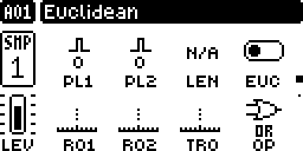
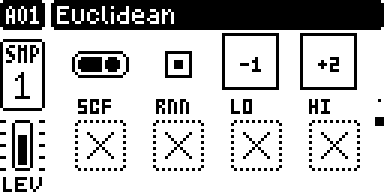

# Euclidean Scale

## Overview

Euclidean Scale adds a second page to the Digitakt II's Euclidean sequencer. It follows the pattern's keyboard scale and can reroll its pitches while the stock sequencer plays the rhythm.

## Controls

**SCF** is the Scale Follow switch. Turn A clockwise to enable it or counterclockwise to disable it. It defaults to off. It snaps an eligible pitch to the nearest note in the current scale, preferring the lower note on a tie. Turning it off also clears the track's last reroll.

**RNN** enables Scale Follow and picks a repeating melody from the available in-scale notes. Another press changes the pitches where the scale offers a choice.

**LO** and **HI** set the lowest and highest pitches RNN may choose. Turn C for LO and D for HI. Zero is the scale root nearest the track's stock note. Each step is an octave. With a reference of C4, `−1` to `+2` allows scale notes from C3 through C6, inclusive. The controls stop at each other. At the ends of the instrument's note range, the bounds stop at the nearest playable occurrence of the root.

Press C or D to restore **AUTO**, which limits RNN to six semitones either side of the quantized pitch. Changing the bounds updates an active reroll immediately.

## Usage

1. Press FUNC + KEYBOARD and set the pattern root and scale, for example C Ionian.
2. Select an audio track. Press FUNC + AMP, enable EUC and set the pulse count. Press FUNC + AMP again to reach the Scale page.
3. Turn encoder A clockwise for SCF. Start playback and press encoder B for RNN. Listen to the next loop, then turn A counterclockwise to clear the reroll and hear the original pitches.
4. Turn C counterclockwise for a lower LO and D clockwise for a higher HI. Press B again to hear another melody inside the selected range.

The stock indicator at the right edge marks the selected page. **FUNC + AMP** or **NO** returns from SCF/RNN to the stock Euclidean page.

## Compatibility and limitations

The module targets Digitakt II OS 1.17 and the Modwerk 1.1 base with the shared audio sequencer pitch hook and active-project kit-data reset. The stock sequencer owns transport, tempo, track speed, swing and note releases. Regular trigs, MIDI tracks and explicit stock trig overrides pass through.

Saving a project saves SCF, the last reroll and both octave bounds per pattern and track. Reloading with the same kit-data layout restores all four. New projects start with SCF off and both bounds on AUTO. Projects saved with the K117 trial use its previous layout and open with default Euclidean Scale settings on this version.

## Tests and measurements

Claptom-music reported that the O117 octave-range trial passed on their Digitakt II. See [TESTING.md](TESTING.md) for the O117 results and the earlier K117 checks.

## Authorship and licences

Claptom-music authored Euclidean Scale under [GPL-3.0-or-later](LICENSE).

## Screens and audio

The monochrome screenshots are captures of the octave-range build in digikit.

