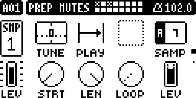
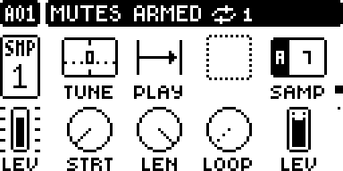
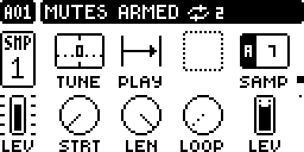

# Mute Latch — Digitakt II

A Digitakt II mod by @crisp909. Version 0.1.0-experimental, for OS 1.17 with Elekloader core 1.0. The author reported working builds on a Digitakt II (see [TESTING.md](TESTING.md) for which build each result belongs to). Screenshots are emulator captures.

## Overview

PREP MUTES (in Mute Mode, hold FUNC and press the TRIG keys of the tracks to switch) normally changes those tracks the moment FUNC is let go. Mute Latch adds one gesture. Pressing PERFORM once then arms the choice (MUTES ARMED), so FUNC key can be released; the mutes switch when the pattern next reaches its first step (applied just after the pattern's last step, so the last step stays as it was and the first step already plays switched). Both hands are free for a synth or effects until then. Without that PERFORM press, PREP MUTES works exactly as before.

Pressing PERFORM again, with FUNC held, waits more passes of the pattern: 2, 3 or 4 presses switch the mutes after 2, 3 or 4 passes, and a fifth press goes back to one. The header shows MUTES ARMED, a loop icon and the passes left, counting down to the switch.

- Arms on one short press, on any page of the pattern; STOP drops it, and so does leaving Mute Mode.
- The header message stays while something is armed (the stock one would fade); it goes when the mutes switch.
- Follows the instrument's own step position and pattern length: no clock of its own.
- Uses three core hooks (`ev_key`, `ev_tick`, `ev_draw`) and patches no stock site. The TRIG LEDs are not changed; that would need the core's key-LED hook, which is not published for the Digitakt II yet.

## Controls

There are no knobs and no SETTINGS rows.

| Gesture | What it does |
| --- | --- |
| Mute Mode, FUNC held (PREP MUTES open), TRIG keys, then PERFORM | The choice is armed for one pass ("MUTES ARMED", loop icon, 1); the stock PERFORM view does not open. |
| FUNC held, PERFORM again (up to four presses) | Waits one more pass each time: the number next to the icon shows the passes left. The fifth press goes back to 1. |
| Let go of the TRIG keys, PERFORM and FUNC | Nothing happens now. The armed tracks switch at the end of the last pass, at the pattern's first step. |
| FUNC held, the same TRIG keys again, PERFORM | Takes those tracks back out; the last one out cancels ("ARM CANCELED"). |
| STOP, or leaving Mute Mode | Drops everything still armed. |

Armed tracks toggle their mute state, as PREP MUTES does: a track that is muted becomes audible. Choosing a track again and pressing PERFORM takes it back out. Choosing new tracks and pressing PERFORM adds them and counts as a press.

## Usage

- Location: Mute Mode (FUNC+TRK), PREP MUTES (FUNC held). Nothing else in the instrument moves.
- Play a pattern first: the module works while the sequencer plays.
- For a longer break, press PERFORM again with FUNC held: the header counts the passes left.
- Example: to mute the drums on TRIG 1 and TRIG 2 for three passes, choose them with FUNC held, press PERFORM three times (the header counts 3, 2, 1) and let go; at the end of the third pass the two tracks switch. Repeat the gesture to bring them back in.

### Quick tutorial

1. Install a build that contains Mute Latch for the Digitakt II on OS 1.17.
2. Start the sequencer with PLAY and enter Mute Mode with FUNC+TRK.
3. Hold FUNC and press the TRIG keys of the tracks to switch, then press PERFORM once.
4. Let go of everything. The tracks switch when the pattern comes round to its first step.
5. To wait longer, press PERFORM again with FUNC held: each press adds a pass, up to four.

## Compatibility and limitations

- Digitakt II, OS 1.17 only.
- Works while the sequencer plays. Stopped, PERFORM and PREP MUTES keep their stock behaviour. With nothing installed or nothing chosen, nothing changes: there is no setting, and removing the module restores stock behaviour exactly.
- The step counter the module reads runs a step ahead of the sound, and a step's mute is judged a moment after the counter moves on. The module therefore switches on the second UI tick (the core ticks at about 30 Hz) of the pattern's first step, or on the first tick of the second step if steps are shorter than that. On a unit (author's report, one kick per step, several tempos from about 100 to 170 BPM, 128 steps) the last step stayed muted or unmuted as before and the first step played switched. It is not sample-accurate: it rests on the tick landing in a window of about one step, and a very fast tempo or a late tick could move it by one step. A sequencer hook in the base would make it exact.
- With Scale per track, the longest track's last step is taken as the pattern's end.
- The armed choice is kept in RAM only. It is not saved with the project and does not survive a power cycle.
- After PERFORM the PREP MUTES screen shows no chosen tracks, because the stock choice is cleared; the armed tracks are not shown on the TRIG LEDs, only by the header message.
- A change of pattern while tracks are armed counts the new pattern's passes. This is the intended reading, not yet observed.
- Arming during the first two steps of a pass, after the switch moment, does not count that pass; the countdown starts with the next one.
- Built for Elekloader core 1.0. It patches no stock site, so it does not clash with core 1.1.

### Stock flows this module touches

| What changes | For whom | Why | Opt out |
| --- | --- | --- | --- |
| FUNC+PERFORM opens a stock view. While PREP MUTES is open, tracks are chosen and the pattern plays, the PERFORM key press goes to the module instead, so that stock view is not available then; the stock PERFORM view does not open. A PERFORM press with nothing chosen and nothing armed, anywhere else, or while stopped, is left to the stock OS. | Anyone who uses FUNC+PERFORM inside a PREP MUTES session with tracks chosen while playing; also while something is armed, FUNC+PERFORM with nothing chosen adds a pass instead of opening the stock view. | PERFORM is the key nearest FUNC that PREP MUTES leaves free: FUNC and the TRIG keys are already taken inside it. | Let go of FUNC first, or choose no tracks. There is no SETTINGS switch yet. |

## How it works

The module uses three core hooks and patches no stock site. In `ev_key` it reads the key event's code; for PERFORM, while the PREP MUTES view is on top with its session open and the sequencer plays, it moves the view's 16-bit choice into its own armed set, clears the view's mask (so letting go of FUNC applies nothing), sets the number of passes to wait (one more for each press, wrapping from four to one), shows MUTES ARMED in the stock header message and takes the event. In `ev_tick` (the UI task, about 30 Hz) it follows the master track's step position, counts a pass at the second tick of the master track's first step (or on the first tick of its second step, whichever comes first), keeps the header message up, and after the last pass writes the armed set into the view's mask and calls the stock routine that applies it. In `ev_draw` it adds the loop icon and the passes left to the header with the stock rectangle routine.

**The PREP MUTES view.** The module keeps a pointer to the view from the PERFORM press, so it checks it before use. The view is one object that lives while Mute Mode is on: in the emulator its address was the same in four FUNC sessions (and the same after leaving and re-entering Mute Mode), and its session flag toggled with FUNC. Leaving Mute Mode removes it from the view stack, where it may be freed. Before it applies, the tick therefore walks the view stack and looks for that object; if it is not there, the armed choice is dropped and nothing is written or called. Checked in the emulator: armed, then FUNC+TRK to leave Mute Mode, then a full pass: no mute changed. Stock locations of OS 1.17 are named once in `build.json`: the vtable of the PREP MUTES view, the apply routine, the key-down test, the Brain, the header message routine and the UI state, the rectangle routine, and three words of sequencer state (the playing flag, the pattern pointer and each track's step position).

These locations were read from the OS 1.17 image with a static disassembler and then observed in an emulator, not on a unit.

## Tests and measurements

The Modwerk evidence tier is `none`: no qualification record has been made. [TESTING.md](TESTING.md) lists what was and was not checked. Memory and load are not measured.

## Authorship and licences

Original work by @crisp909, GPL-3.0-or-later ([LICENSE](LICENSE)). It uses Elekloader core 1.0 (toonst, GPL) as the hook bus; no code is copied from it, and nothing from Elektron firmware is included: stock locations are addresses only.

## Screens and audio

PREP MUTES with two tracks chosen (emulator capture).

The header after one PERFORM press: MUTES ARMED, the loop icon and the passes left (emulator capture).

The header after three presses (emulator capture).

The module makes no sound of its own. Provenance is in `media/capture.json`.
