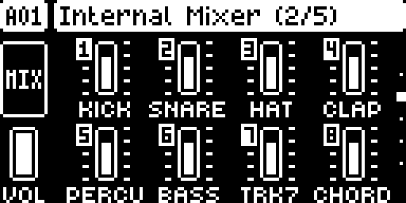
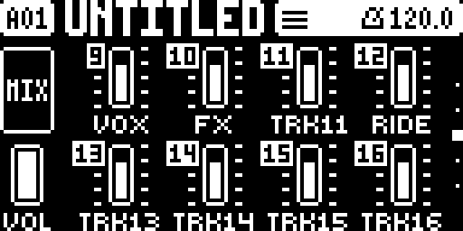

# Track Names

A Digitakt II mod by @crisp909. Version 0.1.3-experimental. OS 1.17, core 1.0.

The Internal Mixer labels its faders TRK1 to TRK16. With Track Names it shows the track's own name instead, and each
fader gets its track number in an inverted box at its top left, so you still know which track it is.

## Use

1. Name a track: select it, open SETUP (FUNC + FLTR), scroll to RENAME at the end of the TRACK section and press YES.
   Type the name and press YES to save.
2. Open the mixer: FUNC + MOD, then FUNC + MOD again to reach Internal Mixer 2/5 (tracks 1-8) and 3/5 (tracks 9-16).

The mixer shows the first **5 characters** of a name, so name tracks short: KICK, SNARE, BASS, VOX1. A longer name
is cut after 5 characters on the mixer and stays whole in SETUP.

A track whose name is still the stock default (PRESET 1, PRESET 2 and so on) keeps its stock label, TRKn.

## Per pattern

The Digitakt II keeps the track names in the pattern's kit. Every pattern has its own names, saved with the project,
and copying a pattern copies its names. Track Names reads them and saves nothing of its own.

## Limits

- Only the Internal Mixer pages (2/5 and 3/5). Other pages are unchanged.
- In PERFORM KIT mode the mixer shows the names of the pattern you are on, even when the sound comes from the kept kit.
- The mod draws over the stock labels; it does not change them or any project data. Where a pop-up (pattern
  select, for example) covers a label or a fader's top, names stay under it, cut at its edge, as the stock labels are; a track number it partly covers is hidden.
